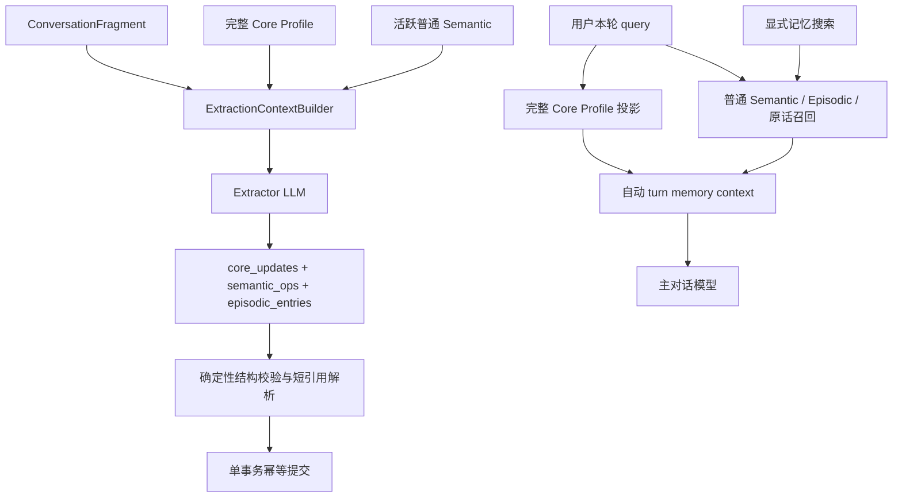

# 核心身份资料与语义记忆重构 - 技术方案

## 状态

CONFIRMED

## 需求文档

[requirement.md](./requirement.md)

## 现状分析

当前 `semantic` 表同时承载普通事实、核心事实与固定注入策略，`memory_class`、`fact_key` 和 `pinned` 既参与存储又影响召回。默认自动召回通过 `StructuredMemorySource` 先读取最多 20 条 core，统一融合阶段再限制为最多 6 条、320 字符。Core 因此仍是查询候选，而不是独立的当前身份状态。

抽取 worker 当前读取最近更新的最多 200 条活跃 Semantic，Extractor 最终只渲染前 60 条且没有稳定引用。Reconciler 先按确定性 `fact_key` 匹配，再用 `target_hint` 做精确或互相包含匹配；无法命中的 `supersede` 会静默降级为 `add`。每条 episodic/semantic 写入分别提交，也没有 fragment 级幂等提交边界。

`Conversation` 每轮只调用一次 `Memory.retrieve`，再把 core、查询召回和原话证据渲染成同一条临时 system message。显式 recall probe 复用同一接口，因此无法在接口层保证显式搜索不携带 Core。

Memory Inspector 的页面和后端路由已经进入构建产物，但桌面入口及打开命令被 debug 编译条件挡住。Bridge 的 `/v1/memory/*` 路由在 release 仍会注册；当前限制只是 UI 隐藏，并不是完整能力门禁。

## 方案设计

### 涉及文件

| 文件路径 | 改动类型 | 说明 |
|---|---|---|
| `memory/src/memory/store/schema.py` | 修改 | schema v5、Core Profile 与 extraction commit 表 |
| `memory/src/memory/store/sqlite_store.py` | 修改 | Core 投影、版本写入、严格事务、迁移和普通 Semantic 选择查询 |
| `memory/src/memory/core_profile/` | 新增 | 字段注册、结构化契约、校验和稳定渲染 |
| `memory/src/memory/extraction/result.py` | 修改 | `core_updates`、短引用目标和结构化失败结果 |
| `memory/src/memory/extraction/context.py` | 新增 | 完整 Core 与 50k 普通 Semantic 上下文装箱 |
| `memory/src/memory/extraction/extractor.py` | 修改 | 新输入/输出协议与解析校验 |
| `memory/src/memory/extraction/reconciler.py` | 修改 | 严格引用执行、原子提交、幂等和拒绝原因 |
| `memory/src/memory/extraction/prompts/extract.md` | 修改 | Core 优先分类、禁止双写和引用操作说明 |
| `memory/src/memory/extraction/worker.py` | 修改 | 构造 extraction context 并传递 observation identity |
| `memory/src/memory/search/structured_source.py` | 修改 | 普通搜索不再产生 core candidate |
| `memory/src/memory/search/service.py` | 修改 | 删除 core 融合预算和相关 trace 决策 |
| `memory/src/memory/retrieval/renderer.py` | 修改 | 只渲染查询召回；Core 使用独立 renderer |
| `memory/src/memory/facade.py` | 修改 | 新增自动 turn context 装配，显式 retrieve 保持纯查询 |
| `memory/src/memory/contracts.py` | 修改 | 自动上下文与拆分后的 trace 契约 |
| `agent/src/agent/conversation.py` | 修改 | 分别注入 Core Profile 与查询召回数据 |
| `agent_bridge/src/agent_bridge/routes/memory.py` | 修改 | Core API、筛选、trace 与 Owner Mode 路由门禁 |
| `agent_bridge/src/agent_bridge/settings.py` | 修改 | 接收 Inspector 能力环境配置 |
| `frontend/src-tauri/src/owner_capabilities.rs` | 新增 | 本机能力文件读取与 Tauri 命令校验 |
| `frontend/src-tauri/src/paths.rs` | 修改 | Owner capability 文件路径 |
| `frontend/src-tauri/src/runtime_services/supervisor.rs` | 修改 | 把能力状态传给 packaged/source Bridge |
| `frontend/src-tauri/src/lib.rs` | 修改 | 所有构建注册 Inspector 命令，运行时 fail closed |
| `frontend/src/pages/pet/ActionBar.tsx`、`App.tsx` | 修改 | 按运行时 capability 展示入口 |
| `frontend/src/pages/memory-inspector/` | 修改 | Core/普通筛选、结构化卡片和拆分 trace |
| `scripts/owner-tools/`、`scripts/README.md` | 新增/修改 | 跨平台 enable/status/disable 入口 |
| `memory/tests/`、`agent/tests/`、`agent_bridge/tests/`、`frontend/**.test.*`、Rust tests | 修改 | 机制性回归测试 |
| `memory_eval/` | 修改 | Core 更新、普通 Semantic 替换与预算切片 |

### 数据流



Core Profile 只进入自动 turn context 和显式身份查询的专用读取，不再进入普通 `MemorySearchService` 的候选融合。显式记忆搜索与 recall probe 默认只返回查询召回数据。

### Core Profile 字段模型

首期字段注册为固定白名单，不建设动态 schema/plugin 系统：

| 字段 | 作用域 | 基数 | 含义 |
|---|---|---|---|
| `user.preferred_name` | owner 全局 | 单值 | 用户希望 Agent 如何称呼自己 |
| `user.current_residences` | owner 全局 | 多值 | 用户当前同时有效的住处 |
| `relationship.kind` | owner + persona | 单值 | 用户与当前 persona 的主要关系描述 |
| `relationship.agent_nickname` | owner + persona | 单值 | 用户如何称呼当前 persona；不修改 persona 自身身份 |

Agent 的正式名称、人格和自我描述继续由 persona 真相源负责。用户提出“以后我叫你 X”时，Extractor 可更新 `relationship.agent_nickname`；它表达双方关系中的称呼，不重写 persona 文件。

Core 表使用原子、版本化行，而不是把整个 Profile 保存成一个 JSON blob：

```text
core_profile_entry(
  id,
  owner_user_id,
  scope_kind,       -- user | persona
  persona_id,       -- user scope 使用空字符串；persona scope 使用稳定 persona id
  field_key,
  value_json,
  normalized_value,
  valid_from,
  valid_until,
  supersedes_id,
  provenance,       -- fragment 中的直接 source_ref 列表
  created_at,
  updated_at,
  deleted_at
)
```

单值字段通过 active partial unique index 保证同一作用域只有一个当前值；多值字段通过 `(scope, field, normalized_value)` 的 active unique index 防止完全相同的重复值。`normalized_value` 只做去首尾空白、Unicode/大小写等结构归一化，不把“深圳”和“深圳市”判断为同一地点。

读取时把活跃原子行投影为稳定结构：

```json
{
  "user": {
    "preferred_name": "小陈",
    "current_residences": ["上海", "深圳"]
  },
  "relationship": {
    "kind": "长期朋友",
    "agent_nickname": "小七"
  }
}
```

数组按规范化值和稳定 ID 排序，Core renderer 按字段注册顺序渲染，不按 importance 排序。新写入执行字段级长度、类型、作用域、基数和整体序列化安全上限校验；读取永不按条数或字符预算截断。若存量数据违反约束，自动上下文明确报告 Core unavailable/invalid，并进入 diagnostics/trace，不能返回半份 Profile。

### Extraction 上下文与 50k 装箱

Extractor 输入由三个互不挤占的区块组成：

1. 完整 Core Profile，逐个原子值分配 `[C001]`、`[C002]` 短引用；不计入普通 Semantic 预算。
2. 当前对话 fragment，完整提供；不计入普通 Semantic 预算。
3. 当前有效的普通 Semantic，逐条分配 `[M001]`、`[M002]` 短引用；只有本区块受 50,000 token 预算约束。

普通 Semantic 的稳定排序算法：

1. 取当前 fragment 中的用户发言作为 FTS query；没有用户发言时使用完整 fragment 文本。
2. 对活跃普通 Semantic 做一次 semantic-only FTS，按 BM25 排序。
3. 再取全部活跃普通 Semantic，按 `updated_at DESC, id ASC` 排序。
4. 拼接两组并按数据库 ID 去重；相关命中在前，未命中事实按最近更新时间补齐。
5. 使用与项目上下文管理一致的保守字符 token 估算口径，只累计渲染后的 `[Mxxx] statement` 行；能放入的逐条加入，单条放不下则跳过并继续检查后续条目，直到遍历结束或预算耗尽。
6. 短引用只在最终入选后按顺序分配，映射仅存在于本次 extraction 调用内。

本期不使用 dense 排序，不分块扫描预算外事实，也不让确定性代码判断预算外事实是否应被替换。50k 是构造参数的默认值并由单测锁定；Core、fragment、system prompt 和输出空间不从该 50k 中扣除。最终请求仍服从 provider 的物理 context window；超限时按 extraction failure 显式记录，不静默裁剪其他区块。

### Extractor 输出协议

输出键顺序与处理顺序固定为 Core、Semantic、Episodic：

```json
{
  "core_updates": [
    {
      "op": "replace",
      "field": "user.preferred_name",
      "target_ref": "C001",
      "value": "小陈",
      "reason": "用户明确更新希望被如何称呼，对应 user.preferred_name"
    },
    {
      "op": "add",
      "field": "user.current_residences",
      "value": "上海",
      "reason": "用户说明上海是当前住处，对应 user.current_residences"
    }
  ],
  "semantic_ops": [
    {
      "op": "supersede",
      "target_ref": "M003",
      "statement": "用户目前在字节工作",
      "importance": 0.6,
      "speaker_origin": "user",
      "reason": "当前雇主值得长期记住，但不属于四个 Core 字段"
    }
  ],
  "episodic_entries": []
}
```

Core 操作：

- `add`：只能用于不存在的单值字段或新增多值条目，不带 `target_ref`。
- `replace`：必须带当前调用中可见的 `[Cxxx]`，并提供新值。
- `remove`：必须带 `[Cxxx]`，不提供新值。
- 每个操作必须提供非空 `reason`，说明为何属于该 Core 字段而不是普通 Semantic。
- 字段决定合法作用域，LLM 不输出 owner/persona scope，避免越权更新。

普通 Semantic 操作：

- `add`：不带目标引用。
- `supersede`：必须带当前调用中可见且仍为 active 的 `[Mxxx]`。
- 删除 `target_hint`、`memory_class`、`fact_key` 和 `pinned` 输出字段。
- 每个操作必须提供非空 `reason`，说明为何是普通 Semantic 且不属于四个 Core 字段。
- 引用缺失、跨类型、跨 owner、已失效或不在本轮映射中时拒绝该操作并记录原因；绝不猜目标或降级为 add。

Prompt 明确要求先判断信息能否进入 Core，完成 `core_updates` 后再生成普通 Semantic；已经由 Core 表达的信息不得再次进入 `semantic_ops`。`reason` 是分类决策的可观测证据，保留在 extraction attempt 原始响应和解析结果中，不写入长期记忆正文；当前协议缺失或给出空理由时整批拒绝，确定性代码不会代写理由。确定性执行器只做结构校验、引用解析、精确重复检查和事务写入，不根据理由正文重新判断“这句话属于哪个字段”或“两个值语义是否冲突”。

### 原子性、幂等与来源

新增 `extraction_commit`：

```text
extraction_commit(
  observation_id PRIMARY KEY,
  session_id,
  first_source_ref,
  last_source_ref,
  output_sha256,
  committed_at
)
```

`observation_id` 由 owner、session 和 fragment 首尾 source ref 确定。Reconciler 在同一 SQLite 事务中：

1. 检查 `observation_id` 是否已提交；已存在则返回 idempotent no-op。
2. 再次验证所有 target ref 对应的 DB 行仍 active 且作用域正确。
3. 写 episodic、Core version 和普通 Semantic version。
4. 写入 extraction commit，统一提交。

任一操作结构无效、引用失效或数据库写入失败时整批回滚，不产生半轮 Core/Semantic 状态。合法空 extraction 仍可记录成功 observation；LLM/API/JSON 失败不记录 commit，保留后续显式重试可能。

Core 和 Semantic 都保存 fragment 的直接 source refs。Episodic 继续保存片段 source range；Core 不依赖“本轮是否生成 episodic”才能获得 provenance。

### 自动上下文、显式搜索与渲染

`Memory` 增加自动对话专用入口，例如：

```python
def context_for_turn(query, *, owner_user_id, persona_id, session_id) -> MemoryTurnContext: ...
```

它返回：

```text
MemoryTurnContext(
  core_profile: CoreProfileContext,
  retrieved: MemoryContext,
  trace: RecallTrace
)
```

`Conversation` 将两部分分别包装成无指令权的 system 数据：

- Core Profile：稳定标题和字段顺序，表达“你始终知道的当前资料”。
- Retrieved Memories：继续表达“与当前请求相关的记忆证据”。

`Memory.retrieve`、显式搜索工具和 recall probe 保持纯查询语义，不加载 Core。`StructuredMemorySource` 不再返回 `kind=core`，`MemorySearchService` 删除 core 独立配额；普通 top-k 和 raw evidence 配额保持现状。

自动 trace 新增独立 `core_profile` 段，记录完整装配条目、作用域和状态；`items/candidates/budget` 只描述普通召回。旧 `pinned_pre_gate`、`pinned_post_gate` 和 core budget 字段停止作为新 trace 真相源，Inspector 对进程内旧 shape 做兼容展示即可。

### Schema v5 与旧数据迁移

迁移在现有 `SqliteMemoryStore` 初始化事务内执行，并以 schema version 保证幂等：

1. 创建 Core 与 extraction commit 表及约束。
2. 对当前 active Semantic 中带可靠 `fact_key` 的条目做保守解析：
   - `user.name` → `user.preferred_name`；
   - `user.residence` → `user.current_residences`；
   - `agent.name` → 该旧行 `persona_id` 下的 `relationship.agent_nickname`。
3. 只有命中受限句式、能提取唯一非空值并通过字段校验时才迁入 Core；成功映射的原 Semantic 标记失效并保留历史。
4. `user.employer`、自由文本关系 core 和其他无法可靠解析的行不迁入 Core。
5. 所有未迁移的 active Semantic 统一归一为普通事实：`pinned=0`、`memory_class='normal'`、`fact_key=NULL`，正文、版本、来源和 FTS 内容不丢失。
6. 旧列暂不物理删除；生产查询、抽取和渲染不再读取它们。后续如需清表，另做独立维护需求。

迁移冲突采用 fail-safe 规则：同一单值字段出现多个可迁候选时不选择赢家，候选全部保留为普通 Semantic并记录 migration warning；多值 residence 只去除结构归一化后完全相同的重复值。

### Inspector 与本机 Owner Mode

Inspector API 分为：

- `GET /v1/memory/core-profile?persona_id=...`：返回当前结构化投影与原子条目元数据。
- `GET /v1/memory/semantic?kind=all|ordinary|core&...`：面向 Inspector 的统一展示查询；`core` 内部读取 Core 表，`ordinary` 读取 Semantic 表。
- `GET /v1/memory/recalls`：返回拆分后的 Core 装配与普通召回 trace。
- `POST /v1/memory/recall-probe`：仍只试探普通查询召回。

Semantic 页签增加“全部 / 核心身份信息 / 普通 Semantic”筛选。Core 卡片显示字段、作用域、当前值、更新时间和来源；普通卡片移除 pinned/priority 标签。Recall 面板分栏显示固定 Core 和 retrieved candidates/budget。

本机能力文件位于 Tauri settings namespace 下、独立于公开设置：

```text
<config_dir>/<settings_namespace>/owner-capabilities.json
```

```json
{
  "schemaVersion": 1,
  "memoryInspector": true
}
```

能力计算规则：

- debug/source 开发态默认 `memoryInspector=true`；
- release 默认 false，只在本机文件合法且显式为 true 时开启；
- 文件不是密钥，不进入安装包、迁移包、诊断包或产品设置 UI；它只是一项本地 opt-in，不抵御本地管理员。

Tauri 在所有构建中注册 `get_local_capabilities` 和 `open_memory_inspector`。前者供 ActionBar 决定是否展示入口；后者再次校验 managed capability，关闭时 fail closed。Supervisor 把同一布尔值通过 `AGENT_FRIEND_MEMORY_INSPECTOR_ENABLED` 传给 Bridge；Bridge 关闭时不注册 Inspector 专用 memory routes，从 HTTP 层返回 404，而不是仅隐藏按钮。

新增 `scripts/owner-tools/run.sh`、`run.ps1`，主体放在 `run.py`，提供：

```text
enable-memory-inspector
disable-memory-inspector
status
```

脚本使用平台标准 config dir 与 production settings namespace，原子写入 UTF-8 without BOM；提示重启应用使 shell 和 Bridge 同时取得新 capability。它不修改安装目录、build identity 或安装 profile，因此 stable/trusted-beta/local-test 升级都会保留本机状态，分发制品也不会携带该状态。

## 影响分析

### 上下游影响

- `ConversationFragment` 保持不变；Extractor 输出、Reconciler 接口和结果观测 shape 会变化。
- `Memory.retrieve` 从“core + recall”收敛为纯查询；自动对话调用方改用 `context_for_turn`，memory eval adapter 和 recall probe 同步更新。
- `MemorySearchService` 继续服务自动召回、显式工具和 probe，但不再拥有 Core。
- `SemanticRow` 的旧分类字段为迁移兼容保留；所有新 Semantic 写入固定为 ordinary。
- dense 索引只索引普通 Semantic/Episodic；迁移后失效的旧 Core 最终由现有 backfill/sweeper 清理。
- Inspector API/TS 类型同步升级；旧进程内 trace 兼容仅用于热切换和测试，不作为长期协议。
- Owner capability 增加 shell → packaged Bridge 的启动环境输入，但不改变 InstallProfile、active receipt、manifest 或升级事务。

### 冻结运行时与跨平台

- memory、agent 和 agent_bridge 代码进入 Windows frozen runtime，但不新增依赖、动态导入或新的 Python package data 路径；现有 prompt 资源路径原位更新。
- Owner tools 必须同时提供 shell/PowerShell 入口，复杂逻辑下沉 Python；PowerShell 文件遵守项目 UTF-8 BOM 与输出编码约定。
- capability config path 在 Windows/macOS/Linux 均使用平台标准 config dir，并与 Rust `dirs::config_dir()` 的 production namespace 对齐。
- 本需求不改变安装协议，默认属于 standard package impact；只有用户要求生成安装包时才进入完整 package workflow。

### 风险点

| 风险 | 影响 | 缓解 |
|---|---|---|
| 50k 仍看不到非常旧且无词面相关的事实 | LLM 可能 add 而非 supersede | 明确作为本期限制；FTS 优先、近期补齐、trace 记录入选/预算外数量，后续由 eval 决定是否引入 dense/分块 |
| 模型错误地把普通事实写入 Core | 固定上下文污染 | 固定字段白名单、Core-first prompt、结构校验、来源与历史可查；语义质量用 memory_eval 验证 |
| 多条 Core 操作互相冲突 | 同轮产生不一致状态 | 执行前对整批操作做 shadow-state 校验；冲突则整批拒绝并回滚 |
| Core 数据异常导致上下文过大 | 主对话物理超窗 | 写入时实施字段和整体安全上限；读取不截断，异常时显式 unavailable + warning |
| 旧关系事实不能自动迁入 Core | 升级后固定关系资料暂缺 | 保留为普通 Semantic，不猜测；Inspector 可发现，后续对话由新 Extractor 确认 |
| Owner Mode 只隐藏前端 | release 可绕过读取敏感记忆 | Tauri command 与 Bridge route 双重门禁，关闭时路由不注册 |
| capability 文件与运行中进程状态不一致 | UI/Bridge 一边开启一边关闭 | 启用脚本明确要求重启；shell 启动时一次计算并向 Bridge 传递同一值 |

## 测试策略

### 确定性自动化

- Store/schema：v4→v5、全新库、迁移幂等、可靠映射、歧义降级、唯一约束、版本历史和事务回滚。
- Extraction context：完整 Core、FTS 优先、近期补齐、ID 去重、50k 只计算 Semantic、短引用稳定、超预算条目省略。
- Parser/executor：Core-first shape、字段/作用域/基数、有效/无效 C/M 引用、无 silent downgrade、整批原子性和 observation 幂等。
- Search/assembly：automatic 完整 Core + ordinary recall；explicit/probe 不含 Core；普通 TopK 不影响 Core；trace 两段分离。
- Persona scope：用户字段跨 persona、关系字段隔离、Agent nickname 不修改 persona 文件。
- Inspector API/UI：三种筛选、Core 卡片字段、拆分 trace、旧 shape 容错。
- Owner Mode：debug 默认开、release 默认关、合法/非法文件、命令二次校验、Bridge 路由 404、脚本 enable/status/disable、跨升级路径稳定。

### 评测

- `memory_eval` 增加称呼、多个当前住处、搬家、关系隔离、Agent nickname、Core/Semantic 禁止双写、可见 supersede 与预算外 add 限制切片。
- fake LLM 固定机制性行为；不以 mock 证明真实抽取语义质量。
- 如需真实模型验证，冻结 case、模型、调用量和报告位置后，按 `llm-api-confirm` 取得当次授权；未授权不运行真实 LLM。

### 项目门禁

- 受影响局部测试通过后运行完整 `scripts/check`。
- 本需求包含 Inspector 可见交互；实现完成后按 `frontend-visual-verification` 询问是否由 Agent 做真实桌面端视觉验收。
- 未要求安装包时不主动构建 installer；若验收要求正式安装态 Owner Mode，则另按 package 规则确定对应验证等级。

## 实施顺序

1. Core contracts、schema v5、迁移与 store 原子操作。
2. Extraction context、输出协议、prompt 与严格 Reconciler。
3. 自动 Core 装配与普通 search 解耦，更新 renderer/trace/Conversation。
4. Bridge API 与 Inspector 数据模型、筛选和 trace UI。
5. Owner capability、Tauri runtime gate、Bridge route gate 和跨平台脚本。
6. memory_eval、全量自动化门禁及按需视觉/真实模型验收。

## 变更记录

| 日期 | 变更内容 | 是否需要重新实现 |
|---|---|---|
| 2026-08-15 | 首次确认 Core Profile、50k 普通 Semantic 上下文、严格引用执行、召回拆分、迁移与本机 Owner Mode 方案 | — |
