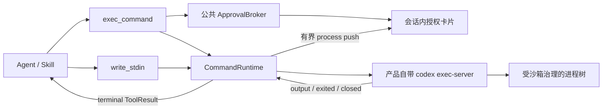
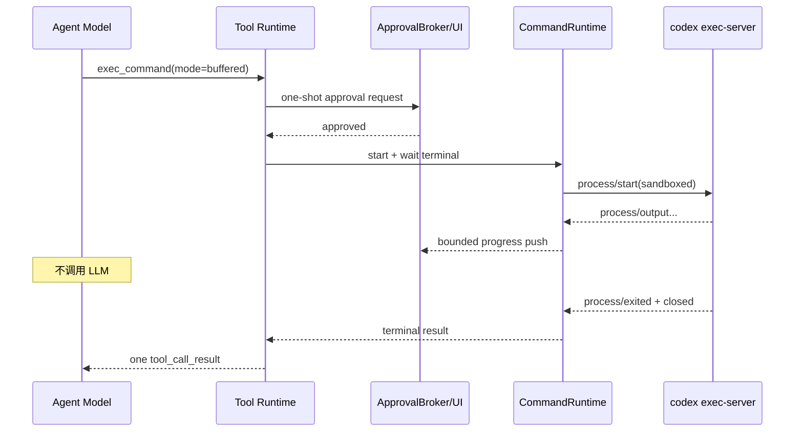
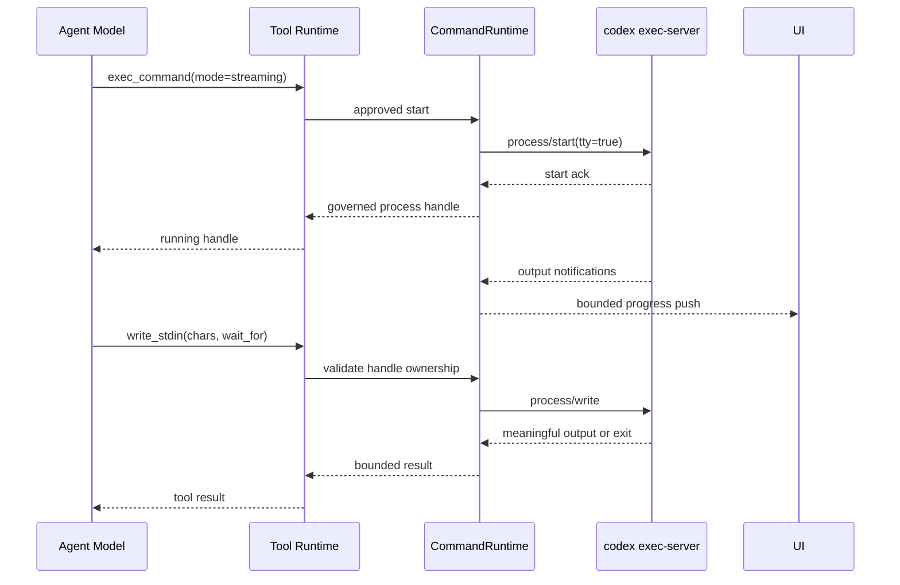

# 受治理的通用本地命令运行时 - 技术方案

## 状态

CONFIRMED

## 需求文档

[requirement.md](./requirement.md)

## 现状分析

### Tool Runtime

- `Tool` 当前只有同步 `invoke(args) -> ToolResult` 契约。协议注释预留了未来异步工具，但执行链尚未提供进度事件或协作式取消接口。
- `ToolBatchExecutor` 使用线程池执行同步 Tool，主执行线程每 50ms 检查一次 run 取消。通用超时只尝试取消 `Future`；已经开始运行的线程不会因此停止底层工作。
- `Conversation._execute_tool_calls()` 会在 Tool 返回后才落盘并发送 `tool_call_result`。这适合短 Tool，也允许 buffered 命令在工作线程中阻塞等待，但命令进度必须通过独立事件通道发布，不能等待 generator 下一次 yield。
- `ToolRunContext` 已承载当前用户轮内的可信时间、URL 证据和文件授权账本，适合继续持有当前 run 的命令句柄与 Skill 执行快照引用。

### 授权

- 文件授权已经具备线程安全 broker、`pending / approved / denied / expired / cancelled` 生命周期、session/run/tool-call 绑定、Bridge REST 决策、SSE push、断线恢复和会话内授权卡片。
- 现有实现的类型、路由、push kind 和前端 store 都以 `filesystem` 命名，决定载荷也只支持文件 permission/action，不能直接表达命令、网络、执行模式或未来授权生命周期。
- 当前 broker 的阻塞等待本身不调用 LLM。命令审批可以沿用这个性质，但需要把生命周期内核提炼为公共审批控制面，而不是复制一个 command broker。

### Skill 内容身份

- `SkillTurnSnapshot` 已冻结本轮 catalog、激活项和 `SKILL.md` 内容；个人 Skill 的 `version` 当前只覆盖 `SKILL.md` 字节，不覆盖 `scripts/`、`references/` 或 `assets/`。
- builtin Skill 安装目录按整个 builtin bundle 指纹物化，内容身份较强；个人和共享个人 Skill 仍可能在一轮执行期间被外部进程修改。
- 因此，仅复用现有 Skill version 不能证明即将执行的脚本与本轮看到的是同一份内容，需要增加命令执行专用的包快照。

### Bridge、push 与打包

- Bridge 是桌面 Agent Runtime 的进程所有者，Tauri 已负责 Bridge 的启动、readiness、drain 和 Windows Job Object 治理。
- 现有 SSE / Tauri event 链路能够立即推送 run、会话和授权变化，适合增加有界的命令进程变化事件。
- Windows package payload 已有版本化目录、完整 manifest、逐文件 SHA-256 和 active receipt 校验。新的 Codex 可执行文件应进入同一 payload 与供应链锁定流程，不另建安装根或自更新器。

## 方案设计

### 总体结构



Bridge 进程拥有一个 `CommandRuntime`。它惰性启动产品锁定的完整 `codex` 可执行文件，并使用：

```text
codex exec-server --strict-config --listen stdio --concurrent-requests <bounded-count>
```

Bridge 通过子进程 stdin/stdout 独占 JSON-RPC 连接，不开放本地 TCP 端口，不使用 remote exec-server。启动后完成 `initialize` / `initialized` 握手，再允许 Tool 提交进程请求。

exec-server 子进程、它托管的命令和 Bridge 具有同一生命周期：

- Bridge 正常关闭时先停止接收新命令，终止仍活跃进程，再关闭 exec-server 连接和子进程。
- stdio 连接异常断开时，exec-server 负责终止该连接下的托管进程；`CommandRuntime` 把所有未终结句柄标记为 `runtime_lost`。
- Windows packaged 模式下，exec-server 及其后代同时继承 Tauri 已有的受治理 Job Object，作为异常退出的第二层清理兜底。
- source 模式由 Bridge 直接拥有子进程句柄，并执行相同的 drain / close 语义。

### 公共审批控制面

把现有文件审批实现重构为 `agent.approvals` 公共域，保留一个进程级 `ApprovalBroker`。公共模型包含：

```text
ApprovalRequest
├── request_id
├── kind: filesystem | command
├── session_id / run_id / tool_call_id
├── reason
├── requested_lifetime: once
├── status / version
└── details: FilesystemApprovalDetails | CommandApprovalDetails

ApprovalDecision
├── request_id
├── lifetime: once
└── grant: FilesystemGrant | CommandGrant
```

`requested_lifetime` 和 `lifetime` 从第一版起就是显式字段，但策略注册表只启用 `once`。任何未知值以及 `turn`、`session`、`persistent` 等尚未启用值都在进入 broker decision 前拒绝；不能把未知值降级成更宽松授权。

typed adapter 负责资源特有校验：

- 文件 adapter 保留现有逐 item permission、逐 destructive action 和部分批准语义。
- 命令 adapter 只允许批准请求中完整展示的命令能力；第一版命令不做参数级部分批准。用户想缩小范围时拒绝原请求，由 Agent 形成新的、更小请求。

Bridge 使用统一 `/v1/approvals` 查询与决策入口，push kind 统一为 `approval_changed`。前端公共 approval store 按 `kind` 投影为文件或命令详情卡片。迁移同时更新所有现有文件调用方和测试，旧的文件授权产品行为保持不变；仓库内不长期保留两套 broker、两套活动 request registry 或两套生命周期状态机。

取消 run 时按精确 `session_id + run_id` 取消其 pending approval，不再用仅按 session 批量拒绝作为主路径。历史终态继续只读，不能再次批准。

### Agent Tool 表面

#### `exec_command`

公开参数采用 Codex 风格的通用命令形态：

```json
{
  "cmd": "./scripts/check/run.sh --stage backend",
  "workdir": "/absolute/project/path",
  "mode": "buffered",
  "timeout_seconds": 900,
  "access": {
    "filesystem": "workspace_write",
    "additional_roots": [],
    "network": "disabled"
  },
  "reason": "运行项目后端检查"
}
```

字段约束：

- `cmd` 是需要展示和审计的完整 shell 命令；runtime 根据 exec-server `environment/info` 返回的当前平台 shell 生成确定的 argv。Windows 非交互命令不加载用户 PowerShell profile。
- `workdir` 必须是绝对、规范化后的目录。不存在、越界、链接身份变化或不满足请求访问模式时，在启动进程前失败。
- `mode` 只能是 `buffered` 或 `streaming`，默认 `buffered`；进程启动后不可静默切换。
- `timeout_seconds` 有产品默认值和硬上限。第一版默认 15 分钟、最大 60 分钟；批准卡片展示实际值。内部测试可以通过依赖注入使用更短时钟，不改变生产上限。
- `access.filesystem` 第一版支持 `read_only` 和 `workspace_write`；不提供 unsandboxed / danger-full-access。
- `additional_roots` 每项都包含规范化路径和只读或读写意图，并完整展示在同一次命令审批中。
- `access.network` 第一版支持 `disabled` 和 `enabled`。网络开启是显式高风险能力，必须在卡片中单独展示；不因命令名称或安装工具类型自动开启。
- `reason` 是给用户看的本次操作理由，不参与权限判定。

Tool 的公开参数只是请求，不是授权事实。实际批准形成绑定精确请求指纹的 one-shot `CommandGrant`，包含规范化 cwd、shell argv、访问范围、网络状态、模式、超时和 Skill 快照身份。启动前再次比较请求指纹与批准指纹。

#### `write_stdin`

`write_stdin` 只接受 `streaming` 模式返回的 opaque 进程句柄：

```json
{
  "process_id": "proc_...",
  "chars": "yes\n",
  "wait_for": "output",
  "timeout_seconds": 30
}
```

- `chars` 以 UTF-8 编码后写入 PTY；有严格的单次字节上限。空输入只允许配合显式等待，不产生无意义 write。
- `wait_for` 支持 `none`、`output`、`exit`：`none` 只确认写入；`output` 等待新的有界输出或终态；`exit` 忽略普通输出唤醒并一直等待终态、超时、取消或运行时失联。
- 句柄必须属于当前 `ToolRunContext`、session、run 和原始 `exec_command`，且仍处于可交互状态。句柄不会进入下一用户轮，也不能由其它会话猜测复用。
- `write_stdin` 不重新扩大文件或网络权限；所有输入仍在原进程和原沙箱中执行。初始审批卡片明确说明这是可继续输入的交互式进程。
- Tool description 明确禁止把 `write_stdin(wait_for="output")` 用作固定频率状态轮询。误把长构建设为 streaming 时，Agent 应使用一次 `wait_for="exit"`，或由用户主动介入。

### buffered 与 streaming 执行语义

#### buffered

普通非交互命令默认使用 buffered：

1. `exec_command` 创建并等待 one-shot 命令审批。
2. 批准后启动进程，Tool 调用在逻辑上保持 `pending`。
3. exec-server reader 持续消费 `process/output`、`process/exited` 和 `process/closed`；输出可以推给 UI，但不返回模型。
4. 仅在进程退出、内部超时、run 取消或 exec-server 失联时结束 Tool 调用。
5. Tool Runtime 落一条合并后的最终 `tool_call_result`，随后才进行下一次模型推理。

因此，一个安静运行 10 分钟的 buffered 命令只有“模型提出工具调用”和“工具终态后的模型续写”两个相邻推理阶段，中间不存在模型级状态检查。

#### streaming

交互式命令显式使用 streaming：

1. 审批卡片明确展示交互模式和可继续写入 stdin 的事实。
2. 进程启动并取得 exec-server start ack 后，`exec_command` 尽早返回受治理的 opaque 句柄和当前有界输出快照。
3. exec-server reader 继续在模型之外接收并向 UI 推送输出。
4. Agent 只在需要实际输入或等待一个有意义条件时调用 `write_stdin`。
5. 当前 Agent run 结束时仍活跃的 streaming 进程一律终止；句柄不构成 detach。

streaming 的“尽早返回”只改变 Tool 何时把句柄交给 Agent，不改变进程的授权、沙箱、输出上限、取消或清理边界。

### 进度事件、输出与恢复

`CommandRuntime` 为每个进程维护有界 `CommandProcessSnapshot`：

```text
process_id / session_id / run_id / tool_call_id
mode / status / started_at / finished_at
output_seq / bounded_tail / dropped_bytes
exit_code / sandbox_denied / terminal_reason
```

新增 `command_process_changed` push envelope，按 `session_id` 投递。输出 reader 先在本地聚合，再按固定时间窗或字节阈值合并推送，不能为 PTY 的每个小 chunk 产生一个跨层事件。push 只进入前端运行态，不写成模型消息。

前端断线重连时通过一次 REST snapshot refresh 恢复仍活跃进程和有界 tail；正常在线期间不设置周期性进程查询 timer。push 序号中断或 runtime 重连才触发恢复读取。

输出采用三层预算：

- exec-server cursor 确保 chunk 不重复消费；
- `CommandRuntime` 保存有界 stdout/stderr/pty tail，并累计 `dropped_bytes`；
- 最终 `ToolResult.text` 使用更小的模型预算，保留命令、终态、退出码、尾部输出与截断说明。

原始无限输出不进入 session JSONL、普通日志或诊断包。普通日志只记录命令指纹、进程关联 ID、字节计数、截断量、持续时间和终态；不记录完整环境和疑似凭据。

### 协作式取消与超时

在 Tool Executor 增加内部 `ToolInvocationControl`，包含 cancellation event 和可选 cancel callback。它是宿主隐藏上下文，不进入模型 schema。

- main run 的 `cancel_check` 发现取消时，先 signal invocation control，再传播现有 run cancellation。
- Tool 超时时先 signal control，并等待一个很短的有界清理窗口；不能只调用 `Future.cancel()` 后把仍运行的命令遗留在线程池中。
- `CommandRuntime` 收到 signal 后只终止与精确 process ID 绑定的 exec-server 进程，并等待 exited/closed；清理超时则关闭受影响连接并把同连接进程标记为 `runtime_lost`。
- buffered 命令内部超时早于通用 Tool Executor 的兜底超时；streaming 进程的生命周期上限继续由原 grant 和 run 控制。
- ToolRunContext 在 run 的 `finally` 阶段关闭全部仍活跃的命令句柄，使模型直接结束回答也不会留下 streaming 进程。

这个控制对象作为通用可选扩展加入 Tool Runtime，现有同步短 Tool 无需实现 cancel callback，行为保持不变。

### 沙箱与环境映射

命令审批结果被转换为 exec-server `process/start` 的 sandbox context：

- cwd 是主 workspace root；`read_only` 只允许读取，`workspace_write` 只允许在批准根内写入。
- additional roots 逐项映射为显式只读或读写 permission entry。
- Skill 执行快照目录作为内部只读根；run 私有临时目录作为内部最小写入根。
- network disabled 映射为拒绝网络的 permission profile；enabled 映射为本次明确批准的网络能力。
- 请求必须要求 sandbox。`process/start` 返回的 `sandboxType` 缺失、为 `none`，或当前平台不能落实请求 policy 时，runtime 立即终止进程并返回 `sandbox_unavailable`。
- exec-server 报告 `sandboxDenied` 时保留独立错误类别，不把它折叠为普通非零退出。

子进程环境从最小基线构造，不继承整个 Bridge 环境：

- 保留平台启动必需的 `PATH`、`PATHEXT`、`SystemRoot`、`ComSpec`、locale 和 run 私有临时目录等明确 allowlist。
- 不继承 LLM provider key、社交平台凭据、代理凭据、生命周期 token、产品内部端口 token、用户 Codex auth 或调试注入变量。
- Agent 请求的额外环境键和值会显示在授权详情中；命中凭据型名称、控制字符、超限或产品保留前缀时拒绝。第一版不提供隐藏 secret 注入通道。
- exec-server 自身使用独立产品 `CODEX_HOME`；该变量不自动传给受执行命令。

### Skill 执行快照

`exec_command` 增加可选的结构化 Skill 绑定：

```json
{
  "skill": {
    "id": "builtin/skill-creator",
    "entry": "scripts/quick_validate.py"
  }
}
```

使用 Skill 脚本时必须满足：

- `id` 是当前 `SkillTurnSnapshot.activations` 中已激活的 Skill；不能按任意磁盘路径声称属于某个 Skill。
- `entry` 是包内相对路径，规范化后不能逃逸 package root，也不能经过 symlink、junction 或特殊文件。
- runtime 在首次执行前把该激活 Skill 的受支持常规文件复制到 run 私有、不可被用户路径别名访问的 execution snapshot，生成包含相对路径、大小和 SHA-256 的 manifest。
- snapshot 过程有文件数、单文件大小和总字节上限；遇到链接、特殊文件、读取竞态或预算超限时 fail-closed，并提示 Skill 包不满足可执行快照约束。
- 命令中的 Skill entry 和位于 Skill 根内的工作目录被重写到 snapshot 路径；批准卡片展示原 Skill 名、entry 和内容指纹，不暴露内部 staging 路径。
- 同一 run 内相同激活 Skill 复用同一 immutable snapshot。run 结束后清理；清理失败只保留不含用户凭据的诊断并在下次启动回收。

直接把当前 Skill 原路径拼进普通 `cmd` 不构成受保护的 Skill 执行。检测到命令或 cwd 指向已激活 Skill 根、但没有结构化 Skill 绑定时拒绝并提示使用 Skill 绑定，从而避免 shell 字符串解析承担安全判断。

### Codex 二进制供应链与运行身份

新增受治理的 Codex vendor lock，按支持平台记录：

- Codex 版本和官方 release 来源；
- 平台、架构、制品文件名和 SHA-256；
- 许可证文件来源和 SHA-256；
- exec-server protocol capability floor。

package runner 只把通过 lock 校验的制品放入 staging。payload manifest 已对所有 staging 文件逐项哈希，因此 Codex 可执行文件、license 和产品 runtime 共享现有 active payload 完整性、receipt 和版本身份。

Bridge 启动 `CommandRuntime` 前再次核对以下事实：

- 路径来自 launcher 明确传入的 active payload 或 source-mode project cache，不从用户 PATH 搜索；
- 文件哈希和版本与产品 lock 匹配；
- `codex exec-server --listen stdio` 与所需 initialize、sandbox、output/exited/closed capability 可用；
- 使用产品隔离的 `CODEX_HOME`，目录内不包含 auth 文件，也不读取用户主目录的 `.codex`。

任一检查失败时只把命令工具标记为 `unavailable`，Bridge 的普通聊天和其它 Tool 继续可用。runtime 不执行 Codex login、不调用 Codex Agent、不访问远程 exec-server，也不在产品运行期下载或更新二进制。

source 模式通过 `scripts/command-runtime/run.sh|run.ps1` 提供 `prepare`、`doctor` 和测试入口；两端使用同一 vendor lock，把二进制放到项目管理的 cache，不做系统级安装。Windows 正式 package 首期携带对应制品；macOS/Linux source 接口与协议保持一致，正式安装包留待后续。

### 前端交互

现有 `ToolCard` 继续是会话内展示入口：

- `exec_command` pending approval 时显示命令授权卡片，包含命令、cwd、buffered/streaming、超时、文件范围、网络状态、理由和“仅本次允许”。
- 批准后同一卡片进入运行态，展示持续时间、最近有界输出、截断提示和取消入口；不会弹出全窗口 Dialog。
- streaming 模式额外显示“交互式进程”与句柄仍受当前任务治理，不提供独立终端输入 UI。
- 命令在后台会话等待授权时复用现有侧边栏 attention 机制；运行中的普通长命令不抢占当前会话。
- 完成、失败、超时、取消、sandbox denied 和 runtime lost 使用可区分终态；历史卡片不可重新批准或写入。

命令详情组件是对话域组件，复用已有 `Button`、状态点、Collapsible 和主题 token。第一版不引入终端模拟器依赖。

### 涉及文件

| 文件路径 | 改动类型 | 说明 |
| --- | --- | --- |
| `agent/src/agent/approvals/` | 新增并迁移 | 从文件审批提炼公共 request、decision、broker 和 typed adapter；只保留一个活动审批控制面 |
| `agent/src/agent/filesystem/` | 修改 | 文件授权模型接入公共 broker，保留现有 permission/action 与 ledger 语义 |
| `agent/src/agent/command_runtime/` | 新增 | exec-server stdio client、进程 registry、沙箱映射、输出预算、Skill snapshot 和 Tool 实现 |
| `agent/src/agent/tools/factory.py` | 修改 | 注入并注册 `exec_command`、`write_stdin` |
| `agent/src/agent/tools/protocol.py` | 修改 | 记录可选协作式取消扩展，不破坏同步 Tool |
| `agent/src/agent/tool_runtime/executor.py` | 修改 | 传播 invocation control，超时和 run 取消时触发底层清理 |
| `agent/src/agent/tool_runtime/context.py` | 修改 | 持有 run-scoped 命令句柄与 Skill execution snapshots，并在 finally 清理 |
| `agent/src/agent/conversation.py` | 修改 | 注入命令隐藏上下文，保持 buffered 结果只在终态落盘 |
| `agent/src/agent/runtime/listeners.py` | 修改 | 增加通用 approval 和 command process push |
| `agent_bridge/src/agent_bridge/assembly.py` | 修改 | 装配唯一 ApprovalBroker 与进程级 CommandRuntime，绑定 lifecycle/listeners |
| `agent_bridge/src/agent_bridge/routes/` | 修改 | 通用审批决策、命令 snapshot 和精确取消/恢复入口 |
| `frontend/src-tauri/src/push_subscriber.rs` | 修改 | 透传 `approval_changed` 与 `command_process_changed` |
| `frontend/src/services/api/` | 修改 | 通用 approval 和 command process 类型/REST client |
| `frontend/src/stores/` | 修改 | 公共 approval store、命令 process push/reconnect store |
| `frontend/src/pages/chat/components/ToolCard.tsx` 及邻近领域组件 | 修改 | 命令审批、运行进度和终态卡片；文件审批改用公共壳 |
| `runtime_config/src/runtime_config/` | 修改 | 产品 Codex 路径、隔离 home 和命令 runtime 配置 |
| `frontend/src-tauri/src/runtime_services/` | 修改 | packaged/source 启动时向 Bridge 注入经过身份校验的 Codex 路径；不新增第三个长期服务槽 |
| `scripts/package/vendor/` | 新增 | Codex 制品与 license lock |
| `scripts/package/` | 修改 | 下载、校验、staging、payload capability 和 frozen smoke |
| `scripts/command-runtime/run.sh` / `run.ps1` | 新增 | 跨平台 prepare、doctor 和确定性 smoke 入口 |
| `scripts/README.md` | 修改 | 登记新的开发者入口 |
| 各受影响模块 tests | 修改/新增 | 公共审批、协议、沙箱、模式、取消、Skill identity、push、UI 和 packaging 回归 |

## 数据流

### buffered 长命令



### streaming 交互命令



## 影响分析

### 上下游影响

- **Agent 循环**：buffered 命令会长期占用一个 run worker，但不占用模型请求；现有 scheduler 的 queued/running、取消和 drain 语义继续有效。
- **Tool 并行**：`exec_command` 和 `write_stdin` 固定为 serial。它们不与同一模型批次中的其它调用并行，避免审批顺序和工作区修改竞态。
- **文件工具**：审批基础设施会迁移，但文件 Tool 的公开 schema、授权范围和用户可见结果不改变。命令沙箱权限不生成可供文件 Tool 使用的 scope ID，反向亦然。
- **Skill 系统**：激活快照增加 execution snapshot 能力；普通 Skill 发现、读取和 catalog 热更新不因未执行脚本而承担复制成本。
- **多入口**：桌面端可审批并展示进度；不能展示本地审批的入口得到 `approval_surface_unavailable`，不会启动命令。
- **产品生命周期**：Bridge drain 必须等待或取消活跃命令；Tauri background demand 已把运行中的 Agent task 视为 active，无需另造常驻需求类型。
- **打包**：新增官方二进制和 license 属于 package-sensitive 输入，需要真实 frozen candidate 与 capability smoke；不改变安装根、active receipt 或迁移状态机，因此默认不升到 full-matrix。
- **诊断**：诊断结构若增加 command runtime 摘要，需要同步 producer contract、检查 Skill 与 fixture；不收集原始命令输出正文。

### 兼容与迁移

- 公共 ApprovalBroker 在一个提交序列内替换 filesystem-only broker；测试先固定文件既有行为，再迁移 Bridge 和前端，不用长期 shim 掩盖两套真相源。
- 已落盘 session 中的文件授权卡片仍由原 `tool_call_request/result` 内容渲染；活动 approval 是进程内状态，升级后旧 pending request 按既有规则显示失效，不能恢复批准。
- `ToolResult` 的持久格式保持字符串正文加 meta；命令最终结果不要求 session schema 迁移。
- 新 push kind 对旧前端是未知事件，packaged shell 与 Bridge 必须同版本交付；active payload 身份检查继续阻止混装。

### 风险点

- **Codex 协议漂移**：lock 同时固定二进制和 capability floor，protocol adapter 对未知字段向前兼容、对缺少安全字段 fail-closed；升级必须重跑 contract tests。
- **本地子进程逃逸**：sandbox 必须被 exec-server 明确确认；stdio 断开清理、run-scoped registry 和 Windows Job Object 形成多层兜底。
- **交互式模型循环**：streaming 工具描述和 `wait_for=exit` 提供一次性等待路径；测试统计模型续轮，防止输出 chunk 驱动模型循环。
- **输出洪泛**：reader、push、UI tail 和 ToolResult 分层限额；慢订阅者仍遵循现有断开策略，不能反压阻塞子进程 drain。
- **Skill TOCTOU**：实际执行 immutable snapshot 而非原目录；snapshot 失败不回退到原文件直接执行。
- **环境兼容**：最小环境可能使依赖用户 profile 的脚本失败。失败结果应列出被允许的环境类别，引导 Skill 使用显式、可复现入口，不为兼容而恢复全量继承。
- **Windows sandbox 能力**：锁定版本必须在 packaged Windows 上真实证明 requested policy 被落实；不能只根据命令成功或进程存在判断沙箱有效。

## 验证方案

### 确定性单元与集成测试

- 公共 ApprovalBroker：kind/lifetime 校验、精确 session/run/tool-call 绑定、并发决定、过期、取消、旧版本决策和 filesystem 行为回归。
- exec-server adapter：用本地 fake stdio server 覆盖 initialize、并发 request、output sequence、read recovery、write、terminate、exited、closed、断线和 malformed frame。
- 模式契约：buffered 只在终态返回；streaming 在 start ack 后返回句柄；模式不可切换；句柄跨 run、跨会话和 run 结束后不可用。
- 模型调用边界：fake LLM 发出一次 buffered 命令，虚拟时钟或可控 fixture 跨过长等待，断言等待期间没有模型 continuation 或状态 Tool 调用。
- 取消与超时：run cancel、工具 timeout、Bridge drain 和 exec-server crash 都触发精确 terminate，并证明子进程树清理及终态唯一。
- 沙箱与环境：cwd/额外根、链接/junction、read-only/write、network disabled/enabled、敏感环境剥离、sandboxType 缺失/none 和 sandboxDenied。
- 输出：stdout/stderr/pty、UTF-8 边界、不可解码字节、持续洪泛、tail 截断、push 合并、重连 cursor 和最终结果预算。
- Skill：未激活、version 不匹配、包内 entry、`..`、symlink/junction、复制竞态、预算超限、run 内复用和修改原包后仍只执行 snapshot。
- 前端：文件与命令 approval 共用 store、background attention、buffered progress、streaming 标识、终态、重连恢复和不可重复操作。

### 项目与跨平台入口

- `scripts/command-runtime/run.* doctor` 验证 source-mode 锁定二进制、隔离 CODEX_HOME、exec-server handshake 和 sandbox capability。
- `scripts/command-runtime/run.* smoke` 使用无网络、无真实 LLM、无 MAA 的本地 fixture 覆盖 buffered、streaming、write、cancel 和输出边界。
- Windows、macOS、Linux 的 source 测试共享同一行为断言；平台特有 sandbox fixture 只验证对应 backend，不用其它平台结果代替。
- 运行项目规定的完整 `scripts/check/run.*` 门禁。

### Windows frozen 与长任务验收

- 使用标准 package runner 构建 `package-sensitive` frozen runtime candidate，确认 Codex binary、license、lock identity 和 payload manifest 一致。
- frozen capability smoke 通过真实被携带的 Codex 执行本地命令、sandbox 拒绝、streaming 输入、取消和进程树清理；不调用网络、真实 LLM 或第三方 provider。
- 10 分钟长任务使用 fake LLM 加真实本地命令：模型只发出一次 buffered `exec_command`，runtime 独立推送少量合并进度，命令终态后才发生一次模型 continuation。报告记录模型调用数、process push 数、输出截断和最终退出状态。
- Windows 安装形态验证在无用户 Codex、空用户 Codex auth、PATH 不含 Codex的隔离环境运行；再加入一个不同版本的用户 Codex，结果仍绑定产品 lock 与 active payload。
- 只有需求验收明确需要完整 installer 时才进入标准 installer 构建；本需求不改变安装事务语义，不因新增 payload 文件机械扩大到升级/降级 full matrix。

## 变更记录

| 日期 | 变更内容 | 是否需要重新实现 |
| --- | --- | --- |
| 2026-08-16 | 首次确认：Bridge 通过 stdio 独占产品自带 exec-server；复用并泛化现有审批控制面；普通命令使用 buffered pending-to-terminal，交互式命令使用 streaming governed handle；进度不触发 LLM；Skill 执行使用 immutable run snapshot；Windows packaged 优先、source 跨平台。 | 是，新需求尚未实现 |
