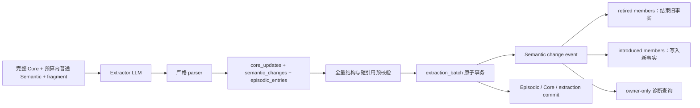

# Semantic 多对多变更图 - 技术方案

## 状态
CONFIRMED

## 需求文档
[requirement.md](./requirement.md)

## 现状分析

当前 `ExtractionOutput.semantic_ops` 由一组相互独立的 `SemanticOp` 组成。每个操作只能是：

- `add`：写入一条新 Semantic，不带旧事实引用；
- `supersede`：写入一条新 Semantic，并通过单个 `target_ref` 结束一条旧 Semantic 的有效期。

该一对一约束贯穿整个链路：

- Extractor prompt 只允许单个 `target_ref`；
- parser 只解析一个引用；
- Reconciler 禁止同一目标被多个操作触碰，并按操作顺序立即结束目标；
- `SemanticRow` 与 `semantic` 表只保存单值 `supersedes_id`；
- `ExtractionResult` 只区分 added 与 superseded 文本，不保存一次概念变更的成员边界。

现有 `extraction_batch` 已提供 observation 级幂等和整批 SQLite 事务，能够作为新模型的原子提交边界。活跃召回也已统一依赖 `valid_until IS NULL AND deleted_at IS NULL`，因此事实撤回只需可靠结束有效期，不需要改变 FTS 或召回的基本过滤语义。

当前成功抽取的分类理由只存在于 LLM 原始响应；生产装配默认不持久化 `ExtractionAttempt.raw_response`。要保证多对多变化可诊断，已提交的逐项理由和变更成员必须进入权威存储，而不是依赖可选回调或日志正文。

## 方案设计

### 涉及文件

| 文件路径 | 改动类型 | 说明 |
|---|---|---|
| `memory/src/memory/extraction/result.py` | 修改 | 用统一的 Semantic change contracts 替换单目标 `SemanticOp`，补 contract version 与结果诊断 |
| `memory/src/memory/extraction/extractor.py` | 修改 | 解析新输出、兼容旧输出并记录实际 contract version |
| `memory/src/memory/extraction/prompts/extract.md` | 修改 | 输出 `semantic_changes`，增加通用新增、撤回、合并、拆分约束与示例 |
| `memory/src/memory/extraction/reconciler.py` | 修改 | 整批预校验、多对多变更写入、目标重检与稳定错误码 |
| `memory/src/memory/store/schema.py` | 修改 | schema v6 与 Semantic change/member contracts |
| `memory/src/memory/store/sqlite_store.py` | 修改 | change/member 事务写入、历史查询及 v5→v6 迁移 |
| `memory/src/memory/store/__init__.py`、`memory/src/memory/__init__.py` | 修改 | 导出新 contracts，移除生产侧旧操作依赖 |
| `memory/src/memory/factory.py`、`memory/src/memory/extraction/worker.py` | 修改 | 透传新诊断字段并保持后台抽取失败隔离 |
| `agent_bridge/src/agent_bridge/routes/memory.py` | 修改 | 增加 owner-gated Semantic change 诊断查询，不增加 UI |
| `memory_eval/` | 修改 | 增加通用多对多抽取契约、历史状态与真实 LLM 评测切片 |
| `memory/tests/`、`agent_bridge/tests/` | 修改 | parser、事务、迁移、查询和路由回归 |

### 数据流



### Extractor 输出协议

新生产 prompt 固定输出以下顶层结构：

```json
{
  "core_updates": [],
  "semantic_changes": [
    {
      "retirements": [
        {
          "target_ref": "M001",
          "reason": "用户明确否定了该事实"
        }
      ],
      "new_facts": [
        {
          "statement": "新的长期事实",
          "importance": 0.7,
          "speaker_origin": "user",
          "reason": "这是值得长期保留的普通 Semantic，不属于 Core Profile"
        }
      ]
    }
  ],
  "episodic_entries": []
}
```

对应内存 contracts：

```python
@dataclass(frozen=True)
class SemanticRetirement:
    target_ref: str
    reason: str

@dataclass(frozen=True)
class SemanticFactDraft:
    statement: str
    reason: str
    importance: float = 0.5
    speaker_origin: Literal["user", "agent"] = "user"

@dataclass(frozen=True)
class SemanticChange:
    retirements: list[SemanticRetirement]
    new_facts: list[SemanticFactDraft]
```

不再让模型输出 `op`。操作语义由两侧成员推导：

| `retirements` | `new_facts` | 语义 |
|---|---|---|
| 空 | 非空 | 新增 |
| 非空 | 空 | 事实撤回 |
| 非空 | 非空 | 修正、合并、拆分或其组合 |
| 空 | 空 | 非法 |

一个 change 是一个概念变更的超边：组内成员共同描述一次变化，但不把所有旧事实与所有新事实展开成笛卡尔积边。多个不相关变化必须输出为多个 change。同一旧引用不得在同一输出的多个 change 中重复出现；一条旧事实拆成多条新事实时，应把所有新事实放在同一个 change 中。

每个 retirement 的 `reason` 解释为什么该旧事实不应继续有效。每个 new fact 的 `reason` 继续解释为什么值得作为普通 Semantic 保存、并且不属于 Core Profile。不增加 change-level 总理由，避免重复解释和额外注意力负担。

#### Contract version

LLM 输出不携带 `schema_version`。Prompt、parser 和 Reconciler 属于同一发布单元，要求模型复述常量不能证明其余结构有效，反而会增加无业务意义的失败点。

版本由 parser 根据入口契约确定并显式记录：

- 存在 `semantic_changes` 且不存在 `semantic_ops`：contract v2；
- 不存在 `semantic_changes`、存在旧 `semantic_ops`：contract v1，转换为若干一对一 `SemanticChange`；
- 两者同时存在：`ambiguous_semantic_contract`，整批拒绝；
- 新结构字段缺失、类型不符或成员不合法：以 v2 稳定错误码和 JSON path 拒绝；
- 未来未知结构不做猜测或静默转换。

`ExtractionOutput`、`ExtractionAttempt` 和 `extraction_commit` 均记录 `output_contract_version`。生产 prompt 只生成 v2；v1 兼容仅服务旧 prompt、历史测试和渐进升级，不作为长期新增入口。

#### Prompt 约束

普通 Semantic 指引改为“先识别概念变化，再填两侧成员”。Prompt 使用通用示例覆盖：

1. 无旧事实的新增；
2. 明确否定但没有替代事实的撤回；
3. 多条重复或重叠旧事实合并为一条；
4. 一条宽泛旧事实拆成多条原子事实。

示例不得包含本需求来源中的真实账号、人物或原句。Core-first 顺序、Core/Semantic 禁止双写、50k 历史 Semantic 预算和严格短引用原则保持不变。

### 存储模型

schema 升级到 v6，增加一个 change 表和一个角色化成员表：

```sql
CREATE TABLE semantic_change (
    id              TEXT PRIMARY KEY,
    observation_id  TEXT,
    owner_user_id   TEXT NOT NULL,
    persona_id      TEXT NOT NULL,
    origin          TEXT NOT NULL,
    provenance      TEXT NOT NULL DEFAULT '[]',
    created_at      TEXT NOT NULL
);

CREATE TABLE semantic_change_member (
    change_id       TEXT NOT NULL,
    semantic_id     TEXT NOT NULL,
    role            TEXT NOT NULL,
    reason          TEXT NOT NULL,
    PRIMARY KEY (change_id, semantic_id, role),
    FOREIGN KEY (change_id) REFERENCES semantic_change(id) ON DELETE CASCADE,
    FOREIGN KEY (semantic_id) REFERENCES semantic(id) ON DELETE RESTRICT,
    CHECK (role IN ('introduced', 'retired'))
);
```

配套唯一索引保证：

- 每条 Semantic 只被一个 change 引入；
- 每条 Semantic 最多被一个 change 撤回；
- 同一成员不能在同一 change 中同时承担两个角色。

“生成一次、撤回至多一次”与 `valid_from` / `valid_until` 生命周期一致。一个 change 可拥有任意数量的 introduced/retired 成员，因此自然支持一对多、多对一和多对多。

`semantic.supersedes_id` 暂时保留为只读兼容列，避免为删除旧列重建主表；v6 新写入固定为 `NULL`，权威谱系只读取 change/member 表。后续如需物理移除旧列，另做独立维护需求。

#### v5→v6 迁移

迁移必须幂等并保守保存已有语义：

1. 为所有现有 Semantic 建立一次 introduced 成员，使每条历史事实都有生成事件。
2. 对 `supersedes_id` 指向有效旧行的记录，按被指向的旧 ID 聚合：同一旧事实的所有后继放入同一个 legacy change，旧事实作为 retired 成员、后继作为 introduced 成员，从而保留旧 schema 可能表达的一对多关系。
3. 没有 `supersedes_id` 的行建立 introduction-only legacy change。
4. 迁移理由统一写明确的占位信息“旧协议迁移，原始理由不可用”，不得推测历史理由。
5. 遇到悬空 `supersedes_id` 时保留原列、将新事实按 introduction-only 迁移并记录 warning；不得伪造不存在的 Semantic 成员，也不得阻止其他合法历史升级。
6. 迁移不修改既有 statement、provenance、valid_from、valid_until、deleted_at、owner 或 persona。

迁移事件使用确定性 ID，重复启动不会产生重复 change/member。

### 校验与原子执行

Parser 负责结构校验；Reconciler 在开启事务前完成整批语义校验：

- 所有数组和成员结构合法，change 至少有一侧非空；
- retirement 引用存在于本轮 `semantic_ref_map`；
- 每个 retirement 和 new fact 理由非空；
- new fact statement 非空，importance 归一到 0~1，speaker origin 只能是 user/agent；
- 同一 change 内引用不重复，同一输出中旧目标不跨 change 重复；
- 同一输出不得产生完全相同的 new statement；
- 新 Semantic 的 owner/scope 只能由 fragment 和服务端上下文确定，LLM 不输出这些字段。

进入现有 `extraction_batch` 后：

1. 为每个 change 和 new fact 预分配数据库 ID。
2. 再次确认所有 retired Semantic 仍 active；任何一个已失效即抛出 `stale_semantic_ref`。
3. 插入 change 元数据。
4. 逐条结束 retired Semantic，并写 retired member 与理由。
5. 写入 new Semantic，再写 introduced member 与分类理由。
6. 写 Core、Episodic 和 extraction commit，统一提交。

任一 SQL、引用重检或约束失败由 `extraction_batch` 回滚。事实撤回只设置 `valid_until`，不设置 `deleted_at`；forget 语义不进入该路径。

### 诊断与查询

新增 store 查询 contract，按 owner、persona、时间和分页返回：

- change ID、observation ID、origin、时间和 provenance；
- introduced/retired 成员的 Semantic ID、statement、理由与有效期；
- 对应 extraction contract version 和 commit 信息。

Bridge 增加 owner-gated 只读接口：

```text
GET /v1/memory/semantic-changes?persona_id=...&limit=...&offset=...
```

本期前端不调用该接口。普通发行版继续受 Owner Mode 的既有 Bridge 路由门禁保护，不新增公开记忆读取面。

拒绝路径使用稳定错误码并附带不含记忆正文的结构位置，例如 change 下标、成员下标和短引用。已解析且成功提交的逐项理由进入 change/member 表；非法原始响应仍只受现有抽取 attempt 和应用日志隐私边界约束，不把完整记忆正文加入通用诊断 ZIP。

`ExtractionResult` 改为报告 change IDs、introduced Semantic 和 retired Semantic；duplicate observation、commit 失败和 apply error 的既有语义保持。

### 查询与索引行为

自动召回、显式搜索、Inspector 当前 Semantic 列表和 dense/FTS 候选仍只读取 `valid_until IS NULL AND deleted_at IS NULL` 的当前事实。事实撤回与替换后，旧行无需从主表或 FTS 历史中物理删除；过滤条件继续阻止其进入当前召回。

历史与诊断查询通过 change/member 表读取变更图，不改变正常对话上下文的 token 预算，也不把谱系元数据注入主对话。

### 评测与测试

机制性测试包括：

- v2 parser 的新增、撤回、一对多、多对一、多对多和非法空 change；
- v1 `semantic_ops` 到 v2 contracts 的兼容转换与歧义字段拒绝；
- 缺少 retirement/new fact 理由时整批拒绝；
- 同一目标跨 change 重复、未知引用、stale 引用和完全重复新 statement；
- 多目标失效与多事实写入的事务原子性；
- 只撤回时不创建虚构新事实、不设置 deleted_at；
- v5→v6 全新库、单链、一旧多新、悬空旧引用和重复迁移；
- 当前查询排除 retired 行，历史查询完整返回成员和理由；
- owner-gated 诊断路由的授权、分页与序列化。

`memory_eval` 增加独立的通用 Semantic change 切片。真实 LLM 评测至少覆盖新增、撤回、重复事实合并和宽泛事实拆分，并检查：目标引用集合、新事实集合、变更分组、逐项理由、Core/Semantic 分层及最终数据库状态。Prompt 示例与 eval holdout 不共享专有实体或答案式措辞。

真实模型运行继续遵守逐次 LLM API 授权；确定性 fake/mock 测试不需要外部调用。

## 影响分析

### 上下游影响

- `Extractor`、`Reconciler` 与 store contracts 同步升级，旧 `SemanticOp` 只在 parser 兼容层消费。
- `SemanticRow.supersedes_id` 暂留但不再作为新谱系的事实源；任何历史调用方必须迁到 change 查询。
- `memory_eval` extraction attempt 文件新增带默认值的 contract version 字段，旧报告仍可读取。
- Memory Inspector 当前列表和筛选行为不变；新增诊断 API 为以后展示谱系预留稳定入口。
- Core Profile、Core 短引用和字段基数完全不变。

### 风险点

| 风险 | 影响 | 缓解 |
|---|---|---|
| 嵌套 change 结构增加 LLM 输出复杂度 | 非法 JSON 或错误分组增多 | 固定字段顺序、少量通用 few-shot、严格 parser 和真实 LLM 重复评测 |
| 模型错误地一次撤回过多事实 | 当前记忆丢失有效信息 | 每目标强制理由、只能引用可见短引用、整批可诊断，不做确定性语义补猜 |
| 多个独立变化被合并成一个 change | 历史边界不精确 | Prompt 明确“一个概念变化一个 change”，eval 检查分组而不只检查最终集合 |
| 旧关系缺少理由或存在悬空引用 | 迁移无法完全恢复原始意图 | 明确 legacy 占位理由、保留旧列、悬空关系 warning，禁止推测 |
| 新旧 parser 并存导致协议误判 | 错误转换或静默丢字段 | 以互斥顶层字段识别；两者并存整批拒绝；记录实际 contract version |
| 诊断接口暴露敏感记忆 | 普通发行版读取用户数据 | 复用 Owner Mode Bridge 门禁，不加入普通 UI 或通用诊断 ZIP |

## 变更记录

| 日期 | 变更内容 | 是否需要重新实现 |
|---|---|---|
| 2026-08-16 | 首次确认统一 Semantic change 输出、多对多事件存储、v6 迁移、原子执行和诊断方案 | — |
