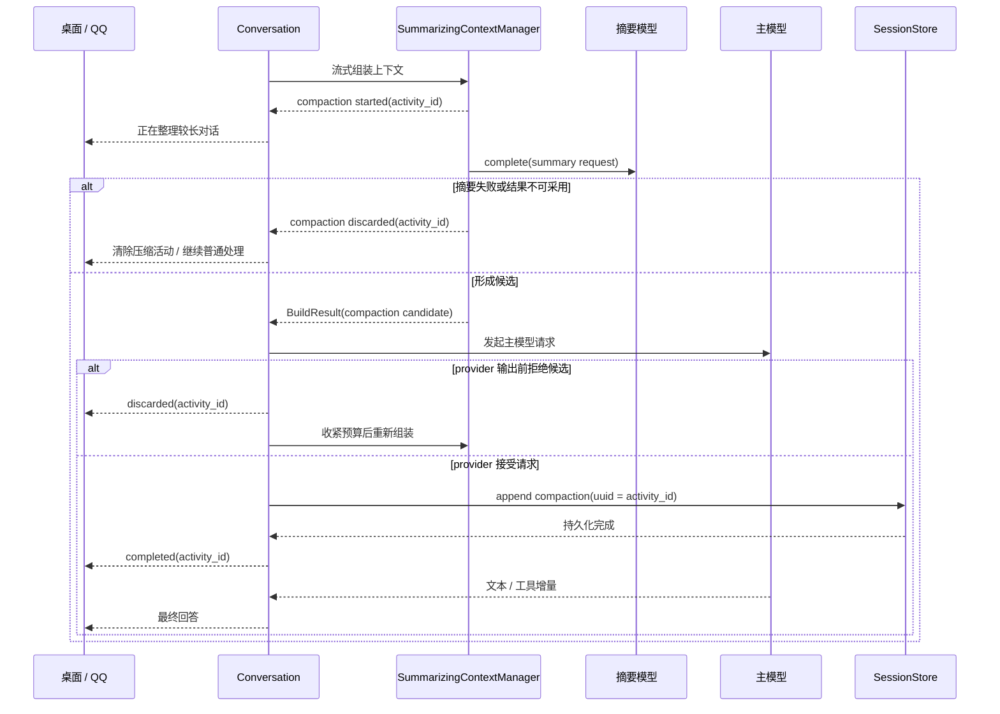

# 上下文压缩进度与持久记录 - 技术方案

## 状态

CONFIRMED

## 需求文档

→ [requirement.md](./requirement.md)

## 现状分析

### 压缩发生在首个实时状态之前

- `Conversation._run_tool_loop()` 先调用 `prepare_first_turn()` 完成上下文组装，之后才产出 `ModelResponseStatus(phase="waiting")`。
- `SummarizingContextManager.build_messages()` 在判断超过阈值后同步调用摘要模型；这段调用可能持续数十秒，但当前返回类型只有最终 `BuildResult`，无法在调用中途向 `Conversation.stream()` 交还进度。
- 因此，把现有模型等待状态改名为“正在整理对话”并不能解决问题：事件仍然只会在摘要结束后到达上层。

### 成功压缩已经持久化，但前端忽略该事实

- 压缩成功后会形成 `CompactionRecord` 候选；只有对应主模型请求被 provider 接受后，`Conversation._commit_pending_context_checkpoints()` 才将其追加为 `compaction` session event。
- `Session.messages` 与 `Session.llm_messages` 都明确排除 `compaction`，所以该事件不会成为用户或助手消息，也不会污染模型上下文。
- 桌面端历史接口已经返回 active session events；`sessionProjection.ts` 当前忽略 `compaction`，导致重载后虽然事实仍在 JSONL 中，界面却看不到。

### 实时桌面协议只有模型状态，没有压缩活动

- `ConversationEvent` 当前包含文本、工具、模型请求状态、Skill 激活与结束事件，没有上下文压缩生命周期事件。
- AG-UI encoder 把 `ModelResponseStatus` 映射为 `agent_friend.run_status` custom event；前端 reducer 将其保存在当前 assistant placeholder 的 `runStatus` 中。
- Tauri push 通道会把 `ConversationEvent` dataclass 平铺转发，因此新增事件只要保持 additive discriminator，就能同时覆盖 pull 与 push 消费方。

### QQ 原生流只累计回答正文

- `IMRouter` 只消费 `TextDelta` 和工具边界，`StreamRelay` 把所有字符串增量追加到 `_parts`，再用同一条 QQ 原生流式消息做 replace 更新。
- 如果直接把压缩提示作为普通 delta 喂给 relay，最终消息会变成“正在整理较长对话……实际回答”，无法在正文开始时替换占位。
- relay 已经拥有“同一消息多次 replace”的能力，缺少的是“临时可见内容”与“权威回答正文”两套状态。

## 设计原则

1. **开始事件必须先于耗时摘要调用**：不能用摘要结束后的推断事件冒充实时进度。
2. **成功以 checkpoint 提交为准**：摘要返回只产生候选；provider 未接受的候选不得留下完成记录。
3. **复用现有持久化事实**：`compaction` session event 是唯一完成记录，不新增 UI 专用数据库或重复事件。
4. **活动与对话内容分离**：压缩活动可以出现在时间线中，但不参与模型输入、正文复制或历史文本搜索。
5. **临时进度与最终回答分离**：QQ 占位只改变当前可见文本，不进入回答正文累计器。
6. **保持协议向前兼容**：新增事件类型；未知消费者继续按现有约定忽略，不改已有事件字段语义。

## 总体方案



## 1. 上下文构建的流式进度契约

### 1.1 保留同步 `ContextManager` 接口

现有 `ContextManager.build_messages()` 被单测、自定义 context manager 和非交互调用方广泛使用，本需求不破坏该接口。新增一个可选的进度能力：

```python
@dataclass(frozen=True)
class ContextCompactionProgress:
    activity_id: str
    phase: Literal["started", "discarded"]

class StreamingContextManager(Protocol):
    def stream_build_messages(...) -> Generator[
        ContextCompactionProgress,
        None,
        BuildResult,
    ]: ...
```

- `SummarizingContextManager` 实现 `stream_build_messages()`；其现有 `build_messages()` 通过完整消费该 generator 取得最终 `BuildResult`，因此同步调用方行为不变。
- `NaiveContextManager`、`FifoContextManager` 和外部自定义实现无需实现新方法；统一 helper 在不支持进度能力时直接调用原 `build_messages()`。
- `started` 在阈值判断确认确实需要摘要后、调用 `llm_client.complete()` 前产出。调用方取得该事件后再次推进 generator，才会进入耗时摘要。
- 摘要失败、空结果、结果超预算或降级 FIFO 时产出 `discarded`；没有真正触发摘要的普通上下文构建不产出任何进度。

### 1.2 稳定活动标识

实际开始摘要时生成一次 `activity_id`，并将其写入成功候选的 `CompactionRecord`：

```python
@dataclass(frozen=True)
class CompactionRecord:
    ...
    activity_id: str = ""
```

- 新候选始终带非空 `activity_id`。
- `_append_compaction_event()` 使用该值作为 session event UUID；兼容旧调用方构造的空值时，仍可在落盘处生成 UUID。
- 实时 `started`、`discarded`、`completed` 与历史 `compaction.uuid` 因而天然指向同一活动，不依赖时间戳或内容匹配。

## 2. Conversation 级生命周期

### 2.1 新增外部事件

`conversation_events.py` 新增 additive 事件：

```python
@dataclass(frozen=True)
class ContextCompactionStatus:
    activity_id: str
    phase: Literal["started", "completed", "discarded"]
    type: Literal["context_compaction_status"] = "context_compaction_status"
```

事件不携带摘要正文、token 数、模型名或内部失败详情。失败分类继续写入现有 context notes 与日志。

### 2.2 组装入口

- 在 `_assemble()` 旁增加内部流式变体；它消费 context manager 的进度事件、映射为 `ContextCompactionStatus`，最后以 generator return value 返回 rendered messages。
- 原 `_assemble()` 保留为同步适配器，完整消费流式变体并忽略进度，供 silent turn 或不需要用户反馈的内部路径使用。
- 普通用户发送、工具续轮、工具错误继续、provider 超窗恢复和工具边界收尾改用流式变体，使任何用户可见运行中的实际持久化压缩都能及时反馈。
- `persist_compaction=False` 的编辑重发临时投影不发布压缩活动；这类摘要不会形成稳定 checkpoint，避免界面出现永远无法完成和恢复的活动。
- `output_visibility="memory_only"` 的 silent turn 保持零 `ConversationEvent`，不把后台记忆轮的内部压缩投影给用户。

### 2.3 候选提交与丢弃

- `_commit_pending_context_checkpoints()` 在 `compaction` event 成功落盘后返回一次 `completed(activity_id)`；`_iter_model_stream()` 必须先向上游产出该事件，再暴露对应 provider 的首个文本或工具事件。
- provider 在输出前返回 context exceeded 时，先清除旧候选并产出 `discarded`，再通过流式 recovery builder 重新组装；若重新触发摘要，会获得新的 activity ID。
- 主请求在接受候选前以其它异常或取消终止时清除 pending candidate。能够安全产出事件时发送 `discarded`；消费者中断导致 generator 无法继续时只做内部清理，桌面和 QQ 的 run terminal 仍负责清除临时状态。
- 多次调用 checkpoint commit 保持幂等：pending candidate 第一次提交后即置空，不重复落盘或重复发送 `completed`。

## 3. Bridge 协议映射

### 3.1 AG-UI

AG-UI encoder 将新事件映射为 custom event：

```json
{
  "name": "agent_friend.context_compaction",
  "value": {
    "activityId": "stable-uuid",
    "phase": "started|completed|discarded"
  }
}
```

- 不复用 `agent_friend.run_status`：模型状态是瞬态单值，压缩完成记录则需要保留为时间线 block，两者生命周期不同。
- OpenAI 兼容输出、CLI 和其它未适配 surface 按 ConversationEvent 的既有前向兼容约定忽略新类型，不改变正文输出。
- Tauri push 通道继续使用 dataclass `asdict`，前端 push reducer 消费 snake_case 的 `activity_id` 与 `phase`。

### 3.2 QQ / IM router

`IMRouter._run_turn_sync()` 识别 `ContextCompactionStatus`，仅在当前 provider 已成功打开原生文本流时，把控制消息投递给 `StreamRelay`。不支持原生流的 provider 不额外发送静态进度消息，避免制造无法回收的重复消息。

## 4. QQ 临时占位与回答正文分离

### 4.1 Relay 状态

`StreamRelay` 增加平台无关的临时进度控制，但保留 `_parts` 只累计真实 `TextDelta`：

```text
started   → 当前流式消息 replace 为“正在整理较长对话…”
completed → 如尚无正文，replace 为“已整理好，正在准备回复…”
discarded → 如尚无正文，replace 为“正在继续处理…”
首段正文 → 立即 replace 为正文累计值，并退出临时进度态
后续正文 → 按原 throttle 规则累计 replace
```

- 临时进度不写入 `full_text`、最终 `finish()` 或异常 partial text。
- 即使 QQ session 已因进度更新而 `has_started=True`，首段真实正文也必须绕过普通 throttle 立即发送，确保占位不会粘在屏幕上。
- 失败或取消时仍由现有 `abort()` 用清洗后的错误或中断内容终结同一流；占位文本不拼入错误正文。
- 控制事件与文本 delta 通过同一 asyncio queue 串行处理，不创建并发 provider 请求，保持 QQ `msg_seq` 和 stream id 顺序。

### 4.2 非 QQ 通道

进度控制放在平台无关 relay 中，但本需求只为当前支持原生 replace stream 的 QQ C2C 路径接线。其它 IM provider 后续若实现同一 streaming capability，可自然复用，不在本需求中主动扩展。

## 5. 桌面时间线投影

### 5.1 领域 block

在前端对话领域模型中增加：

```ts
interface CompactionBlock {
  kind: "compaction";
  activityId: string;
  status: "running" | "complete";
}
```

`CompactionBlock` 加入 `MessageBlock`。它是 assistant turn 容器中的系统活动块，不是 `TextBlock`：

- 不进入 `messageCopyText()`。
- 不作为搜索文本或消息编辑目标。
- 不参与 assistant markdown 渲染。
- 在视觉上独立成行，与前后正文保持时间顺序。

采用 block 而不是新增第二套顶层 timeline store，可以复用现有虚拟滚动、assistant turn 聚合、实时 placeholder 与历史投影，同时保持活动语义独立。

### 5.2 实时 reducer

- `started`：按 `activityId` 幂等插入 `running` block。
- `completed`：把同 ID block 更新为 `complete`，不得重复追加。
- `discarded`：移除同 ID 的 `running` block。
- `RUN_ERROR`、取消或其它 run terminal：移除尚在 `running` 的 block，保留已经 `complete` 的历史事实。
- 后续 `run_status`、文本、工具事件不删除已完成 block；因此界面可以同时显示“已整理较长对话”和当前“正在等待模型响应”。
- pull reducer 与 push reducer使用同一组 upsert/remove helper，避免两个实时入口语义漂移。

### 5.3 历史恢复

`sessionProjection.ts` 遇到 `compaction` session event 时：

1. 以 `ev.uuid` 作为 `activityId`。
2. 在当前 assistant turn 中插入 `status="complete"` 的 compaction block。
3. 后续 assistant text/tool event 继续进入同一 turn，保持“压缩记录 → 回答”的顺序。

现有历史接口和 JSONL 无需迁移。升级前已经存在的合法 `compaction` 事件也会自动获得可见记录；摘要 payload 不传给领域 block。

### 5.4 视觉组件

`MessageList.tsx` 使用现有 `StatusDot` 与项目 token 渲染紧凑状态行：

- running：脉冲状态点 + “正在整理较长对话…”；带 `role="status"`。
- complete：静态状态点 + “已整理较长对话”。

不新增交互控件或第三方组件，不需要引入 shadcn。样式只使用现有 token 化 Tailwind class；如确实缺少尺度再补主题 token，不写硬编码视觉值。

## 6. 涉及文件

| 文件路径 | 改动类型 | 说明 |
|---|---|---|
| `agent/src/agent/context/protocol.py` | 修改 | 增加可选流式构建协议、内部进度类型与稳定活动 ID |
| `agent/src/agent/context/summarizing.py` | 修改 | 在摘要调用前产出 started，失败降级时产出 discarded，保留同步接口 |
| `agent/src/agent/context/__init__.py` | 修改 | 导出新增 context 协议类型与 helper |
| `agent/src/agent/conversation_events.py` | 修改 | 新增 `ContextCompactionStatus` 并加入 union |
| `agent/src/agent/conversation.py` | 修改 | 流式组装、候选提交/丢弃事件、恢复路径与 pending 清理 |
| `agent/src/agent/__init__.py` | 修改 | 导出新增 ConversationEvent 类型 |
| `agent_bridge/src/agent_bridge/protocols/ag_ui/encoders.py` | 修改 | 映射 compaction custom event |
| `agent_bridge/src/agent_bridge/protocols/im/streaming.py` | 修改 | 临时进度与回答正文分离、首段正文强制覆盖 |
| `agent_bridge/src/agent_bridge/protocols/im/router.py` | 修改 | 消费压缩事件并投递 relay 控制消息 |
| `frontend/src/types/chat.ts` | 修改 | 增加 `CompactionBlock` |
| `frontend/src/stores/conversationReducer.ts` | 修改 | 实时 started/completed/discarded 与终态清理 |
| `frontend/src/stores/sessionProjection.ts` | 修改 | 将持久化 compaction 投影为完成 block |
| `frontend/src/pages/chat/components/MessageList.tsx` | 修改 | 渲染进行中和完成状态行 |
| 对应 agent / bridge / frontend 测试 | 修改 | 增加时序、持久化、协议、relay 与投影回归覆盖 |

## 7. 测试与验收设计

### 7.1 Agent 确定性时序

- 使用极小 context window 与 fake history 稳定超过阈值。
- 可暂停 fake summarizer：第一次推进 `Conversation.stream()` 必须先取得 `started`；继续推进才进入被 barrier 阻塞的 `complete()`，释放后才能产生后续事件。
- 成功路径断言 `started.activity_id == completed.activity_id == persisted_compaction.uuid`，且 `completed` 先于首个模型正文事件。
- 摘要失败/空结果/结果超预算断言 `started → discarded`，没有 `compaction` session event，主对话仍按 FIFO 既有语义完成。
- provider 首次拒绝断言旧候选 discarded、恢复候选使用新 ID、最终只提交一条成功 compaction。
- 普通未触发回合没有 compaction status。

### 7.2 持久化与模型隔离

1. 在临时目录创建真实 JSONL session 并触发一次成功压缩。
2. 销毁 `Conversation`、context manager、session 与 store 实例。
3. 从同一文件重新加载，断言 `compaction` UUID 和顺序不变。
4. 继续运行一轮，断言 `Session.llm_messages` 与实际主模型输入都不含 UI 活动文案或额外 assistant message。
5. 前端 history projection 对同一事件恢复一个 complete block；多个 compaction 保持顺序且互不覆盖。

### 7.3 Bridge 与 QQ

- AG-UI encoder 只输出 activity ID 与 phase，不泄露 summary、token 或内部失败信息。
- push 原始事件保持 snake_case，可被前端 reducer 正确消费。
- `StreamRelay` 覆盖 started 占位、completed 过渡、discarded 清理、首段正文立即替换、后续 throttle、异常 abort 与 full_text 不含占位。
- IM router 集成测试断言同一 native stream message 按“临时进度 → 最终回答”更新；成功后不走额外静态 send。
- 非压缩回合与不支持 streaming 的 provider 保持当前行为。

### 7.4 前端投影与终态

- AG-UI 和 push reducer 分别覆盖 started、completed、discarded、重复事件幂等与 terminal 清理。
- session projection 覆盖升级前已有 compaction、同会话多次 compaction、compaction 后文本/工具块顺序。
- copy text、搜索锚点、编辑资格与 action bar 不把 compaction block 当正文。
- 运行 frontend unit tests、typecheck 与 production build。

### 7.5 真实桌面视觉验收

用户已确认执行真实 Tauri 桌面端视觉验收。实现后使用 `desktop-visual-inspection`：

- 核对 runtime lease 与当前 worktree/branch/source freshness。
- 使用隔离的 `AGENT_FRIEND_DATA_DIR` 和预置 session event 验证完成记录及重新加载恢复，不触碰用户现有会话。
- 通过真实 WebView 的 dev 模块注入可控 store 状态，观察 running 状态；该步骤只证明真实 WebView 渲染，不冒充完整跨层 E2E。
- 截图或 DOM 分别确认 running、complete、刷新后 complete 三个状态；自动化集成测试承担生命周期与持久化正确性证据。
- 验收后停止本任务启动的 runtime，并确认 lease 与端口已释放。

真实 QQ smoke 不作为合入硬门槛。若后续需要执行，它只验证真实平台呈现与消息替换；涉及真实 LLM 调用时按单次授权规则另行告知和确认。

### 7.6 项目门禁

- 运行受影响的 agent、agent_bridge 与 frontend 局部测试。
- 运行 `./scripts/check` / `./scripts/check/run.ps1` 项目统一门禁，确保 lint、typecheck、test 与构建全部通过。

## 8. 影响分析

### 上游影响

- 默认 `SummarizingContextManager` 增加可选 streaming capability；现有 `ContextManager` 实现和直接 `build_messages()` 调用保持兼容。
- 摘要和主模型调用次数、触发阈值、prompt、预算与 checkpoint payload 语义不变。
- session event 顶层 schema 不变，只复用已有 `compaction` UUID 字段。

### 下游影响

- 桌面 pull、Tauri push 与 QQ router 能消费新 ConversationEvent；其它消费者可以安全忽略。
- 历史接口响应不增加新顶层字段，前端只是开始使用已经返回的 compaction event。
- 搜索、复制、编辑与模型输入继续只处理原始对话内容。

### 跨平台

- 核心事件、Bridge 和 React 逻辑无平台分支。
- Windows/macOS/Linux 共用同一 session JSONL 与前端投影。
- 不新增开发脚本或第三方依赖；真实视觉验收继续使用项目现有双端脚本。

## 9. 风险与防护

| 风险 | 防护 |
|---|---|
| 同步摘要阻塞导致 started 仍然延迟 | 以 generator suspension point 放在 `complete()` 之前，并用 barrier fake 验证调用顺序 |
| 摘要成功但主请求拒绝，界面留下假完成 | completed 只在 checkpoint 成功 append 后发送；拒绝路径先 discarded |
| pending candidate 在异常或取消后污染下一轮 | 所有未接受终态清空 pending；前端 terminal 同时移除 running block |
| 实时事件与历史事件生成两条重复记录 | 使用同一 activity ID 幂等 upsert；刷新后以 session projection 重建，不合并两份 store |
| QQ 占位混入最终回答 | relay 把 transient visible text 与 `_parts` 分开，首段正文强制 replace |
| 进度更新增加 QQ 请求频率 | 控制事件串行且只在 phase 变化时更新；正文继续沿用 throttle |
| compaction payload 泄露内部摘要 | 实时协议只携带 ID/phase；前端历史投影只读取 event UUID，不读取 summary |
| UI block 影响复制、搜索或编辑 | block 使用独立 discriminator，相关纯函数明确排除并补回归测试 |
| 视觉夹具被误当成完整 E2E | 回报中区分真实 WebView 渲染证据与自动化跨层证据，不用 dev 注入证明协议和落盘 |

## 变更记录

| 日期 | 变更内容 | 是否需要重新实现 |
|---|---|---|
| 2026-08-20 | 首次确认流式压缩生命周期、checkpoint 复用、桌面持久活动块、QQ 临时替换与确定性验收方案 | 是 |
