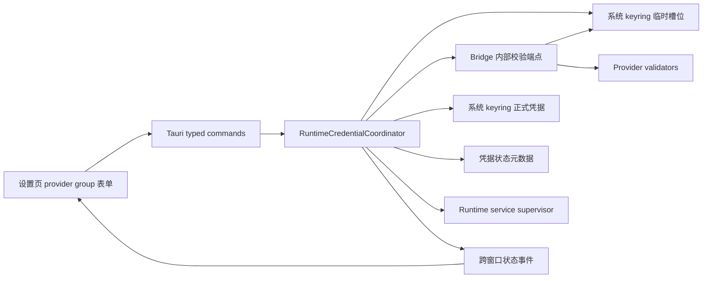
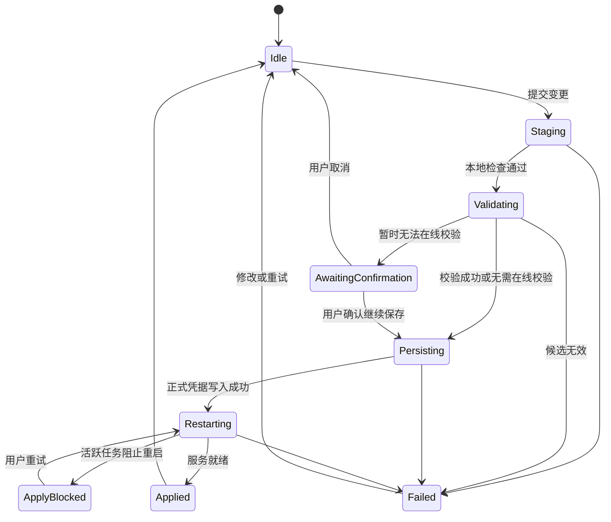

# 运行时凭据校验与应用反馈 · 技术方案

## 状态

CONFIRMED

## 1. 方案目标

本方案在既有 Tauri 桌面设置、系统 keyring、Python runtime config 和受治理的本机服务重启之上，增加一个按 provider group 工作的凭据协调层，解决三个相互独立的问题：

1. 凭据是否已经保存，以及当前使用哪个来源；
2. 当前凭据是否有与其版本严格绑定的真实验证结论；
3. 新配置是否已经被对应本机服务加载。

设计不引入长期“未验证”状态。没有真实结论时只显示中性的“已配置”；只有实际验证成功才增加“已验证”，实际确认鉴权失败才显示“凭据有误”。保存、校验、应用和重启属于一次操作的过程状态，不与长期凭据状态混用。

## 2. 现状与约束

### 2.1 现有边界

- `frontend/src-tauri/src/runtime_config.rs` 负责凭据定义、来源状态、keyring 写入和按字段触发服务重启。
- `runtime_config` Python package 负责环境变量、keyring、legacy 配置的优先级和运行时读取。
- `runtime_services` 负责 Bridge 与语音服务的启动、停止、阻塞和就绪状态。
- 设置页当前逐字段保存，保存后直接给出“已保存并生效”反馈。
- Bridge 和 provider adapter 已经承担真实请求与错误归类，适合复用现有 SDK 做低副作用验证和运行时鉴权兜底。

### 2.2 必须保留的约束

- secret 仍只保存在系统 keyring，不进入普通设置文件、日志、诊断包或前端查询响应。
- 环境变量优先级、legacy 兼容和现有服务安全重启边界保持不变。
- 活跃 Agent run 或语音通话不能因保存设置被静默中断。
- 自动化验证不得调用真实第三方 API。
- 火山语音本期不做在线凭据校验，也不扩张出一套尚未盘点完整的语音能力矩阵。

## 3. 总体架构



新增 `RuntimeCredentialCoordinator` 作为一次 group 变更的唯一协调者。现有 `runtime_config` 保持底层定义、来源解析和 keyring 原语职责；设置页不再自行串联“逐字段写入 → 逐字段重启”。

## 4. 状态模型

### 4.1 Provider group

首批固定支持以下 group：

| group | 配置项 | 应用目标 | 本期在线校验 |
| --- | --- | --- | --- |
| `deepseek` | DeepSeek API Key | Bridge | 支持 |
| `kimi` | Kimi API Key | Bridge | 支持 |
| `tavily` | Tavily API Key | Bridge | 不支持 |
| `amap` | 高德 Web Service Key | Bridge | 不支持 |
| `qweather` | 和风天气凭据与 host | Bridge | 不支持 |
| `volc_voice` | 火山语音现有凭据字段 | Voice | 跳过 |

group registry 复用现有字段定义和 required/optional 规则，不新增独立、可能漂移的字段清单。单字段 group 与多字段 group 使用相同事务入口。

### 4.2 长期凭据状态

`CredentialGroupSnapshot` 对前端返回以下事实，不返回任何 secret：

- `configured`：group 当前是否存在满足既有规则的配置；
- `source`：当前有效来源，例如 `environment`、`keyring` 或 `legacy`；
- `missing_required_fields`：缺少的必要字段名；
- `validation`：仅允许 `none`、`valid`、`invalid`；
- `validation_checked_at`：最近一次与当前版本匹配的检查时间；
- `validation_error_code`：稳定、非敏感的错误码；
- `application`：当前配置是否已被目标服务加载，或处于等待、阻塞、失败状态。

界面映射固定为：

| 事实 | 展示 |
| --- | --- |
| 未配置或必要字段不完整 | `未配置`，并列出缺少字段 |
| 已配置且没有匹配的验证结论 | `已配置` |
| 已配置且当前版本验证成功 | `已配置 · 已验证` |
| 当前版本被实际确认鉴权失败 | `凭据有误` |

`none` 是内部数据状态，不映射成“未验证”徽标。校验不支持、校验暂时不可用、旧版本结论失效或从未校验时都使用这一状态。

### 4.3 操作过程状态

一次 group 操作使用独立状态机：



`staging`、`validating`、`awaiting_confirmation`、`persisting`、`restarting`、`applied`、`apply_blocked`、`failed` 只描述当前操作。控件禁用时必须同时提供阶段和原因。

候选凭据被确认无效时，错误只挂在本次 draft/operation 上；正式凭据、正式凭据的验证状态和正在运行的服务均不改变。

## 5. 验证结果持久化

### 5.1 凭据版本

应用管理的 keyring 凭据每次成功变更后生成一个随机、非 secret 派生的 `credential_revision`。revision marker 使用保留的 keyring account 与正式凭据一起维护；验证元数据写入专用的 `runtime-credential-state.json`。

状态文件只包含：

- schema version；
- group id；
- 随机 credential revision；
- `valid` 或 `invalid`；
- 检查时间；
- 稳定、脱敏的结果码。

状态文件不得包含 secret 明文、前后缀、摘要、第三方原始响应或请求 header。写入使用临时文件加原子替换；解析失败时安全退化为 `validation = none`，不影响凭据读取。

### 5.2 结论绑定规则

- 只有状态文件 revision、keyring revision marker 和当前有效来源同时匹配时，才恢复持久化验证结论。
- 正式凭据被设置、删除、迁移、恢复或通过兼容入口改写时，必须更新 revision 并清除旧结论。
- 环境变量或 legacy 来源没有可安全追踪的内容版本，应用重启后只展示“已配置”，不恢复旧验证结论，也不展示“未验证”。
- 环境变量临时覆盖 keyring 时，不展示 keyring 的验证结论；覆盖解除且 keyring revision 仍匹配时，可以恢复该 keyring 凭据原有结论。
- 运行时鉴权失败事件只有携带的 group revision 与当前已应用 revision 匹配时，才能把当前结论更新为 `invalid`，避免旧请求污染新凭据。

所有项目内受治理的凭据写入口都必须经过统一 mutation helper；无法在本期移除的兼容入口至少要更新 revision/清除状态。直接从操作系统外部改写 keyring 不属于受支持入口，检测不到可靠版本时不得声称验证有效。

## 6. 候选 secret 的安全传递

### 6.1 边界选择

前端只把用户本次输入提交给受 capability 限制的 typed Tauri command。Tauri 响应、跨窗口事件和后续 Bridge HTTP 请求都不回显候选 secret。

Bridge 需要复用 Python provider SDK 完成校验，但候选 secret 不通过以下渠道传递：

- localhost HTTP body 或 query；
- 命令行参数；
- 进程环境变量；
- Tauri event、日志或错误文本。

### 6.2 临时 keyring 槽位

Tauri 将候选值写入按 group 固定命名的保留 keyring 临时槽位，并生成随机 operation id。Bridge 的生命周期令牌保护内部校验端点；请求只包含 group id 和 operation id。Bridge 通过与 Rust 侧兼容的 keyring service/account 规则读取临时值，与未改动的正式值合成候选 group snapshot。

每个 group 同时只允许一个写操作。固定槽位让应用启动时可以无枚举地清理残留；每次操作在写入前清理、在 `finally` 中清理，异常退出后的残留在下次启动继续清理。operation id 只用于拒绝过期响应，不作为 secret 或持久化验证版本。

### 6.3 正式写入与回滚

- 校验无效：不触碰正式 keyring。
- 校验暂时不可用：等待用户确认；取消则不触碰正式 keyring。
- 校验成功、无需在线校验或用户确认继续：按 group 一次提交正式变更。
- 多字段写入前在进程内保留最小范围的旧值用于回滚；写入失败时恢复已改字段，并返回 `persist_failed`。
- 正式字段全部成功后才更新 group revision 和验证元数据；任一步骤无法确认一致性时清除验证结论，安全退化为“已配置”。
- secret 值不得进入可格式化的通用错误对象；日志只记录 group、字段标识、阶段和稳定错误码。

## 7. Provider 校验策略

### 7.1 统一结果

内部 validator 只返回：

- `valid`：第三方明确接受凭据；
- `invalid`：明确的 401、403 或稳定 provider 鉴权错误；
- `temporarily_unavailable`：网络、超时、429、5xx 或无法可靠归因的响应；
- `unsupported`：本期没有安全、低成本、无业务副作用的在线校验方式。

原始响应正文不会透传给前端。只有 `invalid` 能阻止候选自动保存；`temporarily_unavailable` 进入用户确认，`unsupported` 直接按普通配置保存但不产生“已验证”。

### 7.2 各 provider 策略

| provider | 策略 | 说明 |
| --- | --- | --- |
| DeepSeek | 使用现有 OpenAI-compatible client 调用 models list | 不发 completion，不消耗模型 token；明确鉴权错误判 invalid |
| Kimi | 使用现有 OpenAI-compatible client 调用 models list | 与 DeepSeek 使用同一结果分类，不假设错误文案完全一致 |
| Tavily | `unsupported` | 通用账户没有适合所有用户的独立低副作用 key 校验接口 |
| 高德 | `unsupported` | 真实 Web Service 请求具有业务语义，权限/配额也可能造成歧义 |
| 和风天气 | 仅本地 host/必要字段检查，在线为 `unsupported` | 不为拿绿色状态发送真实天气查询 |
| 火山语音 | 跳过在线校验 | 只复用现有 required/optional 字段规则和应用反馈 |

DeepSeek 与 Kimi 的实现放在 `llm_providers`，通过可注入 client 测试，不新建第二套 HTTP client。外部接口依据：

- [DeepSeek · List Models](https://api-docs.deepseek.com/api/list-models)
- [Kimi · List Models](https://platform.kimi.com/docs/api/list-models)
- [Tavily · Key Info](https://docs.tavily.com/documentation/enterprise/key-info)
- [高德 Web Service 错误码](https://lbs.amap.com/api/web-service/tools/info)
- [和风天气错误码](https://dev.qweather.com/en/docs/resource/error-code/)

## 8. Bridge 内部接口

新增生命周期令牌保护的内部端点，例如 `POST /internal/runtime-credentials/validate`。请求和响应均为稳定的非 secret schema：

```text
request:  { group_id, operation_id }
response: { result, safe_code }
```

处理流程：

1. 校验 group allowlist、operation id 和生命周期令牌；
2. 从临时 keyring 槽位和当前正式来源组装候选 snapshot；
3. 执行既有 required/format 检查；
4. 对 DeepSeek/Kimi 调用 provider validator，其它 group 返回 `unsupported`；
5. 只返回稳定结果和安全错误码。

候选不完整属于本地 `invalid_candidate`，不等同于第三方鉴权失败。Bridge 未就绪时，在线校验结果为 `temporarily_unavailable`，由设置页给用户继续保存或稍后重试的选择。

## 9. 应用与服务重启

正式凭据写入后，coordinator 按 group effect 只调用一次目标 service supervisor：

- Bridge group：一次 Bridge restart；
- 火山语音 group：一次 Voice restart。

一次操作保留三个互不覆盖的事实：

- `persisted`：正式 keyring 是否已经写入；
- `validation`：是否有与新 revision 匹配的验证结论；
- `application`：目标服务是否已加载新 revision。

若活跃任务阻止重启，返回 `apply_blocked`，保留“已保存、尚未应用”，提供重试；不得回滚为“保存失败”。若重启失败，返回 `restart_failed` 并保留重试入口。应用启动后目标服务正常拉起并加载当前配置时，可以把旧的未应用操作收敛为 applied。

supervisor 启动 Bridge 时注入非敏感的已应用 group revision map。Bridge 后续报告鉴权失败时携带 group 与 revision，Tauri 只更新匹配版本，避免并发请求或旧进程造成误判。

## 10. 运行时鉴权兜底

`llm_providers` 的异常映射先检查 HTTP status 和 provider error type，再落入普通 bad request：

- 401、403 或稳定 `authentication_error` → `LLMAuthError`；
- 429 → rate limit；
- timeout/network/5xx → transient provider error；
- 内容安全和普通参数错误保持现有类别。

各 credential-bearing adapter 在能够明确识别鉴权错误时，向 Bridge 推送一个不含 secret 的 `runtime_credential_auth_failed` 事件，字段包括 group、applied revision 和 safe code。Tauri push subscriber 将匹配的当前凭据标记为 `invalid`，并通过统一状态事件通知所有窗口。

用户可见错误包含对应设置 group 的跳转动作。模型、搜索、地图和天气只在有明确鉴权证据时走该路径；模糊第三方错误仍保留原类别。火山语音的在线鉴权归类不在本期扩张范围内。

## 11. 前端交互

### 11.1 Group 表单

设置页把现有逐字段卡片改为 provider group 表单：

- 已存在的 secret 永不回显；空输入表示“不修改”；删除使用独立显式动作。
- 多字段 group 允许一次编辑后整体提交。
- 同一 group 操作期间禁用冲突操作，并在按钮或字段附近显示具体阶段和原因。
- 校验无效时保留用户 draft，正式配置状态仍显示旧凭据事实。
- 校验暂时不可用时显示一次明确确认：“当前无法完成校验，是否仍保存配置”；确认后长期状态只显示“已配置”。
- 不支持校验的 provider 可用辅助文案说明“将在实际使用时检查凭据”，不显示“未验证”徽标。
- 火山语音只显示已有字段完整性和保存/重启过程，不增加在线校验承诺。

优先复用现有 Button、Input、Badge、Alert/Dialog 等语义组件和设计 token；只有现有组件缺失时才按项目 UI 规范引入新通用组件。

### 11.2 跨窗口反馈

新增前端 runtime credential store：

- 首次加载查询 group snapshots；
- 监听 `runtime-credential://changed`；
- 保存当前 operation phase、disabled reason 和受影响服务；
- 设置页、对话页和语音相关界面共享同一事实来源。

当 Bridge 因配置应用正在重启时，对话输入区优先显示“正在应用模型/搜索等配置并重启对话服务”；当 Voice 因配置应用正在重启时显示对应语音原因。只有不存在配置操作上下文时才使用泛化的“本机服务未连接”。

设置导航支持携带 `group_id`，使运行时鉴权错误可以直接打开并定位对应配置组。

## 12. Tauri command 与事件契约

建议命令：

- `runtime_credential_group_snapshots()`：读取全部脱敏 group 状态；
- `apply_runtime_credential_group(command)`：提交 set/delete/unchanged 变更；
- `confirm_runtime_credential_save(operation_id)`：校验暂时不可用后确认继续；
- `cancel_runtime_credential_operation(operation_id)`：取消等待中的操作；
- `retry_runtime_credential_apply(group_id)`：重试被阻塞或失败的服务应用。

`apply` command 使用字段 allowlist 和 tagged mutation：`unchanged`、`set`、`delete`。返回值与 event 只包含 group snapshot、operation phase 和安全错误码，不返回输入值。

建议事件：

- `runtime-credential://changed`：group snapshot 或 operation 更新；
- 既有 `runtime-service://changed` 继续表达服务自身状态，不承载 secret 或凭据 draft。

## 13. 模块与文件落位

### 13.1 Rust / Tauri

- 新增 `frontend/src-tauri/src/runtime_credentials/`：model、coordinator、state store、keyring staging 和 command。
- `frontend/src-tauri/src/runtime_config.rs`：保留下层 registry/source/keyring 原语，写入口接入统一 mutation helper。
- `frontend/src-tauri/src/runtime_services/`：支持一次 group apply 的 service context 和非敏感 revision map。
- `frontend/src-tauri/src/paths.rs`：增加凭据状态文件路径。
- `frontend/src-tauri/src/push_subscriber.rs`：消费运行时鉴权失败事件。
- `frontend/src-tauri/src/lib.rs`：manage coordinator、注册命令和启动时清理临时 keyring 槽位。

### 13.2 Python

- `runtime_config`：集中 group 定义、临时 keyring account 和 revision marker 规则，兼容写入口清除旧验证绑定。
- `llm_providers`：新增 provider validator，修正 401/403 与 auth error 映射。
- `agent_bridge`：新增内部校验 route、运行时鉴权事件和安全用户错误映射。

### 13.3 Frontend

- 扩展 `frontend/src/lib/runtime-config/` 的 typed contract。
- 新增 runtime credential store 和 provider group 表单组件。
- 更新设置导航、设置页和受影响的对话/语音 disabled reason。
- 删除逐字段保存成功即宣称“已生效”的旧路径。

具体拆分跟随相邻模块风格；不为六个固定 group 提前建设通用 provider 插件系统。

## 14. 并发、恢复与兼容

- coordinator 对同一 group 串行化；不同 group 可以并行，但同一目标服务的 restart 由 supervisor 合并或排队，避免并发重启。
- operation id 防止旧校验响应覆盖新 draft。
- 应用退出、命令取消和异常路径都清理临时 keyring 槽位；启动时再次清理固定槽位。
- 旧 keyring 凭据首次升级没有 revision marker，按“已配置”显示；用户下一次通过受治理入口保存后开始版本化。
- legacy migration、备份恢复和删除操作更新 revision 或清除验证元数据，绝不继承无法证明对应关系的绿色状态。
- 新状态文件损坏、缺失或版本未知时不阻塞服务启动，只降级为中性“已配置”。
- 环境变量覆盖继续只读；设置页明确显示覆盖来源和“保存值尚未成为当前生效来源”。

## 15. 错误模型

面向前端使用稳定错误码，文本由前端本地化：

| code | 含义 | 是否改正式凭据 |
| --- | --- | --- |
| `invalid_candidate` | 必要字段或本地格式不满足 | 否 |
| `credential_rejected` | provider 明确拒绝候选凭据 | 否 |
| `validation_unavailable` | 网络、限流或第三方暂不可用 | 等待用户确认 |
| `persist_failed` | 正式 keyring 写入失败或回滚 | 否，或恢复旧值 |
| `apply_blocked` | 活跃任务阻止重启 | 是，尚未应用 |
| `restart_failed` | 新服务未就绪 | 是，尚未应用 |
| `credential_auth_failed` | 当前运行凭据被明确拒绝 | 不改 secret，标记 invalid |

provider 原始消息仅用于受控诊断日志的非敏感归类，不直接呈现或持久化。

## 16. 测试与验证

### 16.1 自动化测试

- Python validator：DeepSeek/Kimi valid、401/403、auth type、429、5xx、timeout、模糊 4xx；使用 fake client。
- Bridge route：token/group 校验、临时 keyring 读取、本地字段检查、结果脱敏；使用 fake keyring/validator。
- Rust coordinator：set/delete/unchanged、同组一次重启、无效候选保留旧值、暂时不可用确认、持久化失败回滚、staging 清理、revision 匹配与失效、环境变量覆盖、迁移清理、重启阻塞与重试。
- Runtime error mapping：鉴权、限流、网络、内容安全和普通参数错误互不误判；旧 revision 事件不污染当前状态。
- Frontend：徽标语义、无长期“未验证”、多字段 draft、各 operation phase、disabled reason、跨窗口 store、设置 group 跳转。
- 所有 fixture 使用明显假 secret，并断言 command/event/log/state file 不包含输入 secret。

### 16.2 项目验证

- 运行受影响模块的局部测试和 `scripts/check` 全量门禁。
- 运行 Windows installer contract 分类，因为改动触及 runtime service / frozen runtime 边界；根据机器输出的影响等级执行对应验证，不自行降低门槛。
- 预计 Python 变更为现有依赖上的纯业务逻辑，默认属于 standard frozen-runtime 影响，不主动构建安装包；若 contract 提升影响等级则按规则执行。
- 前端实现完成后先询问用户是否进行真实 Tauri 桌面视觉验收；未经确认不以 web 预览冒充桌面端结论。
- 不运行真实 DeepSeek、Kimi、Tavily、高德、和风天气或火山语音请求。

## 17. 验收映射

| 需求 AC | 方案落点 |
| --- | --- |
| AC-1、AC-4、AC-5 | 长期状态与操作状态分离、候选 staging、确认流程 |
| AC-2、AC-3、AC-7 | provider 校验策略表 |
| AC-6 | group registry、单次事务和单次 restart |
| AC-8、AC-9、AC-11 | coordinator 状态机、跨窗口 store、service apply context |
| AC-10 | source-aware snapshot 与环境变量覆盖规则 |
| AC-12 | runtime auth event、revision 匹配和错误映射 |
| AC-13 | keyring staging、脱敏 schema、状态文件约束 |
| AC-14、AC-15 | fake-based 测试矩阵、全量门禁与兼容策略 |

## 18. 已放弃的方向

- **长期显示“未验证”**：会把“没有证据”错误塑造成异常状态，用户无法据此采取明确行动。
- **只保存在内存**：应用重启会丢失真实成功/失败结论，绿色状态与错误提示反复跳变。
- **保存 secret 摘要用于绑定**：没有必要增加可关联 secret 的持久化材料；应用管理的 keyring 凭据使用随机 revision，无法可靠版本化的来源安全降级为中性状态。
- **候选 secret 通过 Bridge HTTP 传输**：扩大 secret 出现在序列化、日志和中间件中的风险面。
- **为所有 provider 发真实业务请求**：地图、天气、搜索和语音可能产生业务副作用、配额消耗或权限歧义，不能为了统一绿色状态而强行校验。
- **逐字段保存并重启**：无法保证多字段配置一致性，也会重复触发服务重启。

## 19. 变更记录

| 日期 | 变更内容 |
| --- | --- |
| 2026-08-20 | 初版确认：按 group 协调保存、验证和应用；采用 keyring staging、随机凭据 revision 和持久化验证元数据；取消长期“未验证”；火山语音跳过在线校验。 |
