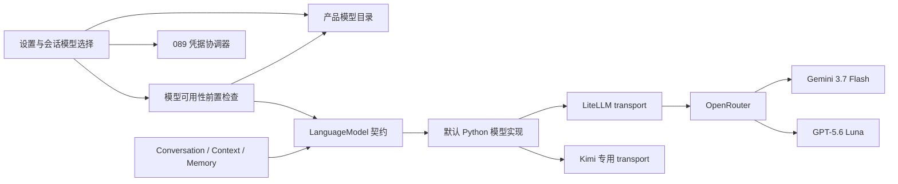

# OpenRouter 模型渠道接入与调用层解耦 · 技术方案

## 状态

CONFIRMED

## 需求文档

[requirement.md](./requirement.md)

## 1. 方案目标

本方案同时完成两个相互支撑、但所有权不同的目标：

1. 将 OpenRouter 作为新的模型调用渠道接入产品目录、凭据管理和现有对话链路；
2. 建立一层薄的项目自有模型调用契约，使 Agent 核心不再依赖具体 `LLMClient`、`ProviderSpec` 或第三方模型 SDK。

外部模型基础设施只负责把一次明确的模型请求送到上游并返回结果。agent-friend 继续拥有模型选择、能力声明、凭据生命周期、请求策略、错误语义、工具循环、审批、上下文、记忆、会话事件、持久化和恢复。不得借本需求把产品语义交给 LiteLLM、OpenRouter 或其它 Agent SDK。

## 2. 设计原则与所有权边界

| 能力 | 所有者 | 说明 |
| --- | --- | --- |
| 产品模型 ID、展示名称、默认模型、能力与限制 | agent-friend | 本地静态目录是运行时事实源 |
| 主对话、记忆和会话模型选择 | agent-friend | 不由 SDK 默认值或 OpenRouter 在线目录决定 |
| 凭据保存、校验、版本、应用和失效 | agent-friend | 复用需求 089 的 coordinator |
| Agent 工具循环、审批、预算、恢复和持久化 | agent-friend | 不迁移到外部 Agent loop |
| 项目模型请求、流事件、usage、错误和取消契约 | agent-friend | 上层只依赖该契约 |
| Provider SDK 参数与响应兼容 | LiteLLM 适配层 | 隐藏在项目模型实现内部 |
| OpenRouter 同一模型的上游端点选择 | OpenRouter | 允许基础设施容灾，不允许更换模型 |
| 模型推理与计费 | OpenRouter 及其上游 provider | 产品只消费结果和安全诊断元数据 |

本需求只做满足当前真实扩展点的依赖倒置与职责拆分，不建设运行时插件系统、动态 provider registry 或第二套 Agent 框架。

## 3. 现状分析

### 3.1 已有可复用边界

- `llm_providers/catalog.py` 已集中管理 provider、模型、LiteLLM model ID、上下文窗口和产品能力。
- `ProviderSpec` 已把绑定凭据后的传输配置收拢到一个值对象。
- `LLMStreamEvent`、`LLMUsage`、`LLMResponseDiagnostics` 和 `LLMError` 已经是项目自有类型。
- `litellm_transport.py`、`kimi_transport.py` 和 `cancellable_stream.py` 已将部分传输细节从主客户端中提取。
- 需求 089 已提供 provider group、候选 secret staging、在线校验、版本绑定、安全应用和跨窗口反馈。
- `/v1/models/catalog` 与 `/v1/models/validate` 已承担产品目录和选择前置检查。

### 3.2 当前耦合

- `Conversation`、`SessionManager`、Memory、Bridge assembly 和大量测试直接标注或强制转换为具体 `LLMClient`。
- `Conversation._iter_model_stream()` 通过 `isinstance(client, LLMClient)` 决定是否传递取消与诊断参数。
- `Conversation._uses_kimi_prompt_cache()` 读取 `client.spec.model`，把 provider 特有请求策略泄漏到 Agent 核心。
- `MultimodalInputAdapter` 直接读取 `LLMClient.spec` 取得模型路由和凭据。
- `agent_bridge.runtime_config` 向外暴露 `ProviderSpec`，Bridge 装配与测试知道传输层配置。
- `client.py` 同时承担原始请求、传输选择、重试、usage 解析、错误归一化、流 chunk 解释和诊断，继续增加 provider 会扩大单文件职责。
- 前端通过模型 ID 字符串前缀推断 credential group，新增 OpenRouter 后会形成第三个手写分支。

## 4. 总体架构



`LanguageModel` 是上层唯一调用边界。LiteLLM 仍是默认 Python 传输兼容层，但它的对象、异常和模型命名不进入 Agent 核心。

## 5. 项目自有模型调用契约

### 5.1 公共类型

在 `llm_providers` 中新增 provider-neutral 协议模块，核心形态如下：

```python
@dataclass(frozen=True)
class ModelCallControl:
    cancel_check: Callable[[], None] | None = None
    diagnostic_callback: Callable[[LLMTransportDiagnostic], None] | None = None


@dataclass(frozen=True)
class ModelRequest:
    messages: list[dict[str, Any]]
    tools: list[dict[str, Any]] | None = None
    settings: Mapping[str, Any] = field(default_factory=dict)
    cache_key: str | None = None
    control: ModelCallControl = field(default_factory=ModelCallControl)


@dataclass(frozen=True)
class ModelResponse:
    text: str
    usage: LLMUsage | None = None
    diagnostics: LLMResponseDiagnostics | None = None


class LanguageModel(Protocol):
    @property
    def context_window(self) -> int: ...

    def generate(self, request: ModelRequest) -> ModelResponse: ...

    def stream(self, request: ModelRequest) -> Iterator[LLMStreamEvent]: ...


LanguageModelFactory = Callable[[str], LanguageModel]
```

设计约束：

- `messages` 和 `tools` 仍使用项目当前已经稳定消费的规范化字典，不在本需求重写完整消息领域模型。
- `settings` 只承载上层确实需要的 provider-neutral 调用设置，例如输出 token 上限；provider 特有默认值由目录与具体实现合并。
- `cache_key` 表达“本轮有一个稳定会话缓存键”的通用意图。具体实现支持时再映射到 provider 参数，Conversation 不判断 Kimi 或 OpenRouter。
- 取消与无内容诊断通过显式 `ModelCallControl` 传入，不再使用 `_cancel_check`、`_diagnostic_callback` 私有 kwargs。
- 模型身份继续由 session model ID 与产品目录拥有。模型调用对象不反向决定当前会话选择。
- 现有 `LLMStreamEvent` 和 `LLMError` 已是项目自有协议，本期保留命名和语义，避免无价值的全仓重命名。

### 5.2 上层迁移

- `Conversation`、`_RunModelSnapshot`、`RuntimeContext`、`SessionManager` 和 Bridge runtime factory 改依赖 `LanguageModel` / `LanguageModelFactory`。
- Context summarizer 和 Memory extractor 改用 `generate(ModelRequest)`。
- Conversation 的模型请求统一构造 `ModelRequest`，工具、settings、cache key、取消和诊断只有一个入口。
- 日志和诊断需要产品模型 ID 时读取当前 session/model selection，不读取 `ProviderSpec`。
- 测试 fake 直接结构化实现 `LanguageModel`；删除为通过类型检查而存在的 `cast(LLMClient, fake)`。
- `DeferredLLMClient` 改为 provider-neutral 的延迟模型代理，不暴露 `.spec`。

### 5.3 多模态适配边界

`Conversation` 的 message renderer 参数改为 `LanguageModel`，不再导入具体客户端。Kimi 上传和文件提取仍属于 `llm_providers.multimodal` 内部实现，可以在该包内部访问受控传输上下文；这一能力不得暴露 secret 或 `ProviderSpec` 给 Agent。

OpenRouter 两款模型在本期保持 `text-only-v1` processing profile，因此不会进入 Kimi 附件上传路径。后续若开放 OpenRouter 多模态，应新增对应 processing profile 和 adapter，而不是只修改目录中的 capability 布尔值。

## 6. 默认模型实现与职责拆分

### 6.1 默认实现

现有 `LLMClient` 作为 `LanguageModel` 的默认实现继续存在于 `llm_providers` 内部。它负责：

- 合并 provider 默认设置与单次请求设置；
- 将通用 cache key 映射到当前 route 支持的参数；
- 选择 LiteLLM 或已存在的 Kimi 专用 transport；
- 只在没有业务事件产出时进行有限安全重试；
- 将原始响应归一化为项目流事件、usage、诊断和错误。

生产上层不再导入或检查这个具体类。

### 6.2 `client.py` 拆分

本需求新增两个明确的内部模块：

| 模块 | 职责 |
| --- | --- |
| `protocol.py` | `LanguageModel`、`ModelRequest`、`ModelResponse`、`ModelCallControl` 与 factory 类型 |
| `error_normalization.py` | provider 错误元数据抽取、OpenRouter typed error/availability 解析和项目错误映射 |
| `usage.py` | 非流式与流式 usage、cache token 字段归一化 |

`client.py` 保留调用编排、重试和流事件生成。`litellm_transport.py`、`kimi_transport.py` 与 `cancellable_stream.py` 保持各自现有责任，不提前建设 transport registry。

## 7. OpenRouter 产品目录与路由

### 7.1 Provider 定义

新增：

- provider/channel ID：`openrouter`；
- display name：`OpenRouter`；
- credential：`OPENROUTER_API_KEY`；
- 默认主对话模型：`openrouter/google/gemini-3.7-flash`；
- 默认记忆模型：`openrouter/openai/gpt-5.6-luna`。

模型目录：

| 产品模型 ID / LiteLLM model | 展示名 | Context window | 本期能力 |
| --- | --- | --- | --- |
| `openrouter/google/gemini-3.7-flash` | `Google · Gemini 3.7 Flash` | `1,048,576` | text、tools、parallel tools |
| `openrouter/openai/gpt-5.6-luna` | `OpenAI · GPT-5.6 Luna` | `1,050,000` | text、tools、parallel tools |

两款模型都使用 `text-only-v1` processing profile；上游宣称的 image/file/audio/video 能力本期不对产品开放。

### 7.2 产品目录字段

`ProviderDefinition` 增加明确的 `credential_group`。`public_model_catalog()` 在 provider 项上返回 `credentialGroup`，前端据此完成选择前置检查、运行时鉴权 revision 捕获和设置跳转。

前端 `ModelProvider` / Rust `ModelProvider` 增加 `openrouter`。现有持久化 `ModelSelection { provider, model }` 形态不变，不需要 settings schema migration。

### 7.3 OpenRouter 请求策略

OpenRouter route 默认设置：

```json
{
  "provider": {
    "require_parameters": true,
    "data_collection": "deny"
  }
}
```

- LiteLLM model 使用完整 `openrouter/<author>/<model>`。
- 不传 `models` 候选数组，不使用 `openrouter/auto`，不实现应用层跨模型 fallback。
- 保留 OpenRouter 对同一个模型的 provider endpoint fallback；它只改变底层基础设施，不改变产品模型 ID、价格档位或能力声明。
- 当 `require_parameters`、隐私约束或地域条件筛掉所有 endpoint 时明确失败，不静默降低约束。

## 8. OpenRouter 凭据生命周期

### 8.1 配置注册

以下层级同步增加 OpenRouter：

- Python `runtime_config`：常量、`ALL_CREDENTIAL_NAMES`、bundle 和 group alias；
- Tauri `RuntimeConfigGroup`、`SECRET_REGISTRY`、required fields、validation support 和 group iteration；
- 前端 `RuntimeConfigGroup`、`RuntimeSecretName`、设置 group 与 helper 文案；
- Bridge staged credential route 的 required field 和 validator 路由。

group ID 固定为 `openrouter`，secret 固定为 `OPENROUTER_API_KEY`，effect 为 `RestartBridge`。

### 8.2 在线校验

OpenRouter 不复用公开 `/models`。新增 validator 使用：

```text
GET https://openrouter.ai/api/v1/key
Authorization: Bearer <candidate>
```

只消费 HTTP 状态，不保存或返回响应中的 label、usage、limit、余额等账户元数据：

| 结果 | 归类 |
| --- | --- |
| 200 | `valid / credential_accepted` |
| 401 | `invalid / credential_rejected` |
| 429 | `temporarily_unavailable / provider_rate_limited` |
| 5xx、timeout、network | `temporarily_unavailable` |
| 其它状态 | 默认 `temporarily_unavailable`，不凭猜测使 Key 失效 |

实现使用 `httpx` 的受注入 client/transport 以便确定性测试。`llm_providers` 显式声明直接依赖，不依赖偶然的传递依赖。

## 9. 选择前置检查与设置交互

### 9.1 模型设置

- 主对话和记忆模型区域的标签由“供应商”改为“调用渠道”。
- 选择任一新 selection 前先调用 `/v1/models/validate`。
- 只有前置检查成功才写入 Tauri settings 并触发 Bridge 重启。
- `credential_missing` 时保持原 selection，不产生短暂错误持久化；toast 提供定位到 OpenRouter 凭据 group 的操作。
- 其它非模型设置中的“供应商”文案保持不变。

### 9.2 会话模型切换

现有服务端 `validate -> switch` 顺序保持。前端从 model catalog 的 `credentialGroup` 找到 OpenRouter group，不再通过 `startsWith()` 硬编码渠道。

运行开始前捕获当前 credential revision；只有 `auth_failed` 才回报 runtime auth failure。额度、permission、content policy 和 routing constraint 错误不得污染凭据验证状态。

## 10. Provider-aware 错误归一化

### 10.1 新增错误类别

项目错误体系增加能够被协议层稳定区分的类别：

- `LLMPaymentRequiredError`：账户或 Key 额度不足；
- `LLMPermissionError`：Key 有效但权限不足、guardrail 阻止或区域限制；
- `LLMModelUnavailableError`：明确模型无满足约束的 endpoint，并携带安全的 retryable/availability code；
- 现有 `LLMContentPolicyError`、`LLMRateLimitError`、`LLMTransientProviderError` 继续使用。

### 10.2 OpenRouter 归类顺序

优先使用稳定 typed error 与 availability 字段，HTTP status 只作次级证据：

| OpenRouter 证据 | 项目错误 | 是否使凭据失效 |
| --- | --- | --- |
| `authentication` / 401 | `LLMAuthError` | 是 |
| `payment_required` / 402 | `LLMPaymentRequiredError` | 否 |
| `permission_denied` / 403 | `LLMPermissionError` | 否 |
| `content_policy_violation` | `LLMContentPolicyError` | 否 |
| `rate_limit_exceeded` / 429 | `LLMRateLimitError` | 否 |
| `provider_overloaded`、retryable availability | `LLMTransientProviderError` | 否 |
| privacy/constraint/no-endpoint availability | `LLMModelUnavailableError` | 否 |

原有 DeepSeek/Kimi 行为不因 OpenRouter 的 403 语义被全局改坏。错误 mapper 接收当前 provider/channel 上下文，允许不同渠道采用明确、可测试的分类策略。

### 10.3 中途流错误

OpenRouter 可能在 HTTP 200 流中发送顶层 `error`。流归一化必须覆盖两种实际形态：

- LiteLLM 将其转换为异常；
- LiteLLM 将 error chunk 交给调用方。

两种形态最终进入同一 provider-aware error mapper。已经产出文本或工具增量后不得自动重放请求，避免重复文本或工具调用。

Bridge 协议映射增加独立用户错误码与安全文案，例如 `payment_required`、`permission_denied` 和 `model_route_unavailable`。

## 11. 迁移顺序

1. 新增项目模型协议、错误/usage 内部模块和对应单测；默认实现保持行为等价。
2. 将 Agent、Context、Memory、SessionManager、Bridge assembly 与 eval proxy 迁移到 `LanguageModel`；移除具体类型判断和 `ProviderSpec` 泄漏。
3. 把 cache key、取消和诊断统一放入 `ModelRequest`。
4. 增加 OpenRouter 目录、route 默认策略和 provider-aware error 解析。
5. 扩展 Python/Tauri/前端 credential group 与在线校验。
6. 增加设置与会话选择前置检查、具体 group 跳转和错误反馈。
7. 完成回归、后端/前端/Rust 门禁和冻结 runtime 验证。

每一步保持测试可运行；不得先加入 OpenRouter 专用 Conversation 分支再“以后重构”。

## 12. 涉及文件

| 路径 | 改动类型 | 说明 |
| --- | --- | --- |
| `llm_providers/src/llm_providers/protocol.py` | 新增 | 项目模型调用契约 |
| `llm_providers/src/llm_providers/error_normalization.py` | 新增 | provider-aware 错误归一化 |
| `llm_providers/src/llm_providers/usage.py` | 新增 | usage 与 cache token 归一化 |
| `llm_providers/src/llm_providers/client.py` | 重构 | 实现项目协议，保留编排/重试/流事件 |
| `llm_providers/src/llm_providers/catalog.py` | 修改 | OpenRouter 目录、credential group、route defaults |
| `llm_providers/src/llm_providers/credential_validation.py` | 修改 | OpenRouter `/key` 校验 |
| `llm_providers/src/llm_providers/multimodal/adapter.py` | 修改 | 上层类型改为 provider-neutral |
| `llm_providers/pyproject.toml`、`uv.lock` | 修改 | 显式声明 httpx 直接依赖；锁文件按实际解析结果更新 |
| `runtime_config/src/runtime_config/` | 修改 | OpenRouter secret 与 bundle |
| `agent/src/agent/conversation.py`、`agent/src/agent/context/`、`agent/src/agent/sessions/` | 重构 | 只依赖 LanguageModel |
| `memory/src/memory/` | 重构 | 记忆抽取使用 ModelRequest/ModelResponse |
| `agent_bridge/src/agent_bridge/runtime_config.py`、`assembly.py` | 重构 | provider-neutral factory 与延迟代理 |
| `agent_bridge/src/agent_bridge/runtime_credentials.py`、`routes/models.py`、`errors.py` | 修改 | OpenRouter 校验、目录前置检查与错误映射 |
| `frontend/src-tauri/src/runtime_config.rs`、`runtime_credentials/`、`settings.rs` | 修改 | OpenRouter group、secret 与持久化枚举 |
| `frontend/src/lib/model-config/`、`runtime-config/`、`settings/` | 修改 | catalog credentialGroup 与 OpenRouter 类型 |
| `frontend/src/pages/settings/components/RuntimeConfigPanel.tsx` | 修改 | 调用渠道文案、OpenRouter group、选择前置检查 |
| `frontend/src/pages/chat/components/ConversationModelSelector.tsx`、`stores/conversation.ts` | 修改 | 精确凭据 group 路由与错误操作 |
| 对应 Python/TypeScript/Rust tests | 修改/新增 | 协议、目录、凭据、错误、选择与回归 |

## 13. 验证方案

### 13.1 确定性测试

- LanguageModel contract：fake 无具体客户端继承或 cast，覆盖 generate、stream、tool delta、usage、error 和 cancel。
- Conversation：取消和诊断总是通过 `ModelCallControl`；cache key 不包含 provider 分支。
- Catalog：OpenRouter 两款模型、上下文、默认用途、text-only 能力、credentialGroup 和公开 schema。
- LiteLLM request：精确 model ID、tools、`require_parameters`、`data_collection`，且没有 model fallback 数组。
- Error mapping：401、402、403 permission、403 content policy、429、503、availability 与 mid-stream error。
- Credential validation：200、401、429、5xx、timeout、network；响应账户元数据不落盘、不透出。
- Tauri credential coordinator：OpenRouter staging、验证、保护旧值、revision、单次 Bridge restart 和 runtime auth failure。
- Frontend：模型始终可见；缺凭据时不持久化并定位 group；成功时才保存/切换；错误码只在 auth_failed 时使 revision 失效。
- Regression：DeepSeek、Kimi、附件、记忆抽取、上下文压缩、工具循环、模型切换和中断恢复。

### 13.2 项目门禁

- 运行受影响的 Python、frontend 与 Rust 局部测试。
- 运行 `scripts/check/run.ps1` 全量门禁。
- `llm_providers` 新增直接依赖并新增安装包内用户能力，按 frozen runtime 规则运行：

```powershell
.\scripts\package\run.ps1 runtime --local-test --verification-level package-sensitive
```

该验证只构建本地测试 runtime，不构建完整安装器。

### 13.3 真实模型验证

自动化测试不调用真实 LLM。若实现完成后需要验证 Gemini 3.7 Flash 与 GPT-5.6 Luna 的真实流式工具调用，按 `llm-api-confirm` 单独说明模型、调用轮数和目的，并取得本次授权后执行。

## 14. 风险与控制

| 风险 | 控制 |
| --- | --- |
| Protocol 只换类型、provider 分支仍在 Conversation | 测试禁止具体类型判断，并移除 Kimi cache 分支 |
| 过度抽象成插件框架 | 只有一个 LanguageModel port 和当前需要的实现，不做动态注册 |
| OpenRouter 403 误伤凭据状态 | typed error 优先，只有 authentication/401 失效 |
| 聚合平台模型能力漂移 | 本地静态目录 fail-closed；升级目录需显式需求/变更 |
| OpenRouter 隐私约束造成无 endpoint | 明确报 route unavailable，不静默放宽 |
| 中途流错误导致重复工具调用 | 有业务事件后禁止自动重试 |
| 直接依赖与冻结包不一致 | 更新 dependency policy，并执行 package-sensitive runtime smoke |
| 解耦重构破坏 Agent 语义 | 分阶段迁移，保留现有事件/错误协议并跑完整回归 |

## 变更记录

| 日期 | 变更内容 | 是否需要重新实现 |
| --- | --- | --- |
| 2026-08-20 | 首次确认方案；接入 OpenRouter 固定模型渠道，并建立薄 LanguageModel 契约，外部只拥有模型传输和供应。 | 是，新需求 |
