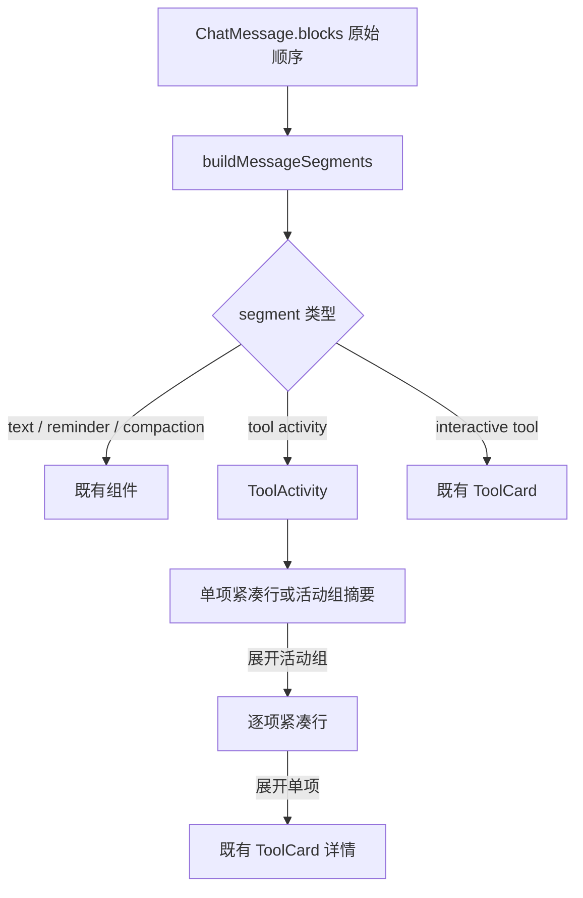

# 紧凑工具调用活动流 - 技术方案

## 状态

CONFIRMED

## 需求文档

[requirement.md](./requirement.md)

## 证据索引

[evidence-index.md](./evidence-index.md)

## 现状分析

桌面对话的领域消息由 `ChatMessage.blocks` 保存。助手一轮中的文本、工具、提醒和上下文压缩活动按事件到达顺序进入同一个块数组；实时路径由 `conversationReducer` 更新，历史路径由 `sessionProjection` 重建。

当前 `MessageList.MessageContent` 直接遍历 `message.blocks`：文本块交给 TDesign Chat 渲染，每个工具块立即渲染为一个 `ToolCard`。因此工具执行事件的粒度同时成为了视觉粒度，连续调用无法共享摘要或折叠入口。

`ToolCard` 已经包含多类领域化展示：

- 普通工具：状态标题以及可折叠的参数、结果；
- `skill_read`：Skill 名称、来源和加载原因；
- `request_filesystem_access`：路径、权限、破坏性动作和授权生命周期；
- `exec_command`：命令、目录、沙箱、网络、进程输出和停止操作；
- `request_social_auth`：独立轮询的登录生命周期和登录操作。

这些组件拥有真实交互和恢复语义，不能为了紧凑化复制一套简化状态机。新的活动层只负责决定默认信息密度、连续分组和渐进披露；展开后的详情继续复用现有领域卡片。

## 方案设计

### 涉及文件

| 文件路径 | 改动类型 | 说明 |
| --- | --- | --- |
| `frontend/src/pages/chat/components/toolActivityPresentation.ts` | 新增 | 纯函数：块分段、工具展示分类、单项摘要、活动摘要和内部聚合状态 |
| `frontend/src/pages/chat/components/toolActivityPresentation.test.ts` | 新增 | 覆盖分组边界、摘要、失败与交互型工具例外 |
| `frontend/src/pages/chat/components/ToolActivity.tsx` | 新增 | 单项与连续活动的受控折叠视图，逐项展开后挂载现有详情 |
| `frontend/src/pages/chat/components/ToolActivity.test.tsx` | 新增 | jsdom 覆盖键盘/点击展开、流式追加后的展开状态保持和可访问属性 |
| `frontend/src/pages/chat/components/MessageList.tsx` | 修改 | 从逐块直接渲染改为先派生展示 segment，再渲染正文、活动段和独立交互卡片 |
| `frontend/src/pages/chat/components/ToolCard.tsx` | 修改 | 明确作为完整详情/独立交互表面复用；提供活动层需要的嵌入入口，不改变现有动作语义 |
| `docs/requirements/091-compact-tool-call-activity/evidence-index.md` | 修改 | 记录方案决策、实现锚点和后续视觉/自动化证据 |

不修改 `frontend/src/types/chat.ts`、实时 reducer、历史投影、Bridge、Agent 工具协议或 session event 格式。

### 数据流与组件结构

`buildMessageSegments` 每次由当前 `message.blocks` 纯函数派生，不把 UI 展开状态写回领域消息，也不生成新的持久化实体。

### 展示 segment

渲染层使用内部联合类型：

- `block`：保留文本、提醒、上下文压缩等现有块及原始下标；
- `toolActivity`：一个或多个可紧凑呈现的工具块，保存首尾原始下标；
- `interactiveTool`：没有稳定 Dock 承接、仍需要独立领域表面的工具块；首版仅用于社交登录，保存原始下标。

每个 `toolActivity` 使用首个工具的 `toolCallId` 作为稳定 identity。单项后续追加为连续活动时，React key 不变化，`ToolActivity` 组件不会因为“1 项变 2 项”被替换，用户已经选择的展开状态可以保留。

segment 同时保存 `startIndex`、`endIndex`。现有消息 action bar 仍依据原始最后可渲染 block 判断；当最后一个工具落在活动段内时，action bar 继续显示在整个活动段之后，不进入某个工具详情。

### 分组与断段规则

按 `message.blocks` 从前到后扫描：

1. 任意非工具块结束当前工具活动。
2. 普通工具进入当前活动；没有活动时创建新的活动。
3. `request_filesystem_access` 和 `exec_command` 无论处于等待、运行还是终态，都进入相邻 `toolActivity`；自动授权与运行操作由输入框上方的稳定 Dock 独占，完整 `ToolCard` 只在用户主动展开时出现。
4. `request_social_auth` 始终作为 `interactiveTool`。其工具块会先完成，但真实登录生命周期由 `SocialAuthCard` 内部 REST 轮询推进；活动层没有足够事实安全判断何时压缩。
5. 除社交登录外，所有相邻工具都进入同一 `toolActivity`；成功、失败、拒绝、取消、超时、沙箱拒绝或运行时失联只影响展开详情，不参与分组边界判断。
7. malformed 或未知工具保持可渲染：默认进入普通活动，摘要使用中性兜底，详情继续展示原始名称、参数与结果。

`request_filesystem_access` 和 `exec_command` 的非成功终态除 `ToolBlock.status` 外，还读取当前结果中已有的结构化状态，避免把“协议已闭合”误显示成“业务成功”。解析失败时退回 `ToolBlock.status`，不影响渲染。

### 工具展示适配器

`toolActivityPresentation.ts` 只消费 `ToolBlock`，输出稳定的展示信息：

- `summary`：一行用户语言；
- `category`：用于活动组聚合；
- `status`：进行中、完成、警告或失败，只用于识别活动是否仍在运行和保留详情，不把失败信息带入终态摘要；
- `joinable`：能否与相邻工具合并；首版等价于 `!standalone`，不读取终态结果；
- `standalone`：是否需要对话流中的独立完整交互表面；首版仅社交登录为 true。

首版覆盖当前产品工具类别：

| 工具类别 | 代表工具 | 单项摘要方向 |
| --- | --- | --- |
| 网页与平台搜索 | `web_search`、`social_search`、`nearby_place_search` | 搜索网页、平台内容或附近地点；可安全取得时带截断后的查询词 |
| 内容与历史读取 | `web_fetch`、`social_read`、`recall_past_chats` | 查看网页、平台内容或过往对话 |
| 本地文件读取 | `filesystem_search`、`filesystem_list_directory`、`filesystem_stat`、`filesystem_read_text` | 查找、浏览或读取本地文件；摘要不暴露完整绝对路径 |
| 本地文件变更 | `filesystem_write_text`、`filesystem_apply_patch`、`filesystem_create_directory`、`filesystem_copy`、`filesystem_move`、`filesystem_delete` | 写入、修改、复制、移动或删除文件 |
| 命令运行 | `exec_command`、`write_stdin` | 运行本地命令或与进程交互；第一层不回显完整命令 |
| Skill | `skill_read` | 加载指定 Skill |
| 待办与时间 | `todo_manage`、`datetime_calculate` | 管理待办或处理日期时间 |
| 查询与计算 | `weather_query`、`calculate` | 查询天气或进行计算 |
| 其它 | 未知名称 | 执行一项工具操作；原始工具名只在详情中出现 |

摘要从已有参数中只选择低噪声、用户已经发起的关键对象，并归一化空白；不得在摘要中放完整命令、完整路径、JSON、长结果或 secret。摘要生成层不按字符数预截断，完整安全摘要交给 `TextEllipsis` 按真实渲染宽度决定是否省略。摘要完全由确定性代码生成，不调用模型。

多项活动摘要只区分是否仍在运行：

- 进行中：`正在执行 4 个步骤：搜索、读取内容…`；
- 已结束：`执行了 4 个步骤：搜索、读取内容`；
- 含非成功结果：仍使用相同的中性终态摘要，不提示或统计失败；展开后查看每项原始状态和原因。

类别去重后只展示有限的主要类别，其余用“等”收敛，避免工具数量多时摘要重新变成长列表。

### `ToolActivity` 交互

`ToolActivity` 同时承载单项和多项：

- 单项：默认显示一个紧凑 disclosure row；展开后显示现有 `ToolCard` 详情。
- 多项：默认显示一个组 disclosure row；展开后按原始顺序显示各单项紧凑 row；单项可再展开完整详情。
- 组与单项的 `open` 均使用受控 React state。block 状态、结果或组长度变化只更新文案，不写入 `open`。
- 默认均为收起；不因完成自动收起，也不因失败自动展开。状态变化不改变分组，终态统一使用中性摘要，原始结果只更新展开详情。
- 使用 Radix `Collapsible` 的语义按钮和 `aria-expanded`，配合可旋转 chevron；紧凑组和单项行不渲染 `StatusDot` 或右侧状态文案，避免长工具链形成重复状态噪声。
- 组摘要与单项摘要统一使用 `components/ui/TextEllipsis`，由其 `ResizeObserver` 按实际宽度测量溢出并在确有截断时提供 tooltip；活动根容器使用 `w-full`，不再用 `max-w-[85%]` 提前压缩可用宽度。
- 紧凑层采用轻量行与 hover/focus 背景，不沿用每项都有边框和大面积 padding 的完整卡片视觉。
- 展开内容才挂载或显示完整 `ToolCard`，确保现有授权、命令停止、登录、结果和恢复逻辑只有一个实现来源。

### 稳定授权与运行 Dock

`ApprovalDock` 是命令和文件工具唯一自动出现的完整实时操作表面：

- pending 命令展示 reason、完整 command、工作目录、模式与超时、执行级别、文件/网络权限、Skill 和附加范围，并提供拒绝/仅本次允许；
- pending 文件请求展示 reason、路径、请求权限和破坏性动作；
- 授权通过且命令进程运行时，原位切换为精简运行条，展示动作、命令、模式/耗时和停止按钮；
- pending 优先于 running，避免多个垂直操作表面争夺输入区；终态不留在 Dock；
- 对话内 `ToolActivity` 与 Dock 同时存在时，前者只承担持久活动记录，后者只承担当前动作，不复制完整卡片。

### 专用卡片复用

现有 `ToolCard` 继续拥有领域详情与交互。活动层只增加受控入口，不复制以下能力：

- 文件授权 broker 状态、路径与破坏性动作；
- 命令 approval/process store、沙箱准备、输出与停止；
- 社交登录 REST 轮询、二维码和动作按钮；
- Skill 来源和加载失败；
- 普通工具 malformed args/result 容错。

`ToolCard` 增加仅服务嵌入详情的展示变体，使其在第二级内容中使用可用宽度并减少重复外边距；业务状态、操作按钮和内部详情不因变体改变。

### 实时、历史与滚动

实时 reducer 与历史 projection 均继续生成相同 `ToolBlock`。分组只发生在 `MessageContent`，因此同一块序列自然得到相同结果。

消息虚拟列表已经通过 `virtualizer.measureElement` 重新测量动态高度。活动展开、收起和流式追加继续使用既有跟随策略：

- 用户仍在底部跟随时，高度变化维持底部可见；
- 用户已经向上浏览时，不因活动状态变化强制回到底部；
- 活动内部不另外调用 `scrollTo`，避免与消息列表争夺滚动所有权。

## 测试与验证

### 纯函数测试

- 单个普通工具形成一个单项 activity；
- 两个及以上连续普通工具形成同一 activity；
- 文本、提醒、压缩块和 interactive tool 正确断段；
- 运行中命令/文件授权保持 activity，完整实时操作只在 Dock；
- 社交登录保持 standalone；
- 失败、拒绝、取消、超时和 malformed 结果分类正确；
- 已知工具摘要、聚合类别、查询截断和未知工具兜底正确；
- 原始顺序、首尾下标和稳定 identity 正确。

### 组件测试

- 单项和多项默认收起并暴露正确 `aria-expanded`；
- 点击与键盘可以展开/收起；
- 单项从一项流式增长为多项后，用户已选择的 open 状态保持；
- 状态更新不会自动重置组或单项展开状态；
- 展开后按顺序出现逐项摘要和完整详情入口；
- interactive tool 继续渲染现有动作组件。

### 项目门禁

- 运行前端针对性测试；
- 运行项目 `scripts/check` 全量门禁；
- 不调用真实 LLM 或第三方服务。

### 桌面端视觉与交互验收

用户已于 2026-08-20 明确授权真实 Tauri 桌面端验收。实现和自动化门禁通过后，按 `desktop-visual-inspection` 使用项目标准脚本验证：

- 单个普通工具默认高度和详情展开；
- 连续普通工具的组摘要、两级展开和原始顺序；
- 命令或文件授权只在底部 Dock 突出，运行中命令停止入口可用，对话流不自动出现完整卡片；
- 完成后回落为紧凑记录；
- 连续的成功与非成功调用保持在同一活动组，摘要不提示失败，展开后能查看原始状态和原因；收起层不出现重复状态装饰；
- 长摘要只在占满活动行真实剩余空间后由公共 `TextEllipsis` 截断，不能在右侧仍有大块空白时提前显示省略号；
- 流式追加、手动展开和消息滚动没有明显跳动；
- 明暗主题以及代表性桌面窗口宽度下无横向溢出。

若真实服务或真实工具执行会产生外部副作用，优先使用项目已有 mock/dev-only 注入验证展示层，并明确标注其覆盖边界；不得把 mock 展示宣称为完整跨层 E2E。

## 影响分析

### 上下游影响

- 上游工具事件、`ToolBlock` 和专用 runtime store 不变。
- 下游只改变桌面对话 `MessageContent` 的展示组合；用户消息、助手正文、提醒、压缩反馈、搜索定位和消息 action bar 继续沿用现有路径。
- 历史会话不需要迁移；旧事件在新渲染层自动获得紧凑展示。
- IM、桌宠气泡、Agent 执行、记忆和上下文预算不受影响。

### 风险点

- **实时卡片闪现或重复**：命令/文件工具始终由 `ToolActivity` 渲染紧凑记录；`ApprovalDock` 直接消费 approval/process store 并独占自动实时操作，避免 conversation block 与 runtime store 状态传播不同步时切换完整卡片。
- **流式追加导致展开状态丢失**：单项和多项统一由 `ToolActivity` 承载，segment key 固定为首个 `toolCallId`，open 使用受控 state。
- **摘要泄漏或过长**：只使用白名单字段、截断用户可见对象，不展示完整命令、路径、结果或未知 JSON。
- **展开详情产生双重状态实现**：完整详情只复用 `ToolCard`，活动层不实现批准、拒绝、停止或登录动作。
- **动态高度影响虚拟滚动**：不新增内部滚动所有权，复用现有元素测量和 follow 状态，并在真实桌面端检查展开与流式更新。
- **未知工具不可读**：第一层使用中性摘要，第二层保留原始名称、参数和结果，避免为了漂亮标题丢失诊断信息。

## 变更记录

| 日期 | 变更内容 | 是否需要重新实现 |
| --- | --- | --- |
| 2026-08-20 | 初始技术方案；以渲染投影建立紧凑单项和连续活动，保留专用交互卡片与原始工具事件。 | 否，尚未开始实现 |
