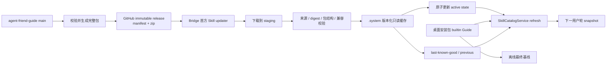
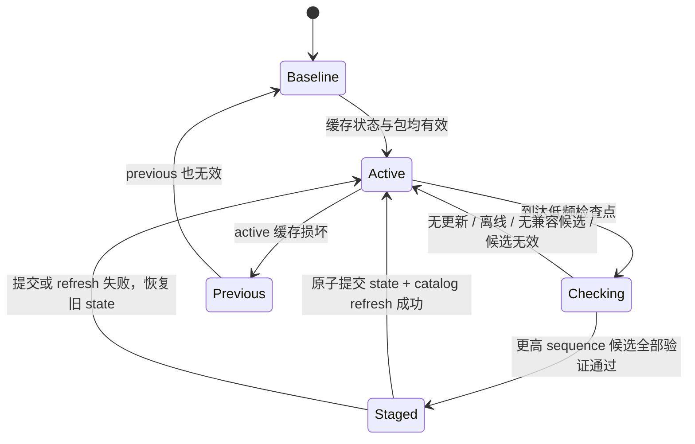

# 首方 Guide / Skill 独立自动更新 - 技术方案

## 状态

CONFIRMED

## 1. 设计目标

本方案把 `agent-friend-guide` 从“随桌面安装包固定分发的 builtin 快照”调整为“安装包提供离线
基线、客户端管理首方更新版本”的完整 Skill package。更新对象仍然是普通 Skill，允许包含
`SKILL.md`、references、scripts、assets、metadata 和其它正常资源；更新器只验证、缓存和切换包，
不会执行包内脚本，也不会扩大脚本日后运行时的权限。

首期固定管理一个首方 Skill，不引入通用来源发现、安装选择、第三方审核或 marketplace UI。实现边界
应允许以后用配置增加少量固定首方 Skill，但不预先建设插件平台。

## 2. 形态比较与结论

| 形态 | 优点 | 主要代价 | 结论 |
| --- | --- | --- | --- |
| 独立知识包 | 可以只围绕知识正文设计很小的下载器 | 会把 Skill 拆成“指令”和“资源”两套生命周期；scripts/assets 仍需另建契约；catalog 与命令快照要理解新类型 | 不采用。需求明确更新完整 Skill，新增知识层反而扩大模型 |
| 受管首方 Skill | 沿用现有 Skill 身份、loader、catalog 与轮次 snapshot；只新增受信发布、版本缓存和有效 root 选择 | 需要给 builtin catalog 增加受管版本 overlay，并管理本地状态 | 采用。它是满足完整包更新和会话一致性的最小闭环 |
| 轻量 marketplace | 天然支持多包发现、版本选择和更新策略 | 单一固定首方包不需要索引、搜索、安装选择、第三方信任与治理；会提前引入平台抽象 | 首期不采用。出现多来源发现或第三方分发需求后再单独立项 |

## 3. 总体架构



责任划分如下：

- Guide 仓库拥有内容、发布序号、兼容范围和不可变 release assets。
- 首方更新器拥有远端检查、验证、版本化缓存、有效版本状态和失败诊断。
- `SkillCatalogService` 只负责把“当前有效首方包”投影成既有 builtin Skill 身份并发布新 catalog。
- 现有 turn snapshot 和命令资源 snapshot 继续拥有轮次及命令执行期间的一致性。
- 桌面安装包继续拥有与该桌面版本一起验证过的最终离线 baseline。

## 4. 不可变发布契约

### 4.1 固定来源

首期客户端编译期固定：

- GitHub repository：`A1m233/agent-friend-guide`
- Skill name：`agent-friend-guide`
- Release tag：`agent-friend-guide-r<sequence>`，其中 `sequence` 为严格递增正整数
- Assets：`agent-friend-guide.manifest.json` 与 `agent-friend-guide.zip`

客户端只读取该固定 repository 的 GitHub Releases API，不接受远端 manifest 改写 owner、repository、
Skill name 或 asset 名称。只考虑 `draft=false`、`prerelease=false`、`immutable=true` 的发布。

Guide 仓库必须启用 immutable releases。发布采用“先创建 draft、上传完整 assets、再 publish”的顺序；
发布后 tag 和 assets 不可修改。客户端同时校验 Releases API 返回的每个 asset `sha256` digest，避免把
未验证的 CDN 下载直接当作模型指令。

### 4.2 Manifest schema

`agent-friend-guide.manifest.json` 为 UTF-8 JSON，首期 schema：

```json
{
  "schema_version": 1,
  "skill_name": "agent-friend-guide",
  "release_sequence": 12,
  "release_tag": "agent-friend-guide-r12",
  "source_commit": "40-char-full-sha",
  "package_sha256": "64-char-lowercase-hex",
  "package_snapshot_sha256": "64-char-lowercase-hex",
  "package_size": 123456,
  "min_product_version": "0.1.0",
  "max_product_version_exclusive": "1.0.0"
}
```

版本比较采用严格的三段 SemVer 核心版本 `MAJOR.MINOR.PATCH`；首期不接受缺段、通配符或 prerelease
范围。`min_product_version` 为包含下界，`max_product_version_exclusive` 为不包含上界。这样可以用一个
新的更高 `release_sequence` 发布与旧内容相同的 zip，表达受信的撤回或回退，同时仍拒绝旧发布状态
重放。

Release API 的 tag、target commit、manifest tag 和 sequence 必须相互一致。manifest zip digest/size 必须
与下载内容以及 Release API asset metadata 一致；`package_snapshot_sha256` 绑定解压后的路径与文件字节，
用于离线缓存复核。manifest asset 本身也必须匹配 Release API digest。

### 4.3 候选选择

更新器按 `release_sequence` 从高到低检查有界数量的最新稳定 immutable releases：

1. 跳过 tag 格式、assets 或 immutable 状态不合规的发布，并记录原因。
2. 下载并验证小型 manifest，筛选当前宿主版本兼容的候选。
3. 选择最高 sequence 的兼容候选；只有需要安装时才下载 zip。
4. 候选 sequence 小于或等于本机已见过的最高 sequence 时，不改变 active 状态。
5. 相同 sequence 但 release identity、manifest 或 digest 不同时视为冲突并拒绝。

“没有兼容版本”“远端没有发布”“网络失败”和“发布无效”分别记录，均不影响现有有效包。

## 5. 包验证与安全边界

候选包在 staging 中完成以下检查，全部通过后才能进入版本缓存：

- ZIP 仅含相对普通文件和目录；拒绝绝对路径、`..`、反斜杠混淆、符号链接和特殊文件。
- 限制下载字节、asset 声明大小、文件数量、单文件大小和解压总大小，避免压缩炸弹与磁盘滥用。
- archive 顶层必须直接是一个合法 Skill package；必须有 `SKILL.md`，name 为固定
  `agent-friend-guide`，且可被现有 `SkillLoader` 完整解析。
- 完整 zip SHA-256、字节数、GitHub asset digest 和 manifest 声明全部一致。
- `metadata/source.json` 继续记录该知识审阅对应的产品 commit/version，并按 Guide 发布工具的统一算法
  复核内容摘要；固定 Guide repository 与精确 Guide source commit 由产品内置配置和 release manifest
  绑定，不把两种来源身份混进知识审阅 metadata。
- 当前产品版本满足 manifest 兼容范围。

校验不限制正常文件类型，也不执行 scripts、hooks 或任意包内程序。首方身份只允许该包进入 builtin
catalog，不授予命令运行时额外能力。客户端信任锚是产品内固定 repository/Skill 身份，加上 GitHub
返回的 immutable release 状态和 asset digest；远程包不能自行声明一个新信任源。

本方案不试图防御已经获得该首方 GitHub repository 发布权限的主体发布恶意内容；这是首方发布权限
治理边界。它防止可变分支内容、非固定来源、普通未冻结 release、传输/缓存篡改、格式攻击和旧状态
重放直接进入模型上下文。

## 6. 本地版本缓存与状态机

受管内容位于 personal Skill 根下的隐藏系统区域：

```text
<skills>/.system/first-party/agent-friend-guide/
|-- state.json
|-- staging/
`-- versions/
    `-- <package_sha256>/
        `-- agent-friend-guide/
            |-- SKILL.md
            `-- ...完整 Skill package
```

整个 `<skills>/.system` 加入稳定的产品保护根，不能因某个版本当前是否 active 而变成模型可写路径。
版本目录以内容摘要命名，写入流程为“独立 staging → 完整校验 → 原子 rename”；已存在且复核通过的
同摘要目录直接复用。首期不自动清理历史目录，避免删除仍被当前轮、命令执行或另一运行实例引用的
路径。

`state.json` 使用原子替换，至少记录：

- schema version；
- `highest_seen_sequence` 及对应 release identity；
- active 与 previous 的 sequence、tag、source commit、package digest、compatibility；
- 最近检查时间、ETag、结果码和可诊断说明。

更新状态机：



启动时按 active → previous → packaged baseline 解析有效 root。state 损坏时不猜测扫描目录中的最高
版本，而是回到 baseline 并记录诊断，避免未提交的 staging 或未知缓存被提升。合法回退通过新的更高
sequence 完成，因此 `highest_seen_sequence` 单调增加；旧网络响应不能回退该值。

## 7. Catalog 与会话一致性

`SkillCatalogService` 不再把 builtin bundle 只作为一个根扫描，而是形成“每个 builtin package 一个
effective root”的列表：

- 普通 builtin Skill 指向当前安装包 fingerprint 下的 package 目录；
- `agent-friend-guide` 若有有效受管 active 版本则指向该 immutable version 目录，否则指向 packaged
  baseline。

两种路径都以 source=`builtin` 加载，因此 Skill ID 继续是 `builtin/agent-friend-guide`，不会产生新的
用户安装项或 duplicate precedence。切换完成后更新器显式请求 catalog refresh；隐藏 `.system` 仍由
watcher 忽略，避免半成品或状态文件变化触发扫描。

已经开始的用户轮持有原有 `SkillTurnSnapshot` 和 `SkillActivationSnapshot`；命令执行前对该轮记录的
immutable package root 再做完整资源快照。因此后台更新不会改变当前轮的正文或资源，refresh 后的下
一轮才取得新版本。版本目录不原地修改，保证 catalog snapshot 中的路径也具有内容一致性。

## 8. 更新生命周期与诊断

Bridge 组装一个独立的首方更新服务，并与 Bridge lifespan 同启停：

- Bridge 启动和 catalog baseline 初始化不等待网络。
- 后台任务在启动后进行一次检查，随后默认每 24 小时检查一次；失败使用下一正常周期，不做高频
  重试风暴。
- 所有 HTTP 请求有连接、读取和总字节上限；关闭 Bridge 时可取消等待与在途请求。
- 无 packaged build identity 时（普通源码开发）默认不联网更新，并记录
  `host_version_unavailable`；测试通过依赖注入指定宿主版本和 HTTP 响应。
- 使用 ETag/`If-None-Match` 避免重复传输 release 列表；304 和同一最高 sequence 均不刷新 catalog。

`/v1/skills` 的诊断扩展一个只读 `firstPartyUpdates` 摘要，包含当前来源（managed/baseline）、active
sequence/digest、最高已见 sequence、最近检查时间和结果码；日志不输出包正文。首期不增加更新 UI、
用户开关或手工选版。

## 9. 发布与桌面基线流程

Guide 仓库的同一确定性发布工具生成 manifest/zip 并完成已有 Guide 语义校验。两条发布入口等价：

- 产品常规合入中，`maintain-agent-friend-guide` 在确有知识变更时提交并推送 Guide，然后创建下一条
  immutable release；不再为了纯 Guide 内容更新同步产品 builtin 并制造产品提交。
- Guide 仓库的维护者可直接合入并运行同一发布流程；客户端不区分由哪个会话或 Skill 发起。

桌面 package-release 在构建新安装包前，把最新兼容 immutable Guide release 同步成 packaged builtin
baseline，并更新现有来源 manifest。这样新安装仍有较新的离线内容，但已安装客户端的日常内容更新
不依赖桌面打包。

本需求只调整上述职责，不修改 Guide 知识正文；支付宝相关内容保持在其它会话和分支。

## 10. 代码落点

- `agent/src/agent/skills/first_party_updates/`：发布模型解析、安全下载/解压、版本 store、状态机和后台
  service。
- `agent/src/agent/skills/service.py`：effective builtin roots、active override 和显式 refresh。
- `agent/src/agent/filesystem/policy.py` 与 Bridge assembly：保护稳定 `.system` 根，组装宿主版本和 updater。
- `agent_bridge` lifespan/routes：后台服务生命周期与只读诊断。
- `scripts/agent-friend-guide/`：完整包/manifest 构建、发布准备与 packaged baseline 同步。
- `.cursor/skills/maintain-agent-friend-guide/`、`package-release` 相关入口：迁移发布和打包职责，消除旧的
  “每次 Guide 更新都复制 builtin”指引。
- 对应 agent、bridge、脚本与打包测试：覆盖兼容选择、篡改拒绝、安全解压、幂等、合法回退、状态
  损坏、catalog 切换和轮次一致性。

## 11. 验证策略

- 单元测试以 fake GitHub API 和内存/临时目录包覆盖正常升级、完整资源包、无兼容候选、asset digest
  不符、危险 ZIP、重复 sequence、合法回退、状态损坏及 previous/baseline 回退。
- catalog 测试固定同一 `builtin/agent-friend-guide` ID 在 refresh 前后版本变化，并证明已创建的 turn
  snapshot 仍读取旧正文和资源根。
- Bridge 测试验证源码运行时不联网、packaged build identity 注入、生命周期取消和诊断投影。
- 发布脚本测试验证 deterministic archive、manifest、source metadata、任意正常资源包含和不执行脚本；
  该脚本测试目录纳入项目 backend pytest testpaths，避免发布协议脱离完整门禁。
- 运行项目规定的 backend 完整检查；由于新增运行时网络能力和 frozen package 资源读取，按
  package-sensitive 门禁构建并验证 local-test frozen runtime。除非用户另行要求，不为本需求主动
  构建完整安装器或调用真实 LLM。

## 12. 取舍与剩余风险

- GitHub 是首期唯一线上可用性和发布信任域；服务不可用时依靠本地 active/previous/baseline，不额外
  建镜像或更新服务。
- 不增加独立签名密钥，避免为单一首方公开仓库引入密钥生成、托管、轮换和恢复系统。客户端只接受
  固定仓库的 immutable releases；若未来需要跨托管平台、镜像或把发布权限与仓库写权限分离，再新增
  独立签名 ADR/需求。
- 首期保留所有版本，优先保证并发轮次与回退安全；磁盘回收在有可靠引用/租约模型后再设计。
- 固定 24 小时周期意味着紧急撤回不是即时推送。发布新高 sequence 回退后，用户最迟在下一检查周期
  生效；需要更快的安全响应时可随桌面版本提供新的 baseline，或另立手工立即检查能力。

## 变更记录

| 日期 | 变更内容 | 影响范围 |
| --- | --- | --- |
| 2026-08-21 | 首次确认：采用固定来源的受管首方 Skill、immutable GitHub Release、版本化本地缓存、effective builtin root 与轮次后切换 | 全部方案 |
