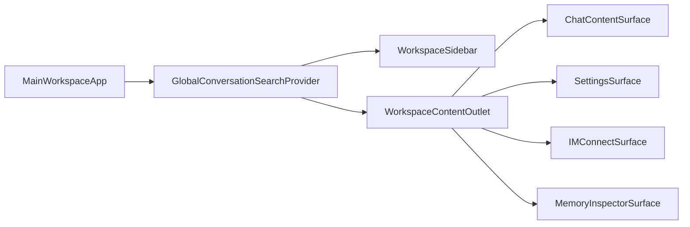
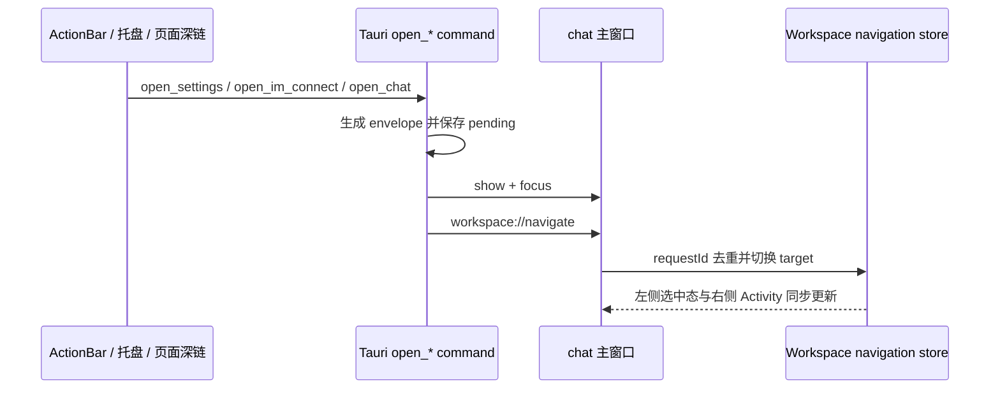

# 统一主窗口与内容导航 - 技术方案

## 状态

CONFIRMED

## 需求文档

[requirement.md](./requirement.md)

## 现状分析

### 窗口与入口

当前普通内容被拆成四个独立 Tauri WebView：

| 内容 | window label | HTML entry | 前端根组件 |
|---|---|---|---|
| 对话 | `chat` | `chat.html` | `ChatApp` |
| 设置 | `settings` | `settings.html` | `SettingsApp` |
| IM 接入 | `im-connect` | `im-connect.html` | `IMConnectApp` |
| 记忆面板 | `memory-inspector` | `memory-inspector.html` | `MemoryInspectorApp` |

桌宠 ActionBar 分别调用 `open_chat`、`open_settings`、`open_im_connect` 和 `open_memory_inspector`。Rust 命令当前直接显示对应窗口；设置还额外维护 `SettingsNavigationState`，用于在窗口尚未接收事件时保存一次性的设置深链。

### 对话页面边界

`ChatApp` 当前同时承担三类职责：

1. 外层 `SidebarProvider`、全局搜索和 `HistorySidebar`；
2. bridge 健康检查、会话同步、授权同步、命令运行时同步、凭据同步和桌面 presence；
3. 右侧对话内容，包括 header、语音阻塞提示、消息列表和 Composer。

右侧内容的结构样式主要由局部 Tailwind class 和 `chat-*` CSS class 承担。`layout.css` 已按 `chat-*` class 收口；TDesign Chat 基础样式由主入口加载，同时也被设置中心的人格编辑器使用。

### 页面生命周期

- 设置独立窗口关闭时只隐藏，组件状态不会销毁。
- IM 页面依赖 `window://shown` / `window://hidden` 控制 provider 刷新和 QR 轮询。
- Memory Inspector 的 recall trace 每 5 秒轮询，独立窗口隐藏后前端仍然挂载。
- 对话窗口始终挂载，因此离开桌面窗口不会清空消息、草稿和运行状态。

统一主窗口需要保留这些状态连续性，同时避免不可见页面继续执行轮询和订阅。

### window label 下游依赖

`settings` 不只是展示窗口 label，还被以下能力引用：

- Windows 开机自启命令的调用方限制；
- 麦克风 WebView profile 探测和权限 flow 的 `sourceWindow`；
- 数据迁移文件选择对话框 capability；
- command runtime 事件的额外投递目标。

移除独立设置窗口时必须同步迁移这些边界，不能只删除 HTML entry。

## 方案设计

### 总体结构

保留 `chat.html` 作为唯一普通内容主入口，在其 React 根下建立统一工作区：



`WorkspaceContentOutlet` 只负责尺寸、溢出和页面可见性，不承载任何对话专属布局。四个 surface 是平级直接子节点。

### 导航模型

新增统一主窗口导航类型：

```ts
export type WorkspaceTarget =
  | "chat"
  | "settings"
  | "im-connect"
  | "memory-inspector";

export interface WorkspaceNavigationEnvelope {
  requestId: number;
  target: WorkspaceTarget;
  chat?: { newConversation: boolean };
  settings?: SettingsOpenRequest;
}
```

导航状态只表达右侧当前 surface。新对话和具体会话继续由 `useConversationStore.currentSessionId` 表达：

| workspace target | currentSessionId | 左侧选中项 | 右侧内容 |
|---|---|---|---|
| `chat` | `null` | 新对话 | HomeStart |
| `chat` | 非空 | 对应会话 | 消息与 Composer |
| `settings` | 任意 | 设置 | SettingsSurface |
| `im-connect` | 任意 | IM 接入 | IMConnectSurface |
| `memory-inspector` | 任意 | 记忆面板 | MemoryInspectorSurface |

进入非 chat surface 不修改 `currentSessionId`。点击新对话时先切到 `chat`，再调用现有 `newSession()`；点击会话或搜索结果时先切到 `chat`，再调用现有会话打开动作。

前端状态放在主窗口本地 store，不持久化最后一个工具页。主窗口首次挂载默认 target 为 `chat`，现有 `lastChatSessionId` 恢复逻辑继续决定显示最近会话还是新对话。

### 页面保活

项目当前锁定 React 19.2，使用 React `<Activity>` 管理访问过的 surface：

```tsx
{visited.has("settings") ? (
  <Activity mode={target === "settings" ? "visible" : "hidden"}>
    <SettingsSurface />
  </Activity>
) : null}
```

规则如下：

- `ChatContentSurface` 从首次挂载起始终存在，只切换 Activity mode；
- 其他 surface 首次被访问时加入 `visited`，随后保持 React state 和 DOM；
- hidden Activity 自动隐藏 DOM、清理 Effects；再次 visible 时恢复 state 并重建 Effects；
- bridge、会话、凭据、授权和桌面 presence 等跨页面必需订阅移到 Activity 外的主窗口 runtime 层；
- 页面私有轮询仍留在原 surface 内，隐藏后由 Activity 的 Effect cleanup 自动停止。

这避免为每个页面另造 keep-alive 框架，也避免手工维护 `display:none` 和 Effect 生命周期。

### 对话内容抽取与样式隔离

从现有 `ChatApp` 抽出完整 `ChatContentSurface`，边界包含：

- 对话 header；
- 反馈入口和连接状态；
- 语音通话阻塞提示；
- HomeStart；
- MessageList；
- Composer 与 ApprovalDock。

抽取时保持现有 DOM 相对层级、布局 class、消息滚动和 Composer 定位不变。主窗口只在它外面增加统一 surface 容器。

样式边界：

- `layout.css` 继续只作用于 `chat-*` class；
- 对话 surface 使用独立 `min-w-0 h-full overflow-hidden` 边界；
- 设置、IM、Memory Inspector 各自使用独立的 `h-full` wrapper；
- 不把消息渐隐、Composer、header 或对话 flex class 上提到 outlet；
- TDesign Chat 基础组件样式继续由 `chat.html` 主入口加载，因为对话和设置人格编辑器都需要；不把这些组件基础样式误判为只属于消息页的结构样式。

### 主窗口 runtime 层

将当前 `ChatApp` 中跨页面必须持续存在的副作用整理到主窗口层：

- bridge ping 与连接状态；
- session sync；
- runtime credential sync；
- filesystem approval sync；
- command runtime sync；
- active chat session 请求与发布；
- desktop presence；
- model catalog 按连接状态加载。

这些逻辑继续使用现有 store 和 helper，不新增通用 runtime 框架。Composer 高度、输入 focus 等纯对话 UI 状态留在 `ChatContentSurface`。

### 左侧导航

把 `HistorySidebar` 扩展为工作区侧栏，保留现有搜索和会话列表：

```text
搜索全部对话
新对话
IM 接入
设置
记忆面板（owner capability 开启时）
────────
对话
会话列表
```

入口继续使用现有 `SidebarMenuButton` 和项目语义 token，不新增 UI 依赖。

选中态统一由 `workspaceTarget + currentSessionId` 派生：

- utility surface active 时所有 session `isActive=false`；
- chat surface + null session 时新对话 active；
- chat surface + session id 时对应 session active；
- Memory Inspector 入口与桌宠一致，通过 `get_local_capabilities` 决定是否显示。

全局搜索打开结果后显式切换到 `chat`，再执行现有 `openSearchResult`。

### 设置 surface

`SettingsApp` 改造成可嵌入 `SettingsSurface`：

- 根高度从 `h-screen` 改为 `h-full`；
- 保留内部 200px 设置分类 sidebar 和所有现有 panel；
- 取消自身对 `settings://navigate` 的 Tauri 监听；
- 接收主窗口传入的 `WorkspaceNavigationEnvelope`，按 requestId 去重并复用现有 `locateSettings()`；
- 无深链的普通“设置”导航保留当前设置分类，不强制重置到默认页；
- feedback、permissions、runtime credential group 等请求继续精确定位。

设置页面所需的 session、permission、command runtime 等全局订阅由主入口统一初始化，不在 surface 内重复启动。

### IM surface

直接复用 `IMConnectPanel`，移除只服务独立窗口的 `IMConnectApp` shown/hidden 事件桥接。Activity visible 时其 Effects 启动，hidden 时清理轮询。

`IMConnectPanel` 已有 `active` 语义；主窗口仍传入当前可见状态，使事件回调和用户动作具备显式保护，Activity 负责实际 Effect 生命周期。

### Memory Inspector surface

复用现有 Memory Inspector 两栏内容：

- 根容器从 `h-screen` 改为 `h-full`；
- 保留 MemoryList、RecallTrace、probe 和 localStorage 选择状态；
- Activity hidden 时 RecallTrace 的 interval 和页面 Effects 自动清理；
- 只有 owner capability 开启时允许前端导航和 Rust 命令导航到该 surface。

### Tauri 主窗口导航协议

Rust 侧把 `SettingsNavigationState` 泛化为 `WorkspaceNavigationState`，持有自增 requestId 和最后一个 pending envelope。



保留现有命令名以避免桌宠和页面调用方扩散修改：

| 命令 | 新 target | 附加数据 |
|---|---|---|
| `open_chat` | `chat` | 无 |
| `open_new_conversation` | `chat` | `chat.newConversation=true` |
| `open_settings` | `settings` | 可选 SettingsOpenRequest |
| `open_im_connect` | `im-connect` | 无 |
| `open_memory_inspector` | `memory-inspector` | owner capability gate |

新增 `consume_pending_workspace_navigation`，替换设置专用 pending command。主窗口先消费 pending，再监听事件，并以 requestId 防止重复或乱序请求覆盖较新导航。

系统托盘“打开对话”和第二实例激活也走相同 `chat` target helper，保证它们不会恢复到关闭前的设置或 IM 页面。

### 系统托盘

托盘右键菜单使用原生 Tauri menu，按以下顺序组织：

```text
打开 agent-friend
新对话
────────
IM 接入
设置
帮助与反馈
────────
隐藏桌宠 / 显示桌宠
────────
退出 agent-friend
```

- `打开 agent-friend` 和左键双击都发送普通 `chat` navigation envelope，不改变当前会话；
- `新对话` 调用 `open_new_conversation`，发送带 `chat.newConversation=true` 的 envelope，主窗口收到新 requestId 后调用既有 `newSession()`；该一次性请求沿用 pending + event 机制，避免主窗口监听未就绪时丢失；
- 设置、IM 和帮助与反馈复用统一 workspace target，帮助入口携带 `target=feedback` 设置深链；
- 桌宠显隐沿用 `pet_display_recovery::toggle_visibility`，菜单文案由 pet window 当前可见性派生；右键托盘时和执行切换后都刷新文案；
- `show_menu_on_left_click(false)` 使单击不弹菜单，右键保留原生菜单行为；`TrayIconEvent::DoubleClick` 的左键事件打开主窗口；
- 语音通话和 Memory Inspector 不加入托盘，避免扩大高频菜单和误触低频或受 capability 限制的入口。

### 独立窗口移除

删除以下普通内容窗口入口：

- `settings.html` 与 `pages/settings/main.tsx`；
- `im-connect.html` 与 `pages/im-connect/main.tsx`；
- `memory-inspector.html` 与 `pages/memory-inspector/main.tsx`。

保留各页面的 App/panel 组件作为主窗口 surface。同步更新：

- Vite rollup inputs；
- `tauri.conf.json` windows；
- default capability window labels；
- window placement managed labels；
- package 前端 entrypoint 清单与测试；
- frontend README 的窗口模型。

用户已有 window placement store 中的旧 label 数据不主动迁移或删除；它们不再被读取，保留兼容与回退空间。

### settings label 下游迁移

| 现有依赖 | 调整 |
|---|---|
| Autostart 仅允许 `settings` window | 改为仅允许 `chat` 主窗口 |
| Windows 麦克风 profile 优先选 settings | 改为优先选 chat |
| PermissionPanel `sourceWindow="settings"` | 改为 `chat` |
| migration dialog capability 绑定 settings | 改为绑定 chat |
| command runtime 额外 emit 到 settings | 移除重复 emit，chat 已是目标 |

测试中的任意示例 label 若不表达真实窗口契约，不做无意义改名。

### 主窗口尺寸与标题

`chat` 主窗口调整为：

- 默认宽高：`1040 × 720`；
- 最小宽高：`960 × 640`；
- title：`agent-friend`，避免在设置或 IM 页面仍显示“对话”。

左侧保持 240px。默认宽度下内容区约 800px，可承载 Memory Inspector 当前最小宽度；最小宽度下内容区约 720px，设置中心仍能保持原独立窗口的内容宽度，Memory Inspector 两栏允许收窄但不得产生不可达内容。

## 涉及文件

| 文件路径 | 改动类型 | 说明 |
|---|---|---|
| `frontend/src/pages/chat/App.tsx` | 重构 | 主窗口外壳、runtime 与 content outlet |
| `frontend/src/pages/chat/components/ChatContentSurface.tsx` | 新增 | 完整承载现有右侧对话内容 |
| `frontend/src/pages/chat/components/HistorySidebar.tsx` | 修改 | 固定入口与统一选中态 |
| `frontend/src/pages/chat/components/GlobalConversationSearch.tsx` | 修改 | 打开搜索结果时切到 chat |
| `frontend/src/lib/workspace/navigation.ts` | 新增 | target、envelope、store 和 Tauri 监听 |
| `frontend/src/pages/settings/App.tsx` | 修改 | 改为可嵌入 SettingsSurface，接收深链 |
| `frontend/src/pages/im-connect/App.tsx` | 修改或移除 | 独立窗口 wrapper 下线 |
| `frontend/src/pages/memory-inspector/App.tsx` | 修改 | 高度与嵌入边界 |
| `frontend/src-tauri/src/lib.rs` | 修改 | 统一导航 state、commands、托盘和第二实例 |
| `frontend/src-tauri/src/autostart.rs` | 修改 | 主窗口调用方边界 |
| `frontend/src-tauri/src/permissions/**` | 修改 | 权限 source 与 WebView host |
| `frontend/src-tauri/src/push_subscriber.rs` | 修改 | 去除 settings 重复投递 |
| `frontend/src-tauri/src/window_placement.rs` | 修改 | 移除三个窗口 label |
| `frontend/src-tauri/tauri.conf.json` | 修改 | 窗口移除与主窗口尺寸 |
| `frontend/src-tauri/capabilities/*.json` | 修改 | 窗口与 dialog capability |
| `frontend/vite.config.ts` | 修改 | 移除三个 HTML input |
| `frontend/{settings,im-connect,memory-inspector}.html` | 删除 | 独立入口下线 |
| `scripts/package/run.py` 与相关测试 | 修改 | 同步正式构建入口契约 |
| `frontend/README.md` | 修改 | 更新窗口模型 |

实际实现中若现有测试要求就近增加小型 helper，优先放在对应模块，不新增全局 registry 或 router 框架。

## 测试与验收方案

### 自动化测试

- workspace target 与 requestId 去重；
- 新对话、会话、utility 的选中态投影；
- 搜索结果打开后切回 chat；
- 设置深链在嵌入模式下定位且旧请求不覆盖新请求；
- Activity 首次访问与保活集合投影；
- Rust pending envelope 与 target 映射；
- 托盘菜单 id 到动作的映射、桌宠显隐文案与新对话 envelope；
- autostart 仅允许 chat 主窗口；
- package entrypoint 列表不再要求三个已移除 HTML；
- 现有 chat、settings、IM、Memory Inspector 测试继续通过。

### 项目门禁

- 运行 `scripts/check` 的 Windows 入口；
- 前端 lint、token guard、typecheck、Vitest；
- Rust format、clippy/test 与项目现有检查；
- 不调用真实 LLM API。

### 真实桌面端验收

用户已授权真实 Tauri 桌面视觉验收。实现和自动化门禁通过后，使用项目 `desktop-visual-inspection` 流程验证：

- 主窗口来源与当前 worktree/branch 一致；
- 默认尺寸和最小尺寸下左侧入口、选中态和右侧各 surface；
- 对话 header、消息渐隐、滚动、Composer 和草稿连续性；
- 设置二级侧栏、IM 绑定内容和 Memory Inspector 双栏；
- ActionBar 各入口导航正确且自身视觉不变；
- 托盘右键菜单顺序、分隔、各导航落点、动态桌宠显隐和双击打开主窗口；
- voice-call 仍为独立窗口；
- 验收完成后按 runtime 所有权规则清理本次启动的实例。

## 影响分析

### 上下游影响

- 前端由四个普通内容 React root 收敛为一个 root，跨页面共享 store 与事件监听；
- 设置 capability、权限和 autostart 的可信窗口 label 从 settings 迁移到 chat；
- 安装包不再包含三个 HTML entry，但业务组件仍被 chat bundle 引用；
- 现有后端 HTTP/SSE 协议不变；
- voice-call、pet、bubble 和 Live2D debugger 窗口不变。

### 风险点

1. **Activity 隐藏会清理 Effects**：关键同步若仍留在 ChatContentSurface，会在进入设置时停止。缓解：跨页面 runtime 统一放在 Activity 外，并用测试覆盖。
2. **设置深链事件竞争**：窗口 show 与事件监听存在时序。缓解：Rust pending + requestId 去重，前端先消费再监听。
3. **样式层泄漏**：把现有右侧结构直接拆散可能改变 flex/overflow。缓解：完整抽取 ChatContentSurface，其他页面仅作为平级 surface。
4. **权限能力遗漏**：删除 settings label 后可能导致自启、麦克风或文件对话框失败。缓解：按下游依赖表逐项迁移并保留单测。
5. **窗口宽度变化**：旧 placement 可能保存较小 chat 尺寸。缓解：Tauri minWidth/minHeight 约束恢复后的合法尺寸，真实桌面端同时验证默认与最小尺寸。
6. **隐藏页后台工作**：IM/Memory 轮询不能继续运行。缓解：Activity hidden 清理 Effects，页面现有 cleanup 继续承担资源释放。

## 变更记录

| 日期 | 变更内容 | 是否需要重新实现 |
|---|---|---|
| 2026-08-21 | 创建并确认统一主窗口、React Activity 保活、样式隔离和窗口迁移方案 | 否，尚未开始实现 |
| 2026-08-21 | 追加托盘右键菜单、一次性新对话 envelope、动态显隐文案和双击打开主窗口 | 是，作为同一需求的合入前补充实现 |
