# 094 · DeepSeek 视觉与图片 Files API 接入 - 技术方案

## 状态

CONFIRMED

## 需求文档

[requirement.md](./requirement.md)

## 证据索引

[evidence-index.md](./evidence-index.md)

## 现状分析

### 1. 现有附件主链路已经完整

059、060 已经完成以下能力：

- `AttachmentStore` 负责附件内容识别、本地托管、草稿 lease、引用与 GC；会话事件只保存稳定 `AttachmentRef`。
- Bridge 在接受 run 前按统一模型目录校验附件类型、单文件大小、总大小和单轮数量。
- `MultimodalInputAdapter` 在每次上下文装配后，把领域消息渲染成目标 Provider 的内容块。
- 前端模型列表和附件 accept/禁用态来自 `/v1/models/catalog`，不维护独立的 Provider 能力表。
- Kimi 图片以 `purpose=image` 上传后使用 `ms://<file_id>`；文档以 `file-extract` 上传并把抽取正文作为不可信文本加入上下文。
- 本地 provider cache 已按资产、账号、transport、processing profile 和 purpose 隔离，并使用 single-flight 锁避免并发重复上传。

因此本需求不新增附件领域对象、Bridge 输入协议、前端上传状态或会话持久化字段，只扩展模型目录、DeepSeek 图片 preparation 和最终 wire payload。

### 2. 当前模型目录不能表达新的处理策略

`ProviderModel` 当前只有模型标识、展示名、LiteLLM 目标、上下文窗口和 capabilities。公共目录中的 `processingProfile` 根据“是否有附件”硬编码推导：有附件就是 `kimi-multimodal-v1`，否则是 `text-only-v1`。

新增 DeepSeek 视觉模型后，“支持附件”不再等于“Kimi 处理方式”。processing profile 必须成为模型路由的显式属性，供目录投影、Provider adapter 和兼容性测试共同使用。

### 3. LiteLLM 最新版仍不原生支持 DeepSeek 视觉内容块

项目当前锁定 LiteLLM 1.83.14。调研同时核对了：

- 最新稳定版 1.97.0；
- 2026-08-21 发布的 1.99.0.dev2；
- LiteLLM 当前 `main` 与 `litellm_internal_staging`。

上述版本都没有 `deepseek-v4-flash-vision-exp` 模型条目。DeepSeek chat transformation 仍无条件调用 `handle_messages_with_content_list_to_str_conversion`，会把 user content list 转成纯文本并丢弃图片/文件块。

把模型改走 LiteLLM 的通用 OpenAI-compatible transformation 可以保留 `image_url`，也可以接受标准嵌套文件块：

```json
{"type":"file","file":{"file_id":"file-api-..."}}
```

但 DeepSeek Chat Completions 要求的 wire shape 是：

```json
{"type":"file","file_id":"file-api-..."}
```

当前 LiteLLM 和最新版都不原生生成该扁平结构。直接升级依赖不能解决本需求，反而会扩大冻结 runtime 与全量 Provider 回归面。

### 4. 继续走 LiteLLM 的最小兼容路径已经验证

OpenAI SDK 的 `extra_body` 会在最终 HTTP body 中覆盖同名标准字段。用当前锁定的 LiteLLM 1.83.14、OpenAI SDK 2.24.0 和 `httpx.MockTransport` 验证：

1. 主 `messages` 使用 LiteLLM 能验证的嵌套 `file` block；
2. `extra_body.messages` 提供 DeepSeek 需要的扁平 `file_id` block；
3. LiteLLM 继续执行 OpenAI-compatible transport、stream 包装和响应规范化；
4. 最终 `POST https://api.deepseek.com/chat/completions` 的 body 只包含扁平 DeepSeek messages，同时保留 `thinking={"type":"disabled"}`。

因此本方案不增加 DeepSeek direct transport。兼容 shim 只负责请求体最后一公里的结构差异，流式生命周期继续由现有 LiteLLM 路径拥有。

## 方案设计

### 1. 总体数据流

```mermaid
flowchart LR
    UI[现有 Composer / IM] --> BRIDGE[Bridge 附件准入]
    BRIDGE --> STORE[AttachmentStore 本地资产]
    STORE --> MESSAGE[Message + AttachmentRef]
    MESSAGE --> ADAPTER[MultimodalInputAdapter]
    ADAPTER --> FILES[DeepSeek Files API]
    FILES --> NESTED[LiteLLM-safe 嵌套 file block]
    NESTED --> SHIM[DeepSeek vision wire shim]
    SHIM --> LITELLM[LiteLLM OpenAI-compatible transport]
    LITELLM --> CHAT[DeepSeek Chat Completions]

    CATALOG[统一 Model Catalog] --> UI
    CATALOG --> BRIDGE
    CATALOG --> ADAPTER
```



稳定边界保持不变：

- 用户附件身份由 `AttachmentRef.asset_id` 表达；
- DeepSeek `file_id` 只存在于 provider cache 和当次 wire request；
- LiteLLM 继续拥有 LLM stream transport；
- shim 不感知 Session、UI 或附件文件路径。

### 2. 模型目录与 Provider route

#### 2.1 `ProviderModel` 显式声明处理策略与模型级 API base

为 `ProviderModel` 增加：

```python
processing_profile: str = "text-only-v1"
api_base: str | None = None
```

`build_provider_spec()` 与 `replace_spec_model()` 按以下优先级选择 base URL：

1. 当前模型的 `api_base`；
2. Provider 的 `api_base`；
3. `None`，交给现有 transport 默认值。

这样只有视觉模型切到 DeepSeek 官方稳定基址，不改变 V4 Flash、V4 Pro 当前路径。

公共目录直接投影 `model.processing_profile`，删除“有附件就推导为 Kimi”的硬编码。

#### 2.2 新模型条目

```python
ProviderModel(
    id="deepseek/deepseek-v4-flash-vision-exp",
    label="DeepSeek V4 Flash Vision",
    litellm_model="openai/deepseek-v4-flash-vision-exp",
    api_base="https://api.deepseek.com",
    context_window=1_000_000,
    processing_profile="deepseek-vision-files-v1",
    capabilities=DEEPSEEK_VISION_CAPABILITIES,
)
```

使用 `openai/` LiteLLM 前缀是为了避开会丢弃 content list 的 DeepSeek transformation；产品侧 canonical ID 仍归属于 DeepSeek，凭据仍使用 `DEEPSEEK_API_KEY`。

能力定义：

```python
ModelRouteCapabilities(
    input_modalities=("text", "image"),
    accepted_media_types=("image/jpeg", "image/png", "image/webp"),
    max_attachment_bytes=64 * 1024 * 1024,
    max_total_attachment_bytes=100 * 1024 * 1024,
    max_attachments_per_turn=10,
)
```

- 64 MiB：DeepSeek Files API 单文件上限，也小于本地资产层 100 MiB 上限。
- 100 MiB / 10 个：沿用当前产品单轮边界，并严于 DeepSeek 的 200 MiB / 600 张上限。
- 不声明 document、GIF 或 multimodal tool result。
- 默认聊天模型、默认记忆模型和已有设置不变。

#### 2.3 canonical model 与 Provider 归属

`MultimodalInputAdapter._canonical_model_id()` 增加映射：

```text
openai/deepseek-v4-flash-vision-exp
    -> deepseek/deepseek-v4-flash-vision-exp
```

`_provider_id_for_spec()` 同样把该 LiteLLM model 映射为 `deepseek`，确保 OpenAI SDK/LiteLLM 异常继续进入 DeepSeek 的统一错误归一化。

### 3. DeepSeek Files API preparation

#### 3.1 上传参数

视觉 profile 只接受 `attachment.kind == "image"`。上传使用现有 OpenAI SDK：

```python
files.create(
    file=(display_name, source, media_type),
    purpose="user_data",
    expires_after={"anchor": "created_at", "seconds": 86_400},
)
```

TTL 固定为 24 小时，不新增环境变量或用户设置：

- 用户原件已在本地可靠托管，远端文件只服务近期请求复用；
- 跨日继续对话时允许重新上传一次；
- 本地资产被删除后，远端残留最长约 24 小时；
- 固定值进入 processing profile 版本，未来调整时通过新 profile/cache namespace 失效旧缓存。

#### 3.2 cache key 与记录

cache key 继续遵守 059 的契约：

```text
(asset_id,
 provider_id=deepseek,
 provider_account_scope=sha256(api_key)[:16],
 transport_profile=openai-compatible,
 processing_profile=deepseek-vision-files-v1,
 purpose=user_data)
```

本地 cache 记录最少包含：

```json
{
  "_asset_id": "<asset-id>",
  "_file_id": "file-api-...",
  "_expires_at": "<unix-seconds>"
}
```

不保存 API Key、图片正文或本地绝对路径。

#### 3.3 复用与重传

在现有 asset/account 级 single-flight 锁内：

1. 读取并校验 cache 结构；
2. `_expires_at` 已过期或距过期不足 5 分钟时，删除本地 cache 并重新上传；
3. 未临近过期时调用 `files.retrieve(file_id)` 确认账号归属与远端存在性；
4. retrieve 成功则复用；认证、404、过期或其它 retrieve 失败均删除 cache 并尝试重新上传；
5. 上传成功后原子写入新 cache；失败统一抛 `attachment_provider_upload_failed`，不破坏本地附件与消息。

本期不为 DeepSeek 增加主动远端 delete：原生 TTL 已提供确定的删除上界，避免本地 GC 依赖第三方删除成功。Kimi 现有行为不修改。

### 4. 内容块与 LiteLLM wire shim

#### 4.1 adapter 输出 LiteLLM-safe block

`MultimodalInputAdapter` 根据显式 processing profile 分派：

- `text-only-v1`：保持当前兼容性 marker / current input 拒绝；
- `kimi-multimodal-v1`：保持现有图片与文档逻辑；
- `deepseek-vision-files-v1`：只处理图片并返回嵌套 block。

内部渲染结果：

```json
{
  "role": "user",
  "content": [
    {"type": "text", "text": "看看这张图"},
    {"type": "file", "file": {"file_id": "file-api-..."}}
  ]
}
```

嵌套结构可以通过 LiteLLM 当前和最新版的 OpenAI-compatible message validation。

#### 4.2 新增局部兼容模块

新增 `llm_providers/src/llm_providers/deepseek_vision_compat.py`，职责仅包括：

- 判断 spec 是否为 `openai/deepseek-v4-flash-vision-exp`；
- 深复制 messages，严格把 `type=file` 且仅含合法 `file.file_id` 的 block 转成 DeepSeek 扁平结构；
- 拒绝缺少 file ID、同时携带未知 file 字段或出现在非 user message 的 block；
- 合并现有 `extra_body`，以 `messages=<wire_messages>` 覆盖最终 HTTP body；
- 不修改调用方的原 messages，不记录任何文本、file ID 或图片内容。

伪代码：

```python
def prepare_litellm_request(spec, messages, options):
    if not is_deepseek_vision(spec):
        return messages, options
    wire_messages = flatten_deepseek_file_blocks(messages)
    extra_body = {**options.get("extra_body", {}), "messages": wire_messages}
    return messages, {**options, "extra_body": extra_body}
```

#### 4.3 接入位置

`LLMClient` 在同步 `_call_once()` 和流式 `_stream_once()` 进入 LiteLLM 前统一调用该 helper：

- 无取消 stream 继续走 `litellm.completion()`；
- 有取消 stream 继续走 `open_cancellable_litellm_stream()`；
- 两条路径收到完全相同的嵌套 messages 和 `extra_body.messages`；
- 现有网络重试、引擎过载退避、流静默超时、usage、tool call delta 和 diagnostics 不变。

diagnostics 中 transport 仍为 `litellm`。请求大小估算不得记录 `extra_body.messages` 的正文；若沿用当前粗估，应避免同时计算原 messages 与 override messages 造成双倍虚高。

### 5. UI、设置与历史兼容

- `/v1/models/catalog` 新条目会自动进入对话模型选择器和现有设置模型选项，不新增 UI 分支。
- label 使用 `DeepSeek V4 Flash Vision`，不展示“实验”徽标或额外文案。
- `ModelSelection.model` 已是字符串，Tauri 设置无需新增 enum variant；现有 `DeepseekModel` 只负责旧字段迁移，不扩大。
- 前端 attachment accept、按钮禁用和模型切换草稿兼容性均从 catalog capabilities 自动得到新行为。
- 旧会话无迁移；历史图片继续保存 canonical `AttachmentRef`。选择视觉模型时重新 materialize，切回文本模型时使用现有 marker 投影。
- 目录 revision 更新后，前端与 Bridge 通过现有启动加载流程获得新能力。

### 6. 错误、安全与隐私

- 进入 Provider 前仍由 Bridge 和 adapter 双重校验 media type、大小、数量及 kind。
- Files API 上传/查询失败不暴露 API Key、远端 ID、响应正文或本地路径。
- wire shim 只接受预期 block，结构漂移 fail-fast 为 `LLMBadRequestError`，不静默删除图片后发送纯文本。
- `extra_body.messages` 仅存在于调用内存，不落盘、不进默认诊断包。
- 图片内容继续是 user 权限的不可信输入；system/assistant message 中出现 file block 直接拒绝。
- 更换 DeepSeek API Key 后 account-scoped cache 自然切换，不向新账号发送旧账号 file ID。

### 7. 上游支持演进与 shim 移除

该 shim 是对明确上游缺口的有界适配，不修改 site-packages、不 monkey patch LiteLLM 全局类。

只有同时满足以下证据时才移除：

1. 新 LiteLLM 稳定版模型目录包含 `deepseek-v4-flash-vision-exp` 或其正式后继；
2. DeepSeek transformation 保留 content list；
3. 它原生输出 DeepSeek 接受的 `file_id` wire shape，或官方 API 改为 LiteLLM 标准嵌套 shape；
4. 当前 golden payload、stream、tool loop 和错误测试在移除 shim 后仍通过。

不得仅因为版本号变大或 changelog 提到 vision 就删除兼容层。

## 涉及文件

| 文件路径 | 改动类型 | 说明 |
| --- | --- | --- |
| `llm_providers/src/llm_providers/catalog.py` | 修改 | 显式 processing profile、模型级 api_base、DeepSeek vision capabilities 与模型条目 |
| `llm_providers/src/llm_providers/multimodal/adapter.py` | 修改 | processing profile 分派、DeepSeek Files upload/cache/retrieve/reupload、嵌套 file block |
| `llm_providers/src/llm_providers/deepseek_vision_compat.py` | 新增 | DeepSeek vision 模型识别、file block flatten 与 `extra_body.messages` 合并 |
| `llm_providers/src/llm_providers/client.py` | 修改 | 同步/流式 LiteLLM 调用前应用有界 shim，保持错误与 diagnostics 归属 |
| `llm_providers/tests/test_provider_catalog.py` | 修改 | 新模型、能力、profile、api base、原 DeepSeek/Kimi 回归 |
| `llm_providers/tests/test_multimodal_adapter.py` | 修改 | DeepSeek 上传参数、TTL、cache、账号隔离、失效重传和类型拒绝 |
| `llm_providers/tests/test_deepseek_vision_compat.py` | 新增 | 嵌套到扁平转换、非法形态、输入不变性、最终 HTTP body golden test |
| `llm_providers/tests/test_context_window_and_usage.py` | 修改 | vision route 继续走 LiteLLM stream、usage/tool/error/cancel 兼容性 |
| `agent_bridge/tests/test_model_routes.py` | 修改 | 公共 catalog 投影视觉模型及严格能力限制 |
| `frontend/src/lib/model-config/index.test.ts` | 修改 | 动态目录投影 image-only 能力与显示名；生产代码不改 |
| `.env.example` | 修改 | 增加可选视觉模型说明，保持默认模型不变 |
| `docs/requirements/094-deepseek-vision-and-files-api/evidence-index.md` | 修改 | 固化最新版 LiteLLM、当前主线和本地 golden payload 证据 |

实现中若现有测试夹具因模型精确列表新增而受影响，只更新与模型目录契约直接相关的断言，不机械改写无关测试数据。

## 验证方案

### 1. 纯单元测试

- Catalog：三个 DeepSeek 模型的 canonical ID、LiteLLM target、api base、context、processing profile 和 capabilities。
- 能力边界：vision 只接受 JPEG/PNG/WebP；Flash/Pro 仍 text-only；PDF/TXT/GIF 明确拒绝。
- Files preparation：`purpose=user_data`、`expires_after.created_at=86400`、单次上传、cache hit、临期重传、retrieve 失败重传、API Key 隔离、single-flight。
- Shim：仅转换目标模型；只转换 user file block；不修改输入；保留 text、tool history 和 attachment order；非法结构 fail-fast。
- 错误：Files SDK 错误和 LiteLLM/OpenAI-compatible 错误继续进入现有项目错误类型。

### 2. 最终 HTTP body golden test

使用锁定的 LiteLLM/OpenAI SDK 和 `httpx.MockTransport` 捕获最终 request：

- URL 为 `https://api.deepseek.com/chat/completions`；
- model 为无 provider 前缀的官方模型名；
- messages 中只出现 DeepSeek 扁平 `file_id`，不出现嵌套 `file` 或 base64；
- `thinking.type=disabled`、tools、stream 和 stream options 保持；
- 文件顺序、历史 user 图片和当前 user 图片顺序不变；
- 不命中视觉 route 的 DeepSeek/Kimi/OpenRouter payload 完全不变。

该测试是升级 LiteLLM/OpenAI SDK 时的兼容门禁。

### 3. 跨模块自动化

- Bridge catalog route 投影新模型；前端从动态 catalog 得到 image-only accept。
- 桌面/IM admission 对 JPEG/PNG/WebP 接受，对 PDF/TXT/GIF 拒绝。
- 从视觉模型切到文本模型时草稿阻止与历史 marker 不回归。
- Kimi 图片、PDF、TXT provider adapter 和 direct Kimi stream transport 保持现有测试结果。

### 4. 项目门禁

- 先运行受影响 Python 与前端定向测试；
- 再运行项目规定的 `scripts/check` 全量门禁；
- 本需求不新增依赖，不单独触发 frozen runtime 依赖收集或安装器构建。

### 5. 真实 DeepSeek 验收

真实调用必须另行取得单次授权。预计：

- JPEG、PNG、WebP 各 1 次图片理解；
- 至少 1 次同图复用，确认没有重复上传；
- 至少 1 次带 function tool 的图片对话，确认工具循环；
- 必要时人为使 cache 失效后复验重传。

常规量级约 5–7 次模型请求、3–4 次文件上传/查询；执行前按实际用例再次告知。真实验证失败时保留本地原件与诊断状态，不把失败写成通过。

## 影响分析

### 上游影响

- 依赖 DeepSeek 当时有效的视觉模型名、Files API 字段、Chat Completions file block 和 1 小时至 30 天 TTL 范围。
- 依赖 OpenAI SDK `extra_body` 的同名字段覆盖语义；由最终 HTTP body golden test 固定。
- LiteLLM 升级不再被假定为自动兼容，必须经过 shim 移除条件与全量回归。

### 下游影响

- 模型 selector 自动多一个普通 DeepSeek 选项；无新增 UI 状态。
- 当前选中视觉模型时，现有附件入口开放 JPEG/PNG/WebP；其它 DeepSeek 模型保持禁用。
- provider cache 增加 DeepSeek 账号作用域条目，不进入迁移和默认诊断包。
- 会话、上下文压缩、IM 与设备迁移继续只认识 provider-neutral `AttachmentRef`。

### 跨平台与多入口

- 文件选择、拖放、粘贴和本地托管均复用 059/060 已验收的 Windows/Tauri 路径；没有新平台 API。
- Python adapter 与 LiteLLM shim 在 Windows/macOS/Linux 使用同一代码路径。
- 桌面与 IM 的差异只发生在附件进入本地 store 之前；Provider preparation 完全共享。

### 风险点

| 风险 | 控制方式 |
| --- | --- |
| LiteLLM 最新版仍丢弃 DeepSeek content list | 视觉模型走通用 `openai/` route；最终 messages 由受测 shim 覆盖 |
| `extra_body.messages` 行为随 SDK/LiteLLM 变化 | 锁版本 + 最终 HTTP body golden test；漂移时 fail-fast，不静默降级成纯文本 |
| 视觉模型被错误归为 OpenAI Provider | canonical model 映射与 provider error 映射显式归属 DeepSeek；凭据仍取 DeepSeek group |
| 远端 file ID 跨账号误用 | cache key 纳入 API Key 摘要；retrieve 和上传都用同一 spec credential |
| 文件临近过期导致模型请求竞态 | 5 分钟安全窗口内提前重传；远端失效时本地原件可重建 |
| 大图导致上传延迟或请求超限 | catalog 64 MiB 单文件、100 MiB 总量、10 个；前后端同源校验 |
| 新模型发布当天契约继续变化 | 实现与真实验收前重新对账官方 Change Log、Vision、Files API |
| 顺手改变 Kimi 或 DeepSeek 文本路线 | shim 仅匹配一个 LiteLLM model；Kimi/Flash/Pro golden/regression tests |

## 不采用的方案

### 1. 直接升级 LiteLLM

不采用。1.97.0、1.99.0.dev2 和当前主线均没有原生支持，升级不能解决 file block 问题，只会扩大依赖和冻结 runtime 回归面。

### 2. DeepSeek 视觉模型继续使用 `deepseek/` LiteLLM provider

不采用。DeepSeek transformation 会把 content list 转成纯文本，图片被静默丢弃，属于不可接受的数据损失。

### 3. 绕开 LiteLLM，新增 DeepSeek direct stream transport

不采用。虽然 OpenAI SDK 可以直接发送正确 payload，但需要额外维护 stream、取消、超时、重试、usage、tool delta 和 diagnostics；局部 wire shim 已能保留现有 transport，复杂度更低。

### 4. 首期只发 base64 `image_url`

不采用为主路径。它可以无 shim 通过通用 OpenAI-compatible route，但放弃了已确认的 Files API 复用与有限远端生命周期，并受 32 MiB 单图、48 MiB request body 限制。可在 Files API 真实故障诊断中作为一次性对照，不作为产品 fallback。

### 5. monkey patch LiteLLM site-packages 或维护私有 fork

不采用。全局 monkey patch 难以隔离，私有 fork 会增加长期升级成本。兼容逻辑留在项目自有模块并由精确 model gate 控制。

## 变更记录

| 日期 | 变更内容 | 是否需要重新实现 |
| --- | --- | --- |
| 2026-08-21 | 初版确认：显式 DeepSeek vision processing profile；Files API 24h TTL 与账号隔离缓存；视觉模型走 LiteLLM 通用 OpenAI-compatible route，通过有界 `extra_body.messages` shim 生成 DeepSeek 扁平 file block；不升级 LiteLLM、不新增 direct transport | 是，进入 Phase 3 前需另行取得实现授权 |
