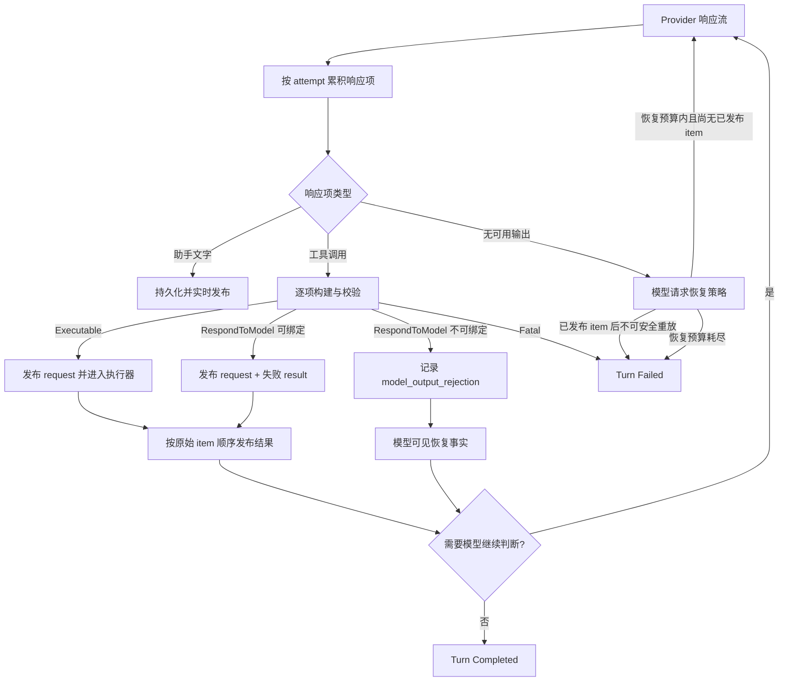

# Agent 运行恢复与终止语义 - 技术方案

## 状态

CONFIRMED

## 需求文档

[requirement.md](./requirement.md)

## 证据索引

[evidence-index.md](./evidence-index.md)

## 设计目标

本方案把一次 Agent turn 拆成三个不同层级：模型响应项、工具调用项和 turn 生命周期。局部响应项失败只闭合当前 item，并把失败事实返回模型；只有 turn 自身无法安全继续时才进入中断或失败终态。

核心约束如下：

1. 模型响应中的文字、工具调用和其它输出项分别处理，一个 item 失败不回滚其它已完成 item。
2. 工具参数解析、工具查找、schema 校验和普通工具执行错误默认进入 `RespondToModel`，形成失败输出并继续采样。
3. 只有宿主不变量破坏、会话损坏、持久化失败或其它无法形成可信模型输入的错误进入 `Fatal`。
4. 非法调用在工具主体、hook、审批 broker 和副作用边界之前被拒绝。
5. 重复失败、空结果和重复证据只产生诊断与软提醒，不拥有 turn 终止权限。
6. turn 生命周期只使用 `InProgress`、`Completed`、`Interrupted`、`Failed` 四种状态；更具体的停止原因使用稳定 `reason_code` 表达。
7. 模型请求恢复继续使用当前模型、Provider、账号、权限上下文和会话路由，不静默 fallback。

## 现状问题

当前 `Conversation` 在整批工具调用完成流式组装后统一解析和校验。任一调用 malformed 会使整批调用被拒绝；第二次 malformed 直接抛 `MalformedToolCallError`。合法调用、非法调用和助手文字没有成为独立闭合的响应项。

工具执行后，`NoProgressTracker.observe()` 与 `requires_user_action` 会直接写入 `ToolRunState.stop_reason`。这使重复错误启发式和普通工具元数据具备了禁用工具、强制收尾的权限。批次内布尔值一旦置位，同批后续成功也无法撤销。

模型调用层只对部分网络错误做有效输出前重试；流超时被硬编码为不重试，空响应和隐藏推理耗尽输出预算直接抛错。工具增量已经到达但尚未发布时，也没有明确的 attempt 重置协议。

Runtime 执行完事件迭代器后固定写入 `RunOutcome.COMPLETED`，没有消费 `TurnDone.stop_reason`。因此工具策略强制停止、资源边界收尾和正常完成在 Runtime、日志与协议层可能得到相同终态。

## 总体架构



### 涉及文件

| 文件路径 | 改动类型 | 说明 |
| --- | --- | --- |
| `agent/src/agent/conversation.py` | 修改 | 响应项逐项构建、失败闭合、模型可见恢复、批次部分执行和 model request 恢复 |
| `agent/src/agent/conversation_events.py` | 修改 | 工具请求原始参数状态、模型恢复状态和 turn status 字段 |
| `agent/src/agent/tool_runtime/policy.py` | 修改 | no-progress 从停止器降级为进展观测器；拆分 item、执行与副作用计数 |
| `agent/src/agent/sessions/events.py` | 修改 | 新增加性的 `model_output_rejection` 持久事件 |
| `agent/src/agent/sessions/session.py` | 修改 | 可绑定失败事务和不可绑定失败事实的模型历史投影 |
| `agent/src/agent/runtime/models.py` | 修改 | turn 四态、终态 reason 与执行结果载体 |
| `agent/src/agent/runtime/scheduler.py` | 修改 | 消费精确执行结果，不再无条件写 completed |
| `agent/src/agent/runtime/__init__.py` | 修改 | 捕获最终 `TurnDone`，让 hook、listener 与 terminal 共享同一事实 |
| `llm_providers/src/llm_providers/client.py` | 修改 | 有效输出前统一重试、attempt 边界和 incomplete response 诊断 |
| `llm_providers/src/llm_providers/errors.py` | 修改 | 区分可恢复空响应、输出预算耗尽、有效输出前后断流 |
| `agent_bridge/src/agent_bridge/protocols/ag_ui/encoders.py` | 修改 | 将四态与恢复活动映射到 AG-UI |
| `agent_bridge/src/agent_bridge/protocols/openai/encoders.py` | 修改 | 使用同一 turn status/reason 生成兼容终态 |
| `agent_bridge/src/agent_bridge/errors.py` | 修改 | 只把最终失败映射为 run error，移除 malformed 正常路径 |
| `frontend/src/stores/conversationReducer.ts` | 修改 | 消费恢复中状态与 completed/interrupted/failed 精确终态 |
| `frontend/src/stores/sessionProjection.ts` | 修改 | 刷新后从真实工具失败和 run error 重建状态，不把可恢复拒绝投影为整轮失败 |
| `agent_eval/cases/c26-agent-run-recovery.yaml` | 新增 | DeepSeek、Kimi 事故行为和相邻安全 holdout 契约 |
| 对应模块测试 | 修改/新增 | 覆盖响应项、执行器、历史、Runtime、协议、前端和 Provider 边界 |

文件清单允许实现阶段在同一模块内增补小型类型文件；不得把本需求扩张为新的通用工作流框架。

## 响应项构建与错误分类

### `RespondToModel` 与 `Fatal`

工具调用构建层返回以下语义结果：

```text
ToolCallBuildResult
├── ExecutableToolCall
└── RejectedToolCall
    ├── bindable = true
    └── bindable = false

ToolCallHandlingError
├── RespondToModel(message, code, safe_details)
└── Fatal(message, code)
```

`RespondToModel` 表示宿主已经得到足够事实，可以向模型说明当前 item 为什么失败并让模型重新判断，包括：

- 参数 JSON 损坏、缺失或根节点不是对象；
- 缺少必填字段、未知字段或字段类型错误；
- 未注册工具、工具当前不可用或调用形状不受支持；
- 工具拒绝、超时、业务失败、无结果或能力暂不可用；
- 用户拒绝当前具体副作用，但 turn 仍可以换路线或诚实回答。

`Fatal` 仅用于无法构造可信后续上下文的宿主错误，包括：

- append-only session 写入失败或事件关联不变量破坏；
- 工具执行器返回无法关联到任何已接收 item 的结果；
- 会话损坏、内部类型不变量破坏或取消语义丢失；
- 安全边界无法判断当前动作是否已经执行。

错误类别不根据出现次数在 `RespondToModel` 与 `Fatal` 之间升级。

### 逐项构建

每个 `LLMToolCallDelta.index` 独立形成一个候选项，保存：

- provider call id；
- 工具名；
- 原始 argument JSON；
- 解析后的公开参数（仅解析为 object 时存在）；
- 模型响应 attempt 与 item 顺序；
- 宿主生成的唯一 `event_tool_call_id`。

构建器按 provider index 逐项处理，不再使用“任一失败则整批失败”。

| 情况 | 是否可绑定 | 处理 |
| --- | --- | --- |
| call id、工具名、参数和 schema 均合法 | 是 | `ExecutableToolCall` |
| call id 与工具名存在，但参数 JSON/schema 非法 | 是 | request + `is_error=true` result；不执行 |
| call id 与工具名存在，但工具未注册 | 是 | request + `is_error=true` result；不执行 |
| 缺少 call id 或工具名 | 否 | `model_output_rejection` + 模型恢复事实 |
| 重复 call id 导致 provider 关联不唯一 | 否 | 后续重复项拒绝，不伪造关联 |
| 同批其它项合法 | 不受影响 | 合法项继续执行并闭合 |

“可绑定”只说明能够形成协议上成对的 request/result，不代表参数合法，也不代表工具已经执行。

### 可绑定失败事务

`ToolCallRequest` 和持久化 `tool_call_request` 增加加性字段：

- `arguments_json`：模型原始参数字符串；
- `arguments_state`：`valid_object | invalid_json | non_object | missing`；
- `response_item_index`：当前模型响应内顺序；
- `execution_disposition`：`execute | rejected_before_execution`。

现有 `args` 字段继续保存解析后的公开 object；无法解析时使用空字典仅供旧消费者兼容，执行层必须以 `execution_disposition` 为准，不能把兼容空字典当成可执行参数。

拒绝结果使用稳定结构：

```json
{
  "status": "rejected",
  "error": {
    "code": "invalid_tool_arguments",
    "message": "参数包含工具 schema 未声明的字段，请根据当前 schema 重新生成。",
    "retryable": true
  },
  "executed": false,
  "authorization_requested": false
}
```

错误消息可以包含工具名、字段名、期望类型和缺失字段，不包含字段值、凭据、文件正文、隐藏推理或内部堆栈。

Session 的模型投影优先使用 `arguments_json` 重建原始 assistant tool call，再追加相同 provider call id 的 tool error。这样模型能看到自己生成的调用和权威失败结果；UI 继续使用唯一 `event_tool_call_id` 关联卡片，避免 provider id 重复污染展示。

### 不可绑定失败事实

新增持久事件 `model_output_rejection`：

```text
payload:
  response_item_id: str
  response_item_index: int
  provider_call_id: str | null
  tool_name: str | null
  arguments_json: str | null
  arguments_state: str
  error_code: str
  model_message: str
  safe_argument_shape: object
meta:
  run_id: str
  model: str
```

原始损坏参数只保存在用户本地 session 的 `arguments_json` 字段中；日志、diagnostics 和默认 UI 只读取安全结构摘要。事件不生成 `tool_call_request`，因此不会产生孤立工具卡片或授权入口。

`Session.llm_messages` 把该事件投影为一条模型专用恢复事实，明确说明宿主未执行、未授权以及应如何修正。由于当前 Provider 统一使用 Chat Completions 形态，无法可靠关联的 item 不伪造成 `role=tool`；它使用临时 system observation 继续采样。原始事件仍是审计真相源。

实时路径对该事件发送 `ModelResponseStatus(phase="retrying")`。默认 UI 只显示 Agent 正在修正输出，不生成空工具活动；若最终恢复成功，该状态由后续响应项自然覆盖。若恢复最终失败，才显示准确 run error。

## 工具执行与进展策略

### 执行门禁

只有 `ExecutableToolCall` 可以进入以下路径：

1. invocation context 注入；
2. pre-hook；
3. approval broker；
4. 工具主体；
5. post-hook；
6. 副作用与证据登记。

`RejectedToolCall` 在进入这些路径前已经闭合，不消费审批决定、不创建授权请求、不调用工具、不登记副作用。

并行批次只把 executable 子集交给 `ToolBatchExecutor`。返回结果仍按原始响应 item 顺序发布；某个失败结果不能覆盖同批其它调用取得的新证据。

### 计数语义

`ToolRunState` 拆分以下计数：

- `tool_call_items`：模型产生的工具调用 item 数；
- `rejected_tool_calls`：执行前拒绝数；
- `executed_tool_calls`：实际进入工具执行器的数量；
- `side_effecting_tool_calls`：已经越过副作用提交点的数量；
- `model_continuations`：模型工具续轮次数。

`max_total_tool_calls` 只约束实际准备进入执行器的调用；拒绝 item 不伪装成资源消耗。拒绝会消耗模型 continuation 和 token/context 资源，并受这些通用边界约束。

### no-progress 降级

`NoProgressTracker` 重命名为 `ToolProgressTracker`，`observe()` 返回结构化 `ToolProgressObservation`：

```text
intent_signature
error_family
same_intent_count
same_error_family_count
new_evidence_count
reused_evidence_count
advisory_due
```

它不再返回 stop boolean，也不能调用 `runtime.mark_stopped()`。达到配置阈值时只生成一次模型软提醒，建议检查参数、换工具、换路线或基于已有证据回答。新的证据、合法结果和不同路线会更新观测状态，但不需要“清除终止锁”，因为不再存在终止锁。

`repeated_no_progress_limit` 仅表示软提醒阈值；为避免继续误解，实现中重命名为 `no_progress_advisory_threshold`，并兼容读取旧配置名一个发布周期。

### 用户动作与真实等待

工具结果中的 `requires_user_action` 不再被 Conversation 读取为 stop signal。兼容字段可以暂时保留给旧 UI，但执行控制只把它当提示元数据；新代码使用 `user_action_hint` 表达相同展示意图。

真实等待沿用具体协议自身的生命周期：

- 命令/文件审批：approval broker 等待用户决定期间，tool item 和 turn 保持 `InProgress`；用户允许后继续执行，拒绝后形成失败工具结果并把判断权交回模型。
- 社交登录：`request_social_auth` 完成“创建登录请求”这一工具 item，模型说明当前状态后 turn 正常完成；登录成功由现有 system trigger 创建新的 continuation turn，不把已结束 run 伪装为仍在等待。
- 普通运行时不可用、沙箱待安装或能力缺失：作为工具错误回给模型，模型可以尝试其它路线或诚实说明，不触发全局暂停。

不新增 `Waiting` turn 终态。等待审批是 `InProgress`，异步外部动作由后续 turn 接续。

## 模型请求恢复

### 可用响应项边界

一次 provider attempt 只有在以下内容已经发布或持久化后，才视为存在不可盲目重放的可用响应项：

- 任意可见助手文字；
- 已完成并持久化的响应 item；
- 已发布的工具 request/result；
- 已越过副作用提交点的工具调用。

reasoning/activity 信号、尚未收到完成边界的工具增量和 usage-only chunk 不属于可用响应项。它们可以在同一请求安全重试前丢弃。

`LLMRetryScheduled` 表示 attempt 边界。Conversation 收到后清空当前 attempt 尚未发布的工具增量，再开始累积下一 attempt，避免把两个请求的参数片段拼到同一个调用中。

### 统一请求恢复策略

新增 `ModelRequestRecoveryPolicy`，统一表达：

- 临时网络/服务故障重试预算；
- engine overload 重试预算与退避；
- 空响应/输出预算耗尽的 response recovery 预算；
- 整个模型请求恢复的最大 elapsed time；
- 每次恢复的可观测 attempt 编号。

这里的 attempt/elapsed 限制是明确的模型请求资源预算，不根据某种工具参数错误已经出现几次决定 turn 成败。工具参数自修正仍由正常 model continuation 管理。

### 有效输出前传输错误

`LLMStreamTimeoutError` 不再拥有固定 retry limit 0；当尚无可用响应项时，它与其它临时网络错误使用相同请求恢复政策。

若 attempt 只产生了 reasoning/activity 或未完成工具增量：

1. 关闭旧 upstream；
2. 丢弃未发布 accumulator；
3. 发出 `ModelResponseStatus(retrying)`；
4. 使用相同模型、Provider、消息、工具、权限和 cache identity 重试。

若已经发布可见文字，则不重放请求。Conversation 保留 partial assistant 事件，并以 `stream_interrupted_after_output` 准确失败；后续用户轮的模型投影继续使用现有 partial-history normalization，原始事件不删除。

### 空响应

Provider 正常结束但没有可见文字、完整工具调用或其它可用 item 时，返回可恢复的 incomplete response，而不是立即产生 run error。

Conversation 在 response recovery 预算内重新组装同一上下文，并追加模型专用指令：上一 attempt 没有产生可用输出，请直接给出用户可见回答或合法工具调用。恢复 attempt 不写零内容 assistant event。

恢复预算耗尽后，turn 进入 `Failed`，reason code 为 `empty_model_response`；不得标记 completed，也不得让 UI 误以为工具运行边界已到达。

### 输出预算耗尽

隐藏推理消耗和可见输出共同属于单次模型响应的输出预算。若 Provider 以 length/max_tokens 结束且没有可用 item，按 incomplete response 恢复：

1. 保持用户选择的模型与 Provider；
2. 追加“优先产生简洁可见输出或合法工具调用”的恢复指令；
3. 不自动降低 reasoning、切换模型或猜测 Provider 上限；
4. 默认不修改用户或 catalog 的 `max_tokens` 设置。

未来只有模型目录提供可信、显式的 output limit 与恢复配置时，才允许在相同模型路由内使用受配置约束的 override；本需求不通过经验常数放大额度。

恢复预算耗尽后，turn 进入 `Failed`，reason code 为 `output_budget_exhausted`。

## Turn 生命周期与 Runtime 终态

### 四态模型

内部 turn status 固定为：

| 状态 | 语义 |
| --- | --- |
| `InProgress` | 模型采样、工具执行或审批等待仍在当前 turn 内进行 |
| `Completed` | Agent 已自然结束，或到达显式资源边界后成功生成诚实最终输出 |
| `Interrupted` | 用户取消、用户新输入替换当前工作或宿主关闭导致 turn 被中断 |
| `Failed` | 不可恢复外部错误、请求恢复预算耗尽或内部 Fatal 导致 turn 无法完成 |

工具拒绝、审批拒绝、参数错误、空结果和重复证据都不是 turn status；它们是 item result。

### `TurnDone` 与执行结果

`TurnDone` 增加 `status`，默认 `Completed` 以兼容旧生产者；`stop_reason` 继续作为稳定 `reason_code`。正常 `end_turn`、`budget_exhausted` 和其它非默认完成原因都必须保留。

Runtime 的 conversation executor 捕获最后一个 `TurnDone` 并返回 `RunExecutionResult`：

```text
turn_status
reason_code
total_tool_call_items
executed_tool_calls
side_effecting_tool_calls
model_calls
budget_dimension
```

Scheduler 使用该结果完成 `RunHandle`，不再在事件迭代器自然结束后无条件写空 reason 的 completed。

用户可见 turn 若在没有 `TurnDone` 的情况下自然耗尽，按内部不变量失败处理，reason code 为 `missing_turn_terminal`。明确声明为 memory-only/silent 的内部 turn 由 executor 返回显式 completed result，不要求伪造用户可见 `TurnDone`。

异常路径映射：

- `RunCancelled` → `Interrupted`；
- model/provider 不可恢复错误 → `Failed` + 规范化 reason；
- `Fatal` → `Failed` + 内部 error；
- 成功 finalization 后的显式预算边界 → `Completed` + `budget_exhausted`；
- 可恢复 item error → 不触发终态。

PostTurn hook、listener、RunSnapshot、latency log 和协议 encoder 全部消费同一 `RunExecutionResult`。

## 会话历史与协议投影

### Session 历史

可绑定非法调用形成完整的：

```text
assistant_message? -> tool_call_request(rejected_before_execution)
                   -> tool_call_result(is_error=true, executed=false)
                   -> 后续 assistant/tool item
```

不可绑定调用形成：

```text
assistant_message? -> model_output_rejection
                   -> 后续 assistant/tool item
```

`run_error` 只记录最终 `Failed` turn。malformed 不再进入 `sanitize_failed_model_call`；原始助手文字、失败 item 和后续修正都保留。旧 session 中已有 malformed run error 继续按现有兼容逻辑读取，不迁移或改写历史。

### AG-UI

- `InProgress`：继续发送现有文本、工具和 `agent_friend.run_status` 活动；不提前发送终态。
- `Completed`：关闭开放 item，发送 `RUN_FINISHED`；result 中携带非默认 reason 与统计。
- `Interrupted`：发送可识别的 interrupted/cancelled result 后 `RUN_FINISHED`，前端状态为 interrupted。
- `Failed`：发送 `RUN_ERROR`，使用规范化 reason code 和用户可理解文案。

可绑定拒绝调用仍使用 `TOOL_CALL_START/ARGS/END/RESULT`，result 带 error 前缀；它在紧凑工具活动中成为普通失败项。不可绑定拒绝只发送恢复状态，不生成工具事件。

### OpenAI 兼容出口与 IM

OpenAI 兼容出口从相同 status/reason 生成 finish reason 或 error：自然完成使用 stop，资源预算完成使用 length，Interrupted 使用取消语义，Failed 返回规范化错误。

IM 继续消费 Conversation event，但不自行推断终态。它在 `TurnDone` 后让 generator 自然耗尽，并使用 Runtime terminal 决定完成、取消或错误通知。

### 前端

实时 reducer 继续复用 `ModelResponseStatus.phase="retrying"` 展示恢复中状态。工具拒绝结果把对应 `ToolBlock` 从 running 闭合为 error；后续工具和文字仍追加在同一 assistant 消息中。

`RUN_FINISHED` 不再无条件把消息设为 complete：带 interrupted result 时进入 interrupted，其余 Completed 才进入 complete。`RUN_ERROR` 只对应最终 Failed。

历史 projection 以持久化 request/result 和 run_error 为准。`model_output_rejection` 不生成空 `ToolBlock`；已完成 run 刷新后无需保留瞬态“正在修正”提示，但原始 rejection 仍可供诊断和后续模型上下文使用。

## 可观测性

每次模型响应和工具 item 使用 run id、model call index、attempt、response item index 与 event tool call id 关联。日志记录：

- build disposition 与稳定 error code；
- 参数形状、字段类型、未知字段数和缺失字段；
- 是否执行、是否请求授权、是否越过副作用提交点；
- model request attempt、retry kind 与可用输出边界；
- 最终 turn status、reason、模型调用数和工具计数。

日志不得记录完整参数值、凭据、用户文件正文、完整模型输出或隐藏推理。Session 事件仍保留产品恢复所需的本地事实，diagnostic bundle 只导出既有隐私协议允许的摘要。

## 测试与验证

### 确定性 Agent 测试

- 连续三次 schema 非法后第四次合法调用，当前 run 完成；前三次不执行、不授权。
- 非法与合法调用处于同批，合法调用执行并取得结果，非法调用闭合为失败结果。
- 并行批次一项失败、一项成功，成功证据进入后续回答。
- 助手文字与非法调用同一响应出现，文字保留，失败事实进入下一模型请求。
- 未知工具、未知字段、缺字段、错类型、损坏 JSON、非 object、缺 id/name 和重复 id 分别得到正确 disposition。
- 重复错误、空结果和重复证据超过 advisory threshold 后仍可换工具或完成；只注入一次软提醒。
- 普通 `requires_user_action`/`user_action_hint` 不阻止替代工具；真实 approval pending 时 turn 保持 InProgress，拒绝后模型继续。
- 显式模型续轮、工具调用数和 elapsed 预算仍能停止新动作并诚实收尾。

### Provider 与流测试

- 有效输出前网络错误和 stream timeout 按同一 policy 重试。
- reasoning/activity 与未完成工具增量不会阻止安全重试；新 attempt 不继承旧 accumulator。
- 可见文字后断流不重放请求，partial 事件保留并准确失败。
- 空响应在同一 run 重新采样，成功时没有 run error 或零内容 assistant event。
- output budget 被隐藏推理耗尽时使用同模型恢复；不修改模型、Provider 或权限上下文。
- response recovery 预算耗尽后分别得到 `empty_model_response` 和 `output_budget_exhausted` Failed 终态。

### Runtime、协议与前端测试

- `TurnDone.stop_reason` 进入 RunTerminal、snapshot、listener 和日志。
- Completed、Interrupted、Failed 在 AG-UI、OpenAI 兼容出口、push/IM 中一致。
- 用户可见 generator 缺少 TurnDone 时触发 `missing_turn_terminal`。
- 实时与刷新路径都能重建“失败调用 → 修正调用 → 成功结果 → 最终回答”。
- 可绑定失败工具活动正确闭合；不可绑定失败不生成空卡片或 orphan running block。
- 旧 session 的 tool event、run error 和 partial assistant 继续兼容读取。

### Agent 行为契约

新增 C26 case group，至少包含：

- DeepSeek V4 Flash Vision：连续生成带未知字段的 `filesystem_search` 后能够修正并继续；
- Kimi K2.5：连续缺失必填参数后能够使用真实 schema 修正；
- mixed batch：失败项不覆盖合法读取结果；
- assistant text + malformed：最终回答纠正“已经执行”的错误前提；
- side-effect holdout：非法写入/命令不会执行、授权或被恢复逻辑重放；
- resource holdout：显式通用预算仍能终止新动作，避免把本需求实现为无限执行。

case、fixture、judge 和首次真实验证遵守 agent_eval 治理。真实模型运行在实现与确定性测试通过后单独说明模型、预计调用量和必要性，并按真实 LLM 授权执行。

### 项目门禁

- 运行相关 Agent、LLM Provider、Bridge 与 frontend 定向测试；
- 运行 agent_eval schema/judge 确定性测试；
- 运行 `scripts/check` 全量门禁；
- 若前端最终出现新的可见状态或布局，再按项目视觉验收规则向用户确认是否执行真实桌面端验收。

## 兼容与迁移

- `model_output_rejection`、工具事件字段和 `TurnDone.status` 都是加性 schema；旧事件没有新字段时按合法 request 和 Completed 读取，不提升 session schema version。
- `MalformedToolCallError` 保留为历史错误映射兼容类型，但正常 Conversation 路径不再抛出；后续确认没有外部调用方后再单独清理。
- `requires_user_action` 兼容字段保留一个发布周期，但 Conversation 不再读取其控制语义。
- `repeated_no_progress_limit` 兼容映射到新的 advisory 配置一个发布周期；不再触发 stop。
- 现有明确预算、取消、权限、审批、路径与命令安全 schema 不放宽。
- 不修改用户当前模型选择，不新增跨 Provider fallback。

## 风险与控制

- **非法历史事务被 Provider 拒绝**：可绑定失败保留原始 call id 和参数字符串并配对结果；不同 Provider 使用 fake transport 与事故模型分别验证。无法稳定配对时回退到 `model_output_rejection`，不伪造 tool message。
- **提高恢复能力导致副作用重放**：只有未发布、未执行的 attempt 可以整体重试；一旦存在可见文字、持久 item 或副作用提交点，禁止盲目 replay。
- **取消 no-progress 后循环过长**：使用显式模型 continuation、elapsed、context 和 tool execution 预算控制资源；软提醒帮助模型收敛，但错误类别和次数不再充当预算。
- **失败结果造成空授权 UI**：拒绝发生在 approval broker 前；可绑定 item 立即得到 error result，不进入 pending approval store；不可绑定 item不生成工具事件。
- **Runtime 与协议再次漂移**：所有终态消费者只读 `RunExecutionResult`；测试逐一核对 status、reason 和协议事件。
- **原始参数泄漏到日志**：日志只记录 shape；完整本地 session 事实不进入 diagnostics 或公开评测 fixture。

## 实施顺序

1. 增加响应项构建结果、`RespondToModel/Fatal` 分类和持久事件，先用单测固定执行/授权门禁。
2. 重构 Conversation 为逐项闭合和 mixed batch 执行，移除 malformed retry counter、no-progress stop 与 user-action stop。
3. 统一 model request recovery，补齐 attempt accumulator 重置、空响应、输出预算和有效输出前后断流。
4. 让 Runtime 消费精确 TurnDone，完成 AG-UI、OpenAI、IM、前端与历史投影。
5. 增加 C26 行为契约，跑确定性测试与全量门禁。
6. 在取得真实 LLM 单次授权后，用事故模型执行目标与 holdout 复验，记录结果并进入用户验收。
