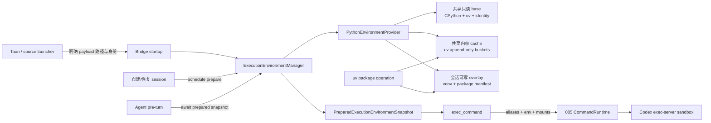

# 受管本地执行环境 - 技术方案

## 状态

CONFIRMED

## 需求文档

[requirement.md](./requirement.md)

## 证据索引

[evidence-index.md](./evidence-index.md)

## 设计目标

本方案在需求 085 的通用命令运行时之上增加一个独立的 execution environment 层。它在应用和会话生命周期中提前准备可执行环境，再向 `exec_command` 提供不可变的环境快照；命令 Tool 不负责下载解释器、创建虚拟环境或管理共享缓存。

核心目标如下：

1. Windows 正式产品携带固定、可校验的 CPython 和包管理器，不解析用户 Python。
2. 应用级基底和依赖制品跨会话共享，会话可写环境彼此隔离。
3. 新会话创建后即开始准备环境，首个 Agent run 在模型采样前取得确定状态。
4. `exec_command` schema 与审批模型不变；模型使用稳定的 `python`、`python3` 和包管理命令，不接触内部绝对路径。
5. Python 是第一个 provider，不是写死在命令 Tool 中的特殊分支；后续 runtime 复用同一生命周期、身份、挂载和诊断接口。
6. 095 继续拥有错误后的继续、暂停和终止语义；096 只返回真实、稳定的 capability 与工具结果。

## 已确认边界

- 不修改 system prompt、persona 或 Skill 指令来弥补环境缺失。
- `exec_command` 继续是唯一模型可见的本地进程入口，不新增 Python Tool 或依赖安装 Tool。
- 工具 description 只做事实同步：说明产品管理的 runtime alias 和独立包安装命令；不加入事故答案或路径猜测策略。
- 首期依赖只接受兼容 wheel，禁止 sdist、editable、Git dependency 和现场编译。
- 正式安装包首期只交付 Windows x64；source mode 保持相同工具与结果语义。
- 095 当前正在修改 Conversation、Runtime、scheduler、tool policy 和终态投影。096 不修改这些恢复内核；实现前先 rebase 095 的合入结果，再只通过公开装配与 hook 边界接入。

## 总体架构



分层职责：

| 层 | 所有者 | 职责 |
| --- | --- | --- |
| 产品 payload | package / Tauri | 携带固定 CPython、uv、许可证和内容身份；把绝对入口传给 Bridge |
| Execution environment | 新模块 | 全局准备、session overlay、alias、child env、共享 cache、quota、GC、health 和 diagnostics |
| Command Tool | 085 既有模块 | 解析模型请求、审批、sandbox roots、启动、输出、取消和结果；消费环境快照 |
| Agent run recovery | 095 | 决定工具失败后继续、换路线、等待或终止；不参与环境 provisioning |

## 模块设计

### 目录与公共类型

新增局部模块：

```text
agent/src/agent/execution_environment/
├── __init__.py
├── manager.py
├── models.py
└── python.py
```

不建立动态插件发现或 entry point 系统。Bridge 在装配时显式传入 provider tuple；首期只注册 `PythonEnvironmentProvider`。

`models.py` 定义以下不可变类型：

```python
@dataclass(frozen=True)
class EnvironmentProviderIdentity:
    provider: str
    schema_version: int
    runtime_version: str
    runtime_sha256: str
    manager_version: str
    platform: str
    architecture: str


@dataclass(frozen=True)
class PreparedProviderEnvironment:
    identity: EnvironmentProviderIdentity
    aliases: Mapping[str, Path]
    readonly_roots: tuple[Path, ...]
    session_root: Path
    child_env: Mapping[str, str]
    revision: int


@dataclass(frozen=True)
class PreparedExecutionEnvironmentSnapshot:
    session_key: str
    status: Literal["ready", "degraded", "unavailable"]
    providers: Mapping[str, PreparedProviderEnvironment]
    prepared_at: datetime
    error_code: str | None
```

`session_key` 继续由 session id 的 SHA-256 映射得到，磁盘路径和 diagnostics 不保存原始 session id。

### Provider 接口

`EnvironmentProvider` 是内部 Protocol，只表达已经存在的变化维度：

```python
class EnvironmentProvider(Protocol):
    name: str

    def prepare_global(self) -> ProviderHealth: ...
    def prepare_session(self, session_key: str) -> PreparedProviderEnvironment: ...
    def resolve_command(
        self,
        snapshot: PreparedProviderEnvironment,
        argv: tuple[str, ...],
    ) -> ResolvedManagedCommand | None: ...
    def release_session(self, session_key: str) -> None: ...
    def collect_health(self) -> ProviderHealth: ...
    def gc(self) -> GcReport: ...
```

Manager 负责 provider alias 冲突检测、并发 single-flight、session future、snapshot 聚合和生命周期；provider 负责自己的 runtime、环境和命令映射。未来增加 Node.js 等 runtime 时新增 provider 和静态装配，不修改 `ExecCommandTool` 的 Python 分支。

### ExecutionEnvironmentManager

Manager 维护三类状态：

- `global_health[provider]`：应用启动后的共享基底状态；
- `session_futures[session_key]`：同一会话并发 prepare 只运行一次；
- `active_snapshots[run_id]`：当前 run 固定使用的环境身份，不在运行中切换 base。

公开操作：

- `start()`：并行执行各 provider 的轻量 `prepare_global`；不在产品运行期下载 runtime。
- `schedule_session(session_id)`：会话创建或恢复时异步 prepare。
- `snapshot_before_run(session_id, run_id, timeout)`：在模型采样前等待既有 future，必要时补启动；返回 ready/degraded/unavailable snapshot。
- `snapshot_for_tool(session_id, run_id)`：只读取本 run 已绑定 snapshot，不重新 provisioning。
- `release_run(run_id)`：释放引用，允许旧 provider identity 被 GC。
- `delete_session(session_id)`：删除 session overlay 和 manifest；共享 base/cache 不受影响。

普通聊天不因 Python unavailable 被拒绝。Manager 仍返回 unavailable snapshot，Command Tool 只有在命令解析到该 provider alias 时才返回 `managed_environment_unavailable`；其它本地 CLI 和非工具对话保持可用。

## 准备时机与并发

### 应用启动

Bridge lifespan 创建 Manager 并调用 `start()`：

1. 读取由 Tauri/source launcher 显式注入的 base 和 uv 路径；
2. 校验文件、vendor identity、产品 build 绑定和平台架构；
3. 运行有界、无网络健康检查：Python 版本/标准库 import、uv version/cache schema；
4. 清理未发布 staging，并只读盘点 quota/GC 候选；
5. 发布 global health。

正式产品缺少或篡改 payload 时不回退宿主 PATH。Bridge 可以继续服务普通聊天，但 execution environment 标为 unavailable；安装清单本身损坏时仍服从既有 installer integrity 的 fail-closed 启动规则。

### 新建和恢复会话

`POST /v1/sessions` 成功持久化 session 后调用 `schedule_session`。任何绕过该路由的现有 session、IM 或 system trigger 仍由 pre-turn 的 `snapshot_before_run` 兜底，因此准备事实只有一个 owner。

session prepare 使用 `session_key + provider identity` 文件锁和 sibling staging：

1. 若匹配 identity 的环境 manifest 与 health smoke 均有效，直接返回；
2. 否则在 staging 创建环境，不修改已有 current；
3. 完成解释器、site、alias 和权限 smoke；
4. 写入 manifest 并 fsync；
5. 原子发布新目录和 `current.json`；
6. 活跃 run 继续引用旧 snapshot，新 run 使用新 identity。

pre-turn 最多等待 30 秒。超时或失败得到 degraded/unavailable snapshot 后仍可进入模型；第一次 `exec_command` 不再继续后台初始化或偷偷切换环境。后续 run 可以在状态变化后取得新 snapshot。

096 通过 Bridge 装配注册 PRE_TURN callback，不修改 095 正在重构的 AgentRuntime 执行和终态代码。095 合入后如果 hook contract 变化，以其正式公开扩展点适配。

## Python Provider

### 正式 Windows base

候选 payload 固定为：

- CPython `3.12.14`，python-build-standalone `20260814`；
- `x86_64-pc-windows-msvc-install_only_stripped` shared build；
- uv `0.12.5` Windows x64；
- runtime 只使用仓库 lock 中的完整 URL、SHA-256、许可证和 identity，不查询“latest”。

当前 release metadata 中候选 digest：

- CPython archive：`89f18f6932917163b74339ebcec2645c8e47ae7f1c5f2ac37f2b4f4cf3beb647`；
- uv archive：`4c4d49d8738847d9b71ba319e49a5688c93eac0fe6204b1df24e98528dddf39a`。

实现开始先下载到受控临时目录，二次计算 hash，核对 license inventory、重定位、`venv`、SSL、sqlite、zip、JSON、CSV、tar/zip archive 和一个带原生 wheel 的 import spike；任一失败都在最终 lock 落盘前更换候选，不把未经验证的 metadata 当作完成证据。

运行期 base 位于 active versioned payload：

```text
runtime/
├── python/                         # 既有 PyInstaller service runtime，不改职责
└── execution-environments/
    └── python/
        ├── base/                   # CPython shared install_only，产品只读
        ├── bin/uv.exe              # 固定 uv
        ├── identity.json
        └── licenses/
```

Tauri 从 active payload 解析路径，向 Bridge 设置 `AGENT_FRIEND_EXECUTION_ENVIRONMENT_ROOT`。Bridge 只接受 manifest 内路径，不扫描用户 PATH 或注册表。

### Source mode

Source Bridge 使用当前项目环境的 `sys._base_executable` 作为 Python base，并使用 dev 启动脚本解析到的 uv 绝对路径。实际版本和路径进入 provider identity；它仍创建独立 session overlay，不把项目 `.venv` 当作用户脚本环境，也不继承项目 site-packages。

source mode 的能力语义、alias、隔离和错误与 packaged mode 一致；正式供应链与无宿主 Python 保证只由 Windows packaged AC 证明。

### 会话 overlay

用户数据根下新增：

```text
execution-environments/
├── sessions/
│   └── session-<sha256>/
│       └── python-<provider-identity>/
│           ├── venv/
│           ├── packages.lock
│           ├── manifest.json
│           └── cache/              # pip fallback 的会话私有 cache
├── shared-cache/
│   └── uv-<uv-cache-identity>/
├── staging/
└── locks/
```

provider 使用固定 base 创建标准 venv，设置 `PYTHONNOUSERSITE=1`、`PYTHONSAFEPATH=1`、`PYTHONUTF8=1`、`PIP_CONFIG_FILE` 指向空配置、`PIP_NO_INPUT=1` 和 `PIP_DISABLE_PIP_VERSION_CHECK=1`。不继承 `PYTHONPATH`、`VIRTUAL_ENV`、pip/index/keyring 配置或用户 site。

`python`、`python3` 解析到 session venv。`py` 不伪装成 Python launcher；模型若显式请求宿主 `py`，仍按普通宿主 CLI 处理，不能作为 managed Python 证据。

## 依赖安装与共享 cache

### 受管 package operation

Python provider 把以下独立直接调用规范化为 managed package operation：

- `uv pip ...`；
- `pip ...` / `pip3 ...`；
- `python -m pip ...` / `python3 -m pip ...`。

只接受结构化 `argv` 或现有 parser 能无歧义识别的单一直接命令。包含管道、重定向、shell 控制符或嵌套字符串的 package operation 返回 `managed_package_command_requires_direct_invocation`，不通过 shell 猜测和提权。

宿主把 install/uninstall/list/show/freeze/check/tree 等允许动作转换为固定 uv executable，并注入：

- session venv 的显式 `--python`；
- `--no-config`、`--no-python-downloads`；
- product-owned `--cache-dir`；
- Windows `--link-mode copy`；
- install/sync 时的 `--no-build`；
- disabled keyring、无交互和有界并发。

首期 registry 固定公共 PyPI，另允许已经由文件授权覆盖的本地 `.whl`。拒绝 sdist、editable、Git/URL dependency、credential-bearing URL、自定义 index、`--system`、cache management、Python download、tool install 和任意 uv 子命令。

安装 registry package 必须由原 `exec_command` 请求 `filesystem=read_write` 与 `network=enabled`；本地 wheel 不需要网络，但仍需写权限。审批显示用户提交的语义命令和“产品 Python · 当前会话环境”，不展示内部 payload/cache 绝对路径。

### cache 权限与链接模式

共享 uv cache 只在规范化 managed package operation 的 sandbox 中作为可写内部 root；普通 Python、shell、Skill 和其它命令不获得该 root。cache maintenance 只由 Manager 在没有活跃 writer 时执行。

uv cache 作为 disposable、append-only 内容存储，不是用户数据真相源。Windows 强制 `copy`，禁止默认 hardlink 和 symlink，避免 session site-packages 被修改时反向改变共享 cache。macOS/Linux source mode也使用 copy 以保持一致安全语义，后续只有实测 copy-on-write 能保持隔离时才可单独改为 clone。

包操作成功后 provider 更新 session `packages.lock` 和 environment revision；失败不发布新 lock。两个会话使用相同 wheel 时复用 shared cache，但安装目录、lock 和 import path 始终独立。

### 配额与 GC

首期内部默认值：

- 单 session Python overlay：1 GiB、25,000 files；
- shared uv cache：4 GiB，高水位触发 prune，目标降到 3 GiB；
- 全部 inactive session overlay：8 GiB，高水位按 LRU 回收；
- staging：24 小时无 owner 即清理；
- 活跃 run、正在 prepare 或 package operation 的目录永不回收。

被 LRU 回收的 session 保留最小 `packages.lock`，下次打开时从 base + shared cache 重建；cache miss 且网络未获授权时环境进入 degraded，不能静默联网。Manager 在安装前检查已有用量和宿主剩余空间，安装期间监控环境/cache 增量，超限时取消受管 package process；命令运行时继续负责进程树终止。

## CommandRuntime 集成

`ExecCommandTool` 在解析普通命令前读取当前 run 的 `PreparedExecutionEnvironmentSnapshot`：

1. provider 先尝试解析稳定 alias 或 package operation；
2. 未命中才进入 085 既有绝对路径/宿主 PATH 解析；
3. managed 命令使用 provider 给出的真实 argv、child env 和内部 roots；
4. approval 保留原始语义 argv，并增加 provider name/version/隔离环境标签；
5. result 增加小型 `execution_environment` 元数据：provider、runtime version、environment revision、cache hit（包操作时）和状态；不返回内部路径。

managed Python 只允许 `execution=sandboxed`。`host_user` 使用 `python`/`python3`/`uv` 等 managed alias 时返回 `managed_environment_requires_sandbox`；用户显式提供绝对宿主程序并批准 `host_user` 仍按 085 普通宿主能力处理，但不能标记为产品 Python。

现有 Tool JSON Schema 不新增 environment id、provider path 或 session key。所有这些事实由宿主从 run/session snapshot 唯一推导，模型不复制内部标识符。

## 错误与 095 边界

provider 错误使用普通 `ToolResult(is_error=True)`，至少包含稳定 code、provider status、是否执行和下一项有意义条件：

| code | 语义 |
| --- | --- |
| `managed_environment_unavailable` | base 缺失、损坏或身份不匹配；本次命令未执行 |
| `managed_environment_prepare_failed` | session overlay 无法创建或恢复；本次命令未执行 |
| `managed_environment_quota_exceeded` | 现有或新增环境超出资源政策 |
| `managed_package_command_requires_direct_invocation` | package operation 不能从复合 shell 安全规范化 |
| `managed_package_source_unsupported` | 请求了 sdist、Git、URL、editable、私有 index 或其它首期不支持来源 |
| `managed_package_distribution_unavailable` | 没有与当前 Python/平台兼容的 wheel |
| `managed_cache_integrity_failed` | cache/identity 无法安全复用，已拒绝发布或安装 |

这些错误不设置 Python 专属重试次数、`no_progress` stop 或 run 终态。095 决定模型是否改用标准库、换路线、申请合规网络、说明能力缺失或最终停止；096 不调用 Conversation/Runtime 的停止 API。

## 生命周期、取消与一致性

- session prepare 由 Manager future 管理，不属于 LLM 工具调用；用户取消 run 会释放等待，但不会删除仍属于 session 的 overlay。
- package operation 和 Python process 仍由 085 注册到当前 run，取消、超时和 Bridge shutdown 终止整个进程树。
- environment revision 只在包操作成功并完成 manifest 更新后递增；失败命令不伪造新 revision。
- 一个 run 的 base/provider identity 固定。产品更新或 repair 产生新 identity 时，旧 run 结束后才允许回收旧环境。
- 删除 session 时先确认没有 active run，再删除 overlay；共享 cache 只减少引用，不跟随单个 session 删除。
- Bridge 异常退出后，启动清理 staging/lock 并验证 manifest；半成品不成为 current。

## 打包与供应链

新增：

- `scripts/package/vendor/managed_python.lock.json`：CPython/uv 版本、完整 URL、SHA-256、平台、架构、许可证与候选能力；
- `scripts/package/vendor/managed_python.py`：安全下载、archive path 校验、提取、identity 和 staging；
- package dependency policy、runtime inventory、THIRD-PARTY-NOTICES 与 doctor 检查；
- install contract capability `runtime-managed-execution-python`。

构建只在 package 阶段下载锁定制品，支持 offline cache；运行期不下载解释器或 uv。archive 提取拒绝绝对路径、父目录跳转、链接逃逸和重复目标。

该变更属于 `package-sensitive`：实现完成后至少构建真实 Windows frozen candidate 并运行 capability smoke。由于 AC 要求实际安装后的干净机器行为，最终验收还需受治理的 local-test installer 与隔离 installer smoke；不触碰 production 安装。

## Diagnostics 与隐私

新增 diagnostic capability `managed-execution-environment-v1`，只输出：

- provider 名称、状态、版本、identity 摘要和平台；
- global/session prepare 的稳定 error code 与耗时分桶；
- active/inactive overlay 数、总字节分桶、shared cache 字节分桶；
- 最近一次 GC/repair 状态；
- 当前 bundle 是否声明并校验 runtime payload。

不输出 session id/key、绝对用户路径、包名列表、脚本正文、文件正文、index URL、环境变量值、完整命令或 stdout/stderr。

修改诊断结构时同步更新 producer machine contract、Rust producer、inspect Skill handler、format reference 和 consumer fixture，schema revision 加性升级并保持旧 bundle 可读。项目 Skill 变更按 skill/rule 维护流程执行 adapter sync/doctor。

## 主要代码影响

| 路径 | 变化 |
| --- | --- |
| `agent/src/agent/execution_environment/` | 新增 manager、models 与 Python provider |
| `agent/src/agent/command_runtime/tools.py` | 消费 run snapshot、managed alias/package operation、内部 roots 与结果摘要；不接管 prepare |
| `agent/src/agent/tools/factory.py` | 注入 EnvironmentManager |
| `agent_bridge/src/agent_bridge/assembly.py` | 构造 Manager、启动 global prepare、装配 Tool |
| `agent_bridge/src/agent_bridge/agent_runtime_factory.py` | 注册 pre-turn session prepare callback，不修改 Runtime 恢复内核 |
| `agent_bridge/src/agent_bridge/routes/meta.py` | 新 session 创建后 schedule prepare；删除 session 时释放 overlay |
| `frontend/src-tauri/src/runtime_services/supervisor.rs` | 从 active payload 注入 execution environment root |
| `scripts/package/**` | vendor lock、stage、inventory、doctor、capability/installer smoke 与 dependency policy |
| `frontend/src-tauri/src/diagnostics/**` | 新增脱敏 capability 和 machine contract |
| `.cursor/skills/inspect-agent-friend-diagnostics/**` | 同步 consumer handler、format reference 与 fixture |

不新增前端设置或新视觉表面。现有命令审批卡只消费加性语义标签；若实现过程中必须改变布局，再按前端视觉验收规则单独确认。

## 验证方案

### 确定性单元与集成测试

- provider identity、alias collision、宿主 PATH 污染和 source/packaged resolver；
- global/session single-flight、原子发布、崩溃 staging、旧 identity 切换和 active snapshot 引用；
- 新 session schedule 与 pre-turn wait，证明 Conversation/LLM 在 prepare 后开始；
- Python 标准库、多文件脚本、JSON/CSV、tar/zip、Unicode 和退出码；
- 用户 `PYTHONPATH`、sitecustomize、venv、pip config、registry/App Execution Alias 不进入环境；
- `pip`/`python -m pip`/`uv pip` 规范化，复合 shell 拒绝，schema 与 approval 显示保持一致；
- wheel-only、本地 wheel、无兼容 wheel、网络拒绝、quota、取消和并发安装；
- 两个 session 同包命中 shared cache，但修改 A 的 site-packages 不改变 B 或 cache；
- Windows copy link mode 证明环境文件与 cache 不是同一可变 inode/file identity；
- cache bucket/version、prune、LRU overlay 重建和无网络 degraded；
- unavailable Python 不影响普通 CLI 和普通聊天；工具错误由 095 通用路径继续处理。

### Source 与 frozen smoke

1. source mode 运行 provider/command/Bridge 定向测试；
2. `scripts/check/run.ps1 --stage backend`；
3. package runner 构建 `package-sensitive` frozen candidate；
4. staged doctor 实际运行 CPython、uv、venv、标准库和本地 wheel fixture；
5. local-test installer 在隔离 profile 安装，移除用户 Python/PATH 后运行完整 capability smoke；
6. 篡改 base、uv、identity、cache 和 session manifest，分别证明正确失败关闭；
7. 两次独立 session 的受控本地 index/network fixture 证明 cache 复用；
8. 一次受批准公开 PyPI wheel smoke 证明真实 DNS/TLS/proxy/download，不调用真实 LLM。

### 095 对账与行为回归

096 实现前先等待或读取 095 最终合入状态并 rebase。使用 deterministic fake model 覆盖：

- managed Python ready 时直接完成脚本任务；
- provider unavailable 时模型获得普通工具错误并可使用替代路线；
- package 无 wheel 时不重复原样调用；
- 用户取消、安全拒绝和显式预算仍按 095 终止。

096 不重复 095 的 malformed、no-progress 和终态 case group，也不为本次诊断模型另建 Python 专属 retry judge。

## 兼容与迁移

- `exec_command` 输入 schema 不变；现有调用不使用 managed alias 时行为不变。
- Command result 只增加可选 `execution_environment` 摘要，旧消费者忽略即可。
- session 环境是可重建派生状态，不写入会话事件正文；持久化只保存 provider identity、revision 和 packages lock。
- 首次升级安装新增 payload 与用户数据目录，不改用户 PATH、注册表 Python、文件关联或用户 pip 配置。
- 产品降级或回滚遇到未知 provider/cache identity 时不读取；保留数据等待兼容版本或由受治理 GC 清理。
- 095 合入后的公开 run/pre-turn contract 是唯一集成基线，不保留针对其分支中间形态的 shim。

## 风险与控制

- **安装包体积增加**：使用 stripped shared archive并记录 payload size；不重复打包现有 PyInstaller modules，实际 spike 后再确认最终制品。
- **shared cache 被会话污染**：cache 只挂载给规范化 uv package operation，禁用 cache 子命令；Windows 使用 copy，session Python 不获得 cache root。
- **环境准备拖慢首轮**：应用启动预热 base，新 session 立即异步 prepare；pre-turn 只等待同一个 future并记录耗时。超时降级，不在首次工具再次冷启动。
- **provider 抽象过度**：接口只覆盖 Python 已经需要的 identity、prepare、resolve、mount、health 和 GC；首期静态注册一个 provider，不做插件市场或动态 discovery。
- **包安装执行任意构建代码**：固定 `--no-build`，拒绝 sdist/editable/Git/URL 和自定义 index；wheel 内容只进入当前 session，后续执行仍在 sandbox。
- **095 并行冲突**：不修改其恢复内核，rebase 后使用正式 hook；共享文件冲突先报告，不复制中间实现。
- **诊断泄漏任务信息**：只输出版本、状态、计数和分桶，不输出包名、session key、路径或脚本内容。

## 实施顺序

1. 用锁定候选制品完成 Windows portable Python/uv、venv、wheel、重定位、license 和体积 spike，固化 vendor lock。
2. 实现 execution environment models/manager/Python provider，以及 global/session preparation、identity、quota 和 GC 单测。
3. 在 Bridge startup、session create 和 pre-turn 接入提前准备；不触碰 095 恢复内核。
4. 将环境 snapshot 接入 `exec_command` 的 alias、child env、sandbox roots、approval 和结果；实现受管 package operation 与 shared cache。
5. 更新 package staging、Tauri runtime discovery、install inventory、doctor 和 deterministic frozen smoke。
6. 更新 diagnostics producer/consumer contract，并完成旧 bundle 兼容测试。
7. rebase/对账 095 最终实现，运行定向、全量、frozen 和隔离 installer 验证。
8. 在确定性验证通过后执行一次不含 LLM 的公开 wheel smoke，整理 AC 证据并进入用户验收。

## 变更记录

| 日期 | 变更内容 | 是否影响需求范围 |
| --- | --- | --- |
| 2026-08-21 | 首次确认技术方案：通用 execution environment manager + Python provider；应用级共享 base/cache、会话前准备隔离 overlay；CPython/PBS + uv；wheel-only；复用 085 命令治理和 095 运行恢复。 | 否，与已确认 requirement 一致 |
