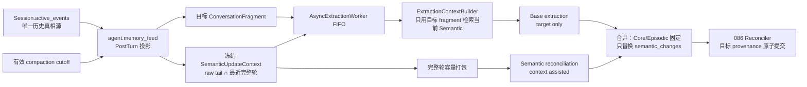

# 097 · 上下文辅助的 Semantic 纠错 · 技术方案

## 状态

CONFIRMED

## 需求文档

[requirement.md](./requirement.md)

## 0. 方案边界

本方案只改变长期记忆写入链路：

- `agent` 在 PostTurn observe 边界，从权威 `Session` 投影目标 fragment 和只读的邻近完整轮次；
- `memory` 把邻近上下文作为 Semantic reconciliation 的辅助输入；
- 目标 fragment 仍是唯一的新记忆与 provenance 来源；
- 086 的 Semantic retirement / introduction 原子提交协议保持不变；
- 098 的 automatic recall scope、检索、排序和注入预算保持不变。

本方案不让 `memory` 读取或持久化 `Session/Event`，不修改 `ContextManager`、`BuildResult`、
摘要生成、FIFO 或主模型上下文组装。为保证 097 与 098 对 compaction checkpoint 的有效性
判断不漂移，只把 `Conversation` 中现有的 checkpoint 校验提取为无副作用的共享 helper；这是一项
调用方薄重构，不新增 visibility snapshot，也不改变 098 的生效时序。

## 1. 现状分析

### 1.1 写入链路只有目标 fragment

当前自然对话在 turn 结束后走：

```text
PostTurn hook
  -> agent.memory_feed.project_turn(new_events)
  -> Memory.observe(ConversationFragment)
  -> AsyncExtractionWorker
  -> ExtractionContextBuilder
  -> Extractor
  -> Reconciler
```

`project_turn` 只保留本轮非空 user message 与非 partial assistant message。Extractor 能看到目标
fragment、完整 Core Profile 和预算内的当前有效普通 Semantic，但看不到本轮之前的原始对话。
因此“不是前面那个”“刚才是我理解错了”等表达可能无法定位被纠正的陈述。

### 1.2 086 已具备写入表达能力

Extractor 已能通过 `semantic_changes` 输出：

- `retirements`：精确引用实际展示的 `[Mxxx]`；
- `new_facts`：引入一个或多个替代事实；
- 只有 retirement、只有 introduction 或两侧同时存在的原子概念变化。

Reconciler 已在单事务内校验引用、结束旧 Semantic、写入新 Semantic 与 change graph。本需求不改
这套协议，只补足 Extractor 理解目标纠错表达所需的证据。

### 1.3 Session 是唯一原始历史真相源

`Session.active_events` 已统一处理 edit/resend 的 inactive 分支；compaction event 也随 Session
持久化，而原始消息不被删除。调用方可以在 PostTurn 时冻结目标 turn 当下的有效 raw tail。若由
`memory` 再保存近期消息，会形成第二份会话真相源，并额外引入重启、编辑重发和压缩同步问题。

### 1.4 098 与本需求使用相反区间

098 在读取路径中允许当前会话的非 Core automatic memory 使用 compaction cutoff 及以前的来源：

```text
source_position <= covered_through
```

097 在写入路径中只把 cutoff 之后、目标 turn 之前仍以 raw 形式存在的连续 tail 当作邻近上下文：

```text
covered_through < source_position < target_turn
```

两者复用 checkpoint 事实，但不互相调用。当前轮新生成的 compaction 只有在模型请求已接受并落盘
后才成为 097 的有效边界；098 仍保持“下一轮 recall 才生效”。

## 2. 总体设计



职责划分：

| 模块 | 责任 |
| --- | --- |
| `agent.context` checkpoint helper | 复用现有规则验证最新 compaction，并返回有效 `PriorSummary` 或结构化失效原因 |
| `agent.memory_feed` | 从 active lineage 选择 raw tail、按完整 turn 分组、应用最近 10 轮策略并冻结契约 |
| `AgentRuntime` / `Conversation` | 在既有 PostTurn observe 点调用统一投影入口；silent turn 保持原路径 |
| `memory.contracts` | 表达目标 fragment 与只读 `SemanticUpdateContext`，不认识 `Event` 或 compaction 类型 |
| `ExtractionContextBuilder` | 继续只根据目标 fragment 构造 Core / Semantic context 和 Semantic query |
| `Extractor` | 先执行现有 target-only 抽取，再用邻近上下文执行 Semantic-only reconciliation |
| `Reconciler` | 继续只使用目标 fragment 计算 observation、provenance 和 Episodic source；不读取邻近上下文 |

## 3. Memory 写入契约

### 3.1 完整轮与上下文快照

在 `memory.contracts` 增加：

```python
@dataclass(frozen=True)
class SemanticUpdateTurn:
    utterances: tuple[Utterance, ...]


@dataclass(frozen=True)
class SemanticUpdateContext:
    turns: tuple[SemanticUpdateTurn, ...] = ()
    covered_through_source_ref: str | None = None
    candidate_first_source_ref: str | None = None
    candidate_last_source_ref: str | None = None
    range_omitted_turn_count: int = 0
    range_omitted_through_source_ref: str | None = None
```

约束：

- 每个 `SemanticUpdateTurn` 必须以 user utterance 开始，并至少包含一个完整 agent utterance；
- turn 内和 turn 间都保持原始会话顺序；
- 所有 `Utterance` 都是 frozen value，turn/context 使用 tuple，入队后不能被调用方追加或替换；
- `covered_through_source_ref` 只记录调用方采用的范围边界，`memory` 不解释 compaction；
- candidate 首尾与省略终点用于诊断连续区间，不复制保存无界的 omitted refs 列表。

### 3.2 ConversationFragment 向后兼容扩展

```python
@dataclass(frozen=True)
class ConversationFragment:
    session_id: str
    utterances: list[Utterance]
    persona_id: str
    owner_user_id: str = DEFAULT_OWNER_USER_ID
    semantic_update_context: SemanticUpdateContext | None = None
```

选择把上下文附在 fragment 上，而不是给 `Memory.observe` 增加平行参数，原因是目标与冻结上下文必须
作为同一个异步队列 item 到达 worker。默认 `None` 使旧调用方、eval fixture、silent turn 和测试
自然保持当前行为。

`fragment.utterances` 仍只表示目标证据。任何 observation id、Episodic `source_ref`、Semantic/Core
provenance 和 speaker bonus 都不得读取 `semantic_update_context`。

## 4. Agent 侧范围投影

### 4.1 统一 PostTurn 投影入口

在 `agent.memory_feed` 保留现有低层 `project_turn(events, ...)`，并新增统一入口：

```python
def project_post_turn_observation(
    session: Session,
    *,
    turn_start_idx: int,
    persona_id: str,
    owner_user_id: str = "local",
    max_context_turns: int = 10,
) -> ConversationFragment: ...
```

该函数一次冻结：

1. `session.events[turn_start_idx:]` 对应的目标新事件；
2. 本次调用时的 `tuple(session.active_events)`；
3. 最新有效 compaction boundary；
4. 目标之前选中的完整上下文轮次。

`AgentRuntime._default_post_turn_observe` 与 `Conversation._observe_turn` 都改调该入口，避免外接 runtime
和直接 Conversation 两条生产路径再次漂移。现有 `project_turn` 保留供 silent turn 之外的旧测试、
回放和显式调用方使用；它不自行查询历史，默认不产生邻近上下文。

### 4.2 目标锚点

投影先从目标新事件中筛出与现有规则相同的 target utterances，再用第一个仍位于 active lineage 的
目标 user/assistant event 作为 `target_start`。上下文只允许来自该位置之前。

- edit/resend marker 和已失活旧分支不进入 `active_events`；
- target fragment 本身永不进入 `SemanticUpdateContext`；
- 目标只有 user 或发生现有失败/取消形态时，不新增 outcome 判断，仍沿用当前 observe eligibility；
- silent `memory_only` turn 继续由既有专用路径处理，默认 PostTurn hook 直接跳过。

### 4.3 有效 compaction boundary

把 `Conversation._derive_prior_summary_from_events` 内的纯校验提取为共享 helper，返回：

```python
@dataclass(frozen=True)
class PriorSummaryResolution:
    prior_summary: PriorSummary | None
    status: Literal["none", "valid", "legacy_revalidated", "invalid"]
    invalid_reason: str = ""
```

它继续执行现有校验：

- summary 与 `covered_through_uuid` 必须存在；
- covered event 必须位于当前 active message 顺序；
- checkpoint v2 的 source / covered / retained 必须连续；
- legacy checkpoint 继续按现有规则重新验证。

`Conversation` 复用 resolution 维护已有 checkpoint diagnostics；`memory_feed` 只读取有效
`covered_through_uuid`。没有有效 boundary 时按“无 compaction”处理，不猜测旧 cutoff。

同一 target turn 内新生成的 compaction 只有在 provider 接受请求并通过既有
`_commit_pending_context_checkpoints` 落盘后，PostTurn 才能看到；被拒绝、取消前未接受或 invalid 的
checkpoint 不参与范围裁剪。

### 4.4 候选 tail 与完整轮选择

候选区间为：

```text
active conversation events
∩ position > valid covered_through（若存在）
∩ position < target_start
```

然后按 user 边界切 turn，并应用：

- 只保留非空 user text；
- 只保留非空、`partial=False` 的 assistant text；
- 工具、系统、skill、compaction、模型状态和其他事件不转成 utterance；
- 缺少完整 assistant 的悬空 user turn 不作为邻近上下文；
- boundary 若异常落在一个 turn 中间，丢弃该不完整首段，不跨 boundary 拼 turn；
- 取最新 10 个完整 turn，最终仍按旧到新顺序输出。

10 轮是业务范围上界，不是模型容量。存在 compaction 时，它只在压缩后的 raw tail 内取最近 10 轮；
不存在 compaction 时，它在全部 active history 中取最近 10 轮。正常重启后，同一 Session/Event 与
checkpoint 会得到等价投影。

## 5. 异步冻结与数据所有权

`Memory.observe(fragment)` 的签名不变，worker 队列仍只接收一个 `ConversationFragment`。新增上下文
在 `observe` 之前已经是不可变 tuple，因此：

- 后续新消息、edit/resend 或 compaction 不会修改已入队任务；
- worker 不持有 `Session`、`SessionStore` 或 context manager 引用；
- memory 数据库不新增 raw message 表或 checkpoint 表；
- `flush/close` 与异常退出时未完成任务丢失的现有语义不变。

项目重启后的“一致”指同一持久化 Session 在同一目标位置重新执行投影会得到相同范围；本需求不新增
持久化 extraction queue，也不自动重放崩溃前尚未完成的 observe。

## 6. 两阶段 Extractor

### 6.1 Base extraction 保持 target-only

第一阶段继续使用现有 `extract.md`，输入仍只有：

- 完整 Core Profile；
- 预算内展示的当前有效普通 Semantic；
- 目标 `fragment.utterances`。

邻近上下文不进入 `ExtractionContextBuilder` 的 Semantic query，也不进入 base prompt。第一阶段产出
现有完整 `ExtractionOutput`，负责 Core、基础 Semantic 和 Episodic。

没有 `SemanticUpdateContext` 或容量打包后为空时，到此结束，行为与当前版本一致，只产生一次 LLM
调用。

### 6.2 Semantic reconciliation pass

新增 `memory/extraction/prompts/reconcile_semantic.md`。当存在可用邻近上下文时，第二阶段接收：

- 当前实际展示的 `[Mxxx]` 普通 Semantic；
- 只读邻近完整轮次；
- 明确标记为唯一可写证据的目标 fragment；
- base extraction 已提出的 `semantic_changes`。

只允许返回：

```json
{
  "semantic_changes": [
    {
      "retirements": [
        {"target_ref": "M003", "reason": "目标片段明确纠正了该旧事实"}
      ],
      "new_facts": [
        {
          "statement": "用户目前每周游泳一次",
          "importance": 0.6,
          "speaker_origin": "user",
          "reason": "替代事实由目标片段明确给出"
        }
      ]
    }
  ]
}
```

prompt 约束：

- 邻近上下文只帮助定位指代、纠错主体和旧 Semantic；
- 不得仅根据邻近上下文引入新事实；新事实必须由目标片段可靠表达；
- 用户纠正可以撤回与之冲突的旧事实；
- 助手明确撤回自己的旧解释时可以 retirement 对应错误 Semantic；
- 助手新的自主判断不能推翻用户仍有效的明确陈述；
- 无法唯一定位时保留 base 结果，不猜测 `[Mxxx]`。

第二阶段输出使用独立严格 parser：顶层只接受 `semantic_changes`，复用 086 的 change/member 解析；
出现未知形状、非法 JSON、LLM error 或非法 change 时，记录 fallback reason 并保留 base
`semantic_changes`。

### 6.3 合并规则

```python
final_output = ExtractionOutput(
    core_updates=base.core_updates,
    semantic_changes=reconciled_changes,
    episodic_entries=base.episodic_entries,
    output_contract_version=base.output_contract_version,
)
```

- reconciliation 成功时，它返回的是最终完整 `semantic_changes`，可保留、合并、删除或补充 base
  的概念变化；合法空数组表示目标最终不应产生普通 Semantic；
- reconciliation 失败时使用 base `semantic_changes`；
- Core 与 Episodic 永远来自 target-only base，形成结构化隔离，而不是只靠 prompt；
- Reconciler 接收 final output、原 target fragment 和同一个 `ExtractionContext`，因此现有引用校验、
  原子事务与 target-only provenance 不变。

## 7. 容量保护

### 7.1 两道不同的边界

Agent 的最近 10 轮决定“业务上哪些历史有资格参与”；Memory 的容量打包只保证实际第二阶段请求不
超过抽取模型窗口。Memory 不得越过调用方提供的 turns 回查更旧历史。

### 7.2 动态预算

Extractor 从 `LanguageModel.context_window` 获取窗口，使用现有近似 token 估算器计算：

```text
safe_input_limit = floor(context_window * 0.80)
mandatory = reconciliation system prompt
          + displayed Semantic
          + target fragment
          + rendered base semantic_changes
hard_context_budget = max(0, safe_input_limit - mandatory)
soft_context_budget = min(64_000, floor(context_window * 0.25))
```

常规 context budget 为 `min(hard_context_budget, soft_context_budget)`。保留 20% 窗口用于估算误差与
模型输出；64k 是容量保护上限，不是调用方历史范围。

### 7.3 完整轮打包

从最新 turn 向前打包，最后恢复为时间正序：

- 只接受连续的最近完整 turn 后缀；
- 不截断单条 utterance，也不拆半个 turn；
- 如果最新一轮超过 64k soft budget，但仍小于 hard budget，允许只保留该一轮；
- 如果最新一轮连 hard budget 也放不下，则上下文为空并记录 `latest_turn_exceeds_hard_budget`；
- 某个更旧 turn 放不下时立即停止，不跳过它再选择更旧、更小的 turn，避免形成非连续语义片段。

base extraction 的现有 50k Semantic budget不因邻近上下文而改变；第二阶段若 mandatory 已超过安全
输入上限，则跳过 reconciliation 并回退 base，不让新增能力扩大现有失败面。

## 8. 诊断与可观测性

### 8.1 Agent 投影日志

PostTurn 投影记录结构化字段：

- session id、target first/last source ref；
- checkpoint status、covered-through ref；
- candidate first/last ref；
- candidate / selected / range-omitted turn count；
- selected source refs；
- 无上下文原因，例如 `no_prior_complete_turn`、`invalid_checkpoint_fallback`。

日志不记录完整正文。

### 8.2 ExtractionAttempt

向 `ExtractionAttempt` 增加均带默认值的兼容字段：

```python
phase: Literal["base", "semantic_reconciliation"] = "base"
semantic_update_source_refs: tuple[str, ...] = ()
semantic_update_selected_turns: int = 0
semantic_update_capacity_omitted_turns: int = 0
semantic_update_estimated_tokens: int = 0
semantic_reconciliation_fallback_reason: str | None = None
```

有上下文时每个 fragment 最多产生两条 attempt：base 与 semantic reconciliation。旧 fixture 反序列化
时因字段有默认值继续有效；没有上下文的 eval 仍只产生一条 base attempt。

最终提交继续由现有 `ExtractionResult` 表达 introduced / retired Semantic、change ids、commit 或错误。
结合投影日志、attempt 和 result，可以区分：范围内没有上下文、容量省略、模型未纠错、解析回退、
引用被 Reconciler 拒绝与成功 retirement。

## 9. 错误处理与兼容性

| 场景 | 行为 |
| --- | --- |
| 旧调用方不提供上下文 | 只跑 base extraction，现有行为不变 |
| checkpoint 不存在 | 在目标之前的 active history 上取最近 10 个完整 turn |
| checkpoint invalid | 与 098 一致视作无有效边界；记录 invalid reason，不使用猜测 cutoff |
| target 不在 active lineage | 不附加上下文，仍按现有 target fragment 尽力抽取 |
| 没有先前完整 turn | 不跑 reconciliation |
| 上下文超过 soft budget | 保留连续最近完整后缀；允许最新单轮使用 hard budget |
| mandatory 超过 hard limit | 跳过 reconciliation，回退 base |
| reconciliation LLM/解析失败 | 回退 base Semantic；不影响 Core/Episodic 和后续队列 item |
| reconciliation 引用未知或 stale Semantic | 沿用 Reconciler 原子拒绝；不部分提交 |
| edit/resend | active lineage 排除旧分支；现有 memory invalidation 先于新 observe |
| silent `memory_only` | 继续现有专用 observe，不附加上下文、不增加第二次调用 |

契约是纯加性的，不迁移 memory schema 或 session schema。`ConversationFragment` 的 observation identity
仍只由 owner/session/目标首尾 source refs 决定，因此补充上下文不会把同一目标变成新的 observation。

## 10. 文件改动

| 文件 | 改动 |
| --- | --- |
| `agent/src/agent/context/checkpoints.py` | 新增纯 checkpoint resolution helper，复用现有有效性规则 |
| `agent/src/agent/context/__init__.py` | 导出 resolution 类型与 helper |
| `agent/src/agent/conversation.py` | 改用共享 checkpoint helper；直接 observe 路径改调统一 PostTurn 投影 |
| `agent/src/agent/memory_feed.py` | 新增 active tail、完整 turn、最近 10 轮与冻结 context 投影 |
| `agent/src/agent/runtime/__init__.py` | 默认 PostTurn hook 改调统一投影入口；silent 分支不变 |
| `memory/src/memory/contracts.py` | 新增 `SemanticUpdateTurn` / `SemanticUpdateContext`，扩展 fragment |
| `memory/src/memory/__init__.py` | 导出新增公共契约 |
| `memory/src/memory/extraction/extractor.py` | 两阶段调用、容量打包、严格 reconciliation parser 和回退合并 |
| `memory/src/memory/extraction/prompts/reconcile_semantic.md` | 新增 Semantic-only reconciliation prompt |
| `memory/src/memory/extraction/result.py` | attempt 增加 phase、context 与 fallback 诊断字段 |
| `agent/tests/test_memory_feed.py` | 范围、完整轮、compaction、edit/resend、重启等投影单测 |
| `agent/tests/test_runtime_observe_migration.py` | 两条 PostTurn 生产路径仍等价，silent 行为不退化 |
| `agent/tests/test_conversation_edit_resend.py` | checkpoint helper 与 098 recall scope 时序回归 |
| `memory/tests/test_extraction.py` | base/reconciliation 合并、失败回退、目标 provenance 隔离 |
| `memory/tests/test_extraction_context.py` | 完整轮动态容量打包与边界测试 |

实现时若已有测试文件职责更合适，可在同模块内调整测试落点；不得改变上述生产模块所有权。

## 11. 测试与验收映射

### 11.1 确定性单元测试

- 无 compaction：全历史候选与最近 10 个完整 turn；
- 有 compaction：只选择 cutoff 后、target 前的连续 raw tail；
- 当前轮新 compaction：accepted checkpoint 当轮可供 097 使用，但 098 recall 仍下一轮生效；
- invalid / legacy checkpoint 与 Conversation 现有诊断完全一致；
- edit/resend inactive 分支、partial、tool、空消息、悬空 user 和 silent turn；
- Session JSONL 重载前后同一目标锚点得到等价 context；
- fragment 入队后追加事件不会改变 worker 输入；
- 10 轮上界、64k soft budget、单个超软预算 turn、hard budget 失败和连续后缀；
- 无 context 只调用一次 LLM；有 context 调用两次；
- reconciliation 成功只替换 Semantic，Core/Episodic 保持 base；
- reconciliation 空结果、LLM error、invalid JSON/shape 的确定性语义；
- context refs 不进入 observation id、Episodic source 或任何新记忆 provenance；
- 未知/stale Semantic ref 继续由 086 原子拒绝。

### 11.2 回归测试

- 098 `CurrentSessionRecallScope` 与当前会话普通 Semantic / Episodic / raw history 过滤；
- 086 Semantic 多对多 change graph、retirement 和 transaction；
- Core-first 抽取与 Core schema；
- Episodic 具体性、owner/persona 隔离；
- 原 `project_turn`、直接 Conversation 与 AgentRuntime PostTurn observe；
- memory eval 的旧 attempt fixture 与 legacy no-context extractor。

### 11.3 LLM 观察型验收

使用通用化样本覆盖：

- 用户说“不是前面那个”并给出替代事实；
- 助手明确承认此前理解错误并给出正确方向；
- 邻近上下文中有多个相似候选，目标证据不足时不 retirement；
- 助手新推断与用户旧陈述冲突，但没有用户纠正时保留用户事实；
- context 中有值得记忆的信息、target 未重述时不得独立新增。

真实 LLM 运行服从项目的逐次授权规则；自动化测试使用 fake/cassette 固定机制性契约。

## 12. AC 对照

| AC | 设计落点 |
| --- | --- |
| AC-1 / AC-2 | §4 active tail、checkpoint 与最近完整轮 |
| AC-3 | §4 active lineage、过滤与重启重投影 |
| AC-4 | §3 tuple 契约与 §5 队列冻结 |
| AC-5 | §7 动态容量与完整轮连续后缀 |
| AC-6 / AC-7 | §6 Semantic reconciliation prompt 与合并 |
| AC-8 | §6 base/reconciliation 两阶段结构隔离 |
| AC-9 | §3.2 与 §6.3 target-only provenance |
| AC-10 | §3.2 默认 `None` 与 §6.1 单阶段 fallback |
| AC-11 | §8 投影、attempt 和 result 诊断链 |
| AC-12 | §11.1 / §11.3 |
| AC-13 | §9 / §11.2 回归矩阵 |

## 13. 实现顺序

1. 提取 checkpoint resolution helper，并用既有 Conversation/098 测试证明零行为变化；
2. 增加 memory context contracts 与 agent PostTurn 投影，完成范围和冻结测试；
3. 实现完整轮容量打包和 attempt 诊断；
4. 实现 target-only base + Semantic reconciliation 两阶段 Extractor；
5. 补 provenance、edit/resend、silent、098 和 086 回归；
6. 运行局部测试与 `scripts/check`；取得真实 LLM 授权后再执行观察型样本。

## 14. 风险与控制

| 风险 | 控制 |
| --- | --- |
| 第二阶段增加 LLM 调用量 | 只在存在且容量可容纳 context 时调用；异步旁路不增加用户回复延迟；attempt 可观测 |
| checkpoint 解释漂移 | Conversation 与 memory_feed 共用一个纯 resolution helper |
| context 被重新抽取 | base 不看 context；第二阶段只返回 Semantic；Reconciler provenance 只读 target |
| 超长单轮破坏输入 | soft/hard 双预算、完整轮不截断、超 hard 回退 base |
| edit/resend 带入旧分支 | 只从 `Session.active_events` 投影，继续沿用现有 memory invalidation |
| reconciliation 误撤回 | 精确 `[Mxxx]`、目标证据约束、歧义保守、086 stale/atomic validation |
| 新能力影响旧 eval | context 默认 `None`；attempt 新字段带默认值；无 context 保持单调用 |
