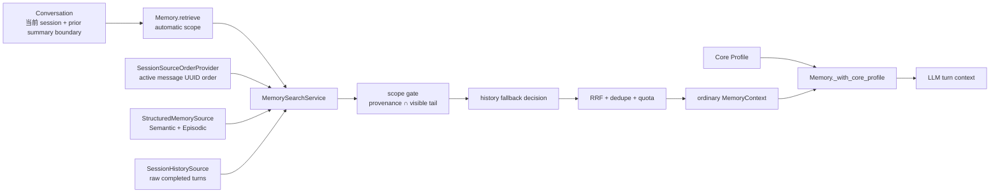

# 098 · 当前可见对话的自动召回抑制 · 技术方案

## 状态

CONFIRMED

## 需求文档

[requirement.md](./requirement.md)

## 0. 方案边界

本方案只改变自动 memory recall 的请求契约、候选过滤和生产 Conversation 薄接线：

- 调用方提供当前会话和允许召回到的事件边界；
- memory 根据候选 provenance 与当前会话 active lineage 做统一过滤；
- Core Profile 继续由 `Memory` 门面始终注入，是唯一永久豁免层；
- 显式历史查询和 probe 不应用本过滤；
- 不修改 `agent/context/`、`ContextManager`、`BuildResult`、摘要生成、FIFO、token 预算或上下文组装顺序。

compaction 只是在当前生产调用方中产生截止边界的一种既有机制。memory 不读取 compaction event，
不理解 summary，也不推导“模型当前可见什么”。

## 1. 现状分析

### 1.1 自动召回发生在上下文组装之前

`agent.Conversation._build_openai_messages_first_turn_stream` 先调用 `Memory.retrieve`，再调用
`_assemble_stream`。当前轮若在 `_assemble_stream` 中新生成 compaction，它天然只能影响后续轮的
自动召回。本需求不重排这两个步骤。

### 1.2 统一搜索已有适合的过滤位置

`Memory.retrieve` 在生产路径中构造 automatic `SearchRequest`，由 `MemorySearchService` 依次调度：

1. `StructuredMemorySource`：普通 Semantic 与 Episodic；
2. `SessionHistorySource`：automatic raw history fallback；
3. `_fuse`：RRF、文本去重、Core/ordinary/raw 配额。

当前 structured 候选还会影响 `_should_search_history`。因此截止过滤必须在每个 source 返回后立即发生，
并且要早于 history fallback 判断、RRF、去重和配额。若只在 `_fuse` 末尾删除，当前会话的新候选仍会
阻止旧 raw history fallback 或占掉更旧候选的名额。

### 1.3 provenance 已足以建立读取期投影

现有数据已经保存以下来源信息：

| 候选 | 现有来源 |
| --- | --- |
| Semantic | `provenance`，新抽取同时包含 fragment 的直接 `session#event` refs 与关联 Episodic IDs |
| Episodic | `source_ref = session#first..last` |
| raw history | `session_id` 与该完整 turn 中的直接 `session#event` refs |

新抽取 Semantic 的 provenance 已含直接原始事件引用。旧 Semantic 若只保留 Episodic ID，
`StructuredMemorySource` 可通过现有 `episodic_by_ids` 在读取期补投影到对应 `source_ref`。
因此本期不需要给 memory 数据库新增 session/turn 列，也不做 schema migration。

### 1.4 Core 已与普通 Semantic 分离

生产自然对话中的 Core Profile 不从 `MemorySearchService` 竞争候选，而是在
`Memory._with_core_profile` 中完整附加。截止过滤只处理普通 Semantic、Episodic 和 utterance；
不得重新引入 pinned 层或把普通高重要性记忆升级为豁免项。

## 2. 总体设计



模块所有权：

- `memory` 定义 scope、顺序提供器 Protocol、判定与 trace contracts，并拥有过滤算法；
- `agent` 用 `SessionStore.active_events` 实现顺序提供器，但不决定候选是否可召回；
- `agent_bridge` 只在生产装配时把 provider 注入共享 `MemorySearchService`；
- `Conversation` 只把既有有效 prior summary 的覆盖终点转换为 scope。

## 3. 搜索契约

### 3.1 显式区分三种调用状态

在 `memory.search.contracts` 增加：

```python
@dataclass(frozen=True)
class CurrentSessionRecallScope:
    current_session_id: str
    recall_through_event_uuid: str | None

@dataclass(frozen=True)
class SearchRequest:
    # existing fields ...
    automatic_recall_scope: CurrentSessionRecallScope | None = None
```

三种状态不可合并：

| 请求 | 含义 |
| --- | --- |
| `automatic_recall_scope is None` | 调用方没有启用本能力；保持既有未限定行为 |
| scope 存在，`recall_through_event_uuid is None` | 能力已启用，但当前会话没有可召回的非 Core 前缀 |
| scope 存在且有 event UUID | 当前会话中该事件及以前的来源可以恢复资格 |

约束：

- scope 只允许用于 `mode="automatic"`；explicit/probe 携带 scope 时直接拒绝错误调用；
- production `Memory.retrieve(source="natural")` 可接收 scope，probe 不透传；
- 现有 `SearchRequest.session_id` 继续承担当前轮 raw history 隔离；若它与 scope 中 session 不一致，
  视为调用契约错误，不猜测采用哪一个；
- 非 Conversation 调用方不提供 scope 时保持兼容。

### 3.2 active lineage 顺序提供器

`memory` 定义只读 Protocol：

```python
class SessionSourceOrderProvider(Protocol):
    def active_conversation_event_uuids(
        self,
        session_id: str,
    ) -> tuple[str, ...] | None: ...
```

`agent.memory_search.SessionStoreSourceOrderProvider` 的实现读取一次目标 session 的 `active_events`，
按原始顺序只投影：

- 非空 user message；
- 已完成、非 partial 的 assistant message。

返回 `None` 表示 session 无法读取或顺序不可用；空 tuple 表示 session 可读但没有有效会话消息。
provider 不返回正文、summary、compaction、token 信息或 context projection。

### 3.3 scope 判定结果

新增独立判定记录，不复用最终 fusion decision：

```python
RecallScopeStatus = Literal["eligible", "suppressed"]

@dataclass(frozen=True)
class RecallScopeDecision:
    evidence_id: str
    status: RecallScopeStatus
    reason: str
    current_session_source_refs: tuple[str, ...] = ()
```

`SearchResult` 增加：

- 本次 source 实际考察过的候选只读投影；
- `scope_decisions`；
- source 级边界过滤数和补位扫描是否截断。

最终 `CandidateDecision` 仍只表达 injected/duplicate/quota。两套 decision 分开，才能同时说明
“属于其他会话所以通过 scope”以及“最后因 ordinary quota 未注入”。

## 4. provenance 与边界算法

### 4.1 来源规范化

读取期只解析现有两种会话引用：

```text
session_id#event_uuid
session_id#first_event_uuid..last_event_uuid
```

- direct ref 投影一个事件；
- range ref 投影首尾两个事件；截止点来自完整 turn，正常情况下不会落在合法 range 中间；
- Semantic provenance 中没有 `#` 的值先按 Episodic ID 批量查询，找到后追加对应 range ref；
- 原 provenance 原样保留，补出的 ref 只存在于 `EvidenceCandidate` 读取投影，不回写数据库。

### 4.2 集合语义

令：

- `P` 为候选可解析到当前 session 的原始事件集合；
- `V` 为 active lineage 中位于 cutoff 之后、仍由原始会话承担的事件集合。

则业务规则是：

```text
P ∩ V 非空  => suppressed
P ∩ V 为空  => eligible
```

实现可以用 active event position 的最大值加速，但“取最新 provenance”不是业务契约。
所有来源都必须保留，以便未来同一事实关联多个 fragment 时仍按集合语义工作。

### 4.3 确定性 reason

按以下顺序判定普通候选：

1. scope cutoff 为空，且候选明确属于当前 session：
   `current_session_empty_boundary`，suppressed；
2. 当前 session 任一来源位置大于 cutoff：
   `current_session_after_boundary`，suppressed；
3. 候选明确属于当前 session，但 cutoff 或候选来源无法在 active lineage 定位：
   `current_session_source_unresolved`，suppressed；
4. 当前 session 全部来源位置小于等于 cutoff：
   `current_session_at_or_before_boundary`，eligible；
5. 候选来源明确只属于其他 session：
   `other_session`，eligible；
6. 候选没有任何可归属的会话来源，且没有 `candidate.session_id` 指向当前 session：
   `legacy_unscoped`，eligible。

“已知当前 session 但顺序未知”与“完全没有会话归属的历史/人工数据”必须分开。前者保守抑制，
后者为兼容既有非会话记忆继续参与召回，但必须进入 trace。

### 4.4 多 provenance 示例

Semantic 同时关联当前 session 的 B、F：

- cutoff=D 时，F 位于 raw tail，候选被抑制；
- cutoff=G 时，B、F 均在边界及以前，候选恢复资格。

Episodic 的 range 若首端在 D 以前、末端在 D 以后，同样抑制。其他 session 的 provenance
不参与当前 session 的位置比较，也不会把候选误判为当前会话新内容。

## 5. 检索编排与补位

### 5.1 每个 source 返回后立即过滤

`MemorySearchService.search` 在一次请求开始时读取一份 active order snapshot。之后对每个 source：

1. 取得 raw candidates；
2. 规范化 provenance 并产生 scope decisions；
3. 保存 suppressed candidates 供 trace 使用；
4. 只把 eligible candidates 交给后续流程；
5. structured 过滤后的集合才参与 `_should_search_history`；
6. 所有 source 完成后才进入 `_fuse`。

这样被抑制的 structured 结果不会错误地阻止 raw history fallback，也不会占 RRF、文本去重、
ordinary/raw quota。

### 5.2 有界渐进补位

scope 生效时，source 的 `limit` 必须作用于过滤后的 eligible 集合。为避免大量新候选排在旧候选前面：

- service 从现有 effective source limit 开始读取；
- eligible 不足且 source 仍返回新 evidence IDs 时，按倍增 limit 重取；
- 取得 `effective_source_limit + 1` 个 eligible、source 耗尽或 raw pool 达到 256 时停止；
- 达到 256 仍可能存在更多候选时，在 `SourceRun` 标记 `scope_scan_truncated`，不得把结果表述为
  “没有更旧记忆”。

该上限只限制本次自动召回的候选扫描成本，不改变已返回候选的截止语义。explicit/probe 不执行这条
额外扫描，也不受 scope 过滤。

### 5.3 Core Profile

Core Profile 继续在 ordinary search 结束后由 `_with_core_profile` 完整附加：

- 不参与 provenance gate；
- 不占普通候选补位预算；
- 不受空 cutoff、边界推进或 scope resolver 降级影响；
- trace 记录 `core_profile_exempt`；
- pinned、priority 或普通 Semantic 不获得该豁免。

### 5.4 provider 缺失或 session 不可读

生产 bridge 必须装配 provider。若 scope 存在但 provider 未装配或 session 不可读：

- 明确归属当前 session 的非 Core 候选按 `current_session_source_unresolved` 抑制；
- 明确属于其他 session 或 `legacy_unscoped` 的候选仍可参与，避免把配置故障扩大为全局记忆失效；
- trace 与日志记录 resolver 状态，不静默退回旧行为；
- Core Profile 继续召回。

## 6. Conversation 薄接线

### 6.1 截止边界来源

`Conversation._build_openai_messages_first_turn_stream` 在调用 `Memory.retrieve` 前计算与本次组装一致的
effective prior summary：

```python
effective_prior_summary = (
    self._derive_prior_summary()
    if prior_summary_override is _UNSET
    else cast(PriorSummary | None, prior_summary_override)
)
```

然后传入：

```python
CurrentSessionRecallScope(
    current_session_id=self._session.session_id,
    recall_through_event_uuid=(
        effective_prior_summary.covered_through_uuid
        if effective_prior_summary is not None
        else None
    ),
)
```

这只是复用已经通过 `_derive_prior_summary_from_events` 验证的旧 checkpoint：

- 无有效 checkpoint 时传 scope + 空 cutoff，而不是省略 scope；
- edit/resend 已有 `prior_summary_override` 时使用同一 prefix boundary；
- 本轮 `_assemble_stream` 新提交的 compaction 不回头重跑 recall；下一轮自然读到新 boundary；
- memory API 不接收 `PriorSummary` 或 compaction event。

### 6.2 多入口

- 持久化 production Conversation 始终提供 scope；
- non-persistent、测试 fake 或独立 memory 调用可以省略 scope，保持兼容；
- explicit `recall_past_chats` 直接构造 explicit `SearchRequest`，不提供 scope；
- Memory Inspector probe 不提供 scope；
- 工具循环只在第 0 次模型调用前召回一次，后续 tool round 沿用已组装的 memory context。

## 7. Trace 与可观测性

`RecallTrace` 增加 automatic scope 摘要：

```text
current_session_id
recall_through_event_uuid
order_snapshot_status
core_profile_exempt_count
```

每个被 source 返回的候选记录：

```text
evidence_id / kind / source
current_session_source_refs
scope_status / scope_reason
final_decision / final_reason（若进入 fusion）
```

要求：

- 被 boundary 抑制的候选也进入 candidate trace，但不进入 `SearchResult.evidence`；
- trace 不新增候选正文副本，只记录现有 evidence ID、类型、来源引用和决定；
- `SourceRun` 记录 raw count、eligible count、suppressed count、渐进扫描次数与
  `scope_scan_truncated`；
- Core Profile 项追加 `scope_reason=core_profile_exempt`；
- `legacy_unscoped` 必须可计数，方便以后判断是否值得单独做数据迁移。

## 8. 涉及文件

| 文件路径 | 改动类型 | 说明 |
| --- | --- | --- |
| `memory/src/memory/search/contracts.py` | 修改 | scope、order provider Protocol、scope decision 与 SearchResult/SourceRun 扩展 |
| `memory/src/memory/search/service.py` | 修改 | per-source 边界过滤、history fallback 前过滤、有界渐进补位和决策汇总 |
| `memory/src/memory/search/structured_source.py` | 修改 | Semantic 旧 Episodic-ID provenance 的读取期 source-ref 扩展 |
| `memory/src/memory/search/__init__.py` | 修改 | 导出新增公共 contracts |
| `memory/src/memory/facade.py` | 修改 | `Memory.retrieve` 透传 automatic scope，Core 豁免 trace |
| `memory/src/memory/contracts.py` | 修改 | RecallTrace scope 与候选决策投影 |
| `agent/src/agent/memory_search/session_source_order.py` | 新增 | 从 SessionStore active events 生成只读消息 UUID 顺序 |
| `agent/src/agent/memory_search/__init__.py` | 修改 | 导出 provider 实现 |
| `agent/src/agent/conversation.py` | 修改 | 使用 effective prior summary 构造 scope；不改变 assemble 顺序 |
| `agent_bridge/src/agent_bridge/assembly.py` | 修改 | 为生产共享 MemorySearchService 装配 provider |
| `agent_bridge/src/agent_bridge/routes/memory.py` | 修改 | 将 scope 与候选判定 trace 暴露给既有 memory inspector API |
| `memory/tests/test_search_service.py` | 修改 | scope 算法、多 provenance、补位、fallback、explicit/probe 回归 |
| `memory/tests/test_facade.py` | 修改 | retrieve 透传、Core 永久豁免和 trace |
| `agent/tests/test_session_history_source.py` | 修改 | active lineage provider 与 raw history 一致性 |
| `agent/tests/test_context_assembly.py`、`agent/tests/test_conversation_edit_resend.py` | 修改 | 无/有 checkpoint、override 与新 compaction 后续生效 |
| `agent_bridge/tests/test_assembly.py` | 修改 | 生产 provider 装配与共享 service 回归 |
| `memory_eval/src/memory_eval/harness/runner.py` | 修改 | 保留新增 scope trace 字段，旧评测调用不启用过滤 |

明确不改：

- `agent/src/agent/context/**`；
- session/compaction 持久化 schema；
- memory store schema 与 migration；
- Extractor、Reconciler、Semantic change/retirement；
- 显式历史工具 schema 与 UI。

## 9. 测试与验证

### 9.1 contract 与纯算法

- scope 省略、scope + 空 cutoff、scope + cutoff 三态；
- explicit/probe 携带 scope 被拒绝；
- `SearchRequest.session_id` 与 scope session 不一致被拒绝；
- cutoff=D 时当前 session D 前后、其他 session 和 unscoped 候选分类；
- cutoff 从 D 推进到 G 后 E-G 恢复资格；
- multi-provenance B+F 在 D/G 两个 cutoff 下的集合判定；
- range 跨越 cutoff、当前来源 UUID 丢失、cutoff 丢失；
- legacy Episodic-ID provenance 可解析时正确归属，完全无会话来源时标记 `legacy_unscoped`。

### 9.2 搜索编排

- boundary 先于 `_should_search_history`，被抑制 structured 结果不会阻止 raw fallback；
- boundary 先于 RRF、文本去重和 ordinary/raw quota；
- 高分新候选超过首批 limit 时，渐进补位能返回更旧 eligible 候选；
- raw pool 触顶时 trace 标记 truncated；
- explicit 与 probe 的 source 调度、排序和结果不变；
- inactive、partial、硬删除、owner/persona 既有过滤继续优先。

### 9.3 Conversation 与装配

- 无有效 compaction：生产 scope 存在且 cutoff 为空；
- 有效 prior summary：透传 `covered_through_uuid`；
- 非法/失效 checkpoint：沿用既有验证结果，传空 cutoff；
- edit/resend：scope 使用 `prior_summary_override`，不误用当前 session 最新 checkpoint；
- 本轮新 compaction 不改变本轮已完成 recall，下一轮使用新 cutoff；
- Core 在所有边界状态下始终存在；
- production bridge 注入 provider，显式历史工具继续共享同一 service 但不应用 scope。

### 9.4 门禁

- 默认使用 fake/store fixture，不调用真实外部 LLM；
- 先运行 memory、agent、agent_bridge 受影响测试；
- 完成实现后运行 `scripts/check/run.ps1` 全量门禁；
- 本需求不新增依赖、资源、动态导入或 schema，按 frozen-runtime 规则归类为 standard，
  不要求构建 PyInstaller runtime 或安装包。

## 10. 影响与风险

| 风险 | 影响 | 缓解 |
| --- | --- | --- |
| scope 的空值被误当成未启用 | 无压缩会话重复召回 | 用 scope 对象是否存在区分，空 cutoff 是明确状态 |
| 多 provenance 只取一个来源 | 可见证据仍被重复注入 | 以来源集合与 visible tail 相交为权威语义 |
| 旧 Semantic 只有 Episodic ID | 无法归属来源 turn | 读取期批量展开，不迁库；无法展开时保留明确 trace |
| inactive/分支来源不在 active order | 错把未知来源当旧来源 | 已知当前 session 但无法定位时保守抑制 |
| 新候选填满 source top-N | 旧候选无法补位 | scope 下渐进扩大 raw pool，过滤后再应用 source limit |
| 渐进扫描导致延迟升高 | 自动召回读路径变慢 | 仅 scope 生效且 eligible 不足时扩大，上限 256 并 trace |
| provider 未装配或 session 读取失败 | 当前会话边界无法比较 | 当前 session fail closed；其他 session、unscoped 与 Core 不被全局误伤 |
| edit/resend 使用错误 checkpoint | scope 与实际 prefix 不一致 | 与 assemble 共用 `prior_summary_override` 输入语义 |
| trace 只看到最终结果 | 无法解释被抑制候选 | SearchResult 分开保存 scope 与 fusion decisions |

## 11. 实施顺序

1. 增加 scope、provider 与 decision contracts，先写纯算法测试。
2. 实现 agent active lineage provider，并固定 source-ref/range/legacy 解析。
3. 在 `MemorySearchService` 接入 per-source gate、history fallback 前过滤和渐进补位。
4. 扩展 `StructuredMemorySource` 的旧 provenance 读取投影。
5. 让 `Memory.retrieve` 透传 scope并补齐 Core/候选 trace。
6. 在 Conversation 薄接线 effective prior summary，在 bridge 注入 provider。
7. 完成跨 source、edit/resend、compaction 后续生效与全量回归。

## 12. 变更记录

| 日期 | 变更内容 | 是否需要重新实现 |
| --- | --- | --- |
| 2026-08-22 | 首次确认；确定显式 scope 三态、provenance 集合过滤、active lineage provider、无迁移兼容与 Conversation 薄接线 | — |
