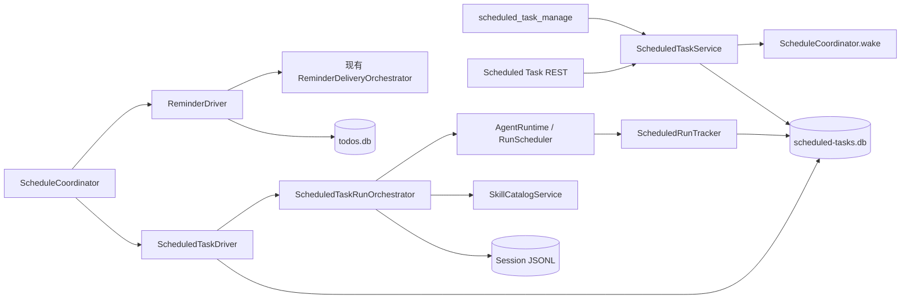
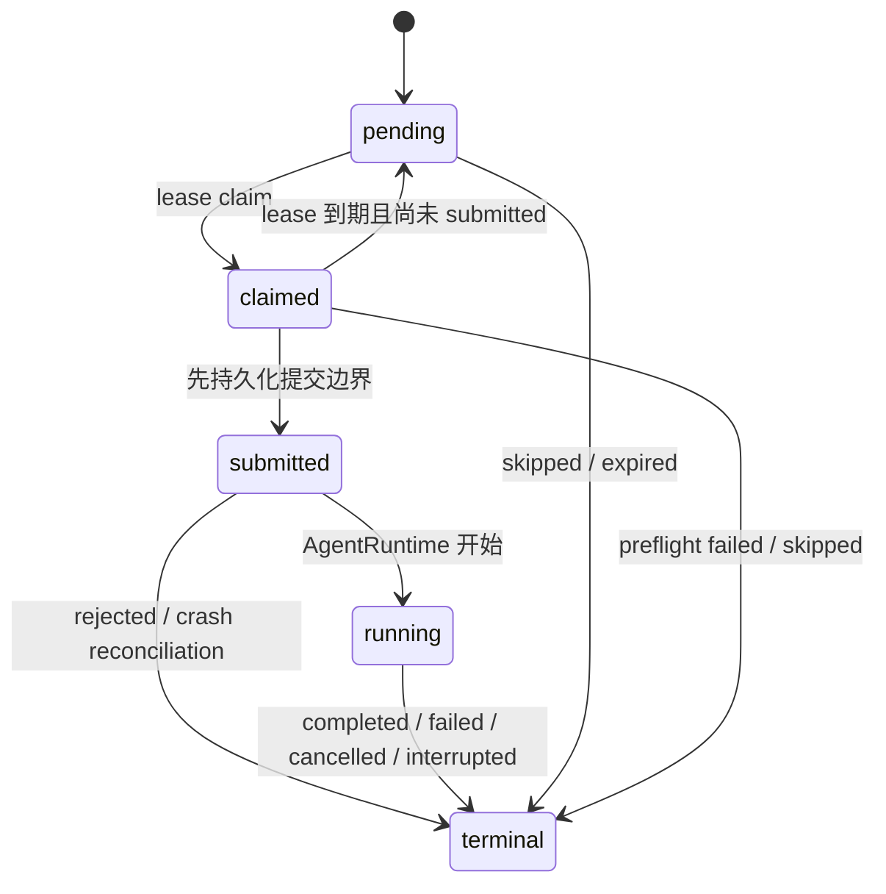

# 099 · 全局 Scheduled Agent Task 与持久调度边界 - 技术方案

## 状态

CONFIRMED

## 1. 需求文档

- [`requirement.md`](./requirement.md)
- [`evidence-index.md`](./evidence-index.md)

## 2. 设计目标

本方案只交付后端调度、持久化、Agent 执行和查询能力。核心目标是：

1. 用一个进程内调度 coordinator 统一时间唤醒，但不把不同领域塞进一套通用业务表。
2. 让 Scheduled Task 拥有独立、可审计的 task/occurrence 生命周期，并复用现有 AgentRuntime。
3. 对已经越过 Agent 提交边界的 occurrence 采用保守的 at-most-once 恢复，避免重启后重复外部副作用。
4. 让 Agent 工具、REST、内部调度和未来 UI 共用同一应用服务与持久化真相源。
5. 在不迁移 Todo/Reminder 数据的前提下，把 Reminder 接到共享调度 coordinator。
6. 不修改任何前端导航、页面、组件、状态或样式，也不决定 issue 056 中的 UI 信息架构。

## 3. 现状分析

### 3.1 当前存在两类不同调度职责

- `agent.runtime.RunScheduler` 负责已经产生的 Agent run：同 session 串行、跨 session 有界并发、优先级、取消和 drain。它不负责持久 schedule，也不能替代本需求的时间调度。
- `agent.todos.ReminderScheduler` 自己持有 condition/thread，负责 Reminder 到期扫描、occurrence claim 和投递调用。Todo store 已经具备 SQLite 事务、唯一 occurrence、claim lease、错过合并和恢复语义。
- `BedtimeSource` 与 `IdleReflectionSource` 继续通过 EventSource 自行等待，本期不迁移。

### 3.2 当前可直接复用的能力

- `agent.todos.recurrence` 已覆盖 IANA 时区、日/周/月周期、月末、DST gap/fold 和停止条件。
- `SessionManager` 可以创建独立持久 session，并装配正常 persona、memory、tools、Skill 和命令运行环境。
- `AgentRuntime.submit` 支持指定 run id、优先级、dedupe、detached consumer、custom conversation runner 和运行元数据。
- `SkillCatalogService.begin_turn` 可以按稳定 `skill_id` 冻结本轮 Skill 来源、正文和内容版本。
- Bridge 已有应用服务、Agent 工具、REST route、lifespan 和装配模式，可沿用 Todo/Reminder 的边界。

### 3.3 当前缺口

- 时间计算与 condition loop 仍由 Reminder 私有，新增领域会复制线程和唤醒逻辑。
- 没有 Scheduled Task 领域模型、独立 store、自然对话工具或 REST API。
- AgentRuntime 的终态只短期保存在内存；Scheduled occurrence 需要自己的长期执行记录。
- 普通 session 没有稳定的 Scheduled 来源字段。若直接创建 session，会未经设计地进入当前会话列表。
- 普通交互允许 Skill 激活失败后由 Agent 解释；Scheduled Task 绑定的 Skill 则必须在模型调用前确定性失败，不能静默退化为无 Skill 运行。

## 4. 总体架构



稳定核心与易变接线分开：

- `agent.scheduling` 只拥有 schedule 计算、driver 协议和 coordinator。
- `agent.scheduled_tasks` 拥有 task/occurrence 领域、SQLite store、应用服务和 driver。
- `agent.todos` 继续拥有 Todo/Reminder 数据与投递语义，只替换时间等待外壳。
- `agent_bridge` 负责把 Scheduled occurrence 装配成真实 session/run，并提供 REST。
- 前端未来只消费 REST/read model；若需要 push，只在 Bridge 增加事件适配，不修改调度核心。

## 5. 模块与文件

| 路径 | 改动 | 职责 |
|---|---|---|
| `agent/src/agent/scheduling/` | 新增模块 | 共享 schedule 类型、时间计算、driver 协议和 coordinator |
| `agent/src/agent/scheduled_tasks/` | 新增模块 | Scheduled Task 模型、store、service、driver 与错误模型 |
| `agent/src/agent/todos/models.py` | 调整 | 从共享 scheduling 模块导入并继续 re-export 现有 schedule 类型 |
| `agent/src/agent/todos/recurrence.py` | 调整 | 兼容 re-export，共享实现迁到 `agent.scheduling` |
| `agent/src/agent/todos/scheduler.py` | 重构 | 去掉私有 thread，改为 `ReminderDriver` |
| `agent/src/agent/tools/builtin/scheduled_task_manage/` | 新增模块 | 单一 Agent 管理工具及严格 schema |
| `agent/src/agent/tools/factory.py` | 调整 | 注入并注册 Scheduled Task 工具 |
| `agent/src/agent/sessions/session.py`、`store.py`、`manager.py` | 加法调整 | 保存 Scheduled 来源并支持普通会话投影过滤 |
| `agent/src/agent/conversation.py` | 加法调整 | 允许可信调用方传入已冻结且校验通过的 Skill turn snapshot |
| `agent/src/agent/paths.py` | 调整 | 新增 Scheduled Task 用户数据库统一路径 helper |
| `agent_bridge/src/agent_bridge/scheduled_tasks/` | 新增模块 | session/run 装配、Skill 预检和 run tracker |
| `agent_bridge/src/agent_bridge/routes/scheduled_tasks.py` | 新增 | 后端 CRUD、run-now 与 history API |
| `agent_bridge/src/agent_bridge/assembly.py` | 调整 | 构造 store/service/drivers/coordinator/runner 并注入 runtime |
| `agent_bridge/src/agent_bridge/app.py` | 调整 | 注册 route，统一 coordinator 生命周期 |
| `agent_bridge/src/agent_bridge/settings.py` | 调整 | 增加测试可覆盖的 Scheduled Task DB 路径 |
| `agent/tests/`、`agent_bridge/tests/` | 新增/调整 | 领域、调度、工具、路由、装配和 Reminder 回归测试 |

本期不新增 scheduler 第三方依赖；继续使用标准库 `zoneinfo`、现有 `python-dateutil` 和 SQLite。

## 6. 共享 schedule 模型

### 6.1 类型

`agent.scheduling.models` 提供三个不可变类型：

- `OnceSchedule`：无 offset 的本地日期时间、IANA timezone 和 fold。
- `CalendarSchedule`：daily/weekly/monthly、interval、本地时间、timezone、开始日期、weekdays/month_days、结束时间、最大次数和 fold。
- `FixedIntervalSchedule`：UTC anchor、固定秒数间隔、可选 UTC 结束时间和最大次数。

为保持 070 兼容：

- 原 `RecurringSchedule` 名称作为 `CalendarSchedule` 的兼容别名继续导出。
- `agent.todos` 继续 re-export `OnceSchedule`、`RecurringSchedule`、`ReminderSchedule` 和现有 recurrence helper。
- Todo Tool 的 schema 不新增 fixed interval，因此既有 Reminder 产品能力与落库 JSON 不变化。

### 6.2 最小间隔

- 一次性任务仍可表达分钟级相对时间或绝对时间。
- `FixedIntervalSchedule` 最小周期固定为 1 小时。
- Calendar schedule 保持日/周/月粒度。
- 本期不提供分钟级周期、cron、RRULE 或任务级最小间隔配置。

固定间隔按绝对 UTC duration 计算，不随 DST 改变；Calendar schedule 按本地日历规则计算。两类语义不得合并为一个含糊的 `interval` 字段。

### 6.3 时间计算

共享 recurrence 模块提供：

- `validate_schedule(schedule)`
- `first_fire_at(schedule, now)`
- `next_fire_after(schedule, after_utc, generated_count)`
- `advance_due_window(schedule, first_due_at, now, generated_count)`
- `schedule_to_dict` / `schedule_from_dict`

`advance_due_window` 一次返回最新错过点、下一个未来点、错过数量和最早错过点。Fixed interval 使用算术直接跳跃，避免设备离线很久后逐小时循环；Calendar schedule 使用有界日历推进并保留现有 DST 语义。

## 7. 共享调度 coordinator

### 7.1 Driver 协议

```python
class ScheduleDriver(Protocol):
    name: ClassVar[str]

    def next_wakeup_at(self) -> datetime | None: ...
    def run_due(self, now: datetime) -> int: ...
```

协议刻意保持小：driver 自己拥有事务、claim、重试和业务 handler；coordinator 不理解 task、Reminder、session 或 run。

### 7.2 Coordinator 行为

`ScheduleCoordinator` 是 Bridge 进程内唯一时间 owner：

1. 从所有固定装配的 driver 读取最近 `next_wakeup_at`。
2. 使用 condition 等待最近时间、显式 `wake()` 或 30 秒保底轮询。
3. 到期 driver 在小型内部 executor 中执行；同一 driver 非重入，不同 driver 可以并行。
4. driver 完成后重新唤醒 coordinator，立即重新计算最近时间。
5. 单个 driver 抛错只记录本 driver 错误，不终止其它 driver；保底轮询负责再次进入。

这里不是动态插件系统：Bridge assembly 明确装配 `ScheduledTaskDriver` 和 `ReminderDriver` 两个实例，不引入全局 registry、entry point 或运行时 driver 热插拔。

### 7.3 生命周期

启动顺序：

1. Skill service / updater；
2. AgentRuntime；
3. IM runtime；
4. Scheduled run tracker 的启动恢复；
5. ScheduleCoordinator。

关闭时先停止 coordinator 接受新 claim，并有界等待正在运行的 driver tick；然后停止 IM，并由 AgentRuntime drain 已提交的 Agent run；run tracker 保持到 AgentRuntime drain 完成后再停止，以便把清洁关闭期间产生的 completed、cancelled 等真实终态持久化。coordinator 不等待完整 Agent run，tracker 也不接管 AgentRuntime 的 drain 职责。

## 8. Scheduled Task 领域模型

### 8.1 Task

`ScheduledTask` 至少包含：

| 字段 | 语义 |
|---|---|
| `id` | 稳定 UUID |
| `name` | 用户可理解的任务名称 |
| `instruction` | 每次独立运行使用的自包含用户指令 |
| `schedule` | 共享结构化 schedule |
| `next_fire_at_utc` | 下一计划点；paused/exhausted/deleted 时为空 |
| `status` | `active / paused / exhausted / deleted` |
| `persona_id`、`persona_name`、`model_id` | 创建或修改时确认的执行身份 |
| `skill_id` | 可选稳定 Skill id；不固定版本 |
| `origin_session_id` | 创建来源，仅作审计，不作为执行上下文 |
| `fire_count` | 已生成的计划 occurrence 数量 |
| `revision` | 乐观并发 revision |
| `created_at`、`updated_at`、`deleted_at` | 生命周期时间 |

删除是 soft delete：停止未来触发，但保留 task 名称、occurrence 与 session/run 关联。普通 list 默认不返回 deleted，显式查询历史时可以包含。

### 8.2 Occurrence

`ScheduledOccurrence` 冻结一次计划或手动触发事实：

| 字段 | 语义 |
|---|---|
| `id`、`task_id`、`task_revision` | 稳定关联与创建时 task revision |
| `trigger_kind` | `scheduled / catch_up / manual` |
| `scheduled_at_utc` | 原计划时间；manual 为请求时间 |
| `task_snapshot_json` | 冻结 name、instruction、schedule、persona/model、skill_id |
| `state` | `pending / claimed / submitted / running / terminal` |
| `outcome` | terminal 时为 `completed / failed / cancelled / skipped / expired / interrupted / rejected` |
| `reason_code` | 稳定机器原因码 |
| `coalesced_count`、`coalesced_from_utc` | 被合并错过点的数量与最早时间 |
| `claim_until` | 仅 pre-submit claim lease 使用 |
| `session_id`、`run_id` | 实际执行关联；未进入 Agent 时为空 |
| `skill_source`、`skill_version` | 本次实际冻结的 Skill 身份 |
| `created_at`、`started_at`、`finished_at`、`updated_at` | 运行时间线 |

计划 occurrence 使用稳定 `schedule_key = task_id + scheduled_at_utc` 唯一约束；manual occurrence 不设置 schedule key，允许用户在不同时间明确多次立即运行。

### 8.3 状态机



只有 `pending/claimed` 可以安全恢复。`submitted/running` 表示 Agent 工作流可能已经产生副作用，进程重启后统一收敛为 `terminal + interrupted`，不自动重放。

## 9. Store 与事务

### 9.1 数据库

新增 `agent.paths.scheduled_tasks_db_path()`，默认路径：

```text
<user_data_dir>/scheduled-tasks/scheduled-tasks.db
```

BridgeSettings 提供仅供测试和隔离运行覆盖的 `scheduled_tasks_db`。生产仍从统一用户数据根解析，不新增日常配置项。

SQLite 使用与 TodoStore 一致的 `WAL`、`foreign_keys=ON`、`BEGIN IMMEDIATE` 和进程内 `RLock`。表由 store 幂等初始化，不增加独立迁移服务。

### 9.2 原子操作

Store 至少提供以下事务边界：

- create/get/list/update/pause/resume/soft-delete task；
- 原子推进到期窗口并创建至多一个 occurrence；
- 创建 manual occurrence；
- claim pending occurrence，并在 claim 时分配稳定 session_id/run_id；
- 只允许预期状态发生状态迁移；
- 启动恢复：释放过期 pre-submit claim，并把旧进程 submitted/running 标记 interrupted；
- 按 task 分页查询 occurrence history。

所有修改使用 `revision`；冲突返回最新 revision，不静默覆盖另一入口的更新。

## 10. Task 应用服务

`ScheduledTaskService` 是 Agent 工具、REST 与 driver 的唯一写入口。

### 10.1 创建与修改

- create 校验名称、指令、schedule、persona/model 和可选 skill_id，计算未来 `next_fire_at_utc`。
- 一次性 schedule 必须指向未来；“立即运行”走 manual occurrence，不伪装成过去的一次性 schedule。
- update 在一个 revision 中修改允许字段并从当前时间重新计算未来计划点；已经生成的 occurrence 使用冻结 snapshot，不被改写。
- schedule 更新不会补旧规则下的计划点。

### 10.2 暂停、恢复与删除

- pause 清空 `next_fire_at_utc`，但不取消已产生或正在执行的 occurrence。
- resume 从当前时间计算下一未来计划点，不补暂停期间的点。
- delete soft-delete task，停止未来计划；已产生 occurrence 与 session 不删除。

### 10.3 立即运行

- run-now 创建 `manual` occurrence，并唤醒 coordinator。
- 若同一 task 已有非终态 occurrence，仍创建一条 terminal/skipped occurrence，reason 为 `task_run_in_progress`，不旁路非重叠规则。
- manual run 使用调用时 task snapshot，进入同一 history。

## 11. 到期、错过与非重叠算法

Driver 对每个 `next_fire_at_utc <= now` 的 active task 在一个事务中：

1. 计算从 `next_fire_at_utc` 到 `now` 的完整到期窗口，并把 task 推进到首个未来计划点或 exhausted。
2. 只保留窗口中最新计划点作为候选；其它点折叠到 `coalesced_count/coalesced_from_utc`。
3. 若最新计划点早于 `now - 7 days`，创建 terminal/expired 审计 occurrence，不启动 Agent。
4. 若同 task 已有非终态 occurrence，创建 terminal/skipped occurrence，reason 为 `task_run_in_progress`。
5. 否则创建一个 pending occurrence；正常准点为 `scheduled`，恢复补跑为 `catch_up`。

不会创建“全部补跑”队列，也不把 `run_latest`、7 天窗口或最大并发暴露成 task 字段。

## 12. Agent 执行编排

### 12.1 Pre-submit

`ScheduledTaskRunOrchestrator` 收到 claim 后：

1. 重新核对 occurrence 仍为 claimed、task snapshot 完整且 task 未产生冲突状态。
2. 若绑定 Skill，从当前 catalog 用稳定 `skill_id` 冻结 `SkillTurnSnapshot`；任何 not-found、conflict、read-failed 或 version race 都在模型调用前把 occurrence 标记 failed。
3. 用 claim 时已分配的 `session_id` 创建独立 session，写入 Scheduled 来源字段。
4. session 已存在时只允许复用“同 occurrence、尚无执行事件”的空 session；其它情况终止并记录 `session_reconciliation_failed`。
5. 把 occurrence 持久化为 submitted，再调用 AgentRuntime。这个顺序有意选择 at-most-once。

### 12.2 Session 与指令角色

任务 instruction 作为该独立 session 的用户消息运行，不提升为 system prompt。编排通过：

- `UserEvent(session_id, instruction)`；
- `priority=PROACTIVE`；
- `consumer_abandon_policy=DETACH`；
- `metadata.protocol=scheduled_task`，并附 task_id/occurrence_id；
- custom conversation runner 调用 `Conversation.stream(..., skill_turn_snapshot=frozen)`。

因此 Scheduled run 自然复用普通对话的 persona、memory、工具循环、预算、权限和 session event 格式；AgentRuntime 不新增第二套执行器。

### 12.3 Run 跟踪

`ScheduledRunTracker` 使用单个后台跟踪线程维护 `occurrence_id -> RunHandle`：

- 定期读取 handle snapshot，把 queued/running/terminal 映射回 occurrence；
- terminal outcome 和 reason code 原样持久化；
- 不消费正文 event stream，session JSONL 是回复与工具过程的真相源；
- Bridge 停止时结束跟踪；下次启动把遗留 submitted/running 标记 interrupted。

同一时刻的真实执行并发仍由 AgentRuntime 的 worker/queue 限制控制。

### 12.4 审批状态

Occurrence store 不复制审批 broker 的状态机。查询 occurrence 时，Bridge 可按 session_id/run_id 叠加现有 approval broker 的活动请求，将运行投影为 `waiting_for_approval`；批准、拒绝或取消仍走既有审批能力和同一 run。

本期不新增审批 UI、任务级永久授权或自动批准。若当前客户端无法处理某个 Scheduled session 的审批，该 run 保持现有等待/失败语义，不由 scheduler 绕过。

## 13. Skill 冻结边界

Task 只保存稳定 `skill_id`，使合法 Skill 更新可用于下一 occurrence。每次运行：

1. runner 从当前 `SkillCatalogSnapshot` 解析 id；
2. `begin_turn` 冻结 source、version、正文和资源 scope；
3. activation issue 立即关闭 occurrence，不调用模型；
4. occurrence 写入实际 source/version；
5. Conversation 接受 runner 提供的可信 `SkillTurnSnapshot`，不在运行中重新选择另一份同名内容。

`Conversation.stream` 新增的 snapshot 参数只供宿主内部调用，不进入模型 schema，也不允许 Agent 自报 Skill 身份。普通用户轮不传该参数时保持现有行为。

## 14. Session 来源与普通会话投影

`session_meta` 以 additive 字段记录：

- `origin_kind = scheduled_task`
- `origin_id = task_id`
- `origin_occurrence_id = occurrence_id`

Session、SessionSummary 和 store parser 对老文件保持兼容。Scheduled session 与普通 session 使用同一 JSONL store，从而保留完整 Agent 过程和未来打开/续聊的技术可能性。

在 issue 056 定案前：

- `/v1/sessions` 普通列表默认排除 `origin_kind=scheduled_task`；
- 普通会话全局搜索默认也排除 Scheduled session；
- 直接按 session id 打开仍可用，Scheduled history API 返回关联 id；
- 不增加临时标题前缀、侧边栏分组、未读或其它 UI 协议。

该过滤只是防止未设计信息架构泄漏到现有 UI，不代表未来 run 必须只读或不能续聊。

## 15. Agent 工具契约

新增一个 `scheduled_task_manage` 工具，保持与 Todo 管理入口相邻但职责独立。

### 15.1 Operations

- `create`
- `list`
- `get`
- `update`
- `pause`
- `resume`
- `delete`
- `run_now`
- `history`

使用一个工具而不是拆成多个相邻工具，原因是这些操作围绕同一个 task id/revision 且通常需要连续查询后修改；schema 使用 `oneOf + operation const` 机械约束各分支。

### 15.2 关键字段

- 修改类操作必须使用 list/get 返回的 `task_id` 与 `revision`。
- `skill_id` 只能复制当前 catalog 的稳定 id，不能传名称、路径或 filesystem scope。
- schedule 是互斥的 `once / fixed_interval / calendar` 结构，根对象和嵌套对象均 `additionalProperties: false`。
- 宿主注入当前 session id 和可信当前时间；模型不填写来源、权限、run id 或 occurrence id。
- create 成功返回规范化 schedule、timezone、下次时间、task id 和 revision。
- history 返回有界摘要，不回灌完整 transcript；需要后续 UI 打开时使用 session_id。

### 15.3 错误

稳定错误至少包括：

- `invalid_arguments`
- `invalid_schedule`
- `task_not_found`
- `revision_conflict`
- `invalid_task_state`
- `skill_not_found`
- `skill_unavailable`
- `task_run_in_progress`
- `store_unavailable`

业务错误通过 `ToolResult(is_error=True)` 返回 machine code、可行动说明和安全的最新 revision；不返回 traceback、绝对路径或内部 SQLite 信息。

## 16. REST 边界

本期实现后端接口但不接前端：

| Method | Path | 用途 |
|---|---|---|
| `GET` | `/v1/scheduled-tasks` | 状态过滤与分页列表 |
| `POST` | `/v1/scheduled-tasks` | 创建 task |
| `GET` | `/v1/scheduled-tasks/{task_id}` | task 详情 |
| `PATCH` | `/v1/scheduled-tasks/{task_id}` | revision 保护的修改 |
| `POST` | `/v1/scheduled-tasks/{task_id}/pause` | 暂停 |
| `POST` | `/v1/scheduled-tasks/{task_id}/resume` | 恢复 |
| `DELETE` | `/v1/scheduled-tasks/{task_id}` | soft delete |
| `POST` | `/v1/scheduled-tasks/{task_id}/runs` | run-now |
| `GET` | `/v1/scheduled-tasks/{task_id}/occurrences` | 分页运行历史 |

REST DTO 与 Agent Tool 共享 schedule codec 和 service，不共享 Pydantic 请求对象或模型可见 tool schema。HTTP 错误映射保持稳定：参数 400、not found 404、revision/state conflict 409、运行时未装配 503。

本期不新增 Scheduled push envelope；未来若 UI 需要实时刷新，在 Bridge 订阅 service/store change 并发布 projection event，不让前端直接订阅 SQLite 或 coordinator。

## 17. Reminder adapter

现有 `ReminderScheduler` 拆为：

- `ReminderDriver.next_wakeup_at()`：委托 `TodoStore.next_wakeup_at()`；
- `ReminderDriver.run_due(now)`：保留现有 create-due、claim、batch handler、异常逐 occurrence 失败与 retry delay 逻辑；
- `ScheduleCoordinator`：替代原 Reminder 私有 condition/thread。

以下内容不变：

- `todos.db` schema 与既有数据；
- Todo/Reminder service 与 Agent Tool/REST；
- occurrence id、唯一约束、claim lease 和失效语义；
- ReminderDeliveryOrchestrator、固定事实、IM/desktop 路由和 Agent 增强回应。

TodoService 的 wake listener 改为 `ScheduleCoordinator.wake`。Reminder driver 的回归测试必须证明错过合并、批量 claim、异常重试和 delivery 行为与迁移前一致。

## 18. 可观测性与诊断

日志使用结构化 key 关联：

- driver、task_id、occurrence_id、session_id、run_id；
- scheduled_at、trigger_kind、coalesced_count；
- state transition、outcome、reason_code 和耗时。

不记录完整 instruction、Skill 正文、模型回复、工具参数或 secret。Scheduled history API 是用户可查询事实；日志只承担运行诊断。

Coordinator 诊断至少暴露 driver 最近成功/失败时间、是否 in-flight 和下一唤醒时间，供现有 diagnostics 汇总使用，不新增 UI。

## 19. 测试方案

### 19.1 共享 scheduling

- once/calendar/fixed interval 校验、序列化和下一时间；
- DST gap/fold、月末、闰年、until/max occurrences；
- fixed interval O(1) 跨长时间推进与 1 小时下限；
- coordinator 最近唤醒、显式 wake、driver 非重入、driver 隔离和 stop。

### 19.2 Scheduled Task 领域

- CRUD、revision conflict、soft delete、pause/resume；
- `run_latest + 7 天`、coalesced audit、expired、manual run；
- occurrence 唯一键、claim lease、同任务非重叠；
- submitted/running 启动恢复为 interrupted，pre-submit claim 可恢复；
- update 不改写已经冻结的 occurrence。

### 19.3 Agent 编排

- 独立 session 与来源字段；
- ordinary session list/search 默认排除 Scheduled session；
- proactive detached run 复用 AgentRuntime，不污染创建会话；
- Skill 最新合法版本冻结、缺失/冲突/竞态时模型调用次数为 0；
- runtime completed/failed/cancelled/rejected 到 occurrence 的映射；
- 同一 task 已运行时新 occurrence skipped。

### 19.4 工具、REST 与 Reminder

- tool 最终 provider schema、所有 operation、隐藏参数和 actionable error；
- REST CRUD/history、分页和 HTTP error mapping；
- tool 与 REST 修改后相互立即可见；
- Reminder 原有到期、错过合并、claim、batch、delivery 和重试回归；
- Bridge lifespan 启停顺序与 coordinator 清理。

测试全部使用 fake AgentRuntime/Conversation 或 mock LLM，不调用真实 LLM、付费 API、外部 scheduler 或生产数据。最终执行项目统一检查脚本。

## 20. 风险与处理

### 20.1 At-most-once 的提交缝隙

Occurrence 先标 submitted 再调用 AgentRuntime，极窄窗口内可能出现“未实际 enqueue 但重启后记为 interrupted”。这是有意的保守语义：宁可显式暴露中断，也不自动重放可能已开始的工作流。用户可以明确 run-now。

### 20.2 Scheduled session 仍是完整会话

同一 store 能最大化复用并为未来 UI 留口，但必须确保所有普通列表和搜索 projection 都按来源过滤；遗漏一个查询入口会产生未经设计的 UI 泄漏。相关 route/catalog tests 作为回归门禁。

### 20.3 Skill 更新竞态

Runner 必须把同一个已验证 `SkillTurnSnapshot` 传给 Conversation，不能只检查 version 后让 Conversation 再读一次文件。否则会出现检查与使用不一致。

### 20.4 Reminder driver 慢调用

Coordinator 不在 clock thread 同步执行 driver；每个 driver 非重入且相互隔离。这样 Reminder 的 IM 投递延迟不会阻塞 Scheduled Task 计算，同时仍避免同一 Reminder driver 并发 claim。

### 20.5 无 UI 的审批体验

本期只保证等待事实正确、权限不扩张，不承诺新的审批入口。需要无人值守持久授权或 Scheduled 专属审批收件箱时，必须另开需求。

## 21. 实施顺序

1. 提取共享 schedule 类型/计算并让 Todo re-export；先跑 Reminder recurrence 回归。
2. 实现 ScheduleDriver/Coordinator，将 Reminder 改为 driver 并恢复全部 Reminder 测试。
3. 实现 Scheduled Task 模型、SQLite store、service 与 7 天错过算法。
4. 实现 session 来源、普通投影过滤、Skill snapshot 注入和 run orchestrator/tracker。
5. 实现 `scheduled_task_manage` 工具与 contract tests。
6. 实现 REST routes、assembly、settings 和 lifespan 接线。
7. 完成集成测试、项目统一检查和需求 AC 对账。

整个实施过程不修改 `frontend/`。

## 22. 变更记录

| 日期 | 变更内容 | 是否需要重新实现 |
|---|---|---|
| 2026-08-23 | 初始确认方案：共享 coordinator + 领域 driver；Scheduled Task 独立 store；周期最小 1 小时；Scheduled session 默认不进入普通会话投影；Agent 提交后按 at-most-once 恢复；Reminder adapter 保留数据与投递语义；本期无前端 | 否，尚未开始实现 |
| 2026-08-23 | 实现校正：关闭时在 AgentRuntime drain 完成后再停止 run tracker，确保清洁关闭产生的真实 run 终态仍能写回 occurrence | 否；与已验证实现一致 |
