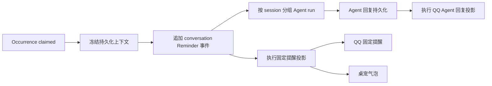

# 100 · Reminder 通知策略与统一会话历史 - 技术方案

## 状态

CONFIRMED

## 需求文档

[requirement.md](./requirement.md)

## 1. 现状分析

### 1.1 当前调用链

Reminder 由 `TodoScheduler` 创建并 claim occurrence，随后由
`agent_bridge.reminders.ReminderDeliveryOrchestrator` 完成固定提醒投递和 Agent 回应。当前
`DestinationPolicy` 同时决定：

- Reminder 事实写入哪个 session；
- 固定提醒发送到桌面对话、IM 还是桌宠；
- Agent run 使用哪个 presentation 与 interaction surface。

这种单目的地模型使持久化与通知无法独立变化。IM 分支还会先产生外部副作用，再以
`presentation=none` 写入 session；前端投影与会话搜索因此主动隐藏 QQ Reminder 及其 Agent 回复。

### 1.2 当前数据缺口

- `Reminder` 没有来源 session；只有 `Todo.origin_id`，无法表达给既有 Todo 从新会话添加 Reminder。
- `ReminderOccurrence` 只有一组 `destination_kind/id/receipt`，不能分别记录会话持久化、QQ 固定提醒、
  QQ Agent 回复和桌宠气泡。
- IM binding 的 `last_interaction_at` 只表示对应 IM 入口的最近交互，无法覆盖同一会话中的桌面对话；
  `updated_at` 只表示绑定关系变化，也不能代表会话级用户活跃度。
- Reminder Agent run 是否进入会话历史由投递出口决定，QQ 分支使用 `presentation=none`。
- Tauri `settings.json` 尚无 Reminder 通知模式；Bridge 只能通过现有 `DesktopSettingsReader` 读取其他
  非敏感设置。

## 2. 总体方案

将到期处理拆成三层稳定职责：

1. `ReminderPersistencePolicy` 只选择并冻结 occurrence 的唯一持久化会话与关联 IM binding。
2. `ReminderDeliveryOrchestrator` 先持久化 Reminder 卡片，并在同一 session 启动唯一 Agent run。
3. `ReminderNotificationPolicy` 根据冻结的通知模式和首次执行时的 presence，规划 QQ、桌宠投影。

session 中的 `todo_reminder` 事件与对应 Agent run 是用户可见事实源；Todo SQLite 只保存调度、冻结
路由和逐投影状态。任何外部通知都不得先于 Reminder 事实成功落入 session。

## 3. 涉及文件

| 文件路径 | 改动类型 | 说明 |
|---|---|---|
| `agent/src/agent/todos/models.py` | 修改 | 增加 Reminder 来源、occurrence 冻结上下文和逐投影领域类型 |
| `agent/src/agent/todos/store.py` | 修改 | SQLite additive migration、冻结路由与逐投影读写 |
| `agent/src/agent/todos/service.py` | 修改 | 创建 Reminder 时接收来源 session；更新 Reminder 时保持来源不变 |
| `agent/src/agent/tools/builtin/todo_manage/tool.py` | 修改 | 把宿主注入的当前 session 传给 create/add_reminder，不改变模型可见 schema |
| `agent_bridge/src/agent_bridge/protocols/im/state.py` | 修改 | 持久化 binding 最近真实交互时间并提供 typed snapshot |
| `agent_bridge/src/agent_bridge/protocols/im/runtime.py` | 修改 | inbound 时更新持久交互时间；presence 暴露 binding 更新时间 |
| `agent_bridge/src/agent_bridge/presence.py` | 修改 | IM snapshot 增加 routing recency；保留现有智能通知决策 |
| `agent_bridge/src/agent_bridge/reminder_settings.py` | 新增 | 从 Tauri settings 解析 Reminder 通知模式并提供 last-valid fallback |
| `agent_bridge/src/agent_bridge/reminders.py` | 重构 | 分离持久化选择、会话事实、Agent run 和通知投影 |
| `agent_bridge/src/agent_bridge/assembly.py` | 修改 | 装配共享 settings reader 与 Reminder mode provider |
| `frontend/src-tauri/src/settings.rs` | 修改 | 持久化并校验 `reminderNotificationMode` |
| `frontend/src/lib/settings/index.ts` | 修改 | 增加 TS 类型、默认值和 snapshot 归一化 |
| `frontend/src/pages/settings/components/ReminderNotificationSetting.tsx` | 新增 | 使用现有 Select/SettingsRow 展示已确认文案 |
| `frontend/src/pages/settings/App.tsx` | 修改 | 通用设置页新增“提醒”分组 |
| `frontend/src/stores/sessionProjection.ts`、会话搜索相关测试 | 调整 | Reminder 统一使用 conversation 投影并覆盖旧 none 兼容 |
| 相关 Python、Rust、TypeScript 测试 | 修改/新增 | 固化选择、冻结、投影、设置与历史行为 |

## 4. 数据模型

### 4.1 Reminder 来源

`Reminder` 与 `reminders` 表新增可空字段：

| 字段 | 含义 |
|---|---|
| `origin_session_id` | 创建该 Reminder 的 session，只作无有效 IM binding 时的持久化兜底 |

`TodoService.create` 创建内联 reminders 时，把 Todo 创建入口的 session 同时传入每条 Reminder；
`add_reminder` 使用本次工具调用所在 session。`update_reminder` 不修改该值。字段保持可空，用于读取旧
数据和支持没有 session 上下文的内部调用方。

旧数据迁移时，如果 `Todo.origin_kind=session` 且 `origin_id` 明确存在，则回填 Reminder 的
`origin_session_id`；否则保持空值并由到期时 IM binding 选择或不可路由状态处理。

### 4.2 occurrence 冻结上下文

`reminder_occurrences` additive 增加：

| 字段 | 含义 |
|---|---|
| `persistence_session_id` | 该 occurrence 唯一持久化 session |
| `persistence_destination_id` | 选中 IM binding 的稳定发送 destination；来源 session 兜底时为空 |
| `persistence_reason` | `latest_session_user_interaction`、`origin_im_session_without_user_interaction`、`stable_im_session_without_user_interaction`、`origin_session` 等诊断原因 |
| `notification_mode` | 首次执行时冻结的 `smart` 或 `all` |
| `notification_decision_kind` | 智能策略首次执行结果；all 模式记为 `all` |

TodoStore 提供 compare-and-set 语义的冻结方法：只有字段尚未设置时才写入；并发或重试读取已经冻结的
值。绑定变化、presence 变化和设置变化不得覆盖它们。

### 4.3 独立通知投影

新增 `reminder_occurrence_deliveries` 表，以 `(occurrence_id, projection_kind)` 为主键：

| `projection_kind` | 内容 |
|---|---|
| `im_fixed` | QQ 固定 Reminder 文本 |
| `im_agent` | 同一 session Agent 增强回复 |
| `pet_fixed` | 桌宠固定提醒气泡 |

每行记录 `destination_id`、`state`、`receipt`、`error_kind`、`attempt_count`、`created_at` 和
`updated_at`。状态为 `pending / delivered / failed / unknown / skipped`。QQ 固定提醒与 QQ Agent
回复分开记录，避免固定文本已成功、增强回复失败时覆盖彼此证据。

旧 occurrence 的 `destination_*` 字段保留作兼容读取，不再作为新编排的事实源。新 occurrence 可将
它们记录为 canonical conversation 目标，逐出口结果只写新表。

## 5. 持久化会话选择

### 5.1 会话级用户交互事实

持久化会话排序不新增独立 activity sidecar，而是以候选 session 的 active event projection 中最新一条
`user_message.ts` 为唯一事实源。桌面对话、QQ/IM 和其他真实用户入口最终都通过 `Conversation` 追加
同一种 `user_message`，因此无需在各入口重复维护时间戳；`assistant_message`、`todo_reminder`、
`system_trigger` 等系统输出不会参与排序。

该派生方式直接兼容升级前会话：已有 JSONL 中的用户消息在下一次 occurrence 选择时即可生效，无需
批量改写 session 或 `im_state.json`。`IMSessionBinding.last_interaction_at` 继续服务智能通知与同会话
多 binding 的具体目的地选择；`updated_at` 仍只表示 binding 创建或变更，不进入持久化会话排序。

### 5.2 选择规则

首次执行 occurrence 时：

1. 枚举全部 persisted IM binding，跳过 session 已不存在的 binding，并按 `session_id` 分组。
2. 读取各候选 session 最新 active `user_message.ts`；存在真实用户消息时，选择时间最新的 session，
   同时间以稳定 session id tie-break。
3. 所有候选都没有用户消息时，若 Reminder `origin_session_id` 也在候选中则选择它；否则按稳定
   session id 做确定性兜底。该分支不宣称推断用户位置，也不读取 binding 更新时间。
4. 选定 session 后，在其多个 binding 中优先使用 `last_interaction_at` 最新的目的地；仍相同时按稳定
   destination id tie-break。该步骤只决定发送地址，不反向改变会话选择。
5. 若无有效 binding，尝试 Reminder 的 `origin_session_id`。
6. 两者均不可用时，occurrence 进入不可路由失败；不得使用当前桌面对话或其他最近 session。

没有 IM binding 的普通 session 不进入第 2 步候选，即使它拥有全局最新用户消息。只要存在有效 IM
binding，持久化会话就只在这些 binding 对应的 session 中产生。

选中 IM binding 时，Agent surface 使用 `im:<im_type>`；来源 session 兜底时使用
`desktop-chat`。surface 只影响 Agent 运行上下文，不影响其输出必须进入 conversation 历史。

已冻结 binding 后如果解绑、换绑或 session 删除，当前 occurrence 不重新选择。QQ 返回
`binding_changed` 或 session 持久化失败并留存诊断；后续周期 occurrence 重新执行完整选择。

## 6. 通知策略

### 6.1 设置读取

新增设置 `reminderNotificationMode`：

- `smart`：默认；
- `all`：所有位置。

Rust 设置结构使用 serde default 保证旧文件加载为 `smart`。Bridge 的
`DesktopReminderNotificationModeProvider` 每次 occurrence 首次执行读取当前设置；文件不可读或字段
非法时沿用进程内 last-valid，初始 last-valid 为 `smart`。

模式随 occurrence 冻结。用户在执行或重试中修改设置，只影响之后首次执行的 occurrence。

### 6.2 智能模式

继续调用现有 `DestinationPolicy` 进行 presence 判断，但只解释为额外通知意图：

- decision 为 `im`：仅规划被冻结的选中 IM binding；不使用 policy 返回的其他 binding 作为接收人。
- decision 为 `pet`：规划桌宠气泡。
- decision 为 `desktop` 或 `none`：不规划额外通知，因为 conversation 历史已经持久化。

### 6.3 所有位置

- occurrence 具有选中 IM destination 时规划 `im_fixed` 与 `im_agent`；发送时仍校验 provider 在线且
  binding 未变化。
- 首次执行时桌宠可用则规划 `pet_fixed`。
- conversation 历史不作为 delivery row，因为它是所有模式共同的 canonical persistence。

## 7. 到期编排与幂等

### 7.1 固定事实

`ReminderDeliveryOrchestrator.deliver_batch` 对每个 occurrence：

1. 读取或冻结持久化上下文。
2. 加载冻结 session；失败时终止该 occurrence，不尝试任何外部发送。
3. 以 occurrence id 作为 event uuid 幂等追加 `todo_reminder`，固定
   `presentation=conversation`。
4. 按冻结模式创建缺失的 delivery rows，并只执行尚未进入终态的投影。
5. 返回 Agent target，按 `(session_id, surface, destination_id)` 分组。

`todo_reminder` payload 的 `destination_kind` 改为 canonical conversation 语义；通知出口状态不再写入
不可变 session event。

### 7.2 Agent run

- 同一批次、同一 target 的 occurrences 继续合并为一轮 Agent run。
- `SystemTriggerEvent.presentation` 始终为 `conversation`。
- dedupe key 只由 batch 与 persistence session/target 组成，不再由通知出口决定。
- 只允许 `agent_response_status=pending` 的 occurrence 进入新 run；一旦 running/completed/failed，重试
  不重新生成。
- QQ 投影需要 Agent 回复时，等待 run terminal 且回复已经落入 session，再发送 watcher 收集到的同一
  完整文本；投影结果单独写 `im_agent`。
- Agent 失败不删除 Reminder 卡片，不影响已经完成的 `im_fixed` 或 `pet_fixed`。

### 7.3 外部副作用

- `im_fixed` 只在 Reminder event 成功持久化后发送。
- `pet_fixed` 使用现有 fixed ambient publisher，按 occurrence id 保持前端幂等。
- 发送前再次校验冻结 destination；binding 变化只记失败，不自动改投。
- `unknown` 视为不可自动重发终态，避免 provider 已送达时重复发送。
- 明确失败保留可诊断记录；同一编排再次进入时只重试允许重试且尚未终态的 row，不触碰 delivered、
  unknown 或 skipped。

## 8. 会话历史与前端设置

### 8.1 历史投影

新 Reminder 永远使用 `presentation=conversation`，因此现有 ReminderCard 与 Agent run 可沿用正常
session projection。保留旧 `presentation=none` 的兼容隐藏语义，避免升级后把历史上刻意隐藏的其他
system run 突然暴露；新测试固定 QQ 新路径不再产生 none。

会话搜索继续依赖 conversation presentation。QQ 投影成功与否不能改变 session event 的可见性。

### 8.2 设置 UI

在“设置 → 通用”新增“提醒”组，复用项目现有 `Select`、`SettingsRow` 和 `SettingsGroup`：

- `智能选择（推荐）`
- `所有位置`

选择器下展示当前选项说明：

- 智能选择：根据最近使用情况决定是否通过 QQ 或桌宠额外提醒；提醒始终保存在对应会话。
- 所有位置：提醒保存在对应会话，同时通过可用 QQ 和桌宠通知。

不新增通用 UI 基础件，不引入依赖或新设计 token。

## 9. 影响分析

### 9.1 上下游

- `todo_manage` 模型可见 name、description、JSON Schema 和结果结构不变；只消费已有隐藏 session 参数。
- Todo SQLite 为 additive migration；旧数据和现有查询保持可读。
- `im_state.json` 增加可选字段，旧 schema 缺字段时按 null 读取；设备迁移 snapshot 自动携带该字段。
- QQ provider 协议不变，继续使用 `send_proactive`。
- Reminder 会话新增正常 conversation run，会触发既有 session change、搜索索引和桌面对话刷新。
- 本次不新增依赖、动态导入、package data 或 frozen runtime 资源，打包影响为 standard。

### 9.2 风险与处理

| 风险 | 处理 |
|---|---|
| 多 worker 同时选择不同 session | TodoStore compare-and-set 冻结并回读唯一结果 |
| 桌面与 IM 活跃度形成两套时间 | 统一从 session active `user_message` 派生，不维护第二份会话 activity |
| 旧 binding 缺少交互时间 | 直接读取历史 session 用户消息，无需迁移或使用 binding 更新时间猜测 |
| session 写入失败后 QQ 已发送 | 强制 session 事实先落盘，外部发送后置 |
| binding 在冻结后变化 | send_proactive 返回 binding_changed；不重新选择 |
| 多出口覆盖同一状态 | projection table 分行记录固定 QQ、Agent QQ、桌宠 |
| Agent run 重复 | occurrence response status + 稳定 dedupe key + session event 幂等 |
| 设置文件损坏 | mode provider last-valid fallback，默认 smart |
| 旧 Reminder 无来源 | 有效 IM 优先；否则明确不可路由，不猜最近桌面对话 |

## 10. 验证方案

### 10.1 Agent / Todo

- Todo create 与 add_reminder 分别保存正确 Reminder origin session。
- update_reminder 不改变 origin。
- SQLite 旧库 additive migration 与 Todo origin 回填。
- occurrence context 只冻结一次；并发/重试不能覆盖。
- projection rows 独立更新且 delivered/unknown 幂等。

### 10.2 Bridge

- 多 binding 对应的会话按最近真实用户消息选择，桌面对话与 IM 入站等价。
- 历史 session 用户消息在 binding 交互时间缺失时仍可直接参与选择；binding 更新时间不参与。
- Agent、Reminder 等系统输出不刷新会话排序；新 occurrence 在其他候选会话出现用户消息后重新选择。
- 所有候选均无用户消息时优先来源候选，否则稳定确定性兜底。
- 跳过缺失 session；无 binding 回退 Reminder origin；两者缺失不选任意 session。
- offline binding 仍可选作 persistence target。
- smart 的 desktop/im/pet/none 映射只改变投影计划。
- all 同时规划选中 QQ 与可用桌宠。
- Reminder 与 Agent run 始终 conversation、同 session；同会话批处理只启动一次。
- binding_changed、unknown、Agent failure 不重复发送或重新生成。

### 10.3 Frontend / Rust

- Rust 旧设置默认 smart、合法值读写、非法值拒绝。
- TS snapshot 缺字段默认 smart，跨窗口设置更新保持既有机制。
- 设置页显示已确认选项与说明。
- QQ 新路径刷新后 ReminderCard 与 Agent 回复仍可见、可搜索。

### 10.4 门禁

- 先运行受影响的 Python、Rust、frontend 定向测试。
- 再运行 `scripts/check/run.ps1` 全量检查。
- 不调用真实 LLM、QQ 或外部付费服务。
- 本次设置页有可见 UI 变化；真实桌面视觉验收需按项目规则另行取得用户确认。

## 11. 变更记录

| 日期 | 变更内容 | 是否需要重新实现 |
|---|---|---|
| 2026-08-23 | 首次确认：分离 occurrence 持久化会话与 QQ/桌宠通知；冻结模式与 binding；保留同会话 Agent 批处理；逐投影持久化 | 是 |
| 2026-08-25 | 修正持久化路由：从 binding recency 改为候选 session 最近真实用户消息；桌面与 IM 统一，系统输出和 binding 更新时间不参与 | 是 |
