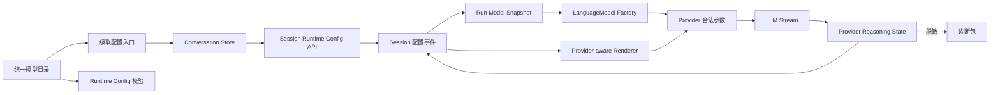

# 101 · 会话推理强度控制 - 技术方案

## 状态

CONFIRMED

## 需求文档

→ [requirement.md](./requirement.md)

## 现状分析

### 当前会话只持有 model 字符串

- `Session` 通过 `session_meta.initial_model` 与后续 `model_change` 事件投影 `current_model`。
- `Conversation` 已有 `_RunModelSnapshot`，能够在一次 run 内冻结 model id 与实际 `LanguageModel`，但快照没有推理 preset。
- Bridge 的模型校验、模型切换、session detail 与 AG-UI `forwardedProps` 都只接受或返回 `model`。
- 前端 conversation store 只有 `currentModel`，快速切换与首次发送的竞态协调也围绕单个 model 字符串工作。

如果在这些边界旁边额外增加一个独立的 `reasoningEffort` 可变字段，模型切换时会短暂产生非法组合，并且 run snapshot、API response 和 UI 可能分别观察到不同状态。因此模型与推理 preset 必须从领域层开始作为一个完整配置处理。

### 当前模型目录无法表达推理差异

- `ModelRouteCapabilities.reasoning_replay` 只是未被消费的布尔值。
- 目录不能表达“完全不支持 / 可开关 / 离散 effort / 固定开启”、有效选项顺序、产品默认值和 replay 生命周期。
- provider 默认调用参数只按 provider 定义。DeepSeek 当前显式关闭 thinking；Kimi 沿用模型原生默认；OpenRouter 只配置路由与数据策略。
- 前端目录类型同样只有 `reasoningReplay: boolean`，不能生成需求中的推理强度子菜单。

### 当前 reasoning 只产生瞬态活动信号

- `LLMClient` 能识别 `reasoning_content` / `reasoning` delta，但只统计长度并发出不含正文的 `LLMActivity`。
- `LLMTurnDone` 不携带 provider continuation，session 事件也没有保存位置。
- 工具循环每次从 session 投影重新组装消息，因此首轮 reasoning 丢失后，下一次模型请求无法按 provider 契约回传。
- 诊断包会导出 session JSON；如果直接新增包含 reasoning 的事件而不增加事件级脱敏，原始内容会进入诊断包。

### 现有 UI 基础件足够实现目标交互

- 项目已封装 `DropdownMenuSub`、`DropdownMenuSubTrigger`、`DropdownMenuSubContent`、`DropdownMenuRadioGroup` 与 `DropdownMenuRadioItem`。
- Root 与 Sub 可以使用受控 open state；item 的 select 事件可以阻止默认关闭。
- 因此本需求只需新增 chat-specific 交互协调，不引入新的 UI 组件库或重新实现定位、焦点与键盘基础设施。

## 方案总览



核心约束如下：

1. `ModelRuntimeConfig` 是模型运行选择的唯一领域值；model 与 reasoning preset 不单独提交。
2. 统一模型目录同时拥有用户可见能力与 provider 私有映射；前端不判断 provider。
3. session 保存 next-run effective config，run 开始时冻结完整配置与 client。
4. provider reasoning 是模型上下文私有状态，独立于普通 assistant 正文持久化和投影。
5. 菜单允许连续调整，但每次具体选择仍是一次后端确认的原子事务。

## 1. 统一模型运行配置

### 1.1 领域类型

在 `llm_providers.catalog` 定义不可变配置：

```python
@dataclass(frozen=True)
class ModelRuntimeConfig:
    model_id: str
    reasoning_preset: str
```

配置只保存稳定的产品 model id 与 preset id，不保存 provider 请求参数、展示 label 或目录 revision。目录提供：

```python
def default_model_runtime_config(model_id: str) -> ModelRuntimeConfig: ...
def validate_model_runtime_config(config: ModelRuntimeConfig) -> ModelRuntimeConfig: ...
```

- `default_model_runtime_config()` 用于新会话、旧会话 fallback 和兼容 `/model` 入口。
- `validate_model_runtime_config()` 严格拒绝未知模型、未知 preset 与不受支持组合，不做静默档位映射。
- 厂商存在稳定等价映射时，目录只暴露实际产品档位。例如 DeepSeek 不暴露 `medium` / `xhigh`，避免 UI 展示与最终执行不一致。

### 1.2 Reasoning 能力定义

```python
ReasoningControl = Literal["unsupported", "toggle", "effort", "fixed"]
ReasoningReplayScope = Literal["none", "tool_turn", "conversation"]

@dataclass(frozen=True)
class ReasoningPresetDefinition:
    id: str
    label: str
    call_options: Mapping[str, Any]

@dataclass(frozen=True)
class ModelReasoningDefinition:
    control: ReasoningControl
    presets: tuple[ReasoningPresetDefinition, ...]
    default_preset: str
    replay_scope: ReasoningReplayScope
```

`call_options` 仅在 provider 层消费，不进入 public catalog。public catalog 对每个模型增加：

```json
{
  "reasoning": {
    "control": "effort",
    "defaultPreset": "medium",
    "presets": [
      {"id": "low", "label": "低"},
      {"id": "medium", "label": "中"},
      {"id": "high", "label": "高"}
    ]
  }
}
```

`schemaVersion` 从 1 升到 2，保留现有 capability 字段；删除无人消费的 `reasoningReplay`，由完整 reasoning 定义替代。

### 1.3 首版模型矩阵

| 模型 | control | 产品选项 | 默认 | replay scope |
|---|---|---|---|---|
| DeepSeek V4 Flash / Pro | `effort` | 关闭、低、高、最高 | 关闭 | 开启时 `conversation` |
| DeepSeek V4 Flash Vision | `effort` | 关闭、低、高、最高 | 关闭 | 开启时 `conversation` |
| Kimi K2.5 | `toggle` | 关闭、开启 | 开启 | 开启时 `tool_turn` |
| Kimi K2.6 | `toggle` | 关闭、开启 | 开启 | 开启时 `tool_turn` |
| Kimi K2.7 Code / Highspeed | `fixed` | 固定开启 | 开启 | `conversation` |
| OpenRouter Gemini 3.7 Flash | `effort` | 低、中、高 | 中 | `conversation` |
| OpenRouter GPT-5.6 Luna | `effort` | 关闭、低、中、高、极高、最高 | 中 | `conversation` |

DeepSeek V4 Flash Vision 与同族 Flash 共享 thinking 开关、effort 档位和 continuation 契约，但仍在模型条目上显式声明，不通过名称或 provider 默认隐式继承。后续目录新增模型时必须同时给出 reasoning 定义；无法确认时使用 `unsupported`，不能继承 provider 级默认。

### 1.4 Provider 参数合并

`build_provider_spec()` 与 `replace_spec_model()` 接收完整 `ModelRuntimeConfig`。provider 默认参数与 preset 参数使用递归 mapping merge：

- OpenRouter preset 增加 `extra_body.reasoning` 时，保留已有 `extra_body.provider`。
- DeepSeek 关闭时只发送 `thinking.type=disabled`；开启时发送 `thinking.type=enabled` 和实际 `reasoning_effort`。
- DeepSeek Vision 的精确 `openai/<custom-model>` route 只在实际发送 `reasoning_effort` 时，通过兼容层增加 `allowed_openai_params=["reasoning_effort"]`；该值只控制 LiteLLM 参数白名单，不进入 provider 请求体，也不扩散到其它 route。
- Kimi K2.5/K2.6 使用 `thinking.type`；K2.6 默认不打开跨用户 turn 的 `keep=all`。
- Kimi K2.7 不发送不支持的 `thinking` 或 effort 字段。
- unsupported/fixed 模型不会因统一抽象收到多余控制参数。

`ProviderSpec` 增加不含 secret 的绑定元数据：`provider_id`、`product_model_id`、`reasoning_preset` 与 `reasoning_replay_scope`，供 stream continuation 与 renderer 判断，不再从 LiteLLM model 前缀反推全部语义。

## 2. Session 配置与兼容投影

### 2.1 Session meta

新建会话在 `session_meta.payload` 加性写入：

```json
{
  "initial_model": "kimi/kimi-k2.6",
  "initial_reasoning_preset": "on"
}
```

旧会话没有 `initial_reasoning_preset` 时，按 `initial_model` 当前目录默认值投影，不改写原文件、不在读取时追加迁移事件。

### 2.2 配置变更事件

新增 `model_config_change`：

```json
{
  "type": "model_config_change",
  "payload": {
    "from": {"model": "kimi/kimi-k2.6", "reasoningPreset": "on"},
    "to": {"model": "deepseek/deepseek-v4-pro", "reasoningPreset": "high"}
  }
}
```

`Session.current_model_config` 从初始配置开始顺序投影 active events：

- 遇到旧 `model_change`：目标 model + 该模型目录默认 preset。
- 遇到新 `model_config_change`：使用事件中的完整目标配置。
- `current_model` 继续作为兼容 property，返回 `current_model_config.model_id`。

编辑重发的控制事件白名单加入 `model_config_change`，不能因替换历史回复让当前配置回退。

### 2.3 Conversation 原子切换

新增：

```python
def switch_model_config(self, target: ModelRuntimeConfig) -> None: ...
```

顺序固定为：严格校验 → 构造新 client → 追加事件 → 更新内存 session → swap client。任一步失败时有效配置与旧 client 不变。

旧 `switch_model(name)` 保留，转换成目标模型目录默认配置后调用新方法。它只服务旧 API / 脚本兼容，不用于新前端。

`LanguageModelFactory` 改为接收 `ModelRuntimeConfig`。这是必要的公共边界调整：client 构造必须看到不可拆分组合，不能让调用方在 factory 外再修改 `ProviderSpec.defaults`。

## 3. Run 内冻结

`_RunModelSnapshot` 调整为：

```python
@dataclass(frozen=True)
class _RunModelSnapshot:
    config: ModelRuntimeConfig
    llm_client: LanguageModel
```

run 开始后以下路径统一读取 snapshot：

- 首次模型请求与所有工具续轮；
- message renderer 与 reasoning replay；
- context window、compaction、缓存 identity；
- assistant / tool / run_error 的 model 与 reasoningPreset 诊断 meta；
- edit resend、system trigger 与取消/失败收尾。

session runtime-config 只表示下一 run 的 effective state。已有 active/queued run 的 mutation reservation 与 turn coordinator 语义沿用需求 061；配置切换不等待当前 run，而是稳定返回 `session_busy`。

## 4. Runtime Config API

### 4.1 目录与新会话校验

`POST /v1/models/validate` 接受完整配置：

```json
{"model":"kimi/kimi-k2.6","reasoningPreset":"off"}
```

返回：

```json
{
  "available": true,
  "runtimeConfig": {
    "model": "kimi/kimi-k2.6",
    "reasoningPreset": "off"
  }
}
```

为兼容旧调用方，只传 `model` 时使用目标模型目录默认 preset。校验仍只构造本地 client，不发真实 LLM 请求。

### 4.2 已有会话配置

新增：

```http
PATCH /v1/sessions/{session_id}/runtime-config
```

请求可加性表达 model 与 preset，但服务层最终必须解析成完整配置后一次提交：

- model 与 reasoningPreset 同时提供：严格校验该组合。
- 只提供 model：使用目标模型目录默认 preset，服务旧调用方与未来简化入口。
- 只提供 reasoningPreset：与当前 model 组合后校验。
- 两者都未提供：400 `invalid_runtime_config`。

成功返回：

```json
{
  "sessionId": "...",
  "runtimeConfig": {
    "model": "deepseek/deepseek-v4-pro",
    "reasoningPreset": "high"
  }
}
```

响应永远是后端确认的完整 effective state。`POST /sessions/{id}/model` 保留一个兼容周期，内部调用同一 service 并返回旧 `{session_id, model}` 形状。

错误模型沿用 061，并新增：

| HTTP | code | 场景 |
|---|---|---|
| 400 | `unsupported_model` | model 不在目录 |
| 400 | `unsupported_reasoning_preset` | preset 不属于目标 model |
| 400 | `invalid_runtime_config` | 请求没有任何可变字段或结构错误 |
| 404 | `session_not_found` | session 不存在 |
| 409 | `session_busy` | session 正在运行、排队或变更 |
| 503 | `credential_missing` | provider 凭据缺失 |

### 4.3 Session 与 AG-UI 投影

- session list/detail 增加 `reasoningPreset`，保留顶层 `model` 兼容字段。
- 新会话 `forwardedProps` 增加 `modelConfig`；decoder 优先读取新字段，缺失时读取旧 `model` 并补目录默认 preset。
- auto-create 使用完整配置创建 session 与首轮 client。
- 已有 session 不接受 forwarded config 覆盖 effective state，继续由 session mutation API 负责。

## 5. Provider Reasoning Continuation

### 5.1 私有状态类型

在 `llm_providers` 增加禁止正文 repr 的类型：

```python
@dataclass(frozen=True, repr=False)
class ProviderReasoningState:
    provider_id: str
    model_id: str
    format: Literal["reasoning_content", "reasoning_details"]
    replay_scope: ReasoningReplayScope
    payload: str | tuple[Mapping[str, Any], ...]
```

`__repr__` 只输出 provider、model、format、scope 与 content length，不输出 payload。序列化与反序列化执行结构校验，拒绝未知 format、非字符串 content 和非 object detail。

### 5.2 Stream 累积

`LLMClient._stream_once()`：

- 继续只把推理过程映射为无正文 `LLMActivity`。
- 对 `reasoning_content` / `reasoning` 按顺序拼接字符串。
- 对 `reasoning_details` 按 stream chunk 顺序保存完整 object 序列，不解释 signature、encrypted content 或 provider-specific fields。
- 如果同时存在 structured details 与 plaintext，优先保存 `reasoning_details`。
- 流结束时把 state 放进 `LLMTurnDone.reasoning_state`；日志只保留 format、对象数量与字符数。
- transport retry 在没有可用响应项时清空当前 attempt 的 reasoning accumulator，不能拼接两个 attempt。

### 5.3 Session 事件与消息投影

每个模型 response 完成后，在对应 assistant/tool-call request 之前追加内部事件：

```json
{
  "type": "provider_reasoning_state",
  "payload": {
    "provider": "kimi",
    "model": "kimi/kimi-k2.7-code",
    "format": "reasoning_content",
    "replayScope": "conversation",
    "data": "..."
  },
  "meta": {"run_id": "..."}
}
```

投影规则：

- `Session.messages` 忽略该事件，用户消息与 Bridge session API 不出现私有状态。
- `Session.llm_messages` 把状态附着到同一个 assistant message；纯工具轮没有 assistant text 时，使用现有 synthetic assistant tool container。
- `tool_turn` 只在当前 `run_id` 内回放；`conversation` 在消息仍被上下文保留且配置兼容时回放。
- partial normalization、failed-call sanitization、turn rewrite 与 context compaction 删除某条 assistant 模型视图时，其附着的 reasoning state 同时消失。
- 原始 append-only event 不因投影裁剪而删除。

### 5.4 Provider-aware replay

通用 `Message.to_openai()` 不认识 reasoning 字段。Conversation 在现有 multimodal renderer 之后调用 provider reasoning renderer，并提供 active `ModelRuntimeConfig` 与 run id：

- provider、model 和 preset 必须兼容；模型或 provider 切换后不回放旧 state。
- `reasoning_content` 写入 assistant message 同级字段。
- `reasoning_details` 完整写入 assistant message同级字段。
- `off` / `unsupported` preset 永远不回放。
- state 缺失或损坏且属于当前工具链必需项时，抛稳定 `reasoning_continuation_invalid`，不静默关闭 thinking 或切换模型。

### 5.5 本地存储与诊断边界

本期沿用 session JSONL 的本地隐私边界，不单独引入 session-at-rest 加密或新的密钥生命周期。控制措施：

- 只在目录 replay scope 非 `none` 且 response 实际返回内容时写事件。
- 所有普通日志、错误、trace callback、前端 event 与搜索/memory 投影禁止读取 `data`。
- 诊断包 producer 识别 `provider_reasoning_state`，将 payload 改写为 provider/model/format/scope、长度摘要与 `redacted: true`，不导出 data。
- 同一 changeset 更新 diagnostic bundle machine contract、schema revision、消费者 skill handler 与契约测试。
- 用户可见普通 session 内容继续按现有诊断政策导出；reasoning state 采用更严格的专门脱敏。

## 6. 前端状态

### 6.1 原子 store 字段

用单一对象替代可独立变化的字段：

```ts
interface ModelRuntimeConfig {
  model: string;
  reasoningPreset: string;
}

currentModelConfig: ModelRuntimeConfig | null;
modelConfigChanging: boolean;
modelConfigTarget: ModelRuntimeConfig | null;
```

`currentModel` 作为 selector/helper 派生值，不再是独立可写真相源。新会话初始化：设置页 chat model + 该模型 catalog default preset；未来按模型偏好只需替换这个初始解析器。

选择模型时构造目标 model 的默认完整配置；选择 reasoning 时复用当前 model。新会话走 `/models/validate`，已有会话走 `/runtime-config`。响应提交继续使用 mutation sequence、open session token 与 detail refresh sequence，防止迟到响应污染当前 session。

发送前一次性捕获 `runConfig`：

- `modelConfigChanging` 时禁止发送。
- 新 session 的 `forwardedProps.modelConfig` 与 store 展示使用同一对象。
- 已有 session 发送不使用前端字段覆盖后端 effective config。
- 附件能力继续从 `runConfig.model` 派生。

### 6.2 API 与类型兼容

- `ProviderModelOption` 增加 `reasoning`。
- `SessionSummary/SessionDetail` 增加 `reasoningPreset`。
- `modelsApi.validateRuntimeConfig()` 返回完整 config；旧 `validate(model)` helper 可暂时包装。
- `sessionsApi.updateRuntimeConfig()` 为新主入口；旧 `switchModel()` 保留测试与兼容调用。

## 7. 级联菜单交互

现有 `ConversationModelSelector` 扩展为会话运行配置选择器，组件仍保持 chat-specific，不与设置页模型表单合并。

### 7.1 结构

```text
Trigger: [当前模型 当前强度 ▾]

Root menu
├─ 模型          当前模型       ›
│  └─ provider 分组模型列表
└─ 推理强度      当前强度       ›
   └─ 当前模型有效 preset 列表
```

- Root、模型 Sub、推理 Sub 全部受控；Root 使用 non-modal 模式，允许菜单打开时操作独立 portal 中的通知按钮，同时保留点击外部关闭语义。
- 指针 hover 主要沿用 Radix SubTrigger 原生打开时序和 pointer grace area；键盘焦点进入一级 SubTrigger 时补充打开对应子菜单。切换到另一一级项时关闭前一个子菜单并打开目标子菜单。
- 两个 SubContent 通过局部 `sideOffset` 抵消 Root 内边距并保留可见间隔；不修改共享 DropdownMenu 默认值，也不用 margin、transform 或层级覆盖修正定位。
- 点击一级项只保持/打开对应子菜单，不关闭 Root。
- 具体 model/preset item 的 `onSelect` 阻止默认关闭。
- 成功后 Root 和当前 Sub 保持打开；模型切换成功时模型 Sub 保持打开，一级“推理强度”摘要立即更新，用户 hover 后看到目标模型选项。
- 点击外部、再次点击 Trigger 或 Escape 关闭 Root；关闭时同时清理 Sub open state。
- ArrowRight/Enter/Space 打开子菜单，ArrowLeft 返回一级，Escape 关闭整组并恢复 Trigger 焦点。

### 7.2 提交态与反馈

- 提交中保留已确认配置作为选中项，目标项显示 spinner；Root 保持打开但所有可变 item 暂时禁用，避免并发提交。
- 成功后更新选中标记，通过独立 Sonner success toast 与 `aria-live` 提示“下一条回复将使用 …”；不把通知收纳为 Root 菜单项。Root 的 non-modal 模式保证 toast 关闭按钮和 action 在菜单打开时仍可点击。
- 失败保留原配置和菜单位置；credential missing 提供设置入口，busy 与 unsupported 给出稳定恢复文案。
- fixed 模型显示只读“固定开启”；unsupported 显示“不支持”，不生成可点击虚假 radio item。
- catalog unavailable 时推理项显示暂不可用；现有有效 session 配置仍显示，不允许猜测提交。

### 7.3 QQ 尾随菜单

QQ 保留每轮回复尾随的单一“菜单”按钮，不把模型和 preset 都塞进尾随消息本身。`IMControlService` 打开主菜单后读取绑定 session 的 `current_model_config`，展示当前模型与 catalog preset label；第一排放置“切换模型 / 调整推理强度”，第二排单独放置“切换会话”，让同属运行配置的操作相邻。

- 模型列表继续来自 `public_model_catalog()`；推理列表从当前模型同一条 catalog reasoning 定义派生，不维护 QQ 专用能力表。
- `reasoning_page` 按 `_PAGE_SIZE` 分页；可调模型生成 preset action 并标记当前项，fixed/unsupported 只显示状态和“返回”。
- `switch_model` 与 `switch_reasoning` 都调用共享 `SessionModelService.update()`：模型切换未显式传 preset 时使用目标目录默认，reasoning 切换复用当前 model。
- mutation 继续受 `IMBindingCoordinator` 与 `AgentRuntime` session reservation 保护；busy 时不提交，成功文案回显后端最终 config，下一轮自然从 session 捕获新快照。
- token action 仍绑定 IM binding key 并沿用 TTL；reasoning action 不进入 Agent user message 或普通聊天投影。

## 8. 诊断与可观测性

每个 run 的内容无关元数据增加：

- `model`
- `reasoning_preset`
- `reasoning_control`
- `reasoning_replay_scope`
- continuation format / count / char length（不含 data）

配置变更日志只记录 from/to model 与 preset。Provider request diagnostics 可以记录最终 preset 和是否附带 continuation，但不得记录 reasoning 正文、detail object、signature 或 encrypted content。

## 9. 涉及文件

| 路径 | 改动 |
|---|---|
| `llm_providers/src/llm_providers/catalog.py` | reasoning 目录、runtime config、provider 参数映射 |
| `llm_providers/src/llm_providers/spec.py` | ProviderSpec 绑定元数据 |
| `llm_providers/src/llm_providers/reasoning.py` | 私有 continuation 类型、累积与 renderer |
| `llm_providers/src/llm_providers/client.py` | 捕获 reasoning_content/details 并放入 turn done |
| `llm_providers/src/llm_providers/stream_events.py` | `LLMTurnDone.reasoning_state` |
| `llm_providers/src/llm_providers/protocol.py` | factory 接收完整 config |
| `agent/src/agent/sessions/session.py` | 初始 preset、配置投影、reasoning 私有投影 |
| `agent/src/agent/conversation.py` | 原子切换、run snapshot、state 落盘与 replay |
| `agent_bridge/src/agent_bridge/runtime_config.py` | 按完整 config 构造 client |
| `agent_bridge/src/agent_bridge/session_models.py` | runtime-config mutation service |
| `agent_bridge/src/agent_bridge/routes/models.py` | 完整配置校验 |
| `agent_bridge/src/agent_bridge/routes/meta.py` | runtime-config route 与 session 投影 |
| `agent_bridge/src/agent_bridge/protocols/ag_ui/*` | 新会话 modelConfig decode/传递 |
| `agent_bridge/src/agent_bridge/protocols/im/control.py` | QQ 主菜单推理摘要、能力驱动 preset 分页与原子配置切换 |
| `frontend/src/lib/model-config/index.ts` | catalog reasoning 类型与 helper |
| `frontend/src/stores/conversation.ts` | 单一 config、mutation/stale guard、send snapshot |
| `frontend/src/services/api/models.ts` | runtime config validate |
| `frontend/src/services/api/sessions.ts` | runtime-config update |
| `frontend/src/services/stream.ts` | forwarded modelConfig |
| `frontend/src/pages/chat/components/ConversationModelSelector.tsx` | hover 级联与保持打开 |
| `frontend/src/types/meta.ts` | session reasoningPreset |
| `frontend/src-tauri/src/diagnostics/*` | provider reasoning event 专门脱敏与 machine contract |
| `.cursor/skills/inspect-agent-friend-diagnostics/*` | 消费者 schema/handler/测试同步 |
| 对应 Python / frontend / Rust 测试 | 目录、session、replay、API、store、UI、诊断契约 |

实现时优先追加现有相邻测试文件；只有新职责无法清楚落入现有模块时才新增文件。

## 10. 测试设计

### 目录与 provider

- 每个模型的 control、preset 顺序、默认值和 replay scope 固定。
- 未知模型/preset 严格拒绝；unsupported/fixed 不能提交非法值。
- DeepSeek、Kimi、OpenRouter 的参数精确映射；recursive merge 不覆盖 OpenRouter provider 策略。
- memory client 不受聊天 reasoning preset 影响。
- public catalog 不包含 provider call options。

### Session 与 Conversation

- 新 session 持久化初始 preset；旧 session 按目录默认投影。
- 旧 `model_change` 与新 `model_config_change` 混合历史得到正确 current config。
- client 构造/事件持久化失败保持原配置；相同配置 no-op。
- run 中并发切换不能改变首轮、工具续轮、context window、renderer 与诊断 meta。
- edit resend 保留配置控制事件。

### Continuation

- reasoning_content stream 正确拼接；reasoning_details 保持 chunk 顺序和完整 object。
- retry boundary 清空旧 attempt；日志/repr 不包含 payload。
- 文本+工具、纯工具、多工具、最终文本分别附着到正确 assistant。
- tool_turn 只在当前 run 回放；conversation 在匹配 model/provider 时回放。
- 切换 provider/model/off preset 不回放不兼容状态。
- compaction、partial/failed normalization 与 rewrite 不产生孤立 reasoning state。
- 缺失/损坏必需 state 返回稳定错误，不静默降级。

### Bridge 与前端

- validate/runtime-config 的成功、默认补全、partial update、unsupported、busy、credential missing。
- 旧 `/model` 和旧 AG-UI `forwardedProps.model` 继续工作。
- session list/detail 恢复 preset；新会话首次发送使用 pending config。
- 快速连续切换、离开 session、后台 refresh 与失败响应不覆盖最终状态。
- hover/focus 打开右侧子菜单，点击一级/具体项不关闭，外部/Trigger/Escape 关闭。
- 模型切换后推理摘要与选项联动；fixed/unsupported/catalog unavailable 正确。
- IM control 覆盖主菜单摘要、preset 分页/当前项、模型默认联动、fixed/unsupported 只读态、busy 与切换反馈。

### 诊断

- 原 session event 含 provider state，诊断包对应事件只含脱敏摘要。
- payload 不出现在 Rust producer 日志、bundle、consumer output 或测试 snapshot。
- producer contract、schema revision、consumer handler 与测试保持一致。

### 项目门禁与验收

- 运行相邻 Python、frontend 与 Rust 定向测试。
- 运行 `scripts/check` 全量门禁。
- 在真实 Tauri 桌面端执行 AC-1、AC-2、AC-3、AC-9 与 AC-15 的视觉/交互验收。
- 真实 provider 调用仅在另行说明模型、目的与调用量并取得授权后执行；确定性 fixture 先覆盖协议映射和 replay。

## 11. 兼容与迁移

- session schema 保持加性：旧 meta、旧 model_change、旧 API 与旧 forwarded model 均可读。
- 不批量重写旧 JSONL；首次配置变更后自然产生新事件。
- public catalog 升到 schemaVersion 2；前端与 Bridge 同版本发布，不维护双份静态 catalog。
- 新 factory contract 是源码级破坏性调整，仓库内所有调用方一次性迁移；不为尚未发布的中间分支增加 shim。
- 模型/preset 后续从目录移除时，历史 session 回落到目标模型当前默认并在 detail 中返回 effective config；原始事件保留供审计。
- 本期没有 preference storage；未来只扩展新会话初始配置 resolver，不改变 session effective config 与 run snapshot。

## 12. 风险与控制

- **菜单保持打开产生连点竞态**：提交中暂时禁用可变 item，store mutation sequence 防止迟到响应。
- **菜单与全局通知浮层竞争**：选择器使用 non-modal Root 允许独立 Sonner 的关闭按钮和 action 交互；不降低全局 Sonner 层级，也不把 toast 改成菜单内容来掩盖 portal 竞争。
- **目录与 provider 行为漂移**：目录是唯一产品能力源，所有映射有无网络 fixture；不使用 LiteLLM `drop_params` 掩盖错误。
- **reasoning 泄漏**：私有事件不进入普通投影，repr/log content-free，诊断 producer 事件级脱敏并有契约测试。
- **跨模型 opaque state 无法解析**：renderer 按 provider + product model + preset 过滤，不尝试转换或复用。
- **plaintext reasoning 本地持久化**：只保存协议必需范围，沿用当前本地 session 权限边界；不通过本需求引入不完整的局部加密体系。
- **旧会话默认随目录变化**：只有缺失 preset 的历史会话使用当前目录默认；一旦用户提交配置即持久化明确 preset。
- **工具循环缺 state 导致 400**：在本地投影阶段检测当前链路完整性，提前返回稳定错误，不把确定失败请求发送给 provider。

## 13. 实施顺序

1. 扩展目录、runtime config、ProviderSpec 与参数映射，先用单测固定模型矩阵。
2. 扩展 Session、Conversation、factory 与 run snapshot，完成配置 API / AG-UI 兼容。
3. 增加 reasoning state stream 累积、事件投影与 provider renderer，补 replay/隐私测试。
4. 更新诊断 producer contract 与消费者 skill，验证 bundle 不含 payload。
5. 把前端 store 迁移到完整 config，完成 hover 级联与保持打开交互。
6. 运行定向测试、`scripts/check` 与真实 Tauri 桌面验收；需要真实 LLM 时单独取得授权。

## 14. 变更记录

| 日期 | 变更内容 | 是否需要重新实现 |
|---|---|---|
| 2026-08-23 | DeepSeek V4 Flash Vision 显式复用 Flash reasoning 契约；级联菜单改用 Radix 原生间距、non-modal 外部交互与菜单内成功反馈 | 是，增量修正模型目录、菜单交互与验收证据 |
| 2026-08-23 | 根据用户复验恢复独立 Sonner success toast，移除 Root 内联反馈；保留 non-modal 以修复 X/action 点击 | 是，增量修正前端反馈与验收证据 |
| 2026-08-23 | 真实 provider smoke 发现 Vision route 被 LiteLLM 本地拒绝 `reasoning_effort`；按精确模型 route 窄范围放行该参数，禁止全局 `drop_params`，并用真实工具 replay 复验 | 是，增量修正 Vision transport compatibility 与验证证据 |
| 2026-08-23 | 用户将 QQ 每轮回复尾随菜单纳入本期：展示当前推理强度并支持能力驱动切换，与桌面共享同一 session config | 是，增量扩展 IM control、测试与验收证据 |
| 2026-08-23 | 用户确认 QQ 主菜单保持两排，第一排调整为“切换模型 / 调整推理强度”，第二排为“切换会话” | 是，仅调整 IM control action 排列与断言 |
