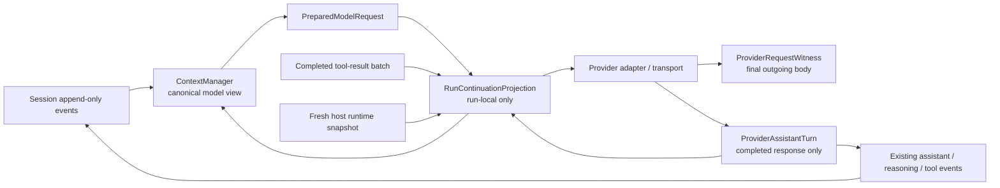

# 102 · Provider transcript 前缀复用 - 技术方案

## 状态

CONFIRMED

## 需求文档

→ [requirement.md](./requirement.md)

## 证据索引

→ [evidence-index.md](./evidence-index.md)

## 现状分析

### ContextManager 每次都正确重建，但不会保留上一次请求表面

`Conversation._assemble_stream()` 每次从 `Session.llm_messages`、当前 system prompt、
动态 runtime context、memory、工具 schema 和恢复指令重新生成完整模型请求。这个入口保证了
预算、compaction、tool result 投影和 reasoning replay 不被绕过，但当前工具续轮会把新的
assistant/tool 事务放到旧的临时 runtime context 之前，导致 provider 可见前缀移动。

因此问题不是 Session 历史缺失，而是“canonical history 可以重建正确请求”与“连续请求保留
上次已经发送的表面”之间缺少一层 run-local continuation projection。

### 当前 provider response 只以增量和 Session 事件重新拼装

`llm_providers` 向上发送文本、tool call 参数增量、activity 和 `LLMTurnDone`；
`Conversation` 再累积文本与 tool call，并通过 Session 事件生成下一轮模型消息。需求 101 已经
补充 opaque reasoning continuation，但完整的 assistant response 仍没有一个“本次 provider
已经完成、可原样用于同 run 下一请求”的类型边界。

这会丢失或弱化以下区别：

- tool-call assistant 的 `content=null` 与空字符串；
- provider 返回的原始 tool call 顺序、ID、名称和参数 JSON；
- provider/model 绑定的 reasoning replay state；
- completed response 与尚未闭合的 stream accumulator。

### 当前诊断发生在 LiteLLM provider transform 之前

`PromptCacheTraceTracker` 比较进入 `LLMClient` 前的 OpenAI 风格 messages/tools；当前调查
overlay 又按这些输入自行重渲染 JSON 计算 request fingerprint。LiteLLM 随后仍会执行
provider-specific `transform_request`、合并 `extra_body`、追加 stream 字段或走 OpenAI SDK，
因此这类 fingerprint 只能说明 adapter 输入，不足以证明最终 provider wire 保持前缀。

### 动态 runtime context 当前使用临时 system message

`_ephemeral_model_context_message()` 每次 inference 都生成新的 system message，并由
`turn_context` 放在请求尾部。该消息不持久化是正确的，但工具续轮重建时旧快照消失、新快照又
出现在 assistant/tool 之后，正是当前前缀被改写的主要来源之一。

## 设计原则

1. **Session 与 ContextManager 仍是事实和治理 owner**：run-local projection 不持久化，不参与
   memory、搜索、摘要或跨用户回合恢复。
2. **保留已发送表面，只追加新事实**：稳定条件满足时，下一请求从上一次已接受的模型视图出发，
   追加 completed assistant、完整工具结果和新的 host runtime snapshot。
3. **语义判断与 wire 判断分层**：ContextManager 决定候选是否仍满足历史、预算与 compaction
   语义；provider transport 对最终实际请求执行 strict-extension witness。
4. **完整 response 才能进入 continuation**：partial 文本、未闭合 tool call 和未完成 reasoning
   不进入投影，也不与下一 attempt 拼接。
5. **未知即重建**：任何无法证明兼容的历史改写、请求包络变化或 provider transform 变化都建立
   新 generation；重建只损失缓存机会，不损失正确性。
6. **诊断不保存正文**：运行内投影可以暂存完成任务所需的请求内容；日志、持久诊断和
   `ProviderRequestWitness` 只保留 digest、尺寸、关系和原因码。

## 总体架构



方案不新增通用 transcript ledger。`RunContinuationProjection` 只保存“上一份已准备请求 +
本次尚待追加的 completed response/tool facts + generation anchor”，其内容随 run 结束销毁。

## 1. 责任边界与状态类型

### 1.1 `PreparedModelRequest`

在 `Conversation` 内部增加一次模型调用的准备结果：

```python
@dataclass
class PreparedModelRequest:
    messages: list[dict[str, Any]]
    build: BuildResult
    projection_anchor: ContextProjectionAnchor
    continuation_disposition: Literal["baseline", "continued", "rebuilt"]
    rebase_reason: str | None
```

- `messages` 是现有 multimodal 与 reasoning renderer 完成后的 provider-neutral 请求输入。
- `build` 继续携带 compaction/tool-context-edit 候选；提交时机不变。
- `projection_anchor` 证明本次模型视图依赖的 active event 前缀、checkpoint 和投影策略。
- 现有只需要 messages 的内部入口保留薄 wrapper；工具循环改为消费完整准备结果。

### 1.2 `ContextProjectionAnchor`

anchor 不复制 Session 内容，只记录可以验证“旧事实仍是当前 active projection 前缀”的身份：

```python
@dataclass(frozen=True)
class ContextProjectionAnchor:
    active_event_uuids: tuple[str, ...]
    compaction_uuid: str | None
    tool_context_edit_uuid: str | None
    projection_policy_version: int
```

Session event 本身不可变，因此 UUID 顺序可以证明旧事实未被改写；`turn_rewrite`、edit/resend、
partial normalization、checkpoint 变化或 tool-result 模型投影变化会使 anchor 校验失败。
普通 assistant/tool 事件只在 anchor 后追加，不视为 rewrite。

### 1.3 `ProviderAssistantTurn`

在 `llm_providers.stream_events` 增加禁止正文 repr 的 completed response 类型：

```python
@dataclass(frozen=True, repr=False)
class ProviderAssistantTurn:
    content: str | None
    tool_calls: tuple[ProviderToolCall, ...]
    reasoning_state: ProviderReasoningState | None
```

`ProviderToolCall` 保存 index、provider call id、函数名和原始 `arguments_json`。Provider 层继续
发出实时 delta；同一 attempt 的 accumulator 只在完整 stream 结束时冻结为
`ProviderAssistantTurn`，并由 `LLMTurnDone.assistant_turn` 交给 Conversation。

该类型不保存整个 SDK response。provider 特有且续轮必需的字段继续通过有界、provider/model
绑定的 replay state 表达。Session 仍使用现有 assistant、provider_reasoning_state、
tool_call_request/result 事件持久化事实；active run 则优先使用 completed turn 保留 wire 细节。

### 1.4 `RunContinuationProjection`

由单个 `Conversation.stream()` / edit-resend / continuation run 创建并在 `finally` 中销毁：

```python
@dataclass
class RunContinuationProjection:
    continuation_id: str
    generation: int
    prepared: PreparedModelRequest | None
    provider_witness: ProviderRequestWitness | None
    pending_assistant: ProviderAssistantTurn | None
```

它只允许以下状态迁移：

```text
empty -> baseline prepared -> request completed
      -> completed assistant + tool-result batch
      -> continuation candidate -> continued | rebuilt
      -> ...
```

投影不提供任意 append API，不读取下一用户回合，也不持久化。所有 tool result 必须先成为现有
Session 事件，投影再按 event UUID 读取对应模型视图；这样不会形成第二套工具事实源。

## 2. 首次请求与工具续轮

### 2.1 首次请求建立 baseline

1. run 开始冻结现有 `_RunModelSnapshot`、tool specs、附件表示和 request settings。
2. ContextManager 按现有流程从 canonical history 生成 `PreparedModelRequest`。
3. 新鲜 runtime context 以 host snapshot 追加到当前 user 后面。
4. provider transport 发送最终请求并产生 `ProviderRequestWitness`。
5. 首次请求只建立 baseline，不报告缓存延续。
6. 只有 stream 完整结束后才产生 `ProviderAssistantTurn`。

provider 在 header 前、首个 chunk 前或未产生可用响应项时的相同请求重试复用同一 baseline；
重试 attempt 不创建新的 continuation generation。

### 2.2 continuation candidate

工具执行全部完成后，候选顺序固定为：

```text
previous prepared messages
+ completed provider assistant turn
+ complete tool-result batch
+ fresh host runtime snapshot
+ optional host advisory/recovery packet
```

约束：

- assistant turn 使用 provider 层冻结的 content/tool calls/replay state，不从 UI 文本反推。
- tool result 使用 Session 已持久化的模型视图，按 provider call id 完整配对。
- 并行工具结果按原响应 item 顺序形成一个 batch；host snapshot 只能出现在整个 batch 之后。
- 可绑定但执行前拒绝的调用仍形成 assistant tool call + authoritative error result，可以继续。
- 无法绑定的 malformed response 使用既有 `model_output_rejection` 恢复事实并直接重建，不尝试
  把非法 tool transaction 当作可延续前缀。

### 2.3 ContextManager 接受或重建

`ContextManager.build_messages()` 增加可选的 `continuation_candidate`。三种策略共用一段前置
校验，不分别实现 ledger：

1. 校验 projection anchor 仍是当前 active model view 的前缀。
2. 对新追加 tool result 应用现有 context projection；该投影只能改变新尾部，不能改旧前缀。
3. 使用当前 `RuntimeContext`、tool schema 开销和 calibration 重新计算完整请求预算。
4. 未触发历史收缩、compaction 或旧 tool-result rewrite 时，原样接受 candidate。
5. 任一检查失败时忽略 candidate，按现有 canonical history 重新 build，并记录稳定 rebase reason。

因此 continuation 不绕过预算。若新增工具结果本身过大，可在追加前投影它；若必须收缩已经发送的
旧前缀，则只能重建。

### 2.4 provider witness 回灌

请求实际发送后，Conversation 保存新的 content-free witness：

- final wire 是上一 witness 的严格 transcript extension，且 envelope 相同：`continued`；
- agent-side candidate 认为可延续，但 provider transform 后不再是严格前缀：本次请求仍安全发送，
  结果标记 `rebuilt/provider_transform_changed`，并以本请求建立新 baseline；
- witness 不可用：对话正常完成，但 prefix relation 为 `unavailable`，不得根据 adapter 输入宣称命中。

缓存由 provider 自动决定，witness 不控制或伪造 provider cache hit。

## 3. Host runtime snapshot

### 3.1 角色与结构

把 `_ephemeral_model_context_message()` 从临时 system message 调整为受信 host `user` packet：

```xml
<agent_friend_runtime_context source="host" run="..." sequence="2" supersedes="1">
  ... surface、trusted time、权限与文件系统 scope ...
</agent_friend_runtime_context>
```

Message meta 使用结构化内部身份：

```python
{
    "synthetic": "run_runtime_snapshot",
    "trusted_host_context": True,
    "run_id": run_id,
    "sequence": sequence,
}
```

普通用户文本新增对应 marker 转义；模型侧可信性来自“基础 system contract + 宿主生成的结构化
packet + 用户 marker 转义”，内部代码不得只按正文前缀识别 snapshot。

### 3.2 supersede 语义

- sequence 从当前 run 的 0 开始单调递增。
- 新 snapshot 明确 supersede 旧 sequence；旧 snapshot 留在已发送前缀中，不原地修改。
- 同一次 inference 只刷新一次 trusted time，并与随后工具调用的隐藏 runtime time 共用。
- 同一个 provider request 的传输重试不刷新 snapshot。
- snapshot 不进入 Session、summary、memory、搜索、run snapshot 或下一用户回合。

### 3.3 工具协议邻接

host packet 永远不插入 assistant tool call 和对应 tool result 之间：

```text
assistant(tool calls)
tool result 1
tool result 2
...
host runtime snapshot
```

Provider adapter 可以按目标协议把并行 tool results 组合进一个 user message，并把 host block 放在
tool-result blocks 之后；但不得把 snapshot 移到 tool results 之前。OpenAI-compatible/DeepSeek 路径
保持 tool messages 后再追加 host user message。

软预算提醒、no-progress advisory 和 response recovery instruction 统一通过带 kind 的 host packet
追加，不再依赖会被 provider 提升到请求头部的中途 system message。静态行为合同仍只存在于首部
system prompt。

## 4. 最终 wire witness

### 4.1 观察位置

`ProviderRequestWitness` 必须来自 provider transform 之后、网络发送之前的实际请求：

- LiteLLM native route：为本次调用注入独立 `HTTPHandler` / `AsyncHTTPHandler`，在底层 request
  hook 读取 fully prepared body。
- OpenAI-compatible SDK route（含 DeepSeek Vision）：向 SDK client 注入带 request hook 的
  HTTPX client。
- Kimi direct route：在现有 OpenAI client 创建处使用同样的 per-call hook。
- 未来 transport 没有安全 hook 时返回 `unavailable`，不能退回全局 callback 或自行猜最终 body。

不使用 LiteLLM 全局 callback。全局注册既会跨并发请求串扰，也会扩大 prompt 暴露面。

### 4.2 witness 内容

```python
@dataclass(frozen=True, repr=False)
class ProviderRequestWitness:
    version: int
    provider_id: str
    transport: str
    transform_identity: str
    transcript_item_digests: tuple[bytes, ...]
    envelope_digest: bytes
    request_digest: bytes
    request_bytes: int
```

- request body 只在 hook 栈内解析，随后立即释放。
- 内部比较使用完整 SHA-256；日志只输出截短 digest。
- transcript 从最终 body 的 `messages`、`input` 或 provider adapter 声明的等价有序字段提取。
- envelope 是移除 transcript 后的全部 content-bearing body；未知字段默认计入，变化即重建。
- Authorization、API key、动态 request id 和其它 transport headers 不进入 envelope，也不记录。
- raw request bytes 只用于 size 和 digest，不持久化。

### 4.3 strict-extension 判定

只有同时满足以下条件才是 `strict_extension`：

1. witness version、provider、transport 和 transform identity 相同；
2. envelope digest 相同；
3. 新 transcript item 数严格大于旧值；
4. 旧 item digest 序列与新序列前缀逐项完全相同。

完整 request digest 相同则是 `same_request_retry`，不是 continuation。其它情况是 `rebase`。
Raw JSON key order 不作为 transcript 语义；比较对象来自实际 outgoing body 的结构化有序 items，
同时保留 raw-body digest 用于定位序列化变化。

### 4.4 client 生命周期

per-call HTTP client 与 stream 由同一 transport wrapper 持有并在以下路径关闭：

- stream 正常结束；
- header wait 取消；
- 迭代异常；
- provider 初始化失败。

同步、异步可取消路径使用同一 witness callback 契约，避免只在非取消调用中可观察。

## 5. Generation 与重建矩阵

| 场景 | 处理 | reason code |
| --- | --- | --- |
| run 首次请求 | 建立 baseline | `run_start` |
| header/chunk 前临时故障，同请求重试 | 保持 generation，不刷新 runtime | `same_request_retry` |
| completed assistant + 完整工具结果 + 新 host snapshot | 尝试严格追加 | `tool_continuation` |
| 新增 tool result 只在新尾部被截断/占位 | 允许追加 | `tail_tool_projection` |
| compaction、FIFO 需要改旧前缀 | canonical rebuild，generation +1 | `context_compacted` / `history_truncated` |
| turn rewrite、edit resend、partial normalization | 新 run 或 rebuild | `history_rewritten` |
| model/provider/reasoning preset 改变 | 新 baseline | `model_config_changed` |
| tools/tool choice/schema 改变 | rebuild | `tool_envelope_changed` |
| request settings/response format 改变 | rebuild | `request_settings_changed` |
| 附件或 DeepSeek file block 表示改变 | rebuild | `attachment_representation_changed` |
| provider transform 后前缀不一致 | 已发送请求成为新 baseline | `provider_transform_changed` |
| context-window recovery 重新 prepare | rebuild | `provider_context_exceeded` |
| empty/output-budget recovery 追加指令 | 新 baseline | `response_recovery_changed` |
| partial text、未闭合 tool/reasoning 后失败 | run 失败并销毁 projection | `partial_response` |
| malformed response 无法形成合法 replay | canonical recovery/rebuild | `provider_response_unreplayable` |
| witness 不可取得或版本不兼容 | 正常发送，不声明 relation | `wire_witness_unavailable` |

重建不删除 Session 事件，也不重放已经执行的工具。它只是放弃旧请求表面，从当前 canonical
model view 生成一份新的完整请求。

## 6. Retry、取消与恢复

### 相同请求的 provider retry

LLMClient 现有瞬时重试继续冻结 messages、tools、settings、host snapshot 和 continuation witness。
每个 transport attempt 可以产生自己的 request id/timing，但 request digest 必须相同；不相同则
按内部不变量错误处理，而不是静默称为相同重试。

### Context/response recovery

- provider context exceeded 且无可用输出：丢弃未接受的 compaction candidate，重新经过
  ContextManager；新请求是明确 rebase。
- empty response/output budget recovery：上一 attempt 没有 completed assistant turn；恢复指令
  作为新的 host packet 追加，并建立新 baseline。
- 已经产生用户可见文字或已完成 response item 后断流：沿用需求 095，不盲目 replay；projection
  随 run 失败销毁。

### Run 生命周期

下列任一情况都立即销毁 projection 与 provider witness：

- `TurnDone` 完成；
- Failed / Interrupted / 用户取消；
- edit resend、regenerate、新用户输入；
- session/model 切换；
- 应用重启或 run recovery 重新装配。

持久化的 prompt-cache 诊断可以说明上一请求曾经命中，但不能恢复正文 digest 或 continuation
state，也不能让下一 run 继承旧 prefix。

## 7. 诊断与隐私

### 7.1 权威字段

每次 provider 请求输出：

- `continuation_id`、`generation`、model call index、transport attempt；
- `continuation_disposition=baseline|continued|rebuilt|unavailable`；
- `rebase_reason`；
- `wire_request_fingerprint`、`wire_request_bytes`、`wire_transform_identity`；
- `wire_prefix_relation=baseline|same_request_retry|strict_extension|rebase|unavailable`；
- transcript item count、common-prefix item count；
- provider request/response id、usage、cached/uncached input tokens。

`cached_input_tokens / prompt_tokens` 只在分母大于 0 且 provider 明确给出 cached counter 时计算。
缺失仍是 `unavailable`，不转为 0。

### 7.2 现有 trace 调整

`PromptCacheTraceTracker` 保留 adapter-input 级的 message/tool 差异定位能力，但字段明确改名，不能再
把它的 `previous_request_prefix_preserved` 当成 final-wire 结论。最终同名对外诊断由
`ProviderRequestWitness` 填充；无 witness 时为 unavailable。

当前 overlay 中 `_request_payload_bytes()` 自行重渲染的 fingerprint 删除或降级为测试辅助，
不得继续命名为 final-wire identity。

### 7.3 内容边界

禁止日志、错误、diagnostic bundle 和持久 cache diagnostics 包含：

- request body、message/item digest 列表；
- host snapshot 正文；
- tool args/result 正文；
- reasoning payload；
- API key、Authorization 或签名头。

允许保存完整 request digest、聚合计数、角色/类型、原因码和 provider usage。

## 8. 涉及文件

| 文件/模块 | 改动 |
| --- | --- |
| `agent/src/agent/conversation.py` | 创建/销毁 run projection；准备请求；消费 completed assistant turn 与 wire witness；rebase 诊断 |
| `agent/src/agent/run_transcript.py`（新增） | `RunContinuationProjection`、generation、candidate 与 anchor 校验编排 |
| `agent/src/agent/context/protocol.py` | `ContextProjectionAnchor`、continuation candidate 与 BuildResult disposition |
| `agent/src/agent/context/*` | 共用 continuation preflight；预算、tool projection、compaction 后安全回退 |
| `agent/src/agent/messages.py` | host snapshot marker 转义与 provider assistant replay meta |
| `agent/src/agent/sessions/session.py` | active projection anchor 与按事件 UUID 读取 tool-result 模型视图；不新增持久事件 |
| `agent/src/agent/prompt_cache_trace.py` | 区分 adapter-input trace 与 final-wire relation，移除跨 run continuation 含义 |
| `llm_providers/src/llm_providers/stream_events.py` | `ProviderAssistantTurn`、`ProviderToolCall`、witness/continuation 诊断 |
| `llm_providers/src/llm_providers/protocol.py` | ModelCallControl 携带 continuation identity 与 prior opaque witness |
| `llm_providers/src/llm_providers/client.py` | attempt-local completed response 累积；provider witness 接入；移除猜测 final wire 的 renderer |
| `llm_providers/src/llm_providers/litellm_transport.py` | per-call sync/async HTTP handler、request hook 与确定性关闭 |
| `llm_providers/src/llm_providers/kimi_transport.py` | direct OpenAI client request hook 与 witness |
| `llm_providers/src/llm_providers/deepseek_vision_compat.py` | 保持 file block transform；通过最终 SDK request witness 验证实际 body |
| `llm_providers/tests/`、`agent/tests/` | provider body、tool loop、rebase、重试、隐私和兼容回归 |
| `scripts/prompt-cache-smoke/` | 真实 DeepSeek 工具续轮 case、wire relation 与 cache usage 报告 |

不修改 frontend、AG-UI 用户协议、Session schema、memory 数据结构或 provider 配置 UI。

## 9. 测试设计

### 9.1 Context 与 run projection

- 首次请求建立 baseline，普通工具续轮接受严格追加 candidate。
- old anchor 仍 active 时允许追加；turn rewrite、compaction、tool-context-edit 改旧前缀时重建。
- 长历史、巨大新 tool result、巨大旧 tool result 分别覆盖 tail projection 与旧前缀重建。
- run 完成、失败、取消、edit resend、新用户回合和重载后 projection 均为空。
- host snapshot sequence/supersedes 单调，旧 snapshot 不修改且不进入 Session/memory/summary。

### 9.2 Completed provider response

- 文本、单工具、多工具、并行工具、`content=None`、原始 arguments JSON 和 reasoning state 完整冻结。
- transport retry 清空旧 attempt accumulator，不拼接两个 attempt。
- partial/unclosed stream 不产生 `ProviderAssistantTurn`。
- malformed bindable 调用形成权威错误 result；unreplayable item 触发明确 rebuild。

### 9.3 最终 HTTP body

用 mock transport 捕获真正发出的请求，而不是 monkeypatch `litellm.completion` 输入：

- DeepSeek native LiteLLM sync/async cancellable route；
- DeepSeek Vision OpenAI-compatible `extra_body.messages`；
- Kimi direct sync/async route；
- OpenRouter 既有 route；
- tools、reasoning、stream options、attachments 和额外 body 字段进入正确 envelope/transcript。

每条路径验证：请求 body digest 来自 hook；第二请求的最终 transcript 是第一请求严格前缀；
全局 LiteLLM callbacks 未被修改；client 在成功、错误和取消后关闭。

### 9.4 工具协议与动态上下文

- assistant tool call 后立即出现全部对应 tool results，host snapshot 在 batch 之后。
- 并行结果在需要分组的 provider 中保持同一 user message 且 tool-result blocks 在前。
- trusted time/permission/scope 变化只追加新 snapshot；模型可识别最新 sequence。
- 普通用户伪造内部 marker 会被转义，不能产生 `trusted_host_context` meta。
- soft reminder、progress advisory 和 response recovery 不被提升后改写旧 system envelope。

### 9.5 Rebase 与 retry

- generation/reason matrix 对 compaction、model、tools、settings、attachment、provider transform
  和 recovery 各有确定断言。
- 同请求 retry 的 request digest 完全相同且不推进 generation。
- final wire 意外不连续时本次对话仍成功，但诊断为 `provider_transform_changed`。
- witness unavailable 时不影响回答，不误报 prefix preserved。

### 9.6 Usage 与真实 smoke

- cached counter 缺失、明确 0、非 0 三态保持区分。
- DeepSeek 受控真实工具续轮固定 model、tools、消息规模与 runtime packet；报告两次请求的
  prompt/cached/uncached tokens、wire relation、工具数和消息规模。
- AC-7 只检查第二次模型请求 `cached_input_tokens / prompt_tokens >= 95%`，不外推 dashboard。
- 真实调用在实现和确定性测试通过后按 `llm-api-confirm` 单次授权执行。

### 9.7 项目门禁

- 运行 agent/context/session/provider 定向测试与 prompt-cache smoke 自测。
- 运行 `scripts/check` 全量门禁。
- 本需求无前端视觉改动，不触发桌面视觉验收。

## 10. 兼容与迁移

- 不新增或迁移 Session event；旧 session 继续由既有投影读取。
- `LLMTurnDone` 新字段为加性内部协议；fake provider 未提供 completed turn 时可在过渡期由
  adapter 生成，但生产 transport 必须提供。
- provider 没有 cache usage 或 witness 能力时正常完成，只降级诊断与优化。
- Kimi/DeepSeek/OpenRouter 保持现有模型选择、API base、工具 schema 和 reasoning replay。
- 现有跨进程 cache lineage 只用于历史诊断，不恢复 run transcript。
- 不引入 provider SDK 全响应持久化、跨用户回合 transcript 或新的加密生命周期。

## 11. 风险与控制

| 风险 | 控制 |
| --- | --- |
| run projection 成为第二份历史 | 只接收 ContextManager prepared request 和已持久化 tool facts；run finally 强制销毁；rebuild 以 Session 为准 |
| provider response replay 丢字段 | completed typed turn + adapter-private replay state；最终 body contract test |
| LiteLLM 升级改变 transform/client 类型 | `transform_identity` 版本化；每条 transport 捕获真实 HTTP body；不依赖全局 callback |
| host user packet 被当成真实用户意图 | 静态 system contract、结构化 provenance、sequence/supersedes 与 marker 转义 |
| tool result 邻接被动态 context 打断 | candidate builder 只允许整批 tool results 之后追加 host packet；provider fixture 验证 |
| 为缓存绕过预算或 compaction | continuation candidate 必须先过 ContextManager；改旧前缀时只能 rebuild |
| partial response 被重复消费 | completed boundary 前不推进 projection；partial 后沿用 095 fail/interruption 语义 |
| request hook 泄漏 prompt | body 只在调用栈内解析；witness 只含 digest/计数；日志和诊断契约禁止正文 |
| 优化失败影响正常回答 | witness/缓存均为可降级能力；不连续时发送完整正确请求并建立新 baseline |

## 12. 实施顺序

1. 先补 `ProviderAssistantTurn` 与 final-wire `ProviderRequestWitness`，用 mock HTTP transport 固定
   DeepSeek/Kimi/OpenRouter 的真实请求边界。
2. 增加 run-local projection、context anchor 和 completed tool batch candidate，不改变 Session schema。
3. 把 runtime/advisory 改为 host packet，完成 marker 转义、supersede 与 tool adjacency。
4. 接入 ContextManager continuation preflight 与 correctness-first rebuild matrix。
5. 把现有 cache trace 改为 wire witness 权威关系，补齐 usage/隐私诊断。
6. 跑定向测试与 `scripts/check`；通过后再按单次授权执行 DeepSeek AC-7 真实 smoke。

## 13. 变更记录

| 日期 | 变更内容 | 是否需要重新实现 |
| --- | --- | --- |
| 2026-08-24 | 初版确认：ContextManager 保持治理 owner；增加 run-local continuation projection、completed provider turn、host runtime snapshot 与 transport-specific final-wire witness；未知变化 correctness-first rebuild | 是，进入 Phase 3 前需单独授权 |
