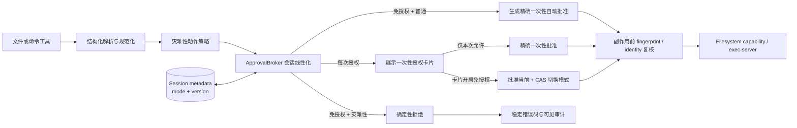

# 103 · 会话级免授权模式与高危兜底 - 技术方案

## 状态

CONFIRMED

## 需求文档

→ [requirement.md](./requirement.md)

## 证据索引

→ [evidence-index.md](./evidence-index.md)

## 现状分析

### 当前授权控制面只有一次性请求

- `agent.approvals.ApprovalBroker` 是文件和命令授权共享的唯一活动请求 registry，负责关联、等待、终态和 push 通知。
- `ApprovalLifetime` 虽然预留了 `turn`、`session` 和 `persistent` 字面值，但 `ENABLED_APPROVAL_LIFETIMES` 只允许 `once`；文件和命令的决定也都只生成当前请求的精确 capability。
- `RequestFilesystemAccessTool` 与 `ExecCommandTool` 都在完成结构化解析后创建 typed pending request，等待 broker 返回决定，再进入 capability grant 或进程启动。
- 输入 surface 不是桌面聊天时，两个工具都会在创建授权请求前 fail closed，因此其它入口不会因为复用 session id 自动获得本地能力。

本需求不能直接启用 `ApprovalLifetime="session"`。该字段表达的是授权决定本身的生命周期，容易被误解为复用某次路径、命令或 scope；需求需要的是“该会话后续每个新请求如何决策”。二者必须保持独立，每个实际执行仍只消费一个精确的一次性决定。

### exec-server 不拥有 Agent 层危险动作策略

- 命令工具把规范化后的 `launch_argv`、workdir、env 与 sandbox 配置交给 Codex exec-server。
- exec-server 负责进程和 sandbox enforcement，不接收 agent-friend 会话授权模式，也不执行 Codex Agent 上层的 approval/exec-policy。
- `host_user` 命令显式不带 sandbox，因此尤其不能假定低层执行器会代替产品判断灾难性动作。

因此会话模式与灾难性动作策略都必须由 agent-friend 自己拥有；现有 sandbox、受保护路径和执行前身份复核继续作为彼此独立的后续安全层。

### 会话 metadata 适合保存模式，但需要版本化

- `SessionMetadataStore` 已通过 `metadata.json.lock`、锁内 read-modify-write 和临时文件替换保存展示标题与归档状态。
- metadata 不进入 Session JSONL 事件流，也不参与模型消息投影，符合授权模式属于宿主运行时安全状态、而不是对话事实的边界。
- `SessionManager` 已把 metadata 投影到 session summary，并通过 `SessionChangeBroker` 通知多窗口刷新。

当前 metadata 没有 per-session 版本。若两个窗口同时切换模式，仅靠最后写入者覆盖无法判断请求是在切换前还是切换后创建，因此需要为授权模式增加独立的单调版本与 compare-and-set 写入。

### 前端已有所需语义组件

- Composer footer-prefix 已容纳附件与会话模型控件，可以并列放置会话授权模式入口。
- `ApprovalDock` 是聊天页唯一自动展示活动文件/命令授权的 surface，适合增加卡片入口。
- 项目已有 `DropdownMenu`、`Button`、`Tooltip` 和通用 `ConfirmDialog`，无需新增组件库或用通用容器模拟菜单、弹窗。
- Composer 与 ApprovalDock 位于同一个 `ChatContentSurface`，可以由页面级协调器共享同一弹窗内容和提交逻辑，避免两处交互漂移。

## 方案总览



核心约束：

1. 会话模式只改变新授权请求的默认决策，不扩大请求中的路径、动作、网络或执行级别。
2. 所有允许结果仍是当前 request 的 typed one-shot decision；不启用 `session` lifetime，不创建复用规则。
3. 灾难性策略独立于会话模式；模式与策略组合后才得到等待、自动允许或拒绝结果。
4. 模式切换、请求创建和卡片组合动作按 session 线性化；已有 pending 不被追溯处理。
5. 授权时看到的对象与真正产生副作用前的对象必须由同一 risk fingerprint 和现有 identity 校验绑定。

## 1. 会话授权模式领域模型

### 1.1 稳定类型

在公共 approvals 模块定义：

```python
SessionApprovalMode = Literal["per_request", "session_auto"]

@dataclass(frozen=True)
class SessionApprovalModeState:
    mode: SessionApprovalMode
    version: int
```

- `per_request` 对应“每次授权（推荐）”。
- `session_auto` 对应“本会话无需授权”。
- 缺失 metadata 的 session 投影为 `per_request, version=0`。
- `version` 只在该 session 的授权模式成功变化时递增；重复提交当前值是 no-op，不递增。

`ApprovalLifetime` 与 `ENABLED_APPROVAL_LIFETIMES` 保持现状。文件和命令 request 的 `requested_lifetime` 继续固定为 `once`。

### 1.2 metadata 持久化

`SessionMetadata` 加性增加：

```python
approval_mode: SessionApprovalMode = "per_request"
approval_mode_version: int = 0
```

JSON 只保存合法枚举和非负整数。旧文件缺字段时使用安全默认值，不批量改写；第一次模式变化时自然写入新字段。

切回 `per_request` 后仍保留正数 version，不能把 metadata 当成空值删除，否则旧窗口可能带着历史 version 再次覆盖新状态。删除 session 时继续随整条 metadata 一并删除。

`SessionMetadataStore.compare_and_set_approval_mode()` 在现有跨进程文件锁内完成：

1. 读取当前 mode/version；
2. 比较客户端或 broker 提供的 `expected_version`；
3. 不一致时返回当前 effective state，不写文件；
4. 一致时写入目标 mode 与 `version + 1`；
5. 临时文件替换成功后才返回新 state。

### 1.3 REST 与投影

session list/detail 增加：

```json
{
  "approval_mode": "session_auto",
  "approval_mode_version": 3
}
```

新增：

```http
PUT /v1/sessions/{session_id}/approval-mode
```

请求：

```json
{
  "mode": "session_auto",
  "expected_version": 2,
  "risk_acknowledged": true
}
```

- 进入 `session_auto` 必须显式携带 `risk_acknowledged=true`；它是产品确认流程与审计事实，不替代服务端权限校验。
- 切回 `per_request` 不要求 acknowledgement。
- session 不存在返回 `session_not_found`。
- version 不匹配返回 409 `approval_mode_conflict`，响应携带当前 effective state，前端刷新后由用户重新决定。
- 成功后记录 `session_changed(change_kind="approval_mode")`，同一 session 的其它窗口按 revision 重新拉取。

模式变化不进入 Session 事件流，不进入模型上下文，也不改变会话消息 revision 的含义；它通过现有 session change invalidation 同步管理 metadata 投影。

## 2. ApprovalBroker 会话线性化

### 2.1 单一控制面

保留一个 `ApprovalBroker`，不创建平行的“自动授权 broker”。Broker 注入：

- session approval mode reader / CAS mutator；
- `CatastrophicActionPolicy`；
- session change callback。

Broker 把当前全局 registry lock 拆为短时 registry lock 与按 session 的线性化锁，固定锁顺序为 `session lock → registry lock`。文件 I/O 只持有目标 session 的锁，不阻塞其它会话的请求。

以下动作必须持有同一个 session lock：

- 注册并路由一个新 approval request；
- Composer 模式切换；
- 普通一次性决定；
- 卡片“批准当前并开启本会话免授权”；
- run/session 取消 pending request。

### 2.2 新请求决策矩阵

Broker 在请求完成结构化校验后读取一个 mode/version snapshot，并组合 risk assessment：

| mode | risk | 结果 |
|---|---|---|
| `per_request` | `normal` | 注册 pending，等待用户一次性决定 |
| `per_request` | `catastrophic` | 注册 pending，并展示风险类别；用户仍可对精确请求一次性决定 |
| `session_auto` | `normal` | 不等待 UI，生成当前 request 的完整一次性批准 |
| `session_auto` | `catastrophic` | 不注册可批准 pending，直接以稳定风险码拒绝 |

请求对象记录 `mode_snapshot`、`mode_version`、`decision_source` 与可选 risk assessment。自动允许和策略拒绝也经过 listener push，不能因为没有等待卡片而成为不可见路径。

模式切换与请求创建的线性化语义：

- 请求先取得锁并按 `per_request` 注册，则之后从 Composer 开启免授权不处理它；它仍是已有 pending。
- 模式切换先提交，则之后取得锁的新普通请求自动允许。
- 从免授权切回安全模式时，先完成的自动允许请求视为已经开始的操作；切换先完成则后续请求重新等待。

### 2.3 typed 完整决定

`PendingApproval` protocol 增加由具体 request 实现的 `fully_approved_decision()`：

- command 返回 `CommandApprovalDecision(allow=True, lifetime="once")`；
- filesystem 返回请求中每个 item 的全部已请求 permissions，以及全部 action ids。

自动允许与卡片组合动作都调用这个 typed factory。前端不重新拼装“完整授权”范围，避免 UI 漏字段、越权或与后端 request 漂移。

### 2.4 卡片组合动作

新增通用端点：

```http
POST /v1/approvals/{request_id}/enable-session-auto
```

请求至少包含：

```json
{
  "session_id": "...",
  "run_id": "...",
  "expected_request_version": 1,
  "expected_mode_version": 0,
  "risk_acknowledged": true
}
```

Broker 在同一 session lock 内：

1. 核对 request 仍 pending，session/run/version 全部匹配；
2. 核对 session 当前仍为预期 mode/version；
3. 对 sandboxed command 先执行现有 sandbox readiness 等会失败的前置检查；
4. CAS 持久化 `session_auto`；
5. 使用 request 自己的 `fully_approved_decision()` 设置决定并唤醒等待线程；
6. 发布 request 与 session 变化。

持久化之前不释放 request；持久化失败时 mode 与 request 都不变。持久化成功后只执行不可失败的内存状态提交，listener 失败只记日志、不回滚已经成立的事实。进程级异常终止继续取消当前 run；重连后客户端以 mode metadata 和 pending calibration 为准，不根据丢失的 HTTP response 猜测结果。

其它 pending 不在组合动作的查询或 mutation 集合中。当前 request 已过期、被取消、已决定或版本变化时返回 409 `approval_request_stale`，且不切换 mode。

## 3. 灾难性动作策略

### 3.1 结果模型

公共策略返回不可变结果：

```python
RiskLevel = Literal["normal", "catastrophic"]

@dataclass(frozen=True)
class RiskAssessment:
    level: RiskLevel
    code: str | None
    message: str | None
    fingerprint: str
    evidence: tuple[str, ...]
```

第一版固定三个用户可见风险码：

- `disk-wipe`
- `critical-root-recursive-delete`
- `unresolved-recursive-delete-target`

内部 TOCTOU 复核失败使用独立错误 `approval-target-changed`，不伪装成首次风险分类。

`evidence` 只保存不含 secret 的类别事实，例如“target resolves to drive root”或“PowerShell target contains unresolved variable”；不把完整环境变量、隐藏 launch 参数或额外路径泄漏给模型。

### 3.2 策略 owner 与资源 adapter

`CatastrophicActionPolicy` 是风险级别与风险码的唯一 owner。它消费 typed request，但把资源特有解析收敛到两个小 adapter：

- filesystem adapter 直接使用已 canonicalize 的 `ApprovalAction`、`recursive` 与 `expected_identity`；
- command adapter 使用内部 `launch_argv`、workdir、execution level 与实际 launch environment，输出已识别的命令段和 destructive target facts。

不在 API route、前端或 exec-server wrapper 中再维护一份危险命令表。受保护路径仍由 `ProtectedPathPolicy` 拥有；sandbox 仍由 command runtime/exec-server 拥有；灾难性策略不复制或放宽这些边界。

### 3.3 关键根集合

策略从运行时注入并规范化以下 critical roots：

- POSIX filesystem root；
- Windows 每个实际目标对应的 drive/UNC root；
- 当前用户 home；
- 当前 session-managed command workspace root；
- 当前命令明确表示的整个 working directory 目标（如对 `.` 发起强制递归删除）；
- `ProtectedPathPolicy.product_roots`。

比较使用解析后的 path 及平台大小写规则，不能只比较原字符串。目标为现有 symlink/reparse point 时进行只读 identity/target 核验，按命令的真实删除语义判断是否会触及 critical root。

### 3.4 文件请求分类

文件 adapter 只把满足以下条件的动作归为 `critical-root-recursive-delete`：

- action 是 delete；
- `recursive=true`；
- canonical target 等于 critical root，或结构化动作明确会删除该 root 本身。

精确的普通文件、明确子目录、临时目录或 session workspace 内的窄范围子树不会仅因 recursive delete 被归为 catastrophic。现有受保护路径、`allow_protected`、capability grant 和 action identity 仍分别校验，用户一次性批准高危请求也不代表能绕过这些规则。

### 3.5 命令分类

命令 adapter 使用 segment-aware 解析，不对完整字符串做裸 substring blocklist。第一版最小覆盖：

- 磁盘/卷/分区破坏命令族：Windows format、PowerShell disk/volume clear 或 format、可只读解析的 diskpart destructive script；POSIX `mkfs*`、指向 block device 的 wipe/overwrite；macOS disk erase 命令族。
- 强制递归删除命令族：POSIX `rm` 的 recursive + force 组合；PowerShell `Remove-Item -Recurse -Force`；CMD `rmdir/rd /s /q` 及等价明确形态。
- 已知 shell 包装：`sh/bash/zsh -c`、`powershell/pwsh -Command`、`cmd /c` 等按固定小上限解包；每一层都按自己的 token/segment 规则解析。

只有在已经识别为 destructive command family 后，才检查目标是否包含无法稳定求值的变量、glob、command substitution、PowerShell subexpression、CMD delayed expansion 或其它间接目标。命中时返回 `unresolved-recursive-delete-target`。

可从同一实际 launch environment 无歧义解析的普通绝对/相对 literal target，结合 workdir canonicalize 后再与 critical roots 比较。需要 shell 运行时动态展开、匹配集合可能变化或解析器无法证明等价时不猜测具体范围。

### 3.6 明确残余边界

第一版不读取和理解任意 Python、Node、Ruby、二进制程序或通用脚本文件的业务语义。仅当 argv 或受支持的有限包装层已经暴露已知 destructive command 时才分类；`python cleanup.py` 之类的未知程序不会因为名字看起来像清理脚本就被错误宣称为已审计。

这意味着 `session_auto + host_user` 仍具有真实残余风险，必须由二次确认文案明确告知。现有产品受保护路径只约束文件工具，不能被描述成对任意 host process 的全面保护。本需求不以不可靠的静态分析制造虚假安全承诺。

### 3.7 fingerprint 与副作用前复核

Risk fingerprint 使用稳定 canonical representation 的 SHA-256，至少覆盖：

- request kind、session/run/tool call ownership；
- 文件 items/actions、canonical targets、recursive 与 expected identity；
- 命令实际 `launch_argv`、execution、workdir、filesystem/network scope；
- 解析出的 destructive command family、normalized targets 与 critical-root evidence。

复核位置：

- command 在 path identities 与 sandbox readiness 再校验后、调用 `start_process()` 前重新评估；fingerprint 不一致则不启动。
- filesystem 在 grant 中保留 assessment/fingerprint，并在 destructive action `consume_action_status()` 时与现有 expected identity 一起复核；变化时不消费 grant。

自动允许、用户单次允许和卡片组合允许都走同一复核，不因决定来源不同而跳过。

## 4. 错误、审计与模型恢复

### 4.1 决定来源

approval request/push/tool result 增加稳定来源：

- `user_once`
- `user_enable_session_auto`
- `session_auto`
- `catastrophic_policy`

取消、超时继续由现有 status 表达，不伪造成用户拒绝。request 同时记录做决定时的 mode/version；历史 tool result 保存同一摘要，使重启后仍能解释为什么没有出现逐项卡片。

### 4.2 模型可见错误

免授权模式命中高危策略时返回：

```json
{
  "status": "denied",
  "error": "catastrophic_action_blocked_in_session_auto",
  "risk_code": "critical-root-recursive-delete",
  "message": "该动作不会在本会话无需授权模式下执行。请让用户切回每次授权后重新检查并发起精确请求。",
  "retryable_without_user_change": false
}
```

- 错误明确“没有执行”，并说明只有 mode 或请求目标发生变化后才值得重试。
- 不向模型暴露切换 mode 的工具或隐藏参数；模式只能由用户界面改变。
- Agent 原样或等价改写命令仍命中相同 risk code，日志按 session/run/tool call 关联重复拒绝。
- fingerprint/identity 变化返回 `approval_target_changed`，要求重新发起新请求，旧决定不能复用。

### 4.3 UI 与历史

- 自动允许仍产生 terminal approval push，活动 tool row 显示“依据本会话设置自动允许”。
- 高危拒绝显示风险类别和“未执行”，不能显示为普通运行失败。
- 用户展开历史 tool row 时，从持久 tool result 恢复 decision source、mode version 与 risk code；不依赖内存 approval registry。
- 日志记录 request id、session/run/tool call、decision source、mode version、risk code 和 terminal status，不记录 secret 或额外隐藏 argv。

## 5. 前端状态与交互

### 5.1 真相源与协调器

`useConversationStore` 的当前 session view 增加：

```ts
approvalMode: "per_request" | "session_auto";
approvalModeVersion: number;
approvalModeChanging: boolean;
```

mode/version 只由 session detail 或 mutation 成功响应更新。首页没有持久 session 时投影安全默认值，但模式入口不可切换，并提示“发送第一条消息创建会话后可调整”；不为尚未存在的 session 写 orphan metadata。

在 `ChatContentSurface` 增加页面级 `SessionApprovalModeController`：

- Composer 和 ApprovalDock 通过同一 hook 请求模式变化；
- controller 只保存当前 dialog intent，不复制 effective mode；
- intent 区分 `composer` 与带 request id/version 的 `approval_card`；
- session 切换、request 消失或版本变化时关闭旧 dialog；
- 确认成功使用后端响应更新 store，409 时刷新当前 session 与 pending queue。

### 5.2 输入区控件

新增 chat-specific `SessionApprovalModeControl`，复用现有 DropdownMenu：

```text
Trigger: [每次授权 ▾]

授权模式
├─ 每次授权（推荐）
│  每个文件或命令请求都由你决定
└─ 本会话无需授权  ⚠
   后续普通请求不再逐项询问
```

- footer-prefix 左侧放附件与授权模式，右侧放模型与语音入口，使模型靠近发送区域。
- `per_request` 使用普通中性色并显式标注推荐。
- `session_auto` trigger 持续使用 warning/danger token、风险图标、文字颜色和完整可访问名称；背景保持原输入区中性色，菜单关闭后仍可见。
- 切回 `per_request` 直接提交，不弹窗。
- 进入 `session_auto` 只打开共享确认 dialog，菜单选择本身不先改变 UI 或后端状态。
- 首页尚无持久 session 时，确认结果暂存在 home view；首次 `RunAgentInput.forwardedProps.initialApprovalMode` 携带 `{mode, riskAcknowledged}`，Bridge 只在 auto-create 新 session 时采纳，已有 session 忽略该字段。
- 模式控件不因当前 run 正在 streaming 而禁用，否则用户无法在授权等待期间调整后续请求；只在历史加载、bridge 离线或自身 mutation 中禁用。

### 5.3 二次确认弹窗

复用 `ConfirmDialog` destructive variant，不新增“以后不再提醒”。固定文案 owner 只有 controller：

- 标题：`确认在本会话中免除后续授权？`
- 风险正文覆盖文件读取/创建/修改/覆盖/移动/删除、本地命令、网络与显式 `host_user`。
- 明确说明灾难性动作仍可能拒绝，但这不是全面安全保证。
- 推荐继续使用“每次授权”。
- 取消：`继续每次授权`。
- 确认：`我已了解风险，仍要开启`。

每次 `per_request → session_auto` 都创建新的 dialog intent；此前成功确认不保存客户端 acknowledgement。关闭、Escape、取消、session 切换或请求失效都清除 intent 且不提交。

### 5.4 授权卡片

文件和命令 pending panel 在现有动作旁增加 `本会话无需授权`：

- 只有当前 effective mode 为 `per_request` 时显示。
- 点击只打开同一确认 dialog；不立即调用原 one-shot endpoint。
- 确认后调用组合端点，由后端派生当前卡片的完整批准范围。
- mode 已由其它窗口改变、request 已失效或 sandbox readiness 不满足时，不留下半完成状态；刷新卡片并显示可行动提示。
- sandboxed command 尚未完成系统权限准备时，保持“前往系统权限”主恢复动作，session-auto action 禁用并说明原因，避免切换 mode 后当前请求仍不能批准。
- 当前卡片即使标记 catastrophic，仍允许用户通过这一个显式组合动作批准当前精确请求；dialog 额外展示该卡片的 risk label。未来新高危请求继续在免授权模式下拒绝。

模式切换与 pending 收敛共用 session lock：普通 pending 取得其原始精确 full decision，灾难性 pending 取得 policy deny。卡片入口所对应的当前精确请求仍使用 `user_enable_session_auto` 显式批准；其它请求按新 mode 收敛。前端只在 `per_request` 渲染 pending panel，并在 mutation 返回后主动校准文件与命令请求，不能只隐藏后端仍在等待的请求。

### 5.5 视觉实现边界

- 复用项目 `Button`、`DropdownMenu`、`Tooltip`、`ConfirmDialog` 和现有 warning/danger CSS tokens。
- 页面业务组件不写原生交互元素，不新增 shadcn 组件。
- 若现有 token 不足，只补语义 token并同步所有主题；不硬编码颜色、间距、圆角或动效值。
- 实现完成后先跑组件测试与静态门禁；是否启动真实 Tauri 桌面端做视觉验收，按项目视觉验收规则另行取得用户确认。

## 6. Bridge 与装配

### 6.1 装配顺序

`assembly.py` 在创建 approval broker 前先构造：

1. `SessionMetadataStore`；
2. critical roots provider（home、session workspace、product roots）；
3. `CatastrophicActionPolicy`；
4. 带 mode store/policy/change callback 的 `ApprovalBroker`；
5. filesystem 与 command tools，共享同一个 broker。

当前代码中的 `filesystem_approval_broker` 变量实际持有公共 broker，实施时改成资源无关命名，避免继续强化“公共控制面只属于 filesystem”的误导；`BridgeRuntime` 和调用方同步迁移，不保留尚未发布的双字段 shim。

### 6.2 入口边界

- 文件和命令工具继续先检查隐藏 surface 为 `desktop_chat`，通过后才调用 broker。
- IM、scheduled task 和其它 headless surface 不读取 session-auto 来绕过原 fail-closed。
- REST mode endpoint 只操作已有 session：提交 mode metadata 后由 Broker 让该 session 的现有 pending 按新模式取得终态，但不创建新的 capability、process 或 approval request。
- AG-UI 首轮请求可以携带已确认的 `initialApprovalMode`；该字段只在 `thread_id` 尚不存在、Bridge 正在 auto-create 时应用，不能覆盖已有会话。
- 自动允许 `host_user` 仍要求工具请求显式写出 `execution="host_user"`；broker 不能把 sandboxed request 升级。

### 6.3 工具契约

模型可见 schema 不新增 mode、acknowledgement 或 approval lifetime 参数。宿主注入 session/surface 并决定审批方式。

文件与命令工具 description/result 只做必要加性调整：

- 说明宿主可能根据当前会话设置自动完成普通授权；
- 说明灾难性动作可能以稳定错误拒绝；
- 明确错误发生后应等待用户切换模式或修改目标，禁止无变化重试。

最终 provider tool definition、structured result 和历史投影需要契约测试，避免源码 description、wire schema 与运行时错误漂移。

## 7. 涉及文件

| 路径 | 改动 |
|---|---|
| `agent/src/agent/approvals/models.py` | mode、risk、decision source 与 typed full-decision protocol |
| `agent/src/agent/approvals/broker.py` | per-session 线性化、新请求路由、CAS 切换与组合动作 |
| `agent/src/agent/approvals/risk.py` | 公共灾难性策略、risk code、fingerprint |
| `agent/src/agent/sessions/metadata.py` | mode/version 持久化、兼容解析与 CAS |
| `agent/src/agent/sessions/manager.py`、`catalog.py`、`store.py` | session summary/detail metadata 投影与删除语义 |
| `agent/src/agent/filesystem/models.py`、`tools.py` | 完整决定、文件 risk facts、grant fingerprint 复核与结果审计 |
| `agent/src/agent/command_runtime/models.py`、`tools.py` | 完整决定、命令 risk facts、启动前复核与稳定错误 |
| `agent/src/agent/command_runtime/risk.py` | 跨平台已知命令族、有限 wrapper 与 destructive target 解析 |
| `agent_bridge/src/agent_bridge/assembly.py` | mode store、policy、broker 和 critical roots 装配 |
| `agent_bridge/src/agent_bridge/routes/meta.py` | session mode mutation 与 list/detail 投影 |
| `agent_bridge/src/agent_bridge/routes/approvals.py`、`filesystem.py` | 一次性决定兼容与通用组合端点 |
| `agent_bridge/src/agent_bridge/protocols/ag_ui/decoders.py`、`session_bridge.py` | 首轮风险确认字段校验与新 session 初始 mode 装配 |
| `frontend/src/types/meta.ts`、`services/api/sessions.ts` | mode/version REST 类型与 mutation |
| `frontend/src/services/api/commandRuntime.ts`、`filesystem.ts` | request version、risk/decision source 与组合动作 API |
| `frontend/src/services/stream.ts`、`stores/conversation.ts` | 首页 mode 草稿、首轮 bootstrap、当前 session mode 真相与 stale guard |
| `frontend/src/stores/commandRuntime.ts`、`filesystemApprovals.ts` | terminal auto/deny 投影、pending calibration |
| `frontend/src/pages/chat/components/SessionApprovalModeControl.tsx` | Composer 两档模式菜单与持续风险状态 |
| `frontend/src/pages/chat/components/SessionApprovalModeController.tsx` | 共享确认 dialog、intent 与提交协调 |
| `frontend/src/pages/chat/components/Composer.tsx`、`ChatContentSurface.tsx` | 输入区入口与页面级 controller 装配 |
| `frontend/src/pages/chat/components/ApprovalDock.tsx` | 卡片 session-auto 动作、risk label 与组合提交 |
| 对应 agent、bridge、frontend 测试 | metadata、broker、classifier、API、store、UI 与竞态覆盖 |

实现时优先扩展相邻测试；只有新的 risk parser 或页面协调职责无法清楚落入现有文件时才新增模块。

## 8. 测试设计

### 8.1 metadata 与 API

- 旧 metadata 缺字段投影 `per_request/version=0`，不在只读时改写。
- safe→auto→safe 单调递增 version；切回 safe 后版本仍持久化。
- 两个相同 expected version 的并发写只有一个成功，另一个得到当前 state。
- 新 session 安全默认，archive/unarchive/reopen 保留 mode，delete 清除 metadata。
- session list/detail、session_changed revision 和 reconnect refresh 返回一致 mode/version。
- acknowledgement 缺失、未知 mode、session not found 和 version conflict 的 HTTP/code/message 固定。

### 8.2 Broker 与组合动作

- `per_request` 普通/高危都注册 pending；`session_auto` 普通自动完整批准，高危直接拒绝。
- 自动 filesystem 决定严格等于请求的 permissions/actions；自动 command 仍为 lifetime once。
- Composer 切换自动批准已有普通 pending，并拒绝已有灾难性 pending。
- 卡片组合显式批准当前 exact request，其它同 session pending 按 auto mode 收敛。
- request stale、mode stale、sandbox not ready、metadata write failure 均不产生半完成状态。
- 切换 mode 与新请求、cancel run、timeout 并发时满足固定线性化结果，不复活终态 request。
- listener 抛错不改变已提交状态；transport 丢失后 GET/pending calibration 能恢复真相。

### 8.3 灾难性策略正反例

跨 Windows、macOS/Linux 使用表驱动 fixture 覆盖：

- 每类 disk/volume/partition wipe 正例及对应只读/查询反例。
- `/`、drive root、home、session workspace、workdir 与 product root 的强制递归删除。
- 明确窄范围文件、空目录、临时子目录、workspace 子树的普通清理不误伤。
- `rm -rf` flag 组合、PowerShell 参数顺序/别名、CMD 大小写和 segment chaining。
- 支持 wrapper 内的正例、超过解包上限的保守结果与非 destructive 相邻命令。
- `$VAR`、glob、command substitution、PowerShell/CMD 间接目标返回 unresolved；普通命令中的变量不误判。
- 相对路径、`..`、symlink/reparse point、大小写和 UNC/drive 规范化。
- fingerprint 在等价稳定输入下相同，argv/cwd/target/identity 任一实质变化时不同。
- 任意解释器脚本不被错误声称为已分析；残余边界由测试固定。

### 8.4 文件与命令调用链

- filesystem auto 模式授予精确 scope/action；consume 前 target identity/fingerprint 变化则拒绝。
- sandboxed command auto 模式仍准备 sandbox，不自动升级 host_user。
- host_user 普通命令可自动允许；已知灾难性 host_user 命令直接拒绝且 exec-server 未收到 start。
- 高危默认模式一次性批准后仍经过 ProtectedPathPolicy、sandbox/readiness 和副作用前复核。
- 策略拒绝、用户拒绝、取消、超时、sandbox deny 和 runtime failure 的 tool result/历史终态互不混淆。
- 非 desktop surface 即使 session metadata 为 auto 也继续返回 `approval_surface_unavailable`。

### 8.5 前端

- 输入区只显示两档，安全档有推荐标记，高风险 trigger 在菜单关闭后持续可见。
- 每次进入 auto 都打开新 dialog；取消、Escape、关闭、切 session 不提交。
- 切回 safe 不弹窗；409 conflict 刷新后不乐观保留错误状态。
- active run/approval 等待期间模式控件仍可用；首页无 session 时也可确认并暂存模式，首轮创建后持久化。
- Composer 或 ApprovalDock 开启 auto 都使旧 pending 取得终态；auto 状态不渲染授权卡片，但继续显示命令运行状态。
- 文件/命令卡片共享同一文案和 endpoint；模式切换返回后主动校准两类 pending store。
- sandbox setup required、request stale、loading 和 transport failure 的按钮/提示正确。
- keyboard、focus、screen-reader label 与 destructive dialog 行为覆盖。

### 8.6 项目门禁与验收

- 运行相邻 Python 与 frontend 定向测试。
- 运行 `scripts/check` 全量 lint、typecheck 和 test。
- 本需求不需要真实 LLM 调用；所有 mode/risk 行为使用确定性 fixture 验证。
- UI 实现完成后询问用户是否执行真实 Tauri 桌面视觉验收；若用户自行验收，交付记录标注 `user-owned visual check` 并列出输入区、菜单、弹窗、卡片与多窗口检查点。

### 8.7 AC 覆盖映射

| AC | 主要方案与验证位置 |
|---|---|
| AC-1 两种模式与安全默认 | §1 mode/default、§5.2 两档菜单、§8.1 metadata 测试 |
| AC-2 输入区入口与持续状态 | §1.3 session 投影、§5.2 trigger、§8.5 前端测试 |
| AC-3 每次进入都二次确认 | §5.3 dialog intent、§8.5 取消/重复进入测试 |
| AC-4 普通请求自动允许 | §2.2 决策矩阵、§2.3 typed 决定、§8.4 文件/命令调用链 |
| AC-5 授权卡片切换 | §2.4 组合端点、§5.4 卡片交互、§8.2 原子失败测试 |
| AC-6 已挂起请求不批量批准 | §2.2 线性化语义、§2.4 mutation 集合、§8.2 多 pending 测试 |
| AC-7 高危模式退出 | §1.3 mode API、§2.2 竞态顺序、§5.2 无确认退出 |
| AC-8 灾难性动作兜底 | §3 分类与复核、§4.2 稳定错误、§8.3 正例 |
| AC-9 局部删除不过度拦截 | §3.3/§3.4 目标与范围、§8.3 反例 |
| AC-10 既有安全边界保持 | §3.2 policy owners、§6.2 入口、§8.4 调用链 |
| AC-11 可见审计 | §4 决定来源/错误/历史、§8.4 终态区分 |
| AC-12 多窗口与竞态一致 | §1.2 CAS、§2 session lock、§5.1 stale guard、§8.1/§8.2 并发测试 |

## 9. 兼容与迁移

- metadata schema 加性兼容，旧文件安全默认，不批量迁移。
- `ApprovalLifetime` wire 字段和现有 one-shot decision endpoint 保持兼容；不会把预留 lifetime 开放给旧前端。
- session list/detail 新字段为加性；前端缺字段时安全 fallback，Bridge 与前端同版本发布后以服务端 state 为准。
- 当前公共 broker 的错误变量命名在仓库内一次性迁移，不增加双 broker 或长期 alias。
- 模式不进入 JSONL，因此不会改变 memory、search、compaction、edit-resend 或模型 prompt。
- 非桌面入口行为不变；未来若要支持 headless 自动权限，必须作为独立需求设计其 policy owner 和授权来源。

## 10. 风险与控制

- **auto host_user 的真实破坏风险**：每次进入都明确警告；只覆盖已知灾难性形态，不宣称任意脚本安全。
- **粗字符串规则误伤普通清理**：使用结构化/segment-aware 解析、canonical target 和只读核验，并维护跨平台正反例。
- **classifier 漏检等价包装**：有限 wrapper 解包、稳定 risk code 和已确认事故回归；超出第一版语义边界明确记录残余风险。
- **模式切换与请求竞态**：按 session 线性化并用 metadata CAS version 决定先后，不依赖前端事件到达顺序。
- **卡片组合半完成**：先完成所有可失败校验与 mode 持久化，再以不可失败内存提交释放精确 request；失败前不唤醒工具线程。
- **批准 A 执行 B**：risk fingerprint、现有 path identity、sandbox readiness 与 action grant 在副作用前共同复核。
- **重启后忘记高风险模式**：mode 持久化并进入 session detail；Composer trigger 始终醒目，不只在菜单中显示。
- **前端复制安全判断**：UI 只展示后端 assessment，不解析命令、不决定 risk code、不拼装完整批准范围。
- **审计只存在于内存**：terminal tool result 持久化 decision source/mode version/risk code，push 只负责实时同步。

## 11. 实施顺序

1. 扩展 metadata mode/version/CAS 与 session projection，先固定兼容和多窗口冲突语义。
2. 增加 risk assessment/fingerprint 和跨平台正反例，不接入自动允许前先验证 AC-8/AC-9。
3. 重构公共 broker 为 per-session 线性化控制面，接入自动决定、策略拒绝和组合动作。
4. 在 filesystem grant/consume 与 command start 边界完成二次复核、错误和持久审计。
5. 扩展 Bridge routes、push/session detail 与前端 store stale guard。
6. 完成输入区模式菜单、共享确认 dialog 和 ApprovalDock 组合入口。
7. 运行定向测试与 `scripts/check`；按用户选择完成真实桌面或用户自有视觉验收。

## 12. 变更记录

| 日期 | 变更内容 | 是否需要重新实现 |
|---|---|---|
| 2026-08-24 | 首次确认会话模式持久化、公共 broker 线性化、双入口组合动作、独立灾难性策略、跨平台有限分类与副作用前复核 | 是，新需求 |
