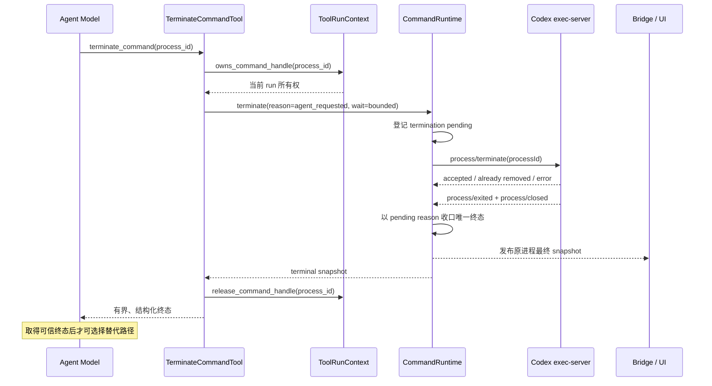

# 104 · Agent 可控的受治理命令终止 - 技术方案

## 状态

CONFIRMED

## 需求文档

[requirement.md](./requirement.md)

## 现状分析

### 当前能力边界

受治理命令链路已经具备三层基础能力：

- `ExecCommandTool` 创建 buffered 或 streaming 命令；streaming 成功后把 `process_id` 与终止回调登记到当前 `ToolRunContext`。
- `WriteStdinTool` 只接受当前 run 拥有的 streaming 句柄，负责写入字符或等待输出/退出；观察到终态后释放句柄。
- `CommandRuntime.terminate()` 校验 session/run 归属并调用 exec-server `process/terminate`；桌面取消、run 取消、超时和收尾已经复用它。

缺口位于模型契约和终态确认两处：

1. 模型只能通过 `write_stdin(chars)` 间接发送控制字符，没有结构化的终止动作。
2. 当前 `CommandRuntime.terminate()` 在调用 exec-server 前就把状态发布为 `cancelled`，并吞掉 RPC 错误。该语义适合快速收敛产品取消状态，但不能作为 Agent 启动替代路径前的可靠终态证据。

### 设计约束

- 不改变命令启动、授权、sandbox / host-user、Skill binding 或文件网络权限模型。
- 不允许 PID、进程名、命令字符串或跨 run 句柄成为终止目标。
- 不把终止并入全局 gate，不推断两个业务命令是否重复。
- 不修改 `write_stdin` 的既有公开 schema，避免破坏已存在的模型调用习惯。
- 运行时终态仍使用现有 `running / exited / cancelled / timed_out / runtime_lost` 集合；Agent 主动终止由 `terminal_reason=agent_requested` 区分，不扩大公共状态枚举。

## 技术方案

### 涉及文件

| 文件路径 | 改动类型 | 说明 |
| --- | --- | --- |
| `agent/src/agent/command_runtime/tools.py` | 修改 | 新增 `TerminateCommandTool`，注册到默认命令工具集合 |
| `agent/src/agent/command_runtime/runtime.py` | 修改 | 增加共享终止中状态与确认式终态收口 |
| `agent/src/agent/command_runtime/__init__.py` | 修改 | 导出新工具 |
| `agent/src/agent/conversation.py` | 修改 | 为新工具注入当前 session/run/tool context 隐藏参数 |
| `agent/tests/fixtures/fake_exec_server.py` | 修改 | 提供可控 terminate 响应、关闭、失败和竞态夹具 |
| `agent/tests/test_command_runtime.py` | 修改 | 覆盖工具 schema、所有权、终态、重复调用和失败恢复 |
| `agent/tests/test_tool_calling_integration.py` | 修改 | 覆盖同一 run 中终止后继续调用工具 |
| `frontend/src/pages/chat/components/toolActivityPresentation.ts` | 修改 | 将新工具归为命令活动并投影成功/失败状态 |
| `frontend/src/pages/chat/components/ToolCard.tsx` | 修改 | 根据原进程 `terminal_reason` 显示 Agent 主动终止 |
| `frontend/src/pages/chat/components/*.test.ts*` | 修改 | 固定摘要、状态和终止来源展示 |
| `agent_eval/cases/`、`agent_eval/tests/` | 修改 | 固化真实事故 anchor、隔离 case 与 control |
| `scripts/package/` 下现有命令 runtime smoke | 按需修改 | 把模型工具到子进程树关闭纳入既有 capability smoke |

最终按实际实现最小化文件集合；如果既有通用组件已经覆盖某项投影，不为保持表格一一对应而机械改动。

### 模型可见工具契约

新增独立工具 `terminate_command`：

```json
{
  "type": "object",
  "properties": {
    "process_id": {
      "type": "string",
      "minLength": 1
    }
  },
  "required": ["process_id"],
  "additionalProperties": false
}
```

工具的模型语义为：

- 只在 Agent 已决定不再让某个 `exec_command(mode=streaming)` 进程继续运行时使用。
- `process_id` 必须原样取自当前 run 中该 `exec_command` 的成功结果。
- 单纯等待输出或自然退出继续使用 `write_stdin`，真实交互输入也继续使用 `write_stdin`。
- 调用结果取得可信终态前，不得把替代命令描述为已安全接管。
- 终止属于原命令已授权生命周期的收缩，不产生新审批；任何替代命令仍独立审批。

工具只暴露 `process_id`。session、run、tool call、ToolRunContext 和规范化原因 `agent_requested` 均由宿主注入并验证。工具固定为 serial，结果按 recoverable 保留。

### 组件与数据流



### 共享终止状态机

`_ProcessState` 增加只在 runtime 内部可见的终止中信息，至少保存首个终止原因和请求状态。它不进入 Provider schema，也不新增公共持久化状态。

状态收口遵循以下规则：

| 起始事实 | 终止请求结果 | 最终公开结果 |
| --- | --- | --- |
| `running` | RPC 接受，随后收到 `process/closed` | `cancelled`，`terminal_reason` 为首个终止原因 |
| `running` | 终止过程中自然关闭 | 若终止尚未被 exec-server 接受，保留 `exited`；否则按已登记终止原因收口 |
| 已是任一终态 | 不发送 RPC | 原终态快照，无新增副作用 |
| RPC 明确失败，连接仍可观察 | 清除尚未成立的 pending 请求 | 保持当前真实状态；调用方得到 `process_termination_failed` |
| 等待窗口结束但未收到关闭 | pending 保留，句柄不释放 | 调用方得到 `process_termination_unconfirmed`，不得假报成功 |
| exec-server 断开 | 连接级失联处理接管 | `runtime_lost`，保留准确失联原因 |
| exec-server 表示句柄已不存在，但本地仍未见终态 | 无法恢复精确退出事实 | 保守收口为 `runtime_lost` / `process_state_unavailable` |

第一个成功登记的终止原因拥有终态归属；之后的用户取消、run 收尾或重复 Agent 调用不得覆盖它。并发调用复用同一个 pending 请求，不重复发送终止 RPC。

### 等待策略

底层仍只有一套进程 registry、所有权校验、RPC 和终态状态机，但不同入口可以选择等待策略：

- `terminate_command` 使用有界确认等待，只有拿到终态才返回成功。
- 桌面精确取消可以使用同一有界等待并返回最终 snapshot；超出窗口时返回当前真实状态而不是虚假 `cancelled`。
- run 取消、Bridge drain 和 `ToolRunContext.close_commands()` 可以发起终止后由异步通知完成收口，避免多个进程串行阻塞收尾；runtime/连接关闭仍提供进程树清理兜底。

等待超时不是再次发送 terminate 的理由。模型可继续用 `write_stdin(wait_for=exit)` 观察同一句柄；状态没有变化时不得原样循环终止。

### 工具结果与错误

成功结果复用 `_bounded_process_result()`，至少包含：

- `process_id`
- `status`
- `terminal_reason`
- `finished_at`、`duration_seconds`、`exit_code`
- 有界 `stdout / stderr / pty` 与 `dropped_bytes`

当自然退出与终止竞态时，返回真实 `exited` 同样属于可继续判断的可信终态；不得为了让工具名看起来成功而改写为 `cancelled`。

模型可见错误保持 `ToolResult(is_error=True)`，使用稳定 code：

- `invalid_arguments`：缺少或非法 `process_id`。
- `process_not_owned`：句柄不是当前 Tool run 持有的命令句柄；不回显其它有效句柄。
- `process_not_found` / `process_owner_mismatch`：runtime 已无法找到句柄或归属不符；副作用前失败关闭。
- `process_termination_failed`：exec-server 拒绝或 RPC 失败，当前状态仍可观察。
- `process_termination_unconfirmed`：请求已发出但等待窗口内未取得终态；结果附带当前有界 snapshot，并指导观察而不是启动替代路径。

已终结句柄如果仍由当前 context 持有，直接返回原终态并释放；如果先前已释放，则稳定返回 `process_not_owned`，不重新获得 capability。

### 授权与审计

- `terminate_command` 不进入 `ApprovalBroker`，因为它只缩短一条已经批准并仍由当前 run 持有的命令生命周期。
- 终止不产生新的 filesystem、network、host-user 或 Skill scope。
- trace 和诊断只记录工具名、目标受治理 `process_id`、当前 session/run/tool call 关联、规范化终止原因、结果 code/status；不额外采集命令输出正文或环境。
- 后续 `exec_command` 与原命令没有授权继承关系，继续走完整审批。

### Bridge、历史与前端投影

- 原 `exec_command` 卡片继续以 command process push 为运行事实源；`terminal_reason=agent_requested` 时显示“Agent 已终止”，其它取消来源保持原文案。
- `terminate_command` 自身作为普通工具活动保存到会话历史，摘要为“终止本地命令”，category 为 `command`。
- 对 `terminate_command` 而言，目标已经成为 `cancelled` 是操作成功而不是工具警告；只有工具错误、`runtime_lost` 或未确认才显示 error/warning。原命令卡片仍可以把 `cancelled` 表现为非自然退出。
- Bridge 的用户取消 REST 路径继续返回同一 runtime snapshot；不新增任意 PID 或批量终止 API。

## Agent Eval 方案

新增一个由“受治理命令生命周期恢复”拥有的 case group；如果现有 contract 无法清楚承载，使用下一个可用编号新建 contract。使用同一脱敏 source 关联：

1. **Anchor replay**：在当前模型 tool loop 内先执行明确的 streaming 原命令；结果为 `running` 且任务需要切换路径时，要求先成功调用 `terminate_command(process_id)`，取得终态后才执行用户已明确给出的替代 argv。
2. **Isolation**：当前 loop 的 streaming 命令仍为 `running` 时，不能把输入已发送等同于已经终止，也不得用 `write_stdin` 代替结构化终止。
3. **Control · 正常等待**：当前 loop 的长任务仍在正常输出且用户没有要求切换路径时，只等待该精确句柄自然完成，不应无故终止或启动替代命令。
4. **Control · 已自然退出**：当前 loop 的命令已是 `exited` 时直接基于终态汇报，不机械调用终止、等待或重跑；结果判定允许准确的语义改写，不依赖单一英文 marker。
5. **Control · 其它句柄**：当前 loop 存在多个 streaming 句柄时只能终止明确需要放弃的目标，并且只执行用户给出的准确替代 argv，不得影响无关进程或编造命令。

每个进程句柄都必须由被测轮本身的 `exec_command(mode=streaming)` 成功结果产生，不能用跨 user turn 的 `current_session_events` 冒充当前 run capability。fake tool 的多响应按 argv / `process_id` 匹配，judge 同时验证原命令、终止目标、替代命令的精确参数与调用顺序，避免无条件成功结果奖励编造命令。fixture 不保留手机号、账号、原始 MAA 日志或完整会话，只保留事故派生的脱敏行为边界。

真实 eval 首次验证使用事故模型 `deepseek/deepseek-v4-flash-vision-exp`，但只有在按 `llm-api-confirm` 获得本次调用授权后执行。未授权前只完成 YAML、fixture、bad/pass/control 判分校准和 `scripts/test/run.* agent_eval`。

## 影响分析

### 上下游影响

- **Provider**：默认工具集合增加一个小型函数 schema；需测试最终 wire 中名称、description、required 和 `additionalProperties`。
- **Agent 循环**：新工具 serial 执行，成功后仍在同一 run 产生下一次模型 continuation；不建立新 run 或后台任务。
- **命令 runtime**：取消终态从“调用前预写”变成“共享 pending + 关闭收口”，需要回归所有既有取消入口。
- **前端**：仅增加工具分类和终止来源文案，不改变布局、交互结构或用户审批流程。
- **冻结 runtime**：生产代码进入 frozen Python runtime，且现有 capability smoke 尚未覆盖模型可见终止工具，因此按 `package-sensitive` 验证；不新增依赖、package data 或二进制。
- **跨平台**：公开工具与状态机完全共用；真实进程树清理仍由各平台 Codex exec-server backend 保证，Windows 使用冻结 runtime smoke 补实证。

### 风险点

- **假终态**：只收到 RPC response 就宣称清理完成。通过等待 `process/closed` 与错误不冒充成功约束。
- **竞态覆盖**：自然退出、用户取消、超时和 Agent 终止同时发生。通过首个有效终止原因和幂等 `_finish` 收口。
- **句柄越权**：模型复制其它 run 的 `process_id`。ToolRunContext 与 runtime session/run 双重校验均在副作用前执行。
- **收尾阻塞**：多个命令逐个等待关闭拖慢 run drain。异步清理入口不做串行确认等待，模型入口才要求同步终态。
- **工具面膨胀**：只增加一个单字段、单目的工具；不扩展为通用进程管理 API。
- **eval 泄漏**：不能把 MAA、手机号、三次重试等事故特征写入产品 prompt/description；description 只表达稳定生命周期语义。

## 验证方案

### 确定性后端与契约测试

- Tool registry 和真实 wire schema 包含 `terminate_command`，隐藏字段不出现在公开 schema。
- 当前 run 活跃句柄可终止；伪造、跨 context、跨 run、跨 session 在副作用前拒绝。
- accepted → exited/closed 得到 `cancelled + agent_requested`，输出尾和 dropped bytes 保持有界。
- 自然退出、请求竞态、重复调用、并发入口只形成一个稳定终态和至多一个底层终止请求。
- RPC error、disconnect、missing handle 和 confirmation timeout 返回准确错误，不释放仍活跃句柄、不假报成功。
- Agent 成功终止后，同一 run 可以继续调用另一个普通工具或发起新的待审批命令。
- 用户取消、run 取消、超时、context close 和 runtime close 回归通过。

### 前端与历史测试

- 新工具摘要、category 和 success/error 状态正确。
- 原命令 `terminal_reason=agent_requested` 显示“Agent 已终止”；其它 cancelled 文案不回归。
- reconnect snapshot 与历史工具活动不会把运行中、已终止和工具失败混为一类。

### Agent Eval 与项目门禁

- 原始错误工具序列失败、合理“终止后替代”序列通过、正常等待和无关句柄 control 不误杀。
- 运行 `scripts/test/run.* agent_eval`。
- 运行受影响 backend/frontend 测试以及项目 `scripts/check/run.*`。
- Windows x64 运行 `scripts/package/run.ps1 runtime --local-test --verification-level package-sensitive`，由 staging 后 doctor 和 frozen capability smoke 验证真实工具到子进程树清理。
- 本需求不要求完整 installer；没有用户明确要求时不进入安装包或发布流程。

真实桌面视觉验收不是本需求默认门禁。实现只改变状态文案、不改变布局；完成静态和组件测试后，按项目规则询问用户是否需要启动 Tauri 做实际视觉验收。

## 变更记录

| 日期 | 变更内容 | 是否需要重新实现 |
| --- | --- | --- |
| 2026-08-24 | 首次确认：新增独立 `terminate_command`；共享底层 pending/closed 终止状态机；保持 `cancelled` 状态并以 `agent_requested` 区分来源；只有可信终态后才允许同一 run 安全继续。 | 是，新需求尚未实现 |
| 2026-08-25 | 真实 eval 归因后修正 C27：所有 handle 改由当前 tool loop 产生，替代 argv 明确且受参数 judge 约束，已退出 control 使用语义结果组；不修改产品工具或运行时。 | 否，只修正评测保真度与判分边界 |
