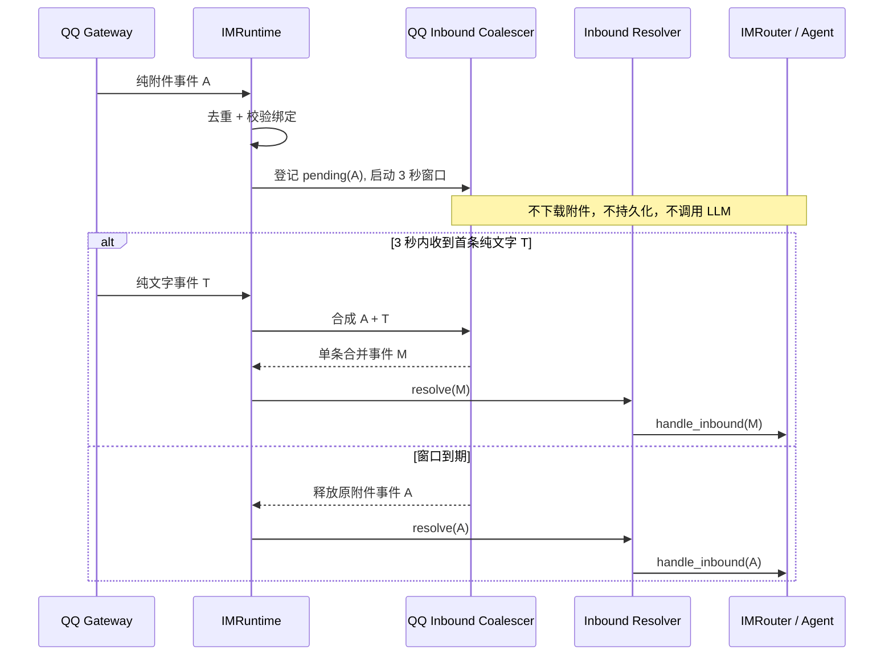
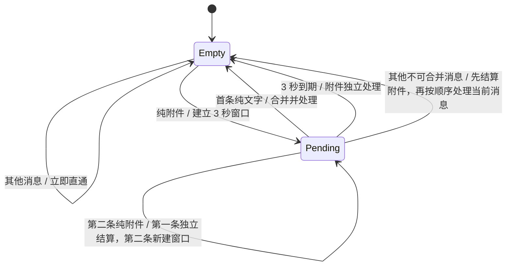

# 105 · QQ 附件与文字消息合并输入 - 技术方案

## 状态

CONFIRMED

## 需求文档

[`requirement.md`](./requirement.md)

## 现状分析

QQ WebSocket 把每条消息事件独立调度到主事件循环，`QQAdapter` 解析为 `InboundEvent` 后交给 `IMRuntime`。`IMRuntime` 当前按以下顺序处理每条消息：

1. 按平台、会话和 message ID 去重；
2. 获取当前 QQ 绑定对应的 `IMBindingCoordinator` turn 锁；
3. 校验绑定会话并记录最近交互；
4. 依次执行人脸、语音和普通附件 resolver；
5. 立即调用 `IMRouter.handle_inbound()`，创建一次 Agent run 并最终回写 QQ。

因此，QQ 分别投递的附件事件和文字事件必然形成两个 Agent 回合。现有 per-binding turn 锁会保证两轮顺序，却无法在第一轮进入 resolver/Router 前等待第二条消息。

相关代码边界：

- `agent_bridge/src/agent_bridge/protocols/im/adapters/qq.py`：QQ 传输、解析和回写；不拥有用户消息聚合语义。
- `agent_bridge/src/agent_bridge/protocols/im/runtime.py`：入站去重、绑定协调、resolver 和 Router 的编排入口。
- `agent_bridge/src/agent_bridge/protocols/im/inbound_resolver.py`：语音、附件等单条消息归一化。
- `agent_bridge/src/agent_bridge/protocols/im/coordinator.py`：同一 IM 绑定的 turn 与控制变更互斥。
- `agent_bridge/src/agent_bridge/protocols/im/router.py`：把一条已确定的用户回合提交给 Agent；不负责猜测多条平台事件是否属于同一表达。

## 方案设计

### 涉及文件

| 文件路径 | 改动类型 | 说明 |
|---|---|---|
| `agent_bridge/src/agent_bridge/protocols/im/coalescing.py` | 新增 | QQ 附件配文合并策略、pending 状态、事件分类与合成 |
| `agent_bridge/src/agent_bridge/protocols/im/runtime.py` | 修改 | 在 resolver/Router 前接入合并层，管理定时器、绑定校验、日志和生命周期清理 |
| `agent_bridge/src/agent_bridge/protocols/im/coordinator.py` | 修改 | 增加 pending turn reservation，使等待窗口内的控制变更保持互斥 |
| `agent_bridge/src/agent_bridge/assembly.py` | 修改 | 以固定 3 秒窗口装配 QQ 合并策略；其他 IM 行为不变 |
| `agent_bridge/tests/test_im_coalescing.py` | 新增 | 覆盖事件分类、合成和非连续聚合状态机 |
| `agent_bridge/tests/test_im_runtime_inbound.py` | 修改 | 覆盖 timeout、单次 Router 调用、隔离、竞态和生命周期清理 |
| `agent_bridge/tests/test_im_control.py` | 修改 | 覆盖 pending reservation 阻止会话、模型等控制变更 |

### 数据流

### 合并层位置与责任

合并发生在 runtime 去重与绑定确认之后、任何 resolver 之前：

- 去重仍先于 pending 登记，重复事件不能新建、续期或重复结算窗口。
- 原始附件地址只在窗口结算后下载一次；合并成功时 resolver 直接处理合成事件。
- Router 始终只看到已经确定的一条用户回合，因此现有 Agent run、附件持久化、消息历史和回复逻辑无需增加跨消息分支。
- QQ adapter 继续只负责平台事件转换，不感知 3 秒产品策略。

`IMRuntime` 通过可注入的 inbound coalescer 使用该能力。生产装配传入 QQ 实现和固定 `3.0` 秒窗口；未装配 coalescer 时保持现有逐条直通行为，便于其他 IM provider 和既有测试不被隐式改变。本期不建设通用插件注册表。

### 消息分类

合并层只处理 `im_type == "qq"`、`chat_scope == "c2c"` 的消息。

#### 待处理附件事件

同时满足以下条件时登记 pending：

- `event.content.strip()` 为空；
- 顶层 `attachments` 或 `msg_elements[*].attachments` 至少存在一个附件；
- 附件不是已明确识别的语音、GIF、视频或其他不支持类型；
- 事件没有已经与附件同行的非空文字。

可读取类型的入口提示包括 JPEG、PNG、WebP、PDF 和 TXT。QQ 元数据可能缺失或与真实内容不一致，因此入口分类只负责排除明确不应等待的类型；窗口结算后的 canonical attachment resolver 仍以下载内容检测为最终权威。未知或错误标注的附件最多多等待 3 秒，之后继续走现有不支持或失败反馈，绝不因入口猜测进入模型。

#### 可合并文字事件

同时满足以下条件时可消费当前 pending：

- `event.content.strip()` 非空；
- 事件本身不含附件或语音；
- Bot 绑定、chat scope、chat ID、绑定 session 与 provider 实例均与 pending 一致；
- 该事件是窗口内首条符合条件的纯文字消息。

已经同行携带附件与文字的事件不进入等待窗口，也不用于消费另一条 pending；它按现有完整消息立即处理。

### 合成事件

合并时以文字事件为主事件：

- 保留文字事件的 `message_id`、时间、发送者和 raw payload，使 QQ 回复锚定用户最后发送的配文。
- 把 pending 附件事件的顶层附件与 `msg_elements` 附件复制到文字事件。
- `content` 使用文字事件的原始清理后正文。
- 附件事件与文字事件的原始 message ID 分别写入脱敏结构化日志；不把两个 ID 拼成新的平台 ID。

两条原始事件都已经在合并前完成去重登记，但只有合成事件进入 resolver/Router，所以会话只持久化一个用户回合并只创建一次 Agent run。

### 非连续聚合状态机

每个隔离 key 最多存在一个 pending 附件事件：

第二条纯附件不会追加到第一条，也不会延长第一条窗口。第二条在第一条独立结算的同时取得自己的新 token 和独立截止时间；同一 binding 的 coordinator 继续保证实际 Router 调用顺序。多条文字不会拼接：第一条消费 pending 后，后续文字恢复普通逐条处理。

### 并发、截止时间与竞态

- 每个 pending 使用不可复用 token；timeout、文字消费、第二附件替换和取消只有拿到当前 token 的一方可以结算。
- 定时器由主 asyncio loop 创建并由 runtime 持有强引用，不使用阻塞 sleep，也不占用 binding turn 锁等待 3 秒。
- timeout 醒来后重新取得同一 binding turn 锁，再次核对 token、provider 实例和绑定 session；失效任务只记录取消原因，不触发 resolver/Router。
- 文字回调和 timeout 同时竞争时，以 coordinator 的实际入队顺序为准：先进入临界区的一方结算，另一方看到 token 已失效后直通或退出，不能产生两次 Agent run。
- 第二附件或其他消息要求先结算 pending 时，在同一 turn 临界区中先固定新状态，再按到达顺序调用现有处理链，避免异步 task 抢锁造成倒序。

### Pending turn reservation

现有 `IMBindingCoordinator.try_mutation()` 只把“正在执行 Router/Agent”视为 busy。等待窗口释放普通 turn 锁后，用户仍可能切换会话或模型，导致附件进入错误配置。

为此 coordinator 增加可精确释放的 pending reservation：

- 创建 pending 时取得 reservation；合并、timeout、替换或取消时释放。
- 普通 inbound turn 不受 reservation 阻塞，配文仍可进入并消费 pending。
- `try_mutation()` 在 turn 锁被占用或存在 reservation 时均抛出 `IMBindingBusyError`，现有控制面继续回复“请等待当前回复完成后再操作”。
- reservation 带唯一 token，重复释放或释放旧 token不会解除新的 pending 占用。

因此，桌面绑定切换、QQ 菜单切换会话、切换模型和推理强度在最多 3 秒内保持现有 busy 语义，不需要各调用方分别理解 coalescer。

### 生命周期与失效处理

- `IMRuntime.stop()`：取消全部 pending timeout，释放 reservation，等待取消完成后再停止 provider；不在关闭流程中启动新的 Agent run。
- `unbind()`：取消该 provider 下全部 pending，随后停止 provider、删除凭据与绑定状态。
- 同一绑定重新 onboard 并替换 provider：旧 provider 的 pending 在旧连接停止前取消；新 provider 使用新的实例身份，不能消费旧 pending。
- session 或 provider 校验失败：丢弃失效 pending 并记录原因，不把附件路由到新 session，也不经已停止 provider 回写。
- 已经离开 pending、正在执行的 Agent run 继续沿用现有 runtime drain/stop 行为，本需求不重做运行中 Agent 取消协议。

关闭或解绑恰好发生在 3 秒窗口内时，尚未结算的附件不会持久化，用户下次需要重发。为这个极小窗口持久化临时 QQ URL、定时器和 provider 身份会引入过期地址、恢复归属和隐私问题，本期不做。

### 可观测性与隐私

新增结构化日志覆盖：

- pending 建立：provider、binding、附件 message ID、窗口长度和附件数量；
- 合并：附件 message ID、文字 message ID、实际间隔和合成附件数量；
- timeout 或提前独立结算：message ID、等待时长和原因；
- 取消：stop、unbind、provider replaced、binding/session stale；
- token 竞态失效：仅 debug 级别记录，不作为错误。

日志不记录消息正文、附件 URL、文件内容、完整本地路径或 QQ 凭据。现有诊断包可以通过普通 runtime 日志观察状态，不新增附件原件采集。

## 测试方案

### 合并策略单测

- JPEG、PNG、WebP、PDF、TXT 的纯附件事件进入 pending。
- 普通文字、已经同行的附件加文字、GIF、语音和明确不支持类型不进入 pending。
- 顶层附件与 `msg_elements` 附件都能合成到文字事件，回复锚点使用文字 message ID。
- 第一条文字消费 pending；第二附件不累计、不续期；多条文字不拼接。
- provider、binding、chat 或 session 不同的事件无法互相消费。

### Runtime 集成单测

- timeout 前 resolver、Router 和 Agent runtime 均未调用；到期后只调用一次。
- 窗口内配文立即结束等待，只用合成事件调用一次 resolver/Router。
- 迟到文字、第二附件、不可合并消息保持独立回合与到达顺序。
- dedupe 发生在 pending 之前，重复附件或文字不能续期或重复结算。
- timeout 与文字竞态只有一个终态；旧 token 无法清除或结算新 pending。
- stop、unbind、provider replace 与失效 session 会取消 pending、释放 reservation，且不产生后台 task 泄漏。

### 协调器回归

- pending reservation 存在时，session/model/reasoning mutation 继续返回 busy。
- 普通 inbound turn 仍可进入并消费 pending。
- reservation 释放后 mutation 恢复，旧 token 重复释放不影响新 reservation。

全部验证使用 fake resolver、mock Router、受控 clock/sleeper 和本地附件对象，不连接真实 QQ Gateway，也不发起真实 LLM API 调用。实现完成后运行相关定向测试与项目规定的 `scripts/check` 全量门禁；本需求没有视觉 UI 改动，不需要桌面视觉验收。

## 影响分析

### 上下游影响

- **QQ adapter**：接口与实现不变；仍按原始事件逐条上报。
- **附件 resolver/store**：接口与支持类型不变；合并成功后只处理一次附件。
- **IMRouter/Agent runtime**：接口不变；收到的事件粒度从平台消息变为确认后的用户回合。
- **会话历史/桌面投影**：无需新增字段；只持久化一次合成后的用户消息即可自然展示附件与文字。
- **控制面**：不新增状态或按钮；等待期间复用既有 busy 提示。
- **其他 IM provider**：未装配 QQ coalescer 时保持逐条直通，不自动继承 3 秒策略。
- **配置与迁移**：无新增用户设置、环境变量、持久化结构或数据迁移。

### 风险点

- QQ 缺少可靠的同一发送批次标识，3 秒内的无关文字可能被误判为配文；通过仅消费首条纯文字、固定短窗口和严格会话隔离控制风险。
- QQ 附件元数据可能错误；入口只做保守分类，canonical 内容检测仍阻止不支持附件进入模型。
- timeout、文字和第二附件可能同时发生；唯一 token、per-binding coordinator 与显式终态测试用于防止双结算和倒序。
- 等待期间允许普通 inbound、拒绝控制 mutation，若 reservation 泄漏会让控制面持续 busy；所有终态和生命周期路径必须覆盖释放测试。
- 应用关闭前最后 3 秒的 pending 不持久化；这是避免关闭期 LLM 调用和临时 URL 恢复复杂度后的明确残余限制。

## 变更记录

| 日期 | 变更内容 | 是否需要重新实现 |
|---|---|---|
| 2026-08-26 | 首次确认技术方案：QQ 附件配文前置合并、固定 3 秒窗口、pending reservation 与非连续聚合状态机 | 是 |
