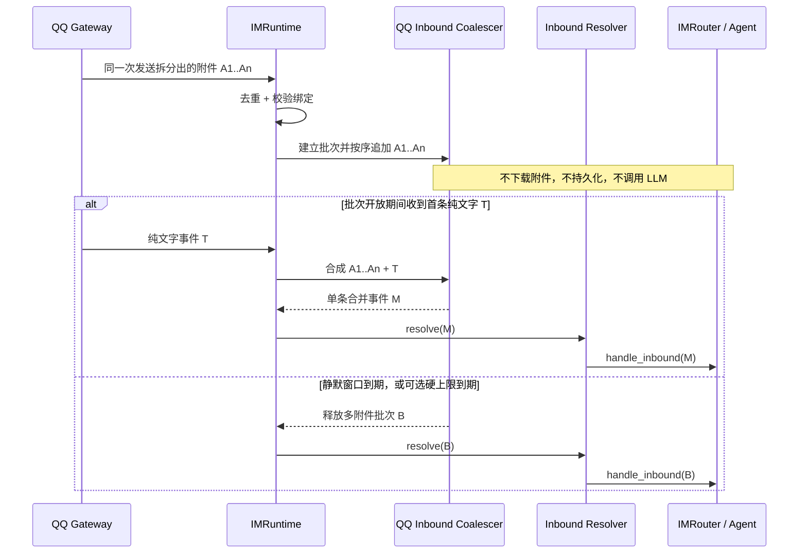
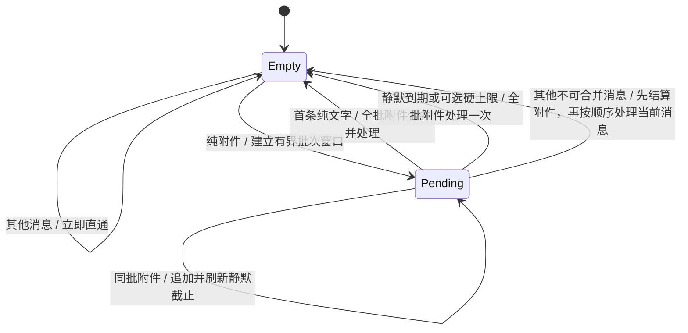

# 105 · QQ 附件与文字消息合并输入 - 技术方案

## 状态

CONFIRMED

## 需求文档

[`requirement.md`](./requirement.md)

## 现状分析

QQ WebSocket 把每条消息事件独立调度到主事件循环，`QQAdapter` 解析为 `InboundEvent` 后交给 `IMRuntime`。真实运行证据表明，用户在 QQ 一次选择五张图片发送时，平台会在数秒内投递五个各含一张图片的 `C2C_MESSAGE_CREATE` 事件，随后再投递配文；因此平台消息 ID 不能直接代表逻辑用户回合。`IMRuntime` 当前按以下顺序处理每条消息：

1. 按平台、会话和 message ID 去重；
2. 获取当前 QQ 绑定对应的 `IMBindingCoordinator` turn 锁；
3. 校验绑定会话并记录最近交互；
4. 依次执行人脸、语音和普通附件 resolver；
5. 立即调用 `IMRouter.handle_inbound()`，创建一次 Agent run 并最终回写 QQ。

现有合并层只保存一条 pending 附件，第二个附件事件会以 `next_attachment` 立即结算第一条；同时 per-binding turn 锁覆盖 resolver、Router 和完整 Agent run，后续已到达事件直到上一轮回复完成才进入合并器。两者叠加会把一次多图发送变成逐图 Agent 回合，并让标称数秒的等待膨胀到数十秒。

相关代码边界：

- `agent_bridge/src/agent_bridge/protocols/im/adapters/qq.py`：QQ 传输、解析和回写；不拥有用户消息聚合语义。
- `agent_bridge/src/agent_bridge/protocols/im/runtime.py`：入站去重、绑定协调、resolver 和 Router 的编排入口。
- `agent_bridge/src/agent_bridge/protocols/im/inbound_resolver.py`：语音、附件等单条消息归一化。
- `agent_bridge/src/agent_bridge/protocols/im/coordinator.py`：同一 IM 绑定的 turn 与控制变更互斥。
- `agent_bridge/src/agent_bridge/protocols/im/router.py`：把一条已确定的用户回合提交给 Agent；不负责猜测多条平台事件是否属于同一表达。

## 方案设计

### 涉及文件

| 文件路径 | 改动类型 | 说明 |
|---|---|---|
| `agent_bridge/src/agent_bridge/protocols/im/coalescing.py` | 修改 | 把单条 pending 改为逻辑输入批次，聚合被平台拆分的多附件事件和后续配文 |
| `agent_bridge/src/agent_bridge/protocols/im/runtime.py` | 修改 | 在长 Agent turn 锁之外完成短生命周期批次收集，再按原顺序串行 dispatch |
| `agent_bridge/src/agent_bridge/protocols/im/coordinator.py` | 核对/按需修改 | pending reservation 与运行中 turn 继续共同阻止控制变更 |
| `agent_bridge/src/agent_bridge/assembly.py` | 修改 | 装配批次静默窗口，QQ 生产默认不设总时长硬上限；其他 IM 行为不变 |
| `agent_bridge/tests/test_im_coalescing.py` | 修改 | 覆盖真实同发/单发时序、多附件批次、默认无硬上限与可选硬上限状态机 |
| `agent_bridge/tests/test_im_runtime_inbound.py` | 修改 | 覆盖 timeout、单次 Router 调用、隔离、竞态和生命周期清理 |
| `agent_bridge/tests/test_im_control.py` | 修改 | 覆盖 pending reservation 阻止会话、模型等控制变更 |

### 数据流

### 合并层位置与责任

合并发生在 runtime 去重与绑定确认之后、任何 resolver 之前：

- 去重仍先于 pending 登记，重复事件不能新建、续期或重复结算窗口。
- 原始附件地址只在窗口结算后下载一次；合并成功时 resolver 直接处理合成事件。
- Router 始终只看到已经确定的一条用户回合，因此现有 Agent run、附件持久化、消息历史和回复逻辑无需增加跨消息分支。
- QQ adapter 继续只负责平台事件转换，并记录不含正文或附件地址的时间与结构计数；不承担产品聚合策略。

`IMRuntime` 通过可注入的 inbound coalescer 使用该能力。coalescer 支持可选的总时长硬上限；QQ 生产装配只传入批次静默窗口，默认关闭硬上限。未装配 coalescer 时保持现有逐条直通行为，便于其他 IM provider 和既有测试不被隐式改变。本期不建设通用插件注册表。

### 消息分类

合并层只处理 `im_type == "qq"`、`chat_scope == "c2c"` 的消息。

#### 待处理附件事件

同时满足以下条件时登记 pending：

- `event.content.strip()` 为空；
- 顶层 `attachments` 或 `msg_elements[*].attachments` 至少存在一个附件；
- 附件不是已明确识别的语音、GIF、视频或其他不支持类型；
- 事件没有已经与附件同行的非空文字。

可读取类型的入口提示包括 JPEG、PNG、WebP、PDF 和 TXT。QQ 元数据可能缺失或与真实内容不一致，因此入口分类只负责排除明确不应等待的类型；窗口结算后的 canonical attachment resolver 仍以下载内容检测为最终权威。未知或错误标注的附件最多多等待 3 秒，之后继续走现有不支持或失败反馈，绝不因入口猜测进入模型。

#### 可合并文字事件

同时满足以下条件时可消费当前 pending：

- `event.content.strip()` 非空；
- 事件本身不含附件或语音；
- Bot 绑定、chat scope、chat ID、绑定 session 与 provider 实例均与 pending 一致；
- 该事件是窗口内首条符合条件的纯文字消息。

已经同行携带附件与文字的事件不进入等待窗口，也不用于消费另一条 pending；它按现有完整消息立即处理。

### 合成事件

合并时以文字事件为主事件：

- 保留文字事件的 `message_id`、时间、发送者和 raw payload，使 QQ 回复锚定用户最后发送的配文。
- 把 pending 附件事件的顶层附件与 `msg_elements` 附件复制到文字事件。
- `content` 使用文字事件的原始清理后正文。
- 附件事件与文字事件的原始 message ID 分别写入脱敏结构化日志；不把两个 ID 拼成新的平台 ID。

两条原始事件都已经在合并前完成去重登记，但只有合成事件进入 resolver/Router，所以会话只持久化一个用户回合并只创建一次 Agent run。

### 逻辑输入批次状态机

每个隔离 key 最多存在一个 pending 逻辑输入批次。批次保存稳定有序的原始 message IDs、合并后的附件、首次/最后到达时间、provider/session 所有权和最终回复锚点：

真实 QQ 对照和 SDK/官方实现核对均未发现标准化 `batch_id`。实际 `message_scene.ext` 携带逐消息 `msg_idx` 引用索引，同一次多图发送的 ext 值也各不相同；平台 `timestamp` 可能在同一次多图发送中跨秒，消息 ID 没有受支持的批次格式。因此首期不维护“显式批次字段优先”的猜测分支，只使用本机单调到达时间：最后一个附件后静默不足 3 秒则继续追加，静默达到 3 秒则结算。总时长硬上限是 coalescer 的内部可选安全阀，`None` 表示关闭；QQ 生产默认使用 `None`，避免持续到达的大量图片被固定总时长强行拆批。多条文字不会拼接：第一条文字消费 pending 后，后续文字恢复普通逐条处理。

2026-08-28 的真实样本给出以下边界：原事故一次选五图总跨度 2.563 秒、最大相邻间隔 1.518 秒；复验一次选五图总跨度 0.613 秒、最大间隔 0.505 秒；一次选两图跨度 0.522 秒；五次单发的相邻间隔为 4.543、3.534、3.542、3.346 秒。3 秒位于当前同发样本最大间隔与单发样本最小间隔之间，但不是 QQ 平台保证。若用户在 3 秒内完成两次独立发送，仍可能被合并；若未来平台投递同一发送动作时出现超过 3 秒的内部静默，也可能被拆分。这是无批次号条件下明确接受的残余歧义。

合成纯多图批次时以最后一个附件事件作为回复锚点；合并配文时仍以文字事件作为主事件。全部原始 message IDs 只用于去重、日志和诊断；进入 resolver/Router 的事件携带统一附件数组，因此核心会话自然持久化为一条多附件用户消息。

### 并发、截止时间与竞态

- 每个 pending 批次使用不可复用 token；timeout、文字消费、barrier 和取消只有拿到当前 token 的一方可以结算。
- 合并器状态变更保持同步、短生命周期，并在主 asyncio loop 上按回调到达顺序完成；它不再持有或等待覆盖 Agent run 的 per-binding turn 锁。
- 完成的 `CoalescingDecision` 才进入 coordinator turn 锁执行 resolver/Router；多个等待 dispatch 沿用同一 binding 锁的有序获取，保持用户输入顺序。
- 每次追加同批附件时刷新静默计时任务；配置硬上限时，其截止时间从首条附件起不变，关闭时只受静默窗口约束。旧 token 或旧 timeout 不能结算新批次。
- timeout 与新事件同时发生时，先完成合并器状态变更的一方取得批次，另一方看到 token 失效后退出，不能产生两次 Agent run。
- pending reservation 在批次完成并立即转入运行锁前释放；pending 或运行中任一状态存在时，控制 mutation 继续返回 busy。

### Pending turn reservation

现有 `IMBindingCoordinator.try_mutation()` 只把“正在执行 Router/Agent”视为 busy。等待窗口释放普通 turn 锁后，用户仍可能切换会话或模型，导致附件进入错误配置。

为此 coordinator 增加可精确释放的 pending reservation：

- 创建 pending 时取得 reservation；合并、timeout、替换或取消时释放。
- 普通 inbound turn 不受 reservation 阻塞，配文仍可进入并消费 pending。
- `try_mutation()` 在 turn 锁被占用或存在 reservation 时均抛出 `IMBindingBusyError`，现有控制面继续回复“请等待当前回复完成后再操作”。
- reservation 带唯一 token，重复释放或释放旧 token不会解除新的 pending 占用。

因此，桌面绑定切换、QQ 菜单切换会话、切换模型和推理强度在最多 3 秒内保持现有 busy 语义，不需要各调用方分别理解 coalescer。

### 生命周期与失效处理

- `IMRuntime.stop()`：取消全部 pending timeout，释放 reservation，等待取消完成后再停止 provider；不在关闭流程中启动新的 Agent run。
- `unbind()`：取消该 provider 下全部 pending，随后停止 provider、删除凭据与绑定状态。
- 同一绑定重新 onboard 并替换 provider：旧 provider 的 pending 在旧连接停止前取消；新 provider 使用新的实例身份，不能消费旧 pending。
- session 或 provider 校验失败：丢弃失效 pending 并记录原因，不把附件路由到新 session，也不经已停止 provider 回写。
- 已经离开 pending、正在执行的 Agent run 继续沿用现有 runtime drain/stop 行为，本需求不重做运行中 Agent 取消协议。

关闭或解绑恰好发生在 3 秒窗口内时，尚未结算的附件不会持久化，用户下次需要重发。为这个极小窗口持久化临时 QQ URL、定时器和 provider 身份会引入过期地址、恢复归属和隐私问题，本期不做。

### 可观测性与隐私

新增结构化日志覆盖：

- pending 建立：provider、binding、首条 message ID、静默窗口、可选硬上限和附件数量；
- 批次追加：source message 数、附件数、批次依据 `arrival_silence`、静默窗口与硬上限是否启用；
- 合并：全部附件 message IDs、文字 message ID、实际间隔和合成附件数量；
- timeout 或 barrier 结算：source message IDs、等待时长、附件数量和原因；
- 取消：stop、unbind、provider replaced、binding/session stale；
- token 竞态失效：仅 debug 级别记录，不作为错误。

日志不记录消息正文、附件 URL、文件内容、完整本地路径或 QQ 凭据。现有诊断包可以通过普通 runtime 日志观察状态，不新增附件原件采集。

## 测试方案

### 合并策略单测

- JPEG、PNG、WebP、PDF、TXT 的纯附件事件进入 pending。
- 普通文字、已经同行的附件加文字、GIF、语音和明确不支持类型不进入 pending。
- 顶层附件与 `msg_elements` 附件都能跨事件按序合成；纯多图回复锚点使用最后附件 message ID，带配文时使用文字 message ID。
- 同一发送动作拆分出的五个附件事件累计为一批；第一条文字消费完整 pending；多条文字不拼接。
- 真实五次单发时序和超过静默窗口的附件保持独立；另用显式配置覆盖硬上限终态。
- 默认关闭硬上限时，即使批次总跨度超过 5 秒，只要每次追加都未跨过 3 秒静默窗口，仍保持同一批。
- provider、binding、chat 或 session 不同的事件无法互相消费。

### Runtime 集成单测

- timeout 前 resolver、Router 和 Agent runtime 均未调用；到期后以完整附件批次只调用一次。
- 窗口内配文立即结束等待，只用包含全部附件的合成事件调用一次 resolver/Router。
- 迟到文字、跨越静默窗口的新附件和不可合并消息保持独立回合与到达顺序。
- 上一轮 Router/Agent 被阻塞时，下一批附件仍立即进入合并器；解除阻塞后只 dispatch 一个多附件回合，timeout 等待不包含上一轮 Agent 耗时。
- dedupe 发生在 pending 之前，重复附件或文字不能续期或重复结算。
- timeout 与文字竞态只有一个终态；旧 token 无法清除或结算新 pending。
- stop、unbind、provider replace 与失效 session 会取消 pending、释放 reservation，且不产生后台 task 泄漏。

### 协调器回归

- pending reservation 存在时，session/model/reasoning mutation 继续返回 busy。
- 普通 inbound turn 仍可进入并消费 pending。
- reservation 释放后 mutation 恢复，旧 token 重复释放不影响新 reservation。

自动化验证使用 fake resolver、mock Router、受控 clock/sleeper 和本地附件对象。2026-08-28 经用户授权连接真实 QQ Gateway 并执行真实模型调用，完成一次选五图、五次单发和一次选两图的对照取证；真实时序已转写为确定性单测，不在后续回归中重复调用 QQ 或 LLM。实现完成后运行相关定向测试与项目规定的 `scripts/check` 全量门禁；本需求没有视觉 UI 改动，不需要桌面视觉验收。

## 影响分析

### 上下游影响

- **QQ adapter**：继续按原始事件逐条上报；只补充平台时间与 `message_scene.ext` 数量等不含正文的结构观测，不在 adapter 内承担产品聚合策略。
- **附件 resolver/store**：接口与支持类型不变；合并成功后只处理一次附件。
- **IMRouter/Agent runtime**：接口不变；收到的事件粒度从平台消息变为确认后的用户回合。
- **会话历史/桌面投影**：无需新增字段；只持久化一次合成后的用户消息即可自然展示附件与文字。
- **控制面**：不新增状态或按钮；等待期间复用既有 busy 提示。
- **其他 IM provider**：未装配 QQ coalescer 时保持逐条直通，不自动继承 3 秒策略。
- **配置与迁移**：无新增用户设置、环境变量、持久化结构或数据迁移。

### 风险点

- QQ 缺少可靠的同一发送批次标识，3 秒内完成的独立附件发送或无关文字可能被误判为同一批；通过固定静默窗口、仅消费首条纯文字和严格会话隔离控制风险，不宣称精确还原平台发送动作。默认关闭硬上限会让持续小于 3 秒间隔的附件继续聚合，这是支持大型同批发送与限制误合并之间的明确取舍；若后续运行证据需要止损，可在装配层启用总时长上限。
- QQ 附件元数据可能错误；入口只做保守分类，canonical 内容检测仍阻止不支持附件进入模型。
- timeout、文字和第二附件可能同时发生；唯一 token、per-binding coordinator 与显式终态测试用于防止双结算和倒序。
- 等待期间允许普通 inbound、拒绝控制 mutation，若 reservation 泄漏会让控制面持续 busy；所有终态和生命周期路径必须覆盖释放测试。
- 应用关闭前最后 3 秒的 pending 不持久化；这是避免关闭期 LLM 调用和临时 URL 恢复复杂度后的明确残余限制。

## 变更记录

| 日期 | 变更内容 | 是否需要重新实现 |
|---|---|---|
| 2026-08-26 | 首次确认技术方案：QQ 附件配文前置合并、固定 3 秒窗口、pending reservation 与非连续聚合状态机 | 是 |
| 2026-08-28 | 修正为逻辑输入批次：同一次多图发送跨平台事件聚合；合并状态变更移出长 Agent turn 锁；静默窗口与硬上限共同约束无批次号兜底 | 是，替换单条 pending 与 `next_attachment` 语义 |
| 2026-08-28 | 真实 QQ 同发/单发对照排除 `timestamp`、消息 ID 和 `message_scene.ext` 作为批次号；删除猜测的显式 batch 字段路径，仅保留 3 秒到达静默与 5 秒硬上限 | 是，收紧批次判定与测试证据 |
| 2026-08-28 | 总时长硬上限改为内部可选，QQ 生产默认关闭；保留显式配置时的安全阀测试 | 是，默认批次仅由 3 秒静默窗口结算 |
