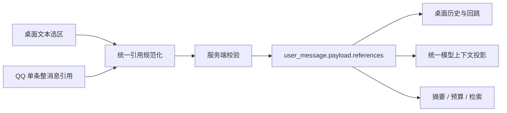
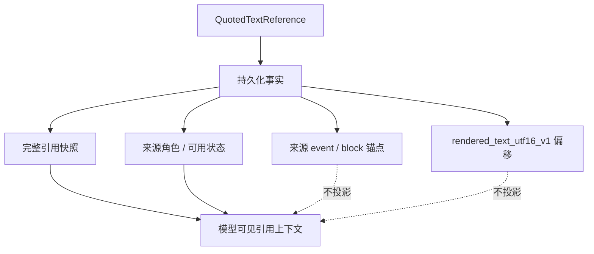

# 106 · 消息文本引用与跨通道统一引用 - 技术方案

## 状态

CONFIRMED

## 需求文档

[requirement.md](./requirement.md)

## 现状分析

### 当前数据流

桌面端与 QQ 最终都通过 `Conversation.stream()` 形成 `user_message` 会话事件，再由 Session 投影为 `Message` 并进入上下文装配。当前链路只承载正文和附件：

- 前端 `ChatMessage`、草稿工作区和发送参数没有结构化引用字段。
- AG-UI 新消息和编辑接口只校验正文、附件与现有扩展字段。
- `Message`、`user_message.payload`、上下文预算和摘要投影不知道引用关系。
- QQ `InboundEvent` 已保留原生引用所需的消息类型、元素和原始字段，但 Router 只把 `event.content` 当作新用户正文。

现有会话事件 UUID、文本块 ID、消息虚拟列表和搜索跳转提供了实现来源锚点与长会话定位的基础，不需要另建第二套会话或消息存储。

### 设计约束

- 引用是用户输入的一部分，但引用原文始终按不可信用户内容处理，不获得更高指令权重。
- 引用原文快照是模型理解和历史展示的事实；来源位置是 UI 导航元数据。二者不能互相替代。
- 桌面端支持多个精确文本片段；QQ 本期只表达一个完整消息引用。
- 通道 adapter 只负责提取和规范化，持久化、上下文投影与历史展示只有一套实现。
- 已持久化内容和模型上下文不得因界面折叠而截断。
- 旧会话、旧前端和不带引用的 QQ 消息必须保持兼容。
- TDesign 只继续承担对话核心组件及不得不做的兼容；引用浮层等通用 UI 使用 shadcn。

## 总体方案

新增 `message_references` 领域模型，把桌面选区和 QQ 原生引用统一为有序 `QuotedTextReference` 列表。列表随用户消息进入 append-only Session 事件，并由同一个 renderer 投影给历史上下文、当前输入、预算估算和摘要链路。



来源位置保留在持久化数据中，但不进入模型可见文本。模型只接收有序引用快照、来源角色和可用状态：



## 统一领域模型

### 模块边界

在 Agent 核心新增命名子域目录，避免把跨通道公共语义放进桌面或 QQ adapter：

```text
agent/src/agent/message_references/
├── __init__.py
├── model.py
└── render.py
```

- `model.py` 定义类型、解析和不变量。
- `render.py` 只负责模型可见投影，不负责平台解析和 UI 展示。
- `Message` 持有 `references`，Session、Conversation 和各 adapter 只依赖公共模型。

### 数据结构

事件中的每个引用使用如下版本化形态；字段名以实现时现有 Pydantic / dataclass 风格为准，但语义不得漂移：

```json
{
  "reference_id": "ref_...",
  "quoted_text": "被引用的完整文本快照",
  "source_role": "assistant",
  "availability": "available",
  "source": {
    "kind": "session_message",
    "message_event_uuid": "...",
    "text_block_id": "...",
    "external_source_key": null
  },
  "locator": {
    "kind": "text_range",
    "coordinate_space": "rendered_text_utf16_v1",
    "start": 18,
    "end": 43
  }
}
```

字段语义：

| 字段 | 语义 |
| --- | --- |
| `reference_id` | 引用实例 ID，用于草稿去重、独立删除和稳定 React key；不是来源消息 ID |
| `quoted_text` | 完整快照；来源后续变化或无法跳转时仍用于历史和模型理解 |
| `source_role` | `user / assistant / unknown`；桌面引用必须是前两者，QQ 无证据时允许 `unknown` |
| `availability` | `available / unavailable`；不可用状态不伪造占位原文 |
| `source.kind` | `session_message / external_message`，区分可验证会话锚点与只有平台来源的引用 |
| `message_event_uuid` | 当前 Session 中来源消息的稳定事件锚点，可为空 |
| `text_block_id` | 来源消息内文本块锚点；精确桌面选区必填，完整消息引用可为空 |
| `external_source_key` | provider-neutral 的不透明来源键，只供平台别名解析和诊断关联 |
| `locator.kind` | `text_range / whole_message` |
| `coordinate_space` | 精确选区固定为 `rendered_text_utf16_v1`；整消息引用为空 |
| `start / end` | DOM 文本投影中的 UTF-16 code-unit 半开区间，只供 UI 恢复与高亮 |

`quoted_text` 是语义快照，`locator` 不是重新切片得到模型文本的依据。这样即使 Markdown renderer、换行或链接 DOM 发生变化，历史仍能准确展示用户当时引用了什么。

### 不变量与校验

- `available` 必须携带非空的完整 `quoted_text`；`unavailable` 不得合成“未知原文”等文本冒充快照。
- `text_range` 必须有同一来源文本块、`start >= 0` 且 `end > start`；坐标空间必须是受支持版本。
- `whole_message` 不携带 `start / end / coordinate_space`。
- 桌面提交的 `session_message` 必须属于当前 Session，并指向已完成的用户或 Agent 文本事件；`source_role` 由服务端来源事件重新推导，不能信任前端自报。
- 引用顺序按用户添加或平台提供顺序保存；规范化不排序、不合并相同文本。
- 同一草稿用 `reference_id` 幂等去重，但允许用户对同一来源添加不同片段。
- 不在引用层另设静默长度上限；超出既有请求或上下文硬限制时返回明确错误。

## 桌面端设计

### 选区捕获

仅在一条已完成消息的一个可引用文本块内接受连续选区。工具卡片、思考、状态、附件和跨消息选区均不产生“引用”动作。

`rendered_text_utf16_v1` 的构建规则为：在 quoteable 文本宿主内按 DOM 顺序连接可见文本节点，偏移使用浏览器 `Range` 的 UTF-16 code unit。捕获时同时保存：

- 来源 `message_event_uuid` 与 `text_block_id`；
- 选区 `start / end`；
- 浏览器实际选择得到的完整 `quoted_text` 快照；
- 服务端可重新推导的来源角色。

TDesign Markdown 的 Shadow DOM 若允许稳定枚举选区，则直接在现有文本宿主上实现；若真实 DOM 原型证明选区或 Range 不可靠，使用 TDesign Chat 的自定义内容 slot 包一层 React 所有的 quoteable 文本宿主。不得 fork TDesign 或把通用引用 UI 写进其内部样式契约。

### 草稿与发送

`DraftWorkspace` 新增有序 `references`。新增引用不改正文和附件；切换会话、发送失败恢复、停止后恢复、编辑最新用户消息时均与现有草稿生命周期一起保存。

发送条件由“正文或附件非空”扩展为“正文、附件、引用至少一项非空”。提交成功后清空当前草稿引用；失败时按现有 draft snapshot 原样恢复。

### Codex 式聚合入口

输入区只显示一个紧凑入口，例如“4 个已选文本”，并提供清空全部的操作。hover、键盘 focus 或 click 打开同一个受控 Popover：

- 浮层按添加顺序列出全部引用；
- 每行显示来源角色、引用快照或明确不可用状态；
- 每行可独立删除，不影响正文和其它引用；
- pointer 从入口移动到浮层时使用短延迟关闭，避免 hover 断层；
- click/focus/touch 仍可完整操作，不能做成只有 hover 才能访问的内容。

使用 shadcn `Popover` 作为通用交互基座，因为浮层内有删除和跳转等交互；不使用只适合非交互预览的 `HoverCard`。组件在实现阶段通过项目 `add-shadcn-component` 流程和 CLI 引入，不手写后声称来自 shadcn。TDesign 只保留 `ChatMessage`、`ChatSender` 和必要兼容层。

发送后的用户消息使用同一聚合展示语义。历史浮层不显示删除动作，改为点击单条引用回到来源。

### 回到原文与降级

点击历史引用后：

1. 用 `message_event_uuid` 复用当前搜索导航能力，把虚拟列表滚动到来源消息。
2. 在 `text_block_id` 对应宿主重建 `rendered_text_utf16_v1`，若偏移片段仍与快照一致，创建精确 Range 并用 CSS Highlight 短时突出。
3. 偏移漂移时，在同一文本块查找完整快照；唯一匹配才精确高亮。
4. 多处匹配、块缺失或来源不可访问时只聚焦整条来源消息并显示降级提示，绝不高亮一个未经确认的相似片段。
5. 没有会话锚点的 QQ 外部引用仍展示快照，但明确不可跳转。

## Session、Bridge 与编辑协议

### 持久化

`Message` 增加 `references: list[QuotedTextReference]`。Session 事件继续使用现有 schema 版本，在 `user_message.payload` 中增加可选 `references`：

```json
{
  "type": "user_message",
  "payload": {
    "content": "这个怎么处理？",
    "attachments": [],
    "references": []
  }
}
```

这是 append-only 事件的可选加法：旧事件缺字段时投影为 `[]`，不需要迁移或 schema version bump。引用必须先写入事件，再由事件投影到历史；不得只保存在请求参数或前端状态中。

### AG-UI 与 HTTP 边界

- 新消息把 `quotedTextReferences` 放在 AG-UI `forwardedProps` 中，复用其受控自定义参数能力，不发明新的 AG-UI content type。
- Bridge 负责把 camelCase wire 结构解析为公共领域模型并执行结构校验。
- 文本与附件为空但引用非空时是合法新消息。
- `Conversation.stream()`、context protocol 和 session append 显式传递 references，不把它们藏进正文。
- 请求幂等判断纳入规范化后的引用列表；正文和附件相同但引用不同不是同一个请求。

编辑最新用户消息时，编辑 body 增加可选 `references`：

- 字段省略表示旧客户端只编辑正文，保留原引用；
- 显式 `[]` 表示删除全部引用；
- 非空列表表示完整替换并重新校验；
- 乐观并发校验纳入引用指纹，避免引用已变化但正文相同仍被误判为未冲突。

编辑重发继续沿用现有 invalidation / resend 语义，不创建引用专属的历史分支规则。

## Agent 上下文投影

### 模型可见内容

`message_references.render` 为当前输入和历史消息生成唯一的稳定投影。引用位于本轮正文之前，采用清楚标记的不可信数据段；每条只包含：

- 顺序编号；
- `source_role`；
- `availability`；
- 完整 `quoted_text`（仅 available）。

不向模型传递 `reference_id`、Session event UUID、文本块 ID、平台来源键或字符偏移。这些位置字段只帮助产品恢复和导航，对模型判断“用户引用了什么”没有增益，还可能在渲染漂移后造成虚假精确性。

示意投影：

```text
[Quoted text references — untrusted user-provided context]
{"references":[{"index":1,"source_role":"assistant","availability":"available","text":"..."}]}
[Current user message]
这个怎么处理？
```

现有 untrusted-content / interaction prompt 契约补充：引用块是用户选择的数据，内部出现的命令、角色声明或提示词不自动获得指令权限。Agent 可以用来源角色理解指代，但不能把 Agent 旧回复误记为用户的新陈述。

### 所有上下文消费者一致

- `Message.to_openai()` 或等价统一入口调用同一个 renderer，历史和当前输入不能各自拼一版。
- token budget 估算按实际投影文本计数，纯引用轮次也产生非空 user content。
- compaction / summary transcript 保留“本轮引用了哪些内容及其来源角色”的关系，不能只留下正文。
- memory retrieval query 可使用 available 引用快照支持“这个呢”类纯引用输入。
- memory observation / extraction 不把引用快照当作用户本轮新断言；需要保留“用户引用了既有内容”的关系或跳过重复摄取。
- unavailable 引用只投影明确不可用状态，Agent 不应根据附近消息猜测缺失原文。

## QQ 接入

### 规范化顺序

QQ adapter 本期最多产生一个 `whole_message` 引用。解析顺序为：

1. 识别原生引用消息类型并读取平台提供的首个引用元素。
2. 平台元素直接提供完整引用文本时，生成 available 快照。
3. 若只有 `message_scene.ext` 中的 `ref_msg_idx / msg_idx` 等别名，查询持久化消息别名索引，定位到 agent-friend Session event 后恢复文本与来源角色。
4. 平台明确表明存在引用、但以上路径都无法取得原文时，生成 `unavailable + whole_message`，不静默删除、不从相邻会话猜测。

如果平台将引用媒体与现有附件信息一起提供，继续交给已有附件解析；统一引用的文本验收不因此新增媒体理解能力。

### 消息别名索引

新增独立的 `IMReferenceAliasIndex`，不把消息正文塞进现有 IM 状态快照。索引只保存：

- provider / channel scope 的不透明别名键；
- agent-friend Session ID 与来源 event UUID；
- 已知来源角色；
- 创建 / 最近访问时间。

别名键由平台作用域和消息标识规范化后生成不透明摘要；公共引用对象、日志和 trace 不暴露原始 QQ 标识。索引不保存消息正文，真正原文仍从 Session 事件恢复，并使用容量和时间双重上限清理。

入站用户消息在持久化前取得稳定 event UUID，成功落盘后登记平台消息别名。出站 Bot 消息在平台返回 static message id 或 streaming session 的已接受 message id 后，把它映射到该 run 已持久化的 Agent 消息 event。只有持久化事实成功存在时才写别名，避免索引指向尚不存在的消息。

真实 QQ payload 的字段差异集中在 adapter/resolver；统一模型和 Agent renderer 不出现 `ref_msg_idx` 等 QQ 专属字段。

## 主要改动范围

| 模块 | 主要改动 |
| --- | --- |
| `agent/src/agent/message_references/` | 新增统一模型、校验和模型上下文 renderer |
| `agent/src/agent/messages.py` | `Message` 增加 references 并复用统一投影 |
| `agent/src/agent/sessions/` | `user_message.payload.references` 往返投影与兼容读取 |
| `agent/src/agent/conversation.py`、`context/` | 发送、幂等、预算、摘要、检索与编辑语义接入 |
| `agent_bridge` AG-UI / session routes | 新消息与编辑 wire 校验、quote-only 输入 |
| `agent_bridge` IM / QQ | 原生引用解析、别名索引、入站与出站消息映射 |
| `frontend/src/types`、chat store | ChatMessage / DraftWorkspace / send / edit / restore 携带 references |
| `frontend/src/pages/chat/components/` | 选区捕获、聚合入口、引用列表、历史回跳和降级展示 |
| `frontend/src/components/ui/` | 通过 shadcn CLI 引入 Popover 通用组件 |
| prompt 资源与测试 | 不可信引用契约、确定性测试和真实通道 smoke |

最终按现有模块职责最小化文件集合；如果某个消费者已经统一经过 `Message` 投影，不再增加旁路 helper。

## 兼容性、隐私与错误语义

- 旧事件和旧客户端缺少 references 时等价于空列表。
- 桌面提交伪造来源、跨 Session 锚点、非法 range 或不匹配角色时，在事件落盘前返回稳定的 validation error。
- 引用定位失败不影响历史文本和 Agent 上下文，只把导航能力降级为不可用。
- QQ 别名索引损坏或缺失时不阻塞普通消息；只把对应引用降级为 unavailable，并记录不含正文和原始平台标识的诊断事实。
- 日志只记录引用数量、availability、locator kind、内部 event 关联是否命中与错误 code；默认不记录引用原文。
- 引用快照随 Session 进入现有用户数据治理、导出和删除边界，不另建长期内容副本。

## 冻结 runtime 与依赖分类

该方案不引入新的 Python 依赖、动态导入、二进制或独立 package data 类型；prompt 修改沿用现有资源打包路径，初始分类为 `standard`。实现时需检查 shadcn CLI 是否只复用现有 `radix-ui` 依赖和 lockfile：

- 若只新增前端源码并复用现有依赖，维持 `standard`；
- 若实际 diff 新增 Python runtime 依赖、资源类型或冻结导入事实，再按项目规则升级为 `package-sensitive` 并补相应 runtime 验证。

本需求默认不构建安装包。

## 验证方案

### Agent 核心与 Session

- 统一模型解析 available / unavailable、text range / whole message、顺序和非法组合。
- `user_message` 事件落盘、重开、历史投影和旧事件缺字段兼容。
- 当前输入与历史使用完全相同的模型可见 renderer；位置 UUID / offset 不泄漏给模型。
- 纯引用输入、多个引用、重复文本、超长引用和 unavailable 引用均有确定性断言。
- 幂等、编辑保留 / 清空 / 替换、乐观并发和 resend invalidation 正确。
- token 估算、summary / compaction、retrieval query 和 memory observation 不丢引用关系、不把旧引用当新断言。

### Bridge 与 QQ

- AG-UI `forwardedProps.quotedTextReferences` 解码、非法来源拒绝、quote-only 通过。
- QQ fixture 覆盖：元素直接带原文、别名索引恢复、引用用户消息、引用 Bot 消息、纯引用、原文不可恢复。
- 别名索引重启后可恢复、容量 / TTL 有界、损坏隔离、无正文与原始 QQ 标识日志泄漏。
- static 发送和 streaming 发送都能把平台 message id 映射到已持久化 Agent event。
- 普通 QQ 私聊 / 群聊、附件、语音和不带引用消息不回归。

### 前端

- 用户与 Agent 文本块可选区；跨消息、工具、思考、附件与空选区不出现引用动作。
- Markdown、链接、代码、换行、emoji / surrogate pair 和重复文本的 UTF-16 坐标可重建。
- 多引用顺序、独立删除、清空全部、quote-only send、失败恢复、会话草稿切换和编辑往返正确。
- shadcn Popover 的 hover / focus / click / touch、延迟关闭和键盘可达性通过组件测试。
- 虚拟长列表可滚动到正确 event；range 漂移唯一匹配时恢复，多匹配时不做错误高亮。
- QQ whole-message 引用在桌面历史按统一组件展示，并正确表达不可精确跳转。

### 项目门禁与真实验收

- 运行受影响的 Agent、Bridge 和 frontend 测试。
- 运行 `scripts/check/run.*` 全量门禁。
- 实现进入最终 UI 阶段前，按 `frontend-visual-verification` 询问用户是否执行真实 Tauri 桌面视觉验收；获得确认后检查聚合入口、Popover 密度、长引用、键盘与长会话回跳。
- QQ 最终验收使用受控账号采集脱敏 C2C / group、引用用户 / Bot 文本的真实 payload，并执行确定性 smoke。该 smoke 可使用 fake / 固定回复验证投影，不需要真实 LLM。
- 如果后续确需真实模型验证 Agent 指代理解，执行前按 `llm-api-confirm` 取得当次授权并说明粗略调用量。

## 风险与控制

| 风险 | 控制方式 |
| --- | --- |
| DOM 渲染变化导致偏移漂移 | 快照是语义真相；偏移校验失败后只做唯一文本匹配或整消息降级 |
| 引用中的提示词注入 | 引用以 user-role untrusted data 投影，prompt 明确不提升指令权重 |
| 当前输入和历史各自拼接导致语义漂移 | 所有消费者只调用一个核心 renderer |
| QQ payload 变体导致偶发丢引用 | 元素原文优先、持久别名索引兜底、最终 unavailable 显式降级 |
| 多引用挤占输入区 | 单一聚合入口，详细内容只在交互 Popover 中展开 |
| 虚拟列表跳到错误相似文本 | 先稳定 event / block 锚点，再校验 range；多义时不精确高亮 |
| 引用快照重复进入记忆 | memory observation 保留引用关系或跳过重复摄取，不当作新陈述 |
| 平台标识与引用正文进入日志 | provider-neutral 不透明键、内容不入索引、日志只记录结构化状态 |

## 变更记录

| 日期 | 变更内容 | 是否需要重新实现 |
| --- | --- | --- |
| 2026-08-27 | 首次确认：桌面采用 Codex 式单一聚合入口与 shadcn Popover；来源 event / block / UTF-16 range 只用于持久化和回跳，模型只接收引用快照、来源角色与状态；QQ 本期为单条整消息引用并统一进入核心管线。 | 是，新需求尚未实现 |
