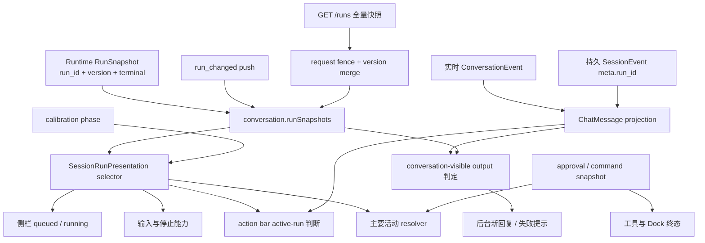

# 107 · 活动运行状态与界面投影一致性 - 技术方案

## 状态

CONFIRMED

## 需求文档

[requirement.md](./requirement.md)

## 现状分析

Runtime 已通过 `RunSnapshot` 提供按 `run_id` 版本递增、唯一 terminal 的运行事实，Bridge 的 REST 与 push 也都传递同一结构。问题主要发生在前端：`runSnapshots`、`activeRunIdBySession`、全局 `streaming`、`SessionConversationView.streaming` 与 `ChatMessage.status` 都能分别改写“是否仍在运行”，并被不同组件直接消费。

当前主要分叉路径如下：

- `openSession()` 会把历史 assistant 投影为 `complete`，同时根据 active map 单独设置会话 `streaming`。
- `applyRunSnapshot()` 会按 session 直接写 `streaming = !terminal`，旧 run terminal 可以清掉新 run 的 busy。
- `applyRunEvents()` 在缺少 active map 时会重新写入 active run，terminal 后迟到事件可以复活旧 run。
- stream transport 会在局部 `done` 后先结束 `ChatMessage.status`，但 Runtime 可能仍在继续模型或工具步骤。
- action bar 只看 `ChatMessage.status`，无法识别该消息仍属于 active run。
- 初始 `calibrateRuns()` 没有 readiness；列表响应与新 push 交错时，缺失项清理可能覆盖请求期间的新事实。
- command / approval store 对 REST 响应只做 merge，长期保留响应中已缺失的 pending / running 项；ToolCard 又允许 stale live process 覆盖持久化 terminal 结果。
- 后台 terminal 直接按 outcome 产生未读，无法区分真正的新对话内容与 hidden、memory-only 或外部出口。

本方案不改变 Runtime 调度、Bridge run schema 或持久化 session 格式；使用现有 `RunSnapshot.version`、session revision、事件 `meta.run_id` 和 presentation 过滤完成收敛。

## 方案设计

### 涉及文件

| 文件路径 | 改动类型 | 说明 |
| --- | --- | --- |
| `frontend/src/types/chat.ts` | 修改 | 为 `ChatMessage` 增加稳定 `runId` 与 terminal `runOutcome` |
| `frontend/src/stores/runPresentation.ts` | 新增 | 纯函数选择 session 的 canonical active run，并派生 busy、恢复、停止能力 |
| `frontend/src/stores/snapshotFence.ts` | 新增 | 小型请求围栏 helper，保护全量 REST 对账不覆盖请求期间的新 push |
| `frontend/src/stores/conversation.ts` | 修改 | 移除会话级重复 `streaming` 与 active map，统一 run 合并、terminal 收口和后台结果 |
| `frontend/src/stores/sessionProjection.ts` | 修改 | 从持久事件 `meta.run_id` 恢复消息归属，并按 run 边界拆分 assistant 聚合 |
| `frontend/src/stores/sessionSync.ts` | 修改 | 使用派生 busy 与 calibration phase 调度详情刷新和重连对账 |
| `frontend/src/stores/commandRuntime.ts` | 修改 | REST/push 版本合并、缺失项清理与 terminal 事实优先 |
| `frontend/src/stores/filesystemApprovals.ts` | 修改 | 为 pending 列表补请求围栏，避免旧响应清理新 push |
| `frontend/src/pages/chat/components/MessageList.tsx` | 修改 | 按 active run identity 隐藏完整 action bar，并承载消息级通用活动 |
| `frontend/src/pages/chat/components/Composer.tsx` | 修改 | 使用派生 busy / canStop / recovering 控制输入和停止入口 |
| `frontend/src/pages/chat/components/ConversationModelSelector.tsx` | 修改 | 使用派生 busy 与恢复状态保护配置切换 |
| `frontend/src/pages/chat/components/HistorySidebar.tsx` | 修改 | 直接从 run snapshots 派生 queued/running，精确显示后台完成或失败 |
| `frontend/src/pages/chat/components/ApprovalDock.tsx` | 修改 | 按 canonical active run 过滤授权与命令，并参与唯一主要活动选择 |
| `frontend/src/pages/chat/components/ToolCard.tsx` | 修改 | terminal 持久结果优先于 stale live process，操作能力绑定 active run |
| 对应 `*.test.ts(x)` | 修改/新增 | 覆盖状态矩阵、乱序、恢复、消息/action bar、未读和 item 对账 |

### 数据流与事实所有权



事实边界：

- `RunSnapshot` 决定整轮 queued、running、terminal 和控制范围。
- `ChatMessage.status` 只描述消息 item 是否仍在接收内容，不再决定 session busy。
- approval、command process、tool block 与 compaction 各自描述局部 item；它们只能提高主要活动的精确度，不能结束整轮。
- session detail 决定最终显示内容；terminal 先结束 busy，detail 刷新只负责补齐持久内容。

### Canonical run 选择与派生状态

新增 `runPresentation.ts`，输入保持为结构化只读字段，不直接依赖 React：

```ts
type RunCalibrationPhase = "calibrating" | "ready" | "degraded";

interface SessionRunPresentation {
  phase: "recovering" | "queued" | "running" | "stopping" | "idle";
  run: RunSnapshot | null;
  busy: boolean;
  canStop: boolean;
}
```

选择规则：

1. 过滤目标 session 的非 terminal snapshots。
2. `running` 优先于 `queued`；同状态按 `created_at` 较早者优先，最后用 `run_id` 保证稳定顺序。
3. 有 run 时以 run 状态为准；没有 run 且 calibration 尚未成功时为 `recovering`；只有 ready 且无非终态 run 时为 idle。
4. `canStop` 仅在 run 的 `control_scope === "desktop_text"` 且 run 非 terminal 时成立。
5. stop request 只把 phase 改为 `stopping`，不改变 busy；terminal 才结束。

`ConversationState.streaming`、`SessionConversationView.streaming` 与 `activeRunIdBySession` 全部删除。store action、React 组件和 session sync 都调用同一纯 selector；消息自身的 `MessageStatus.streaming` 保留。

### Run snapshot 合并与请求围栏

`applyRunSnapshot()` 只做按 run identity 的版本合并：

- `incoming.version <= current.version` 时忽略。
- 非 terminal snapshot 只更新自身，不覆盖同 session 其它 run。
- terminal snapshot 只结束同一 `run_id` 的消息、stop request 和 item 操作能力；active run 由 selector 重新计算，因此旧 run terminal 无法清除新 run。
- 已知 terminal run 的 `run_event` 一律拒绝；未知 run event 可以补消息，但不能自行创建 run ownership。若同 session 已有另一 canonical run，则拒绝未知旧 run 的迟到事件。

全量 REST 对账使用 `snapshotFence.ts`：

1. 请求发起时记录 collection mutation epoch。
2. 每次 push / 本地 authoritative mutation 为对应 key 记录新的 touched epoch。
3. 响应内对象仍按对象 version 合并。
4. 响应中缺失的 pending / running key，只有 `touchedAt[key] <= requestStartEpoch` 时才可清理；请求期间收到新 push 的 key 保留。
5. reconnect 重新运行全量对账；对账失败进入 `degraded/recovering`，不伪装 idle。

Run、filesystem approval、command approval/process 分别持有自己的 fence 状态；先使用同一个小型纯 helper，不建立全局注册中心。

### 消息 run identity 与 terminal 收口

`ChatMessage` 增加：

```ts
runId?: string;
runOutcome?: RunOutcome;
```

- 实时 user turn、编辑重发、工具结果续跑和 conversation presentation 主动 run 在创建 assistant placeholder 时写入 run id。
- 历史投影从 `SessionEvent.meta.run_id` 恢复；只有相邻事件缺少 run id 时才沿用旧兼容聚合。两个明确且不同的 run id 必须拆成两条 assistant message。
- action bar 的隐藏条件为 `message.status === "streaming" || message.runId === activeRun.run_id || editing`。因此局部 message done 不会提前暴露 action bar，更早 run 的消息不受影响。
- terminal snapshot 立即把该 run 的 streaming message 投影为终态：completed → complete、cancelled → interrupted、failed → error；skipped / expired / rejected 使用 interrupted 展示但保留精确 `runOutcome` 文案，不归为失败。
- terminal 后即使 detail refresh 失败，消息也不会永久 streaming 或永久隐藏 action bar；后续 detail 成功时再用持久事件替换内容。

### 唯一主要活动

主要活动按以下顺序解析：

1. 当前 active run 的 pending approval / user input。
2. 当前 active run 的 running command。
3. active message 上的 compaction 或明确模型 `runStatus`。
4. canonical run 的 queued、stopping、running generic 状态。
5. calibration 的 recovering 状态。

表现规则：

- approval / running command 继续由 Dock 承载；出现时抑制消息尾部的 generic 状态。
- active run 有 conversation message 时，generic / model 状态跟随该消息尾部。
- active run 没有 conversation message 时，在 composer 上方显示 session 级简洁状态，不创建伪消息，也不修改最近历史消息。
- 工具历史活动继续展示，但 terminal tool 不参与当前主要活动竞争。

### 后台结果与用户可见内容

后台 terminal 不再直接把所有非 completed 归为 failed：

- `failed` 可以产生明确失败提示。
- `cancelled`、`skipped`、`expired`、`rejected` 不产生“有新回复”或“处理失败”标记。
- `completed` 只有在当前 session projection 中存在 `runId` 匹配、且含可渲染 conversation 内容的 assistant message 时才产生“有新回复”。
- 若后台 session 尚无缓存 view，terminal 后读取一次 active detail，投影后再判断；请求返回前用户已打开该 session 时不再写未读。
- `markSessionViewed()` 继续在进入会话时清理标记；当前可见 session 从不新增后台未读。

### Tool、approval 与 command 收敛

- pending / process REST 列表采用请求围栏，并清理快照中已缺失且请求期间未更新的 active 项。
- Dock 和 ToolCard 的操作入口同时要求 item 属于 canonical active run。
- run terminal 后立即不再展示可操作 Dock；随后触发 authority refresh，把 broker 已清理的项从 store 收口。
- ToolCard 仅在 tool block 仍 running 且 process 属于 canonical active run 时使用 live process；持久化 tool result 已 terminal 时优先使用 result，防止 stale running 覆盖。
- 独立长期后台 terminal 不在本期引入；现有 run-bound command 继续由 run lifecycle 约束。

### 初始化、切换与详情刷新

- store 初始 calibration phase 为 `calibrating`；首次列表成功后才进入 ready。
- current session 在 recovering 时禁用发送、编辑重发和模型切换，但允许查看已有历史。
- `openSession()` 使用 cached view 展示内容，busy 由 selector 独立派生；不再把 cached message status 写回 session busy。
- current session busy 时延迟 session detail replace；selector 从 busy 变 idle 后 flush 最新 revision。
- terminal snapshot 总是触发当前 session detail refresh；失败只保留已确定的 terminal projection，不恢复 busy。
- reconnect 清空未应用的 run event scheduler，进入 calibration，再对 runs、approval、command 和当前 detail 做权威刷新。

## 测试与验收设计

### 确定性自动化

- `runPresentation.test.ts`：queued/running 优先级、recovering、control scope、stopping、多 run 同 session。
- `snapshotFence.test.ts`：旧 pull + 新 push、缺失项清理、低版本响应、重连重复对账。
- `conversation.test.ts`：旧 terminal 不清新 run、terminal 后迟到 event 不复活、terminal 详情失败、后台可见/隐藏结果、外部 run、取消等待。
- `sessionProjection.test.ts`：历史 run id、同 run 多段聚合、不同 run 拆分、hidden/ambient/memory-only 过滤。
- `MessageList` / presentation 测试：active message 整个 action bar 隐藏、历史消息保留、无正文 run 的 session 级状态、Dock 优先级。
- `sessionSync.test.ts`：初次 readiness、重连、busy→idle detail flush、旧 response 不覆盖新 push。
- command / filesystem / ToolCard tests：缺失 pending/process 清理、terminal result precedence、run terminal 后无操作入口。

### 真实 Tauri 验收

按项目桌面验收流程使用当前 worktree 的真实 Tauri runtime，核对 runtime lease 与源码新鲜度。使用可控运行态覆盖：

- active assistant 已有正文但 run 继续时，action bar 完整隐藏且保留唯一继续中反馈。
- A 会话运行中切到 B 再切回 A，侧栏、消息、composer 与 Dock 一致。
- queued、正在取消、等待授权、运行中命令和 terminal 的主要活动切换。
- 不可由桌面控制的外部 run 无停止入口。
- terminal 后 action bar 恢复，失败/取消文案正确，无残留授权或运行中命令。

若验收使用 mock / dev-only 状态注入，只把它作为真实 WebView 视觉与 DOM 证据；跨 Bridge/Runtime 的行为结论必须由对应集成测试或真实运行证据支持。

## 影响分析

### 上下游影响

- Runtime 与 Bridge API 无 schema 变化，现有 voice、IM、AG-UI 和主动 run 入口继续产出原事实。
- conversation store 的 public state 会删除 `streaming` 与 `activeRunIdBySession`；所有前端消费者和测试 fixture 必须同步迁移到 selector。
- `ChatMessage` 新字段为可选，旧持久事件与 Persona 编辑器消息不需要迁移。
- command / approval store 的 terminal history仍可保留用于详情，但 active UI 只认 canonical run ownership。
- session list `updated_at` 不承担 unread 判定，避免改变现有列表排序契约。

### 风险点

- `streaming` 消费者较多，若漏迁移会出现编译错误或局部门禁缺失；通过全仓 `rg`、typecheck 和组件测试机械覆盖。
- calibration 失败若没有恢复入口可能长期 recovering；重连、窗口恢复与显式 refresh 都要能够重新触发校准。
- history 中较老事件可能没有 `meta.run_id`；投影必须保留旧聚合兼容，不能为修新数据破坏旧会话。
- background detail fetch 可能与用户打开 session 竞态；写未读前再次检查 current session，并按 open token/revision 拒绝旧结果。
- request fence 依赖 REST 列表是单次一致读取；如果后续 broker 引入跨进程多写者，应升级为服务端 collection revision，而不是继续叠本地例外。
- 主要活动去重会触达 MessageList 与 Dock；需要真实桌面验收确认状态没有消失、重复或遮挡 composer。

## 变更记录

| 日期 | 变更内容 | 是否需要重新实现 |
| --- | --- | --- |
| 2026-08-28 | 首次确认：canonical run selector、消息 run identity、请求围栏、terminal 收口、可见未读与分层 Tauri 验收 | 是 |
