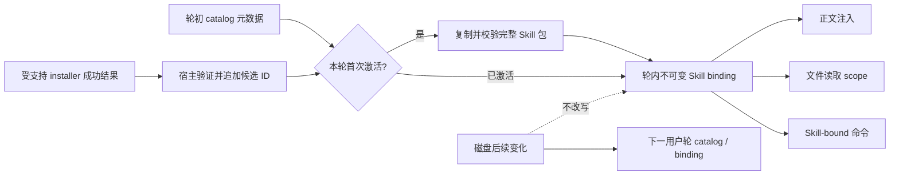

# Agent 可控的 Skill 激活生命周期 - 封存候选技术方案

## 状态

ARCHIVED

> 本文记录 2026-08-28 至 2026-08-29 技术设计阶段形成的候选方案和未决问题。方案没有完成阶段确认、没有进入实现，也不代表当前产品架构。未来重启需求时必须重新对账，不得直接照此实施。

## 需求文档

[requirement.md](./requirement.md)

## 1. 现状分析

### 1.1 Catalog、激活与正文版本当前绑定在同一个轮初快照

- `SkillCatalogService.begin_turn()` 在用户轮开始时取得 catalog，并按调用方选择读取 `SKILL.md`。
- 模型后续调用 `skill_read` 时，工具只得到轮初 `SkillCatalogSnapshot`；`activate_from_snapshot()` 会重新读取磁盘正文并与轮初 `SkillRecord.version` 比较。
- 正文与轮初版本不一致时返回 `skill_changed_during_turn`，即使变化来自本轮刚刚成功完成的受管理更新，也不会形成激活。
- `SkillRecord.version` 只覆盖 `SKILL.md` 字节，不代表引用资料、脚本、资产和其它包内资源的完整版本。

### 1.2 正文、文件读取和命令执行并未真正共用一个包版本

- 激活成功后，`ActivatedSkill.contents` 冻结了正文字符串，但 `record.package_root` 仍指向活的安装目录。
- Conversation 为 Skill 资源签发的文件读取 scope 指向这个活目录；Skill 在激活后被替换时，后续读取可能看到新资源。
- Skill-bound 命令第一次执行时，`command_runtime/skill_snapshot.py` 才从活目录复制完整包，并在本轮命令上下文中缓存。复制时点晚于正文激活，也晚于可能发生的文件读取。
- 因此，简单取消版本不一致错误会形成更隐蔽的混合状态：正文可能来自更新后版本，文件 scope 或命令快照则可能来自另一次变化后的版本。

### 1.3 新安装 Skill 缺少可信的轮中身份桥接

- `skill_read` 只接受轮初 catalog 中的稳定 `skill_id`，这是避免模型用名称、路径或相似 ID 扩权的重要边界。
- `skill-installer` 当前通过 Skill-bound `exec_command` 运行确定性脚本；脚本成功输出是面向人的文本，Conversation 不会把它解释为新的可信激活候选。
- 轮初不存在的 Skill 即使安装成功，模型也拿不到由宿主验证并加入本轮候选集的稳定身份。
- 直接允许 `skill_read` 按名称、绝对路径或最新全局 catalog 任意加载，会绕开轮初候选集和 `allow_implicit_invocation` 的既有边界。

### 1.4 用户轮资源生命周期已经存在，但 Skill 包没有接入该边界

- `ToolRunContext` 随用户轮创建，并在所有终态通过 `close_commands()` 终止进程、清理命令资源。
- 隐式 Skill 激活发生在工具循环中；Conversation 通过替换 `_active_skill_turn_snapshot` 让后续工具看到新 activation。
- 当前包快照由命令工具延迟创建，因此轮前宿主激活、轮中隐式激活、文件读取和命令执行没有共享的资源 owner。
- 若将完整包冻结提前到首次激活，必须同时处理正常完成、异常、取消、streaming 命令仍在运行和测试注入等生命周期。

## 2. 候选方案总览

候选方案把一个用户轮中的 Skill 状态拆成三个层次：

1. **发现 catalog**：用户轮开始时固定，继续只提供有界元数据，用于模型发现和语义选择。
2. **激活候选集**：初始包含轮初 catalog 的稳定身份；受支持安装流程成功后，可追加经过宿主验证的新身份，但不改写已经发送的 catalog。
3. **轮内包绑定**：某个候选首次成功激活时，复制、校验并冻结完整包；正文、文件 scope 和命令执行都从这一份只读快照取得内容。

## 3. 轮级绑定模型

### 3.1 `SkillPackageBinding`

候选新增一个只属于当前用户轮的完整包绑定，至少保存：

- 原始 Skill 稳定身份、来源和原始 package root；
- 本轮只读快照根与快照内 `SKILL.md` 路径；
- `SKILL.md` 内容摘要；
- 完整包 manifest 指纹；
- 文件数量和总字节数；
- 创建状态与失败原因。

`ActivatedSkill` 继续保存模型所需正文和 `SkillRecord`，并新增上述 binding。`SkillRecord.package_root` 保留来源身份含义，所有执行和读取代码改用 activation 上的快照根，避免把来源位置和实际执行位置混为同一字段。

### 3.2 `SkillTurnBindingStore`

候选在 `agent.skills` 内新增一个用户轮级 binding store：

- 为每个 Skill ID 最多创建一份包快照；
- 相同 ID 的重复激活返回首次 binding；
- 提供注入式临时根，便于测试和跨平台控制；
- 统一拥有包快照的清理；
- 不把临时绝对路径写入会话历史或模型可见结果。

绑定 store 不应放在 command runtime 内，因为它同时服务正文、文件工具和命令工具；command runtime 只是消费者之一。

### 3.3 完整包快照

候选复用并上移现有 command Skill snapshot 的安全规则：

- 允许 Skill 顶层目录本身通过受支持链接指向规范化实际目录；包内部链接、junction 和特殊文件继续拒绝；
- 限制文件数、单文件大小和总展开大小；
- 按稳定相对路径排序，为每个文件记录大小与 SHA-256，再计算 manifest 指纹；
- 复制前后核对文件大小、mtime、inode/file identity，并重新扫描路径集合；
- 变化发生在复制过程中时丢弃 staging，刷新当前记录后重试一次；再次变化才返回 `skill_changed_during_binding`；
- 快照文件只读，包目录只通过只读 filesystem scope 和沙箱 additional root 暴露。

复制完整包只表示物化一份稳定字节集合，不表示把引用资料或脚本内容预先放进模型上下文，也不自动执行任何资源。

## 4. 当前版本解析与 Catalog 语义

### 4.1 串行刷新

当前 `refresh()` 在加载 catalog 时没有独立的刷新串行锁。候选增加 `_refresh_lock`，避免 watcher 和首次激活同时扫描时用相同 generation 互相覆盖或后完成的旧扫描反向发布。

### 4.2 首次激活解析

首次激活候选流程：

1. 确认 Skill ID 在本轮候选集中，或已经形成 binding；
2. 若已绑定，返回 `already_active` 和首次 binding；
3. 串行刷新当前 catalog，按稳定 ID 取得当前记录；
4. 重新检查来源身份、存在性、有效性、可读性和当前调用策略；
5. 创建完整包快照，并从快照内重新验证 `SKILL.md` 与 `agents/openai.yaml`；
6. 原子登记 binding，随后才返回激活成功。

轮初 rendered catalog 不随上述刷新改写。刷新只用于确定首次激活的当前有效定义；新 catalog 正常在下一用户轮进入 model-visible 上下文。

### 4.3 `expected_version`

候选方案倾向把 `SkillSelection.expected_version` 从硬性内容锁调整为“选择时观察到的正文版本”：

- 若首次激活时版本相同，正常记录；
- 若版本已合法变化，使用当前绑定并记录 `version_changed_before_activation=true`；
- 若调用方已经传入完整的、此前形成的 `SkillTurnSnapshot`，继续使用该已绑定内容，不重新解析活目录；
- 需要真正固定旧内容的调用方必须传递已形成的 binding，而不能依赖旧 catalog 的摘要值。

这个语义是候选项，尚未得到单独设计确认。

## 5. Conversation 生命周期

### 5.1 创建顺序

候选调整用户轮启动顺序：

1. 建立轮级 binding store；
2. 解析结构化或宿主显式 Skill 选择；
3. `begin_turn()` 通过同一 store 绑定轮前选择；
4. 建立 `ToolRunContext`，为已有 activation 的快照根签发只读文件 scope；
5. 进入首个模型请求和工具循环。

轮中 `skill_read` 获得隐藏的完整 `SkillTurnSnapshot` 与 binding store，而不再只得到 catalog。成功后 Conversation 只在当前没有同 ID activation 时追加；重复调用不能替换首次 binding。

### 5.2 清理顺序

所有完成、失败和取消路径统一：

1. 停止并回收当前用户轮仍存活的命令；
2. 清理命令临时资源；
3. 关闭 Skill binding store 并删除包快照；
4. 恢复外层 Conversation 状态。

命令进程必须先停止，避免仍在读取脚本时删除快照。`close()` 应幂等，异常清理不得覆盖原始 turn 终态。

### 5.3 持久化

- 宿主显式 activation 的 `skill_context` 继续保存正文、名称、来源和正文版本，可追加完整包指纹用于诊断；
- 隐式 activation 继续由 `skill_read` tool result 保存模型实际看到的正文；
- `_activated_skill`、binding 对象、临时根和内部安装结果保持私有 metadata，不进入 JSONL；
- 历史重放只使用已经持久化的正文，不尝试恢复已清理的包快照；新用户轮需要使用资源时重新激活当前版本。

## 6. 新安装 Skill 的可信桥接

### 6.1 结构化 installer 结果

候选为 `install-skill-from-github.py` 增加显式机器输出模式，例如 `--output-format json`。成功结果为有版本的对象或数组，至少包含：

- schema version；
- `installed` / `updated` / `adopted` / `already_up_to_date`；
- Skill 名称；
- GitHub repository、仓库内路径和 ref；
- 安装管理记录中的完整包 digest；
- 目标种类为 agent-friend personal Skill。

默认人工调用仍可保留现有文本输出。builtin `skill-installer` 指引改用机器输出模式，避免宿主从自然语言正则推断成功。

### 6.2 命令结果识别

只有同时满足以下条件时，command runtime 才把机器结果作为私有 install effect 返回：

- 命令通过结构化 Skill binding 绑定到 `builtin/skill-installer`；
- entry 精确为受支持 installer 脚本；
- 进程真实退出且 exit code 为 0；
- stdout 严格符合版本化 schema 和大小上限。

其它命令即使输出相同 JSON，也不能产生 install effect。

### 6.3 宿主验证和候选追加

Conversation 收到私有 install effect 后：

1. 让 `SkillCatalogService` 串行刷新；
2. 核对目标位于 personal Skill 根、名称和来源记录一致、当前包仍有效；
3. 取得宿主计算的稳定 Skill ID 和当前正文版本；
4. 将该 ID 追加到本轮 activation candidate 集，而不改写轮初 catalog；
5. 在原 `exec_command` 模型可见结果中追加已验证的 Skill ID、当前版本和是否允许隐式调用。

模型随后仍调用现有 `skill_read(skill_id, reason)`。`skill_read` 不增加名称、路径或 digest 分支，也不新增可任意刷新全局 catalog 的模型工具。

### 6.4 显式与隐式调用策略

候选边界为：

- 新安装结果只证明“这个 ID 是本轮真实安装产生的候选”，不自动证明用户要求绕过 `allow_implicit_invocation=false`；
- 宿主可在刷新后用原始用户输入和当前记录重新运行现有显式选择解析。只有精确 Skill 名称、结构化选择或其它既有可信显式语法命中时，才按 caller invocation 处理；
- 其它情况仍按 implicit invocation 检查。默认允许隐式调用的 Skill 可以同轮继续，显式-only Skill 则返回准确拒绝；
- 不允许模型通过 reason、命令参数或自报 `invocation_kind` 改变这一事实。

该边界在封存时仍是重点开放问题：它能保留现有策略，但不能保证所有自然语言“安装这个然后用”都被宿主识别成显式调用。

## 7. 文件读取与命令执行

### 7.1 文件 scope

- 轮前 activation 在创建 `ToolRunContext` 时为 binding snapshot root 签发 scope；
- 轮中 `skill_read` 成功后立即为同一 snapshot root 追加 scope；
- scope 仍只提供 `search_metadata` 和 `read_text`，使用相对路径，生命周期为当前用户轮；
- 不再把活的 `record.package_root` 或临时绝对路径持久化到 tool result metadata。

### 7.2 Skill-bound 命令

候选把 `command_runtime/skill_snapshot.py` 从“命令时复制活包”改为“解析已有 binding 中的 entry”：

- `skill.skill_id` 必须来自当前轮 activation；
- `entry` 和 `workdir` 在 binding snapshot root 内解析并拒绝逃逸；
- approval card 使用完整包指纹，保证批准和执行对应同一字节集合；
- sandbox 只读挂载 binding snapshot root；
- Python sibling helper 的 `PYTHONPATH` 只指向快照内 entry 目录；
- 命令正文引用相对 entry 时继续由现有结构化 binding 改写，不能回退到活安装目录。

同一用户轮中的文件工具和多个命令调用因此共享同一 binding，不再各自复制。

## 8. 重复激活与错误模型

### 8.1 重复激活

- 同一 Skill ID 已绑定时返回短的 `already_active` 结果和首次版本信息，不再次注入完整正文；
- Conversation 不替换 activation，也不增加第二份文件 scope；
- 若模型在压缩后确实需要恢复正文，由上下文管理或新用户轮重新激活处理，不通过同轮切换磁盘版本解决。

### 8.2 错误分类

候选移除“只因轮内合法变化而失败”的 `skill_changed_during_turn`，保留并细分真实失败：

| 错误 | 含义 | 可恢复性 |
| --- | --- | --- |
| `skill_not_activation_candidate` | ID 不在轮初 catalog 或本轮可信安装候选 | 不得按名称/路径重试 |
| `skill_not_found` | 当前稳定身份已删除或失效 | 外部状态变化或下一轮重新选择后再试 |
| `implicit_invocation_disabled` | 当前调用不是可信显式选择 | 需要用户显式选择，不能自报类型 |
| `skill_binding_too_large` | 完整包超过文件数或字节预算 | 缩小包后再试 |
| `skill_binding_unsafe_entry` | 包内存在链接或特殊文件 | 修复包结构后再试 |
| `skill_changed_during_binding` | 两次快照尝试期间包仍在变化 | 等更新结束后再试，不原样循环 |
| `skill_binding_validation_failed` | 快照内入口、元数据或策略无效 | 修复 Skill 后再试 |
| `skill_install_effect_invalid` | 安装命令成功输出无法建立可信候选 | 安装状态保留，但不能据此同轮激活 |

错误结果继续携带稳定 machine code 和模型可行动说明，不暴露快照路径、未授权候选或内部 traceback。

## 9. 涉及文件（候选）

| 文件路径 | 改动类型 | 候选职责 |
| --- | --- | --- |
| `agent/src/agent/skills/models.py` | 修改 | 新增包 binding、activation candidate；扩展 `ActivatedSkill` / `SkillTurnSnapshot` |
| `agent/src/agent/skills/binding.py` | 新增 | 完整包复制、指纹、轮内缓存和清理 |
| `agent/src/agent/skills/service.py` | 修改 | 串行 refresh、当前记录解析、候选检查、首次/重复激活 |
| `agent/src/agent/skills/loader.py` | 修改 | 对单个快照包执行可复用校验，不用快照路径重算稳定 ID |
| `agent/src/agent/tools/builtin/skills/tool.py` | 修改 | 接收完整轮状态与 binding store，返回 activated/already-active/精确错误 |
| `agent/src/agent/conversation.py` | 修改 | binding 生命周期、installer effect 采纳、scope、first-binding-wins 与持久化过滤 |
| `agent/src/agent/command_runtime/skill_snapshot.py` | 重构或移除 | 从延迟复制改为已有 binding 的 entry 解析适配 |
| `agent/src/agent/command_runtime/tools.py` | 修改 | 直接使用 binding；识别受信 installer 机器结果 |
| `agent/src/agent/skills/builtin_assets/skill-installer/SKILL.md` | 修改 | 成功后同轮读取、机器输出和失败边界指引 |
| `agent/src/agent/skills/builtin_assets/skill-installer/scripts/install-skill-from-github.py` | 修改 | 输出版本化安装结果，不改变既有安装安全事务 |
| `agent/src/agent/skills/builtin_assets/manifest.json` | 修改 | builtin 资源版本与摘要更新 |
| `agent/tests/test_skill_service.py` 等 | 修改 | 激活、竞态、生命周期、文件与命令一致性回归 |
| `agent_eval/` 对应 case group | 新增 | 固化真实“更新成功后要求下一轮”行为契约 |

未发现必须改动前端的产品要求。既有 `SkillActivationStatus` 和 Tool 卡片可以继续表达成功与失败；若后端新增字段不能被现有投影安全忽略，才补协议兼容调整，不因本需求重做 UI。

## 10. 验证计划（未执行）

### 10.1 确定性单元与调用链

- 更新发生在首次激活前：绑定并返回新版正文和完整包指纹；
- 更新发生在首次激活后：正文、引用读取和脚本均保持首次版本；
- 同一轮重复 `skill_read`：返回 already active，activation 和 scope 不重复；
- 包复制时文件、目录集合或入口变化：第一次丢弃重试，持续变化准确失败；
- 包超限、包内链接、特殊文件、无效 UTF-8、无效策略和删除路径分别失败；
- 文件 scope 只能读取快照，活目录后续变化不可见；
- 多次 Skill-bound 命令使用相同包指纹，审批后源目录变化不影响执行；
- 所有 turn 终态先停止命令再删除快照，无残留进程或目录；
- watcher 与同步 refresh 并发时 generation 单调、不会反向发布旧 catalog。

### 10.2 Installer 桥接

- 只有精确 builtin installer binding + 精确 entry + exit 0 + 合法 JSON 才产生私有 install effect；
- 普通命令伪造相同 stdout、失败命令、截断结果、异源目标和内容漂移不能加入候选；
- 新安装默认隐式 Skill 返回稳定 ID 后同轮激活；
- 显式-only Skill 只有原用户输入被宿主确定性识别为显式选择时才可同轮激活；
- 更新已有 Skill 不需要新增候选，但模型得到当前有效 ID 和版本；
- 安装成功但候选验证失败时，安装事实不被改写成失败，激活状态明确不可用。

### 10.3 行为契约

- 真实 bad case 使用原事故模型 `deepseek/deepseek-v4-flash-vision-exp` 的来源信息归档；
- 原始回答“更新成功但请用户下一轮再说一次”应失败；
- 更新后同轮真实 `skill_read` 并继续任务应通过；
- 删除、禁用、未知 ID、无效包和权限拒绝对照不得被放宽；
- 先运行 deterministic judge/harness，任何真实 LLM 复验仍需单独冻结清单和取得授权。

上述测试与评测均未创建或执行。

## 11. 影响与风险

### 11.1 主要影响

- Skill 激活从读取一个文件升级为物化完整包，I/O、临时磁盘和失败面都会增加。
- 原本可以只读正文、但完整包超限或包含不安全资源的 Skill，会更早在激活阶段失败。
- installer、exec command、Conversation 和 Skill tool 之间新增一条严格的结构化结果链。
- `expected_version` 语义变化会影响结构化选择、idempotent replay 和已有测试。
- 快照路径和清理生命周期进入所有用户轮终态，异常处理必须比普通功能更严格。

### 11.2 关键风险

- **TOCTOU**：原子目录替换和普通文件编辑可能与完整包复制交错，必须用稳定 manifest 和有界重试证明快照自洽。
- **权限漂移**：新安装结果只能增加候选身份，不能授予工具、文件、网络或命令权限。
- **策略绕过**：安装成功不能自动把显式-only Skill 变成隐式可调用。
- **临时资源泄漏**：取消、异常和 streaming 进程会扩大快照清理复杂度。
- **性能**：大型资产型 Skill 每轮复制成本可能不可接受；没有测量前不能把候选预算视为最终值。
- **协议耦合**：若用普通 stdout 自然语言识别安装成功，极易被伪造或随文案漂移，因此候选方案必须使用版本化机器结果。

## 12. 封存时未决问题

1. 首次激活完整复制的实际性能和合理包预算尚未 spike；是否需要内容寻址复用没有数据。
2. `SkillSelection.expected_version` 是否可以全面降为审计字段，尚未核对所有调用方和重放协议。
3. 新安装显式-only Skill 的自然语言指代不能总被宿主确定性识别；是否接受这一限制尚未确认。
4. installer 的包 digest、first-party Skill snapshot digest 和 command manifest fingerprint 当前算法不同；是否统一事实源尚未设计。
5. per-turn 临时根应复用 command execution root 还是使用独立平台临时目录，尚未结合非桌面入口和冻结 runtime 验证。
6. 复制完整包是否会与需求 076 对“附加资源不预加载”的用户认知冲突，需要在未来重启时重新定义“物化”与“进入模型上下文”的文案。
7. 是否只解决“已知 Skill 更新后同轮激活”可以形成显著更轻的窄需求，尚未重新拆分；这是未来最值得先验证的降级方向。

## 13. 封存结论

候选方案能够在机制上同时满足“首次激活使用当前版本”和“激活后正文、文件与命令不混版”，但代价不是删除一个错误分支，而是把 Skill 包提升为用户轮级不可变资源，并建立 installer 到 activation 的可信跨工具协议。该复杂度与用户对当前需求“过重”的判断一致，因此本方案只作为研究档案保留，不进入实现。

## 变更记录

| 日期 | 变更内容 | 是否需要重新实现 |
| --- | --- | --- |
| 2026-08-29 | 封存技术设计讨论：记录轮级完整包 binding、installer 结构化结果、文件/命令统一快照、错误模型、验证计划和未决问题。 | 是；方案从未确认或实现，未来重启必须重新设计与验证 |
