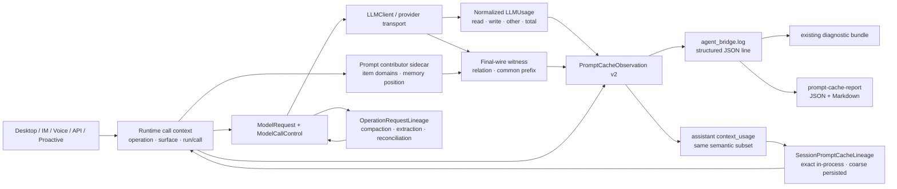

# 109 · Prompt cache 可观测性与优化基线 - 技术方案

## 状态

CONFIRMED

## 需求文档

→ [requirement.md](./requirement.md)

## 证据索引

→ [evidence-index.md](./evidence-index.md)

## 现状分析

### Provider 事实已经存在，但只覆盖 cache read 与部分 miss

`llm_providers.usage` 当前会从 OpenAI compatible、DeepSeek 和 Anthropic/LiteLLM 的若干字段中
归一 `cached_prompt_tokens`，并在总输入已知时推导 cache miss。这个结果足够支持需求 102 的
受控 smoke，却没有保留 cache write，也没有说明 provider 的总输入是包含式总量还是互斥组成部分。
如果直接跨 provider 汇总，可能把 cached/read/write 重复计入总输入，或把“字段缺失”误报成零。

### 请求结构诊断分为 adapter input 与 final wire 两层

`PromptCacheTraceTracker` 能在 Conversation 输入层比较 system、tools、messages 的内容无关指纹；
`ProviderRequestWitness` 则在 provider transform 之后比较实际出站 body，并给出
`baseline`、`same_request_retry`、`strict_extension`、`rebase` 或 `unavailable`。后者才是缓存前缀
可复用性的权威结构证据，但两层结果目前没有与 provider usage 组合成稳定结论。

### 运行语义与 provider 事实位于不同责任域

Conversation 知道 run、session、surface、call kind、call index、恢复与工具续轮；provider client
知道实际 transport、response model、request id、usage 和 final-wire witness。任一层单独承担完整
观测都会丢失另一层事实。因此统一观测由 provider 边界组装，运行层通过显式、内容无关的调用上下文
补充语义，不让 provider 反向依赖 Agent。

### 原方案的 final-wire witness 在新用户回合失去 lineage

`RunContinuationProjection.close()` 会按正确的 run-local 隐私边界清除上一请求 messages 与 witness。
这保证不会跨 run 保存 provider transcript，却也让下一独立用户回合第一请求只能得到
`request_relation=baseline`。`PromptCacheTraceTracker` 虽仍在同进程保存 adapter message digest，
但不能替代 provider transform 后的 wire 事实；跨进程恢复更只剩 namespace/cache state。因此需要新增
session 级、内容无关的跨回合 lineage owner，并把逐 item digest 严格限制在进程内存。

### 已接入的后台调用仍缺少断点比较

memory base extraction、semantic reconciliation 和 context compaction 已经传入 operation/call kind，并由
统一 observation 记录 usage，但三者都走 non-stream `generate()`。当前同步 transport 没有安装与 stream
相同的 final HTTP request capture，`ModelResponse.diagnostics` 因此没有 request witness；只要调用路径是
non-stream，structure 就固定为 unavailable。“统一采集了调用身份”与“能够比较 provider 前缀”是两项
独立能力，不能用前者代替后者。

### Memory recall 不是可独立归因的 prompt contributor

Conversation 把 recall 渲染为当前回合临时 system message，位于 current user 之后。下一用户回合重建
history 时，上一回合的 assistant/history 会插入旧 memory 所在位置之前，即使 recall 内容相同也可能让
旧 provider 前缀从该位置开始失效。现有 adapter trace 和 final-wire witness 只把它归入 system/messages，
既没有 memory presence/content/position flags，也没有 previous/current domain 对照，无法判断断裂是否由
memory 的出现、消失、改变或移动造成。

### 现有诊断包已经有受治理日志入口

`agent_bridge.log` 使用现有 rotating file handler，并已被 diagnostic bundle 以有界 tail、脱敏规则
和 schema revision 收集。新增独立数据库或新日志文件会扩大保留、迁移和 bundle contract；首期改为在
现有日志中写入单行版本化 JSON，并在 session assistant event 中保留同语义子集。

## 设计原则

1. **Provider 层拥有事实，运行层拥有解释上下文**：usage、实际模型、transport 和 wire witness 由
   `llm_providers` 产生；operation、surface、run/session 和调用序号由调用方显式传入。
2. **输入 bucket 互斥**：归一后使用 `cache_read + cache_write + input_other = input_total`；信息不足
   时保留 `null` 和 coverage gap，不猜测 cache write。
3. **结构与结果正交**：strict extension 不是命中，零读取也不自动证明客户端改变了请求。
4. **一条逻辑 provider 调用一条观测**：内部 transport retry 只作为 attempt 诊断；外层恢复重新发起
   的逻辑调用拥有独立 call identity。
5. **采集可降级，不影响回答**：观测组装、日志或旧字段缺失不得阻断正常模型调用。
6. **默认不含内容**：公共 schema 只记录域分离 digest、计数、枚举和安全引用，不保存 prompt、工具、
   reasoning、附件或 provider body。
7. **先固定机制再采真实 baseline**：fixture、聚合数学和入口覆盖先自动化；真实 LLM 另按单次授权执行。
8. **新用户回合不是新观测基线**：有上一成功用户回合时必须比较；无精确证据时标 unavailable 或
   precision-reduced，不能用 `baseline` 掩盖跨 run 边界。
9. **调用入口与 contributor 交叉覆盖**：每个 production operation 都必须声明适用 contributor 和比较
   能力；不能分别证明“调用已采集”和“断点域已实现”后推断交叉组合完整。
10. **Final wire 不从 adapter input 猜测**：non-stream 与 stream 都从 provider transform 后的 HTTP body
    生成 witness；sidecar 只有在能证明 item 对齐时才能补充语义域。

## 总体架构



不引入外部 telemetry、常驻数据库或新的 diagnostic bundle capability。公共 observation 与报告逻辑
放在 `llm_providers`，避免 Agent 主对话之外的 memory/compaction 调用遗漏。

## 1. Provider usage 归一化

### 1.1 `LLMUsage` 加性扩展

保留现有字段兼容 context budget 与旧调用方，增加：

```python
@dataclass(frozen=True)
class LLMUsage:
    prompt_tokens: int | None                 # 归一后的总输入
    completion_tokens: int | None
    total_tokens: int | None
    cached_prompt_tokens: int | None          # cache read
    cache_write_prompt_tokens: int | None
    input_other_prompt_tokens: int | None     # 非 read/write 的输入
    cache_miss_prompt_tokens: int | None       # 兼容原生 miss；不等同 cache write
    usage_source: str | None
    cached_prompt_tokens_source: str | None
    cache_write_prompt_tokens_source: str | None
    input_other_prompt_tokens_source: str | None
    cache_miss_prompt_tokens_source: str | None
    input_token_accounting: Literal[
        "inclusive_total", "exclusive_components", "partial", "unavailable"
    ]
    input_other_prompt_tokens_derived: bool
    cache_miss_prompt_tokens_derived: bool
```

现有构造器继续可用；新字段全部提供默认值。明确 `0` 保持 `0`，缺失保持 `None`，非法/负值按缺失
处理。`prompt_tokens` 始终表示可用于上下文预算的总输入，而不是 Anthropic breakpoint 后普通输入。

### 1.2 字段优先级与 accounting mode

| Provider response 形态 | 总输入 | cache read | cache write | other | mode |
| --- | --- | --- | --- | --- | --- |
| OpenAI/LiteLLM inclusive | `prompt_tokens` | details/top-level | details/top-level | `total-read-write`（信息足够时） | `inclusive_total` |
| Anthropic exclusive | `input_tokens + cache_read + cache_creation` | `cache_read_input_tokens` | `cache_creation_input_tokens` | `input_tokens` | `exclusive_components` |
| DeepSeek hit/miss | `hit + miss`，或可信总量 | `prompt_cache_hit_tokens` | unavailable | `prompt_cache_miss_tokens` | `exclusive_components` |
| 部分兼容响应 | 可得字段 | 可得字段 | 可得字段 | 仅能证明时推导 | `partial` |

嵌套 `prompt_tokens_details`、`input_tokens_details` 与 SDK 私有 fallback 字段继续支持，但每个归一值
记录实际来源路径。若 provider 同时给出 native 与 derived 值，native 优先；冲突不强行对账，标记为
partial 并保留原字段来源。

### 1.3 完整性不变量

- 三个互斥 bucket 都已知时，必须满足 `read + write + other == input_total`。
- inclusive 总输入与 read/write 已知时，可以推导 other，但结果不得小于零。
- exclusive 组成部分已知时可以计算总输入，不把 provider 的 `input_tokens` 原值误当总输入。
- 只有 read 与总输入已知时，可以继续提供 legacy `cache_miss_prompt_tokens=total-read`；该字段明确是
  兼容推导，不代表 cache write。
- cache read/write/other 任一未知时，报告 coverage 必须可见，不能把未知填零。

## 2. 调用上下文与统一 observation

### 2.1 `ModelCallTraceContext`

在 `ModelCallControl` 中增加可选调用上下文：

```python
@dataclass(frozen=True, repr=False)
class ModelCallTraceContext:
    operation: str
    surface: str | None = None
    run_id: str | None = None
    session_id: str | None = None
    call_kind: str | None = None
    call_index: int | None = None
    turn_index: int | None = None
    recovery_attempt: int | None = None
    adapter_trace: Mapping[str, JsonValue] | None = None
```

这个类型不允许携带 messages/tools 正文。原始 run/session 只在进程内用于生成域分离安全引用；写入日志
前转换成 `run_ref`、`session_ref`。没有 context 的未来调用仍由 `LLMClient` 产生 observation，operation
标为 `unspecified`，从而让入口覆盖缺口显式可见。

### 2.2 `PromptCacheObservation v2`

观察对象是 JSON-compatible mapping，顶层固定：

```text
schema                = "agent-friend.prompt-cache-observation"
schema_revision       = 2
observed_at           = UTC timestamp
identity              = code/build、operation、surface、run/session ref、call identity
model                 = requested/response/provider/transport/service tier
usage                 = input_total/cache_read/cache_write/input_other/output + source/derived/mode
structure             = adapter summary + final-wire relation/common prefix/rebase reason
timing                = request/first event/first text/total，字段可空
outcome               = interpretation、coverage、provider request safe ref
```

公共日志不写 message digest 列表，也不写原始 provider request id。需要关联时使用带 schema 域的
SHA-256 截断引用；相同本机记录可关联，无法反推原值。

`ModelCallControl` 再增加仅进程内使用、`repr=False` 的 `transcript_item_domains`。它是与当前 adapter
messages 对齐的语义 sidecar，只允许 `system/persona/tools/messages/memory/runtime/unknown` 等枚举，不含
正文、digest 或原始 ID。transport 只有在 prepared messages 与 final-wire transcript 的 item 数量、顺序和
内容无关 digest 对齐都可证明时才采用这些 domain；否则 final witness 保持通用域并记录 contributor
mapping precision unavailable。

### 2.3 组合解释

| final-wire relation | provider cache read | interpretation |
| --- | --- | --- |
| `baseline` | 任意 | `baseline_request` |
| `same_request_retry` | 任意 | `transport_retry_result` |
| `strict_extension` | `> 0` | `structure_preserved_cache_read` |
| `strict_extension` | `0` | `structure_preserved_no_cache_read` |
| `strict_extension` | unknown | `structure_preserved_usage_unavailable` |
| `rebase` | 任意 | `structure_changed` |
| unavailable | `> 0` | `cache_read_structure_unavailable` |
| unavailable | `0` | `no_cache_read_structure_unavailable` |
| unavailable | unknown | `insufficient_observation` |

`rebase` 时即使 provider 仍读取公共前缀，也不改写为“结构保持”；两个事实同时保留。分类只回答当前
能证明的组合，不推断 TTL、路由粘性、缓存构建延迟或 provider 内部原因。

### 2.4 Comparison scope 与跨用户回合结构

`ModelCallTraceContext` 增加：

```text
comparison_scope       = within_run | within_operation | cross_user_turn | cross_process_resume | unavailable
comparison_precision   = exact_item | domain_only | unavailable
comparison             = previous item/input size、domain flags、coarse relation（内容无关）
```

`PromptCacheObservation.structure` 增加：

```text
cross_turn_relation
first_divergence_domain
first_divergence_index
first_divergence_role
first_divergence_previous_domain
first_divergence_current_domain
lost_prefix_items
lost_prefix_tokens_estimate
change_flags = {
  system_changed, persona_changed, tools_changed, skills_changed,
  messages_appended, messages_rewritten, runtime_changed,
  settings_changed, model_route_changed,
  memory_presence_changed, memory_content_changed, memory_position_changed
}
```

`final_wire_relation` 继续表达当前与 previous witness 的精确关系。若 comparison scope 是
`cross_process_resume` 而逐 item witness 不存在，即使 transport 内部把它称为首次 baseline，统一
observation 也输出 `final_wire_relation=unavailable`，并在 `raw_final_wire_relation` 保留 transport 事实。

### 2.5 `SessionPromptCacheLineage`

由现有 `PromptCacheTraceTracker` 扩展承担，不新增 transcript ledger：

- 每次用户 run 内模型调用成功后记录最后一个 `PromptRequestTrace`、final-wire witness、input tokens、
  response model 与 run identity；同 run 后续调用覆盖，因而 run 结束时自然留下“上一用户回合最后请求”。
- 下一 run 的 `call_kind=initial` 在 provider 调用前读取该 snapshot，把 exact witness 传入既有
  `ModelCallControl.previous_request_witness`；provider transport 继续用同一 `relation_to()` 计算真实关系。
- 第二次及后续同 run 调用使用 projection previous witness，scope=`within_run`；不会被跨回合 anchor
  干扰。
- direct system/silent/tool-error continuation 不更新“用户回合最后请求”，避免主动轮冒充用户 lineage。

进程内 snapshot 允许保存 SHA-256 item digest tuple、角色/域 tuple 和计数，但只存在内存，Conversation
销毁即释放。assistant `context_usage.cache_diagnostics.cross_turn_lineage` 只持久化：system、persona、
tools、runtime、settings、model-route 的分类 fingerprint，message/role 计数、input tokens、实际模型、
时间和 schema revision；不保存 item/message digest tuple。

### 2.6 断点域与损失估算

final-wire witness 为每个 transcript item 额外保留内容无关的 `role` 与 `domain`：system/developer →
`system`，受信 host marker → `runtime`，其它 assistant/user/tool → `messages`。普通用户伪造 marker 已在
上游转义，不能被误标为 runtime。

同进程 exact comparison：

1. provider/transport/model-route 或 settings 变化优先标对应 envelope domain；
2. system item 首先变化时结合 persona fingerprint 区分 `persona` 与 `system`；
3. tools fingerprint 变化标 `tools`；
4. transcript common-prefix 的首个不同 item 以 role/domain 标 `messages` 或 `runtime`；
5. current core message digest 以 previous 为严格前缀时标 `messages_appended=true`；否则标
   `messages_rewritten=true`。

`lost_prefix_items = previous_item_count - common_prefix_items`。对 transcript 断点，用上一请求 input tokens
按丢失 item 比例给出安全量级估算；对 model-route/settings/tools 等可能让整份 cache namespace 失效的
envelope 变化，估算上界为上一请求全部 input tokens。字段明确命名为 estimate，不作为 provider 账单。

跨进程只比较分类 fingerprint。可以报告 domain changed/stable 与最早可解释 domain，但
`common_prefix_items`、精确 index/role、lost items 和 token estimate 保持 unavailable；relation 固定为
`unavailable_precision_reduced` 或 `coarse_domain_change`，不声称 strict extension。

### 2.7 `OperationRequestLineageTracker`

在 `llm_providers` 增加 operation-neutral tracker，不依赖 Agent、Context 或 Memory：

- key 使用域分离 digest，输入为 `session_id + operation + call_kind + prompt_contract_revision`；不在日志中
  暴露原 session id。
- `begin()` 返回 previous witness/input tokens/response model 和 `comparison_scope=within_operation`；无 anchor
  时返回 unavailable + `no_previous_operation_request`，不伪装普通 baseline。
- `complete()` 只在逻辑调用成功且 diagnostics 含 final witness 时更新 anchor；base extraction、semantic
  reconciliation 和 summary generation 使用不同 key，永不互串。
- 每 key 使用递增 generation，较早开始但较晚结束的并发调用不得覆盖更新的 anchor；tracker 同时设置
  最大 key 数并按 LRU 淘汰，避免全局 worker 长期积累 session 状态。
- tracker 只保留 witness digest tuple、计数、token、模型和时间，生命周期不超过 owning component。
  `Extractor` 实例持有 memory tracker；每 session 独立的 `SummarizingContextManager` 持有 compaction tracker。
- 本期不为后台 operation 新增 durable 存储。应用重启后的第一调用输出
  `comparison_scope=unavailable`、`unavailable_reason=no_previous_operation_request`；tracker 保留未来接收安全
  coarse snapshot 的接口，但不持久化逐 item digest。

### 2.8 Memory contributor sidecar 与断点规则

Conversation 在 assembly 阶段同时生成 `PromptContributorTrace`：

- 每个 adapter message 对应一个 domain；内部创建的 recall message 标记 `memory`，runtime host packet 标记
  `runtime`，其余沿用 system/messages。
- sidecar 与 messages 一起经过 recovery/rebuild；只要 messages 被替换或重排，sidecar 必须在同一函数内
  同步重建，禁止按旧 index 复用。
- `PromptRequestTrace` 在进程内记录 memory item digest tuple、数量和 ordinal，计算 presence/content/position。
  durable cross-turn snapshot 只保存 `memory_present`、item count 和位置 bucket；不保存 memory 内容 fingerprint，
  因而跨进程 `memory_content_changed=None` 并明确 precision 降级。
- `ProviderRequestWitness` 同时返回 first-divergence 的 previous/current domain。最早差异位置任一侧为 memory
  时，规范化 `first_divergence_domain=memory`；这样旧 memory 被新 history 挤走不会被误写成普通 messages。
  若更早位置已发生 system/runtime 等差异，仍以真正最早位置为准，memory flags 作为后续变化保留。
- domain sidecar 无法与 final wire 证明对齐时，不用 JSON 文本或 recall 正文猜测 memory；输出 mapping
  precision unavailable，adapter-level flags 仍可用但不得冒充权威 final-wire domain。

## 3. 采集边界

### 3.1 Stream

`LLMClient.stream(ModelRequest)` 返回的 wrapper 拦截最终 `LLMTurnDone`：

1. provider transport 完成 usage、diagnostics 和 witness；
2. 组装 observation，并写入 `LLMResponseDiagnostics.cache_observation`；
3. 以 `prompt_cache_observation {compact-json}` 写入 logger；
4. 向上游发出带同一 observation 的 `LLMTurnDone`。

内部 network retry 仍属于同一逻辑调用，attempt 信息保留在 transport diagnostics。Conversation 的
recovery/finalization 若重新调用 `stream()`，由新的 trace context 形成新 observation。

### 3.2 Non-stream

`LLMClient.generate(ModelRequest)` 使用与 stream 相同的 per-call instrumented HTTP client。同步 completion
transport 返回 raw response 与 `ProviderRequestWitness`，由 client 使用
`request.control.previous_request_witness` 计算 relation/common prefix/first divergence/lost prefix，并写入
`ModelResponse.diagnostics` 后再组装 observation。发送失败时 witness 附着到映射后的 error，failure
observation 仍能表达结构事实；内部 retry 每个 attempt 可以留 transport diagnostic，但只产生一条逻辑
observation。adapter input 不用于伪造 final wire。

### 3.3 调用入口

| 入口 | operation / call kind | context owner |
| --- | --- | --- |
| Conversation 普通与工具续轮 | `conversation` / 现有 call kind | `Conversation` |
| response/context recovery | `conversation` / recovery kind + attempt | `Conversation` |
| 上下文摘要 | `context_compaction` / `summary_generation` | summarizing context + operation lineage tracker |
| memory 基础提取 | `memory_extraction` / `base_extraction` | extractor + operation lineage tracker |
| memory 语义 reconciliation | `memory_reconciliation` / `semantic_reconciliation` | extractor + operation lineage tracker |

桌面、IM、voice、OpenAI compatible / AG-UI 和主动运行最终都进入 Conversation 的共享模型循环时，
surface 从现有 run context 传入；若某 adapter 不提供 surface，则保留 unknown，但仍有 operation/call。
voice bridge 中仅转发外部 HTTP 流量而不进入本项目 `LanguageModel` 的路径不伪装成 provider 调用，
在入口覆盖测试中标注责任边界。

## 4. Session、日志与 diagnostic bundle

### 4.1 实时日志

使用现有 Python logging：

```text
prompt_cache_observation {"schema":"agent-friend.prompt-cache-observation",...}
```

JSON 使用稳定 key、紧凑编码和 UTF-8，不跨行。日志失败只记录普通 warning，不向模型调用抛错。
现有 `run_latency` 与 `[PromptCacheDbg]` 暂时保留兼容，报告工具只认新 schema 行。

### 4.2 Session metadata

Conversation 消费 `LLMTurnDone` 时，把 `cache_observation` 作为既有 assistant event
`context_usage.cache_diagnostics` 的权威字段子集持久化。旧 session 缺少它时沿用旧诊断读取，不做迁移。
Memory/compaction 调用没有对应 assistant event，只进入统一日志。

跨回合 durable lineage 也位于该 `cache_diagnostics`，但只包含分类 fingerprint、计数和 token 量级；
final-wire `transcript_item_digests`、角色/域 tuple 与原始 ID 永不进入 Session。

memory durable 分类只保存 present/count/position bucket，不保存 memory item digest 或 whole-content fingerprint。
后台 operation tracker 本期不进入 Session；进程重启后第一调用必须显示 anchor 未恢复，而不是 baseline。

### 4.3 Bundle

`agent_bridge.log*` 已由 diagnostic bundle 受治理收集，因此不新增 bundle entry、capability 或 contract
revision。bundle 消费者可以按 observation schema 解析；旧 bundle 没有记录时表现为 coverage=0，
而不是“零命中”。若未来改为新文件或数据库，必须另行同步 producer contract、inspect skill 与测试。

## 5. 工程聚合报告

新增 `scripts/prompt-cache-report/`：

- `run.sh` / `run.ps1` 是跨平台入口，主体在 `run.py`。
- 默认读取现有 log dir 的 `agent_bridge.log*`；测试和离线分析可重复传 `--input <path>`。
- `--format json|markdown` 输出机器可读或人可读结果；不修改源日志。
- 不支持的 schema revision、损坏行和无关日志分别计数，不中止其它有效样本。

总览至少包含：

- observation 数、usage/structure/timing coverage、unknown 数；
- `sum(cache_read) / sum(input_total)` token 加权读取比例及明确分子/分母；
- 非零 cache read 请求数 / cache read 已知请求数；
- read/write/other/input/output 绝对量；
- interpretation、relation、accounting mode 和 rebase reason 分布；
- provider、requested/response model、surface、operation、call kind、call index/request-size bucket 分段。
- comparison scope、cross-turn relation、first divergence domain、cross-user-turn rebase 数量和估算未复用
  input token 贡献；同 run 与跨回合指标分开。
- operation/call kind/comparison scope、unavailable reason、memory presence/content/position flags，以及
  `first_divergence_domain=memory` 的请求数和 lost-prefix token estimate；within-operation 不与
  cross-user-turn 混成同一分母。

`agent-friend.prompt-cache-report` revision 2 将跨用户回合机会排名固定为以下契约：

- 只有 `comparison_scope=cross_user_turn` 且 `cross_turn_relation=rebase` 的样本进入
  `breakpoint_opportunities`；strict extension 不冒充未复用机会。
- 每个 rebase 按 final-wire 权威的最早 `first_divergence_domain` 只进入一个桶，保证各域
  lost-prefix token estimate 之和与 rebase 总和可对账。固定桶至少包含 runtime、memory、
  tools/Skill、settings、model-route、system、persona 和 messages；缺少断点域进入
  `unknown`，未知新域保留原标签。
- 每个桶输出 rebase 请求数、lost-prefix token estimate 的 sum/known/unknown、占全部已知
  损失 token 的份额；排名按已知损失 token 降序，同 token 时优先显示 unknown estimate
  更多的桶，最后以 domain 名确定性排序。unknown estimate 只计 coverage，不当作零 token。
- memory presence/content/position flags 是伴随变化，不是第二套 token 归因。若最早断点
  是 runtime 等其它域，Memory 摘要只增加 `shadowed_by_earlier_breakpoint`，不再累加该请求
  的 lost-prefix token；只有 `first_divergence_domain=memory` 才进入 Memory token 贡献。

分段结果使用相同 aggregation 函数，保证总量可复算。单请求比例不做简单平均。成本只消费 observation
中实际 provider/gateway cost；本期不内置动态价格表。时延只报告分布/相关观测，不下因果结论。

## 6. Baseline 与证据回写

代码和确定性测试完成后，baseline 分两类：

1. **自然产品路径**：从受治理日志读取，记录 commit、dirty overlay、runtime identity、时间窗口、入口、
   provider/model、样本数、排除项和 schema revision；原始日志不提交。
2. **受控 provider 场景**：复用 `prompt-cache-smoke`，覆盖首次请求、strict continuation、rebase、恢复等；
   固定模型、消息/tool 规模和调用量。

为验证普通问答在真实长历史上的跨回合缓存，`prompt-cache-smoke` 另提供受控的
natural-history 场景：

- 只按带域分离的不可逆 session ref 选择用户明确允许复用的本机会话，验证模型一致、
  无附件、达到最小历史字符数且有足够完整问答轮；候选查找与输出不显示标题或消息正文。
- 将源 Session 只读加载后原样写入 `TemporaryDirectory` 中的独立 store，新 user/assistant 事件只落在
  临时副本，不污染原会话、memory 或产品 session 时间线。
- 副本上连续发送两个或三个固定、短输出、不需工具的普通问答；同一次 smoke 内的调用复用
  同一 `Conversation` 实例，第二及后续请求必须产生 `comparison_scope=cross_user_turn`。三轮模式用于验证
  连续追加后的缓存变化；不返回或归档提问与回答正文。
- smoke 结果只保留安全 session ref、模型、历史字符/消息/工具事件数、调用量与
  prompt-cache observation；原始 session id、标题、prompt、response 和逐 item digest 不输出。

任何新真实 LLM 请求在运行前都必须说明模型、场景和粗略调用量，并取得本次授权。没有授权时，AC-8
标为待执行，不把 fixture 或历史需求 102 的结果冒充本需求 baseline。

baseline 汇总回写 `evidence-index.md`，每个机会桶记录未读取 token 贡献、coverage、可修复性、证据强度、
替代解释和下一项区分性检查。具体行为优化另建平级需求。

## 7. 涉及文件

| 文件/模块 | 改动 |
| --- | --- |
| `llm_providers/src/llm_providers/usage.py` | 跨 provider read/write/other/total 归一化和来源/derived/accounting mode |
| `llm_providers/src/llm_providers/stream_events.py` | `LLMUsage` 加性字段；diagnostics 携带 observation |
| `llm_providers/src/llm_providers/protocol.py` | `ModelCallTraceContext` 与 `ModelCallControl.trace_context` |
| `llm_providers/src/llm_providers/prompt_cache_observation.py`（新增） | schema、ref hash、解释、组装、日志输出与纯聚合输入语义 |
| `llm_providers/src/llm_providers/client.py` | stream/non-stream 统一 observation emission |
| `llm_providers/src/llm_providers/prompt_cache_lineage.py`（新增） | operation-scoped exact lineage、并发 generation 与有界淘汰 |
| `agent/src/agent/conversation.py` | 注入 call context；构建 contributor sidecar；持久化同一 observation |
| `agent/src/agent/prompt_cache_trace.py` | session exact/coarse lineage、memory trace/flags、跨进程降级 |
| `llm_providers/src/llm_providers/request_witness.py` | final-wire item domain sidecar、previous/current 断点域和 lost item |
| `agent/src/agent/context/summarizing.py` | compaction operation context 与独立 lineage owner |
| `memory/src/memory/extraction/extractor.py` | extraction/reconciliation 独立 lineage owner |
| `scripts/prompt-cache-report/`（新增） | 日志解析、聚合、JSON/Markdown 输出与双端入口 |
| `scripts/README.md` | 工程报告入口说明 |
| `llm_providers/tests/`、`agent/tests/`、`memory/tests/`、`scripts/check/` | 归一化、解释、入口、隐私、聚合数学和兼容测试 |

不修改 frontend、Rust diagnostic bundle contract、Session event schema、provider 请求正文、模型配置或
缓存行为。没有新增 Python 依赖、动态 import 或 runtime resource，因此不触发冻结 runtime 打包验证。

## 8. 测试设计

### 8.1 Usage fixture

- OpenAI inclusive total + cached details；带/不带 cache write。
- Anthropic exclusive input/read/creation；对象与 mapping 两种形状。
- DeepSeek hit/miss；总量存在与缺失。
- 明确零、字段缺失、负数/非法值、冲突数据与 derived source。
- 完整样本对账；partial 样本不猜未知 bucket。

### 8.2 Observation 与隐私

- baseline/strict extension/same retry/rebase/unavailable × read zero/nonzero/unknown 分类矩阵。
- run/session/provider request 只出现安全 ref；输入中的已知敏感 marker 不出现在 JSON、repr 或日志。
- observation 组装失败不改变 `ModelResponse`/`LLMTurnDone` 用户行为。
- stream 与 non-stream 都只发一条 observation；内部 retry 不重复计数。

### 8.3 入口与持久化

- Conversation 主调用、工具续轮、recovery context 的 operation/call identity 正确。
- context compaction、memory extraction、reconciliation 均注入 operation context。
- assistant event 保存与 `LLMTurnDone` 相同 schema revision；旧 done/session 缺字段仍可完成。

### 8.4 跨用户回合

- 同 Conversation 连续两个无工具 user run：第二 run 第一请求 previous witness 非空、scope 为
  `cross_user_turn`；严格追加则 relation=strict extension，否则 common prefix/first domain/lost size 准确。
- 分别改变 persona/system、runtime host packet、Skill/tools、request settings、model route；断言变化标记、
  first divergence domain 和 estimate 边界。
- 正常尾部追加 user message 与 history item 移动/替换/删除分开断言。
- 同进程 session 续开保留 exact item；重建 Conversation 模拟应用重启后只恢复 domain-only snapshot，
  scope=`cross_process_resume`，精确字段 unavailable。
- Session JSON、observation JSON、logger 和 repr 扫描已知敏感 marker 与逐 item digest，确保不持久化。

### 8.5 后台 operation 与 memory

- non-stream LiteLLM/Kimi-compatible fixture 证明 final HTTP body 产生 witness，success/failure/retry observation
  与 stream 使用同一 relation 字段。
- context compaction、base extraction、semantic reconciliation 各运行两次：第二次 scope 为
  `within_operation` 且具有 exact relation；交错执行时 key 不串，旧并发 completion 不覆盖新 anchor。
- 新 tracker/新进程第一次调用显示明确 unavailable reason；任何日志、repr、observation 不出现 witness digest
  tuple 或输入正文。
- memory 持续为空、出现、消失、内容稳定、内容改变、内容相同但位置移动分别断言 flags；与 history 正常
  append 组合时，previous/current domain 能把旧 memory 被挤走识别为 memory breakpoint。
- provider transform 无法证明 domain sidecar 对齐时断言 precision 降级，不把 adapter memory flag冒充
  final-wire first divergence。
- operation × contributor 表逐格绑定测试或明确 not-applicable/unavailable reason。

### 8.6 报告

- 固定 JSONL/log fixture 验证 token 加权比例、请求级比例、absolute buckets、coverage 和 unknown。
- 各维度分段之和可复算；损坏/旧 revision/无关日志安全跳过并计数。
- JSON 输出稳定可解析；Markdown 展示相同分子、分母和样本数。
- Windows/Unix wrapper 参数语义一致，默认日志目录和显式 input 均有测试。
- 固定 cross-turn fixture 验证 rebase 请求数、lost-token estimate、comparison scope 与 divergence-domain
  分段可复算，不与 within-run 请求混合。
- 固定 operation/memory fixture 验证 within-operation、unavailable reason、memory flags 和 memory lost-token
  分段可复算。

### 8.7 项目门禁

- 先运行受影响模块定向测试。
- 再分别执行 `scripts/check` backend、frontend、rust stage。
- 本需求无 UI 改动，不做桌面视觉验收。
- 未获授权不执行真实 LLM smoke。

## 9. 兼容与迁移

- `LLMUsage`、`ModelCallControl` 和 `LLMResponseDiagnostics` 只做可空加性扩展，现有 fake/provider 调用不必
  同步提供新字段。
- 旧 provider 只提供 cache read 时继续正常完成；report 将 write/other coverage 标为 partial。
- 旧 session、日志和 bundle 不迁移；报告按 schema revision 跳过不支持记录并显示数量。
- 现有 `cached_prompt_tokens`、`cache_miss_prompt_tokens` 和 `cache_reporting_state` 继续保留，避免破坏
  context usage、UI 或既有测试。
- 观测只读现有 final-wire witness，不改变 transport、请求序列、工具协议或 retry/recovery 行为。

## 10. 风险与控制

| 风险 | 控制 |
| --- | --- |
| provider token 包含关系判断错误 | 每种 accounting mode 使用官方语义 fixture；保留原始 source；不完整时 partial |
| 统一采集遗漏非 Conversation 调用 | emission 在 `LLMClient`；无 trace context 也输出 `unspecified` 并显示 coverage gap |
| observation 日志泄漏正文或原始标识 | 只接受 typed safe context；域分离 hash；敏感 marker 扫描测试；禁止序列化 request/messages/tools |
| 日志噪音或体积增长 | 单调用一行紧凑 JSON；复用 10 MiB × 5 rotating policy；不记录 item digest 列表 |
| transport retry 被重复统计 | emission 在逻辑调用完成边界；attempt 仅是 diagnostics 子项 |
| 观测异常影响回答 | 组装和写日志为 best effort；测试 observation failure 路径 |
| 聚合把 unknown 当零 | aggregation 维护每个字段独立 known/unknown denominator；比例输出分子、分母、coverage |
| 报告被误认为因果实验 | 输出只描述观测与分段；受控比较另记环境和变量，不自动归因 |
| 真实 baseline 消耗或泄漏数据 | per-run LLM 授权；原始日志不提交；证据索引只保存脱敏汇总与 manifest |
| operation tracker 跨 session 串 anchor 或无限增长 | 域分离 lineage key；operation/call kind/contract revision 隔离；有界 key/LRU；交错调用测试 |
| memory domain sidecar 与 provider transform 错位 | 只有 item count/order/digest 对齐可证明时采用；否则 precision unavailable，绝不按正文猜测 |
| 低熵 memory fingerprint 可被离线猜测 | whole-content/item digest 只在进程内；durable 仅保存 presence/count/position bucket |

## 11. 实施顺序

1. 扩展 `LLMUsage` 与 `_normalize_usage`，用 provider fixture 固定互斥 bucket 与兼容行为。
2. 增加 `ModelCallTraceContext`、`PromptCacheObservation` 和解释矩阵，接入 stream/non-stream client。
3. 为 non-stream completion 增加 final HTTP request capture，复用 stream relation/diagnostics；增加 operation
   lineage tracker，并接入 compaction/extraction/reconciliation。
4. 在 Conversation assembly 生成 memory contributor sidecar，扩展 trace/witness/change flags 与跨进程降级。
5. 扩展 `prompt-cache-report` 的 operation/memory 分段和 AC-15～AC-17 确定性 fixture。
6. 运行定向测试和 backend/frontend/rust 完整门禁，回写 `progress.md` 与证据索引。
7. 若机制验证仍需要真实 provider，按本需求授权在执行前告知模型、场景和粗略调用量后运行；不以真实
   LLM 替代确定性 AC。

## 12. 变更记录

| 日期 | 变更内容 | 是否需要重新实现 |
| --- | --- | --- |
| 2026-08-29 | 初版确认：provider 事实 + runtime context 双层责任；统一 `PromptCacheObservation v2`；复用现有日志/session/bundle；新增 JSON/Markdown 工程聚合；真实 baseline 单独授权 | 是，已授权进入实现 |
| 2026-08-29 | 用户将跨独立用户回合升格为硬要求：增加 comparison scope、session exact lineage、跨进程 domain-only 恢复、断点域/变化标记/损失估算及独立报告；逐 item digest 只在进程内存 | 是，增量实现并重跑 AC |
| 2026-08-29 | 用户确认 memory/后台 operation 增量：non-stream 使用真实 final-wire capture；新增 `within_operation` 与独立 lineage；memory 通过不进入 prompt 的 domain sidecar 提供 presence/content/position flags，跨进程不保存内容 fingerprint | 是，新增 AC-15～AC-17 后直接进入实现 |
| 2026-08-29 | 补充聚合报告 revision 2：`cross_user_turn/rebase` 按最早断点域互斥归因 lost-prefix token，输出固定机会桶、known/unknown coverage 与排名；Memory 被更早断点遮蔽时不重复累加 token | 是，已按本契约实现并重跑聚合 fixture 与项目门禁 |
| 2026-08-29 | 用户确认在真实长会话副本上执行普通问答 smoke：不可逆 ref 选择、临时 store 隔离、固定两次无工具请求、只输出规模与 observation | 是，需扩展 smoke harness、补隐私/选择 fixture 并运行本次真实 LLM 验收 |
| 2026-08-29 | 用户追加第三次普通问答 smoke；由于上次临时副本已删除，将 natural-history 模式扩为可选两轮/三轮，三轮需从同一源会话完整重放 | 是，补轮数路由回归后执行 3 次真实 LLM 调用 |
