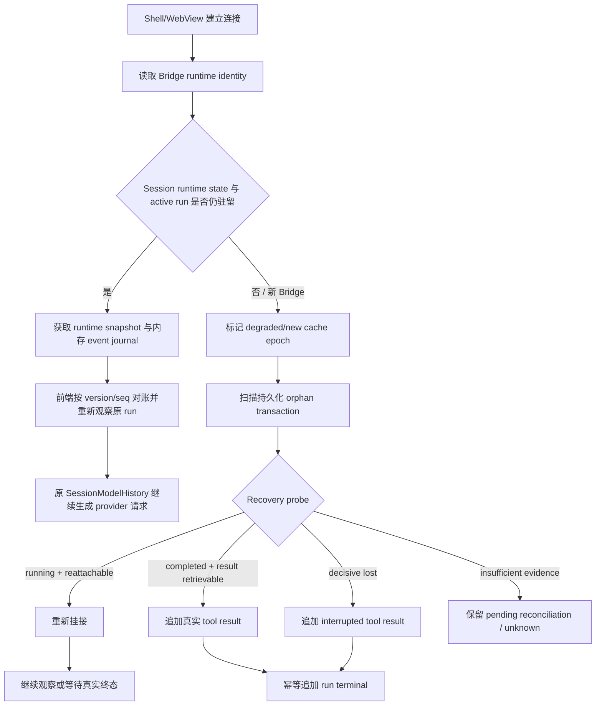
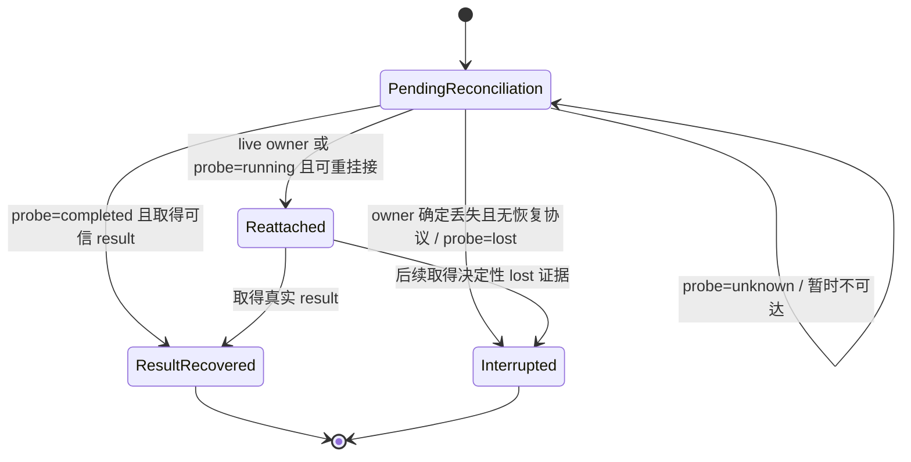

# 111 · Agent 运行连续性与执行效率 - 技术方案

## 状态

CONFIRMED

## 需求文档

[requirement.md](./requirement.md)

## 证据索引

[evidence-index.md](./evidence-index.md)

## 1. 方案摘要

本方案不把 agent-friend 改造成通用 durable workflow engine，也不新增跨进程 model transcript ledger。它在现有 `AgentRuntime`、`SessionManager`、`SessionModelHistory`、append-only Session、push 校准和 CommandRuntime 之上补齐两层能力：

1. **进程内重挂接**：Bridge、SessionManager、SessionModelHistory 和 run 仍存活时，Shell/WebView 通过运行实例身份、权威 snapshot 和短期内存事件 journal 重新观察原 run。模型执行不重启，provider history 不重建，下一次请求继续严格扩展原 final wire。
2. **跨进程事实对账**：Bridge 或电脑丢失后，新进程只从持久化业务 Session 恢复，并明确进入新 cache epoch。启动或打开 Session 时扫描未闭合工具事务；可恢复 operation 先 probe/reattach，证据不足保留 `unknown`，确定无法继续时追加宿主生成的 interrupted tool result 与 run terminal。

Skill activation、filesystem scope 和其它动态上下文继续遵守需求 110 的 append-only 规则：同一 cache epoch 中旧 item 不改写，变化只在尾部追加 delta；进程丢失后不通过持久化 Skill/Memory/runtime model-only 内容伪造旧 epoch。

命令运行时在现有治理边界内增加明确的进程事实和领域语义分层。通用 runtime 只报告 `process_status`，领域 wrapper 才能报告 `semantic_status`。上下文成本治理优先减少重复 contributor、重复正文、低信号结果和可由宿主确定完成的模型续轮，不把 DeepSeek 同进程低 cache read 当成本需求必须解决的根因。

## 2. 现状与缺口

当前实现已经具备大部分基础组件，但它们尚未形成完整恢复协议：

- 桌面 AG-UI run 使用 `ConsumerAbandonPolicy.DETACH`，HTTP/SSE consumer 消失不会自动取消 run；`AgentRuntime` 也保留 active/recent `RunSnapshot`。但是 `RunHandle` 没有重新附着接口，push subscriber 的序号和 turn buffer 只属于单个连接，WebView 重启期间的增量无法补取。
- 前端 `sessionSync` 已在 push 重连后执行 run、approval、command 与 Session 校准，并用 version/fence 防止旧 snapshot 覆盖新状态；但协议没有 Bridge runtime identity，前端无法区分同一 Bridge 重连与新 Bridge 上的业务 Session 恢复。
- `SessionManager` 已把 `SessionModelHistory`、`SessionModelContext`、ContextManager、cache epoch 和 prompt trace 放在进程内 session runtime state 中。同一 Manager 可保持严格前缀；新 Manager 会创建 `process_resume_degraded` epoch。
- 新进程当前从 `session.llm_messages` 重建 history。该投影仍可包含历史 `skill_context`、Skill catalog 和 provider reasoning 等 model-only event；这不能作为跨进程 exact continuation 的依据，也不应继续成为新 epoch 的完整 model-facing baseline。
- `Session.llm_messages` 会在模型投影中隐藏 unmatched tool request 并生成“上一轮工具调用未完成”的占位，但原 Session 中没有可信的 tool result 或 run terminal。UI、审计、后续恢复和模型投影因此使用不同事实。
- CommandRuntime 的 `CommandProcessSnapshot`、process registry 和 exec-server connection 都是进程内状态。Bridge/exec-server 丢失会得到 `runtime_lost`，但没有通用持久化 execution checkpoint，也没有启动后的事务对账入口。
- Skill filesystem scope 的已公告集合当前按 run 重置；scope 结束和 Skill 不再激活时没有稳定的尾部失效 delta。宿主权限能拒绝旧 scope，但模型历史可能仍把旧 item 当成当前能力。
- 命令 tool result 的 `status` 同时承担审批、启动、进程和部分业务含义；exit code、`is_error`、runtime lost 与领域成功之间没有统一分层。

## 3. 术语与不变量

### 3.1 术语

| 术语 | 含义 |
| --- | --- |
| Business Session | 持久化的 user、assistant、tool request/result、配置变化与运行终态等产品事实；跨进程恢复的唯一会话真相源 |
| Runtime instance | 一次 Bridge 进程生命周期及其拥有的 AgentRuntime、SessionManager 和 CommandRuntime |
| Session runtime state | 某个 runtime instance 内，由 SessionManager 持有的 SessionModelHistory、context、cache epoch 等状态 |
| Exact continuation | 下一次 provider final wire 严格扩展同一 runtime state 中的上一份 final wire |
| Cache epoch | 允许比较 exact continuation 的本地观测边界；进程丢失或影响前缀的配置变化会建立新 epoch |
| Tool transaction | 同一 `run_id + tool_call_id` 下从 request 到唯一 terminal result 的事务 |
| Operation | 工具启动后由宿主或外部系统拥有的执行实例；可能只在当前 runtime 存活，也可能支持查询或重挂接 |

### 3.2 强制不变量

1. runtime instance 变化必定结束旧 cache epoch；相同业务 Session、模型或 cache key 不能覆盖该事实。
2. Shell/WebView 重启本身不改变 runtime instance，也不改变 SessionModelHistory。
3. Session 原事件只追加，不删除、移动、替换或回写；model-only delta 同样只在当前进程 history 尾部追加。
4. 一个 tool transaction 只有一个模型可见 terminal result；一个 run 只有一个持久化 terminal。
5. `unknown` 是正式非终态；普通等待超时、一次 probe 失败或 Bridge generation 变化不能单独证明 operation 已丢失。
6. interrupted 表示宿主已确认原事务无法继续受管，不表示副作用一定没有发生；无法判定领域结果时必须是 `semantic_status=unknown`。
7. 跨进程恢复不新增 prompt、Memory recall、Skill 正文、provider reasoning、完整 tool transcript 或可逆内容指纹的持久化副本。
8. provider cache usage 只用于观测，不反向决定 runtime continuity。

## 4. 总体架构



方案包含五个局部组件：

- `RuntimeInstanceIdentity`：Bridge 启动身份与启动原因。
- `RunObservationJournal`：只在内存中保存当前 run 的有界、可补取事件序列。
- `ToolTransactionReconciler`：从业务 Session 识别未闭合事务并执行三值恢复裁决。
- `SessionCapabilityLifecycle`：记录当前进程 epoch 中已进入模型历史的 Skill/scope 生命周期。
- 现有 CommandRuntime 的加性状态协议：分开 process 与 semantic status。

不新增通用 plugin registry、跨进程任务调度器、完整 request cache 或第二套 Session store。

## 5. Runtime identity 与 cache epoch

### 5.1 `RuntimeInstanceIdentity`

Bridge 装配期创建一次不可变身份：

```python
@dataclass(frozen=True)
class RuntimeInstanceIdentity:
    bridge_instance_id: str
    supervisor_generation: int | None
    started_at: datetime
    start_reason: RuntimeStartReason
```

`bridge_instance_id` 使用进程启动时生成的随机 UUID，只用于本机运行身份。它不进入模型消息、普通业务消息或 cache identity；只有 `tool_execution_checkpoint` / `run_terminal` 这类内容无关恢复元事件可以记录 owner runtime id，用于证明旧 owner 是否仍存在。`supervisor_generation` 和 `start_reason` 由 Tauri supervisor 在受控启动时通过一次性启动参数传入；source mode 或非 Tauri 启动可以为空并使用 `direct_start`。

`RuntimeStartReason` 至少区分：

- `desktop_start`
- `controlled_restart`
- `default_model_changed`
- `model_provider_changed`
- `request_settings_changed`
- `service_recovery`
- `host_resume_unknown`
- `direct_start`

reason 只解释新 runtime 为什么出现，不决定 orphan operation 的终态。

### 5.2 与现有状态绑定

- `BridgeRuntime` 持有唯一 `RuntimeInstanceIdentity`。
- `AgentRuntime`、SessionManager 和 CommandRuntime 构造时接收相同 identity。
- `RunSnapshot` 增加 `runtime_instance_id`；RunHandle 从创建到终态不允许改变 owner。
- SessionManager 的 `_SessionRuntimeState` 增加只读 `runtime_instance_id`，并提供内容无关的 resident 查询；不公开 model history 正文。
- `SessionCacheEpoch` 在 runtime state 首次从已有业务 Session 建立时继续使用 `process_resume_degraded`，同时记录具体 `runtime_start_reason` 供 observation 分类。

### 5.3 配置变化

模型、Provider route、默认模型或 request settings 变化有两种实现路径，但 epoch 语义一致：

- Bridge 不重启：现有 `SessionCacheEpoch.prepare()` 在配置变更边界 advance，并记录具体 reason。
- Bridge 重启：新 runtime identity 天然建立新 epoch，Tauri 传入一次性 restart reason，SessionManager 仍从业务 Session degraded restore。

本需求不要求配置变化一定重启 Bridge，也不为追求 epoch 分类主动重启服务。

Tauri 的 restart intent 只绑定当前 supervisor operation/generation；启动成功后即消费。它不写入长期用户设置，避免异常退出后把旧意图错误归因给下一次普通启动。

## 6. A 类：Shell/WebView-only 重挂接

### 6.1 运行时 snapshot

新增聚合只读路由：

```text
GET /v1/sessions/{session_id}/runtime-snapshot
```

返回：

```text
runtime_instance_id
session_runtime_resident
cache_epoch_generation / reason
session_revision
active + recent RunSnapshot
pending approval snapshots
active command process snapshots
run event journal bounds
```

该路由不返回 model history、prompt、Memory、Skill 正文、命令正文或未在现有 UI 暴露的输出。各 owner 仍维护自己的 version；聚合 snapshot 不宣称跨多个 lock 的瞬时全局事务，而是为前端提供一次带 fence 的恢复基线。

### 6.2 `RunObservationJournal`

`ListenerRegistry` 当前按 subscriber 保存 turn buffer，subscriber 消失后该 buffer 也消失。新增 runtime-owned journal，在事件进入 subscriber fan-out 前按 run 记录：

```text
run_id
runtime_instance_id
event_seq
serialized ConversationEvent
approx_bytes
```

约束：

- journal 只活在 Bridge 内存，不写 Session、日志或 diagnostics。
- 每个 run 按 item 数和字节数双重限制；终态后随 recent run TTL 一起清理。
- 超限时优先丢弃可由 Session/command snapshot 重建的早期展示增量，并标记 `journal_truncated=true`；不影响模型执行和业务事件。
- `run_event` push envelope 增加 runtime instance 与 run-local `event_seq`，让 REST 补取和实时 push 可去重排序。

新增：

```text
GET /v1/runs/{run_id}/events?afterSeq=<n>
```

只允许读取仍属于当前 runtime 的 run。runtime id 不匹配或 run 已过 retention 返回明确的 snapshot refresh 指令，不把新 runtime 的同名 run 当作旧 run。

### 6.3 前端重挂接顺序

WebView 初始化或 push 重连时：

1. 先建立 push subscriber，并暂存收到的 versioned envelope。
2. 拉取当前 Session runtime snapshot。
3. 若 snapshot 的 runtime id 与 push envelope 一致，应用 run/approval/process snapshot。
4. 对 active run 拉取 journal；按 `event_seq` 应用并去重，再释放暂存的更高序号 push。
5. journal 截断或 Session revision 有缺口时，刷新业务 Session；后续新增量继续从 journal/push 接收。
6. 前端本地不存在旧 runtime id 时，不自行宣称 exact continuation；只消费 Bridge 返回的 `session_runtime_resident` 与 cache diagnostics。

AG-UI 原 SSE consumer 仍可 detach，AgentRuntime 的执行不依赖新 WebView 重新成为 primary consumer。重挂接补的是观察面，不重新调用 `Conversation.stream()`，因此不会重复 provider 请求、工具或副作用。

### 6.4 exact continuation 判定

A 类必须同时满足：

- runtime instance 未变化；
- SessionManager 仍持有同一 Session runtime state；
- active run owner 与 runtime identity 一致；
- SessionModelHistory 未发生 rewrite；
- model/provider/settings/tools/system 等没有触发其它 epoch advance。

只有 provider 下一次请求的 final-wire witness 实际得到 strict extension，observation 才报告 exact continuation。前端重挂接成功本身只是必要条件，不替代 wire 验证。

## 7. B 类：跨进程 orphan transaction 对账

### 7.1 新增持久化事实

新增两个加性 Session event。

#### `tool_execution_checkpoint`

工具完成 schema、权限、approval 和执行环境预检后，在真正调用工具主体或提交副作用之前，先追加 write-ahead execution checkpoint：

```text
payload:
  tool_call_id: str
  recovery_mode: resident_only | queryable | reattachable | none
  operation_id: str | null
  execution_state: launch_committed
meta:
  run_id: str
  owner_runtime_instance_id: str
  source: host
```

`operation_id` 只能是宿主预先分配或工具协议已有的 opaque、非凭据、非正文 operation identity。通用层不持久化 argv、环境变量、路径、prompt、stdout/stderr 或外部查询凭据。没有安全 durable id 的工具使用 `operation_id=null`。

checkpoint 表示宿主已提交“允许启动”这一事实，不证明子进程或外部副作用一定已经开始。若 checkpoint 后、实际 launch 前进程丢失，恢复结果仍是 transaction interrupted、execution/semantic unknown，不能写成“未执行”。命令 runtime 可以在 IPC 前先生成 process id 并写 checkpoint，从而消除“子进程已经启动但恢复元数据尚未落盘”的窗口。

checkpoint 不投影给模型；它只服务恢复、审计和 diagnostics 分类。

#### `run_terminal`

每个 run 正常完成、失败、取消或恢复中断时追加：

```text
payload:
  run_id: str
  status: completed | interrupted | failed
  reason_code: str
  source: runtime | startup_reconciliation
  recovered: bool
meta:
  owner_runtime_instance_id: str
```

它不投影为 user/assistant/tool message。运行时 snapshot、刷新投影和 diagnostics 可以消费它；旧消费者忽略未知加性 event。

### 7.2 Recovery capability

工具启动边界声明 `recovery_mode`：

| mode | 同 runtime | 新 Bridge | 典型行为 |
| --- | --- | --- | --- |
| `resident_only` | 可继续观察 | owner 丢失后不可继续受管 | 当前 CommandRuntime/exec-server process |
| `queryable` | 可观察 | 可凭 durable operation id 查询终态，但不能恢复控制 | 已有外部异步任务 API |
| `reattachable` | 可观察 | 可恢复查询、取消和结果通道 | 明确实现 durable lease 的工具 |
| `none` | 当前同步调用内完成 | 无恢复协议 | 普通进程内工具 |

首期使用静态、就近声明，不建立通用插件式 recovery registry。只有真实存在跨进程 API 的工具才提供小型 adapter：

```python
class ToolRecoveryAdapter(Protocol):
    def probe(self, checkpoint: ToolExecutionCheckpoint) -> RecoveryProbe: ...
    def reattach(self, checkpoint: ToolExecutionCheckpoint) -> ReattachedOperation: ...
```

`RecoveryProbe.outcome` 固定为：

- `running`
- `completed`
- `lost`
- `unknown`

`completed` 只有在 adapter 能取得可信最终 result 时才能闭合真实 tool result；仅知道外部 operation 不再 running 仍不足以推断业务成功。

### 7.3 Reconciler 入口

`ToolTransactionReconciler` 有两个入口：

1. Bridge readiness 后启动一个低优先级 background pass，遍历业务 Session 并处理 orphan；不因大量历史 Session 阻塞服务就绪。
2. `SessionManager.start_conversation()` 在已有业务 Session 上创建新 runtime state 前，必须在 session turn guard 内先完成该 Session 的同步 reconciliation。未完成对账时不得发起下一次 provider 请求。

扫描按 `run_id + tool_call_id` 建立事务：

- request + result：已闭合，不处理。
- request + no result + live run owned by current runtime：交给 A 类，不处理为 orphan。
- request + no result + checkpoint：按 recovery mode/probe 处理。
- request + no result + no checkpoint 且 owner runtime 已不存在：先允许 tool-specific adapter 按 `run_id + tool_call_id` 发现已有 durable operation；只有没有可发现恢复协议或 adapter 给出 decisive lost 时才追加 interrupted，`execution_state` 与 `semantic_status` 均保持 unknown；暂时不可达仍保留 pending reconciliation。
- 所有 tool transaction 已闭合但缺 run terminal，且原 owner 已不存在：追加 interrupted run terminal，表示原 turn 未完成。

### 7.4 三值裁决



以下事实可以支持 decisive lost：

- operation 明确声明 `resident_only/none`，且其 owner runtime identity 已不存在；
- Tauri owned process job 或 exec-server 明确报告进程树已终止；
- tool-specific durable API 返回带身份校验的 terminal lost/not-found，且协议定义该结果不可恢复；
- 宿主已确认原 operation lease 被撤销或替代。

以下事实单独不够：

- 一次 HTTP/IPC 超时；
- Bridge generation 变化；
- 未收到 push；
- 固定等待时长已过；
- 模型或旧 assistant 文案声称任务失败；
- OS PID 相同或不同，但没有创建时间/owner identity 约束。

### 7.5 宿主 interrupted result

确定无法继续时，复用标准 `tool_call_result` 事件闭合 provider tool pair，并增加加性字段：

```json
{
  "tool_call_id": "...",
  "tool_name": "...",
  "content": "原宿主运行实例已丢失，无法继续该工具事务；副作用结果未知。",
  "is_error": true,
  "transaction_status": "interrupted",
  "process_status": "runtime_lost",
  "semantic_status": "unknown",
  "execution_state": "unknown",
  "result_origin": "host_reconciliation",
  "reason_code": "owner_runtime_lost"
}
```

如果只能确认“受管通道丢失”而不能确认进程退出，`process_status=unknown`。该结果不得写“命令未执行”或“操作失败”，也不得建议自动重放具有副作用的调用。

对一批并行 tool calls，按原 response item 顺序闭合仍未完成的事务；已存在真实 result 的 item 保持不变。最后追加一个 run terminal。

### 7.6 幂等与迟到结果

reconciliation 在 Session turn guard 内执行以下 compare-and-append：

1. 重新加载最新 Session。
2. 重算事务是否已有 terminal result。
3. 只为仍未闭合的 key 追加 result。
4. 再检查并追加唯一 run terminal。

若进程在 result 与 run terminal 两次 append 之间再次退出，下次扫描只补 run terminal。若多个恢复入口竞争，后取得 guard 的入口重新加载后不重复追加。

正常 ToolResult commit 同样检查 transaction 是否已闭合。理论上不应在 decisive lost 后再出现真实结果；若发生竞态，拒绝第二个模型可见 result，记录 `late_tool_result_after_terminal` 内容无关诊断，并保留第一个终态。该冲突属于恢复不变量错误，不能静默覆盖 interrupted。

## 8. 跨进程 model history 与隐私

### 8.1 业务基线投影

`SessionModelHistory.from_session()` 拆成两个明确入口：

```text
from_business_session(session, reason="process_resume_degraded")
from_live_runtime(history_snapshot)
```

新 SessionManager 只能调用 `from_business_session`。该入口从业务消息投影构造 baseline，包含持久化 user、assistant 和已闭合 tool transaction，但不恢复：

- Skill 指令正文或 catalog model-only item；
- Memory recall；
- provider reasoning state；
- runtime capability、permission、surface、calendar 或 filesystem scope item；
- adapter final request 或 wire witness。

这些上下文在新 epoch 中按当前有效状态重新产生首次 snapshot。旧 Session 文件中的历史 model-only event 不删除、不迁移、不替换，但跨进程 baseline 忽略它们。

### 8.2 进程内 model-only item

当前进程新生成的 Skill/catalog/context delta 直接进入 `SessionModelHistory`，不再依赖 Session event 作为跨 Conversation 的载体。对应 fingerprint、已公告 ID 和 contributor snapshot 由 `_SessionRuntimeState` 持有。

业务 UI 所需的 Skill activation 状态继续走结构化实时事件或内容无关业务状态；不得为恢复 model prompt 顺序而把 Skill 正文写入 Session。

该调整不清理旧 `skill_context`、`skill_catalog_state` 或其它历史 event，满足 append-only 与兼容读取要求。

## 9. Skill activation 与 filesystem scope delta

### 9.1 `SessionCapabilityLifecycle`

在 `_SessionRuntimeState` 增加：

```text
announced_skill_activations
announced_filesystem_scopes
current_skill_activations
current_filesystem_scopes
last_boundary_run_id
```

它只保存 ID、version/fingerprint、状态和适用边界，不保存第二份 Skill 正文或绝对路径。

### 9.2 追加顺序

- 当前用户轮需要 Skill 时：user item 后追加 Skill instruction；同一 activation/version 在后续工具续轮不重复。
- Skill 在当前轮结束、不再选择、版本失效或被替换时：在下一 provider boundary、当前新 user item之前追加 `inactive/replaced` delta。
- Skill-bound filesystem scope 创建后，在第一次需要模型使用时追加 scope grant delta；同一 scope 不重复公告。
- scope 被撤销、所属 run 结束或进入下一用户轮时，在下一 provider boundary 追加 expired/revoked delta。
- scope 在同一轮中变化时，delta 必须先于下一次模型工具判断。

旧 item 保持原位置。delta 明确说明“旧事实只代表当时状态，不再授权”。宿主每次执行仍读取当前 `FilesystemCapabilityLedger` 和 Skill binding，不从 model history 推导权限。

### 9.3 进程边界

Bridge 丢失后 lifecycle state 一并丢失，新 epoch 不尝试重建旧 Skill/scope model-only 顺序。当前有效 catalog/permission/runtime capability 可以重新发首次 snapshot；turn-scoped scope 默认不存在，必须由新请求重新取得。

## 10. CommandRuntime 状态协议

### 10.1 两层状态

`ToolResult` 的模型可见 JSON 增加统一字段：

```text
process_status:
  not_started | running | exited | cancelled | timed_out | runtime_lost | unknown

semantic_status:
  succeeded | failed | completed_with_warnings | not_evaluated | unknown
```

通用 `exec_command` 和 `host_process_start` 不读取 stdout/stderr 推断领域语义，进程正常退出时默认 `semantic_status=not_evaluated`。只有拥有确定性业务协议的 wrapper 可以设置 `succeeded/failed/completed_with_warnings`。

| 场景 | process_status | semantic_status |
| --- | --- | --- |
| 参数、权限或环境预检拒绝 | `not_started` | `not_evaluated` |
| streaming process 仍运行 | `running` | `not_evaluated` |
| exit code 0 | `exited` | `not_evaluated`，除非领域 wrapper 明确裁决 |
| exit code 非 0 | `exited` | `not_evaluated`，通用 runtime 不等同业务失败 |
| 用户取消 | `cancelled` | `unknown` |
| 超时并确认终止 | `timed_out` | `unknown` |
| runtime/exec-server 丢失 | `runtime_lost` 或 `unknown` | `unknown` |

现有 `status`、`exit_code`、`is_error` 和 UI 字段首期保留兼容投影，但不再作为领域成功的唯一真相。新调用方优先消费双层状态。

### 10.2 命令恢复能力

当前 CommandRuntime 继续声明 `resident_only`：

- 同一 Bridge 且 exec-server connection、process registry 与 owner identity 仍存活时，可用现有 process id 查询、写入、取消和取得终态。
- WebView 重启只重新获取 CommandProcessSnapshot，不影响进程。
- Bridge/exec-server owner 丢失后，不根据 OS PID 猜测恢复；事务进入 `runtime_lost/semantic unknown`。
- 将来若 exec-server 提供经认证的 durable broker、creation identity 和输出/result store，再把该路径单独升级为 `reattachable`；111 不伪造该能力。

buffered 与 streaming 长命令都在获得批准、生成 process id 后，先追加 execution checkpoint，再调用 exec-server 的 `process/start`。若 start 明确失败，正常追加 `process_status=not_started` 的真实 tool result；不能等命令退出后才第一次记录 operation identity。

### 10.3 命令契约收敛

保留 `exec_command` 与 `host_process_start` 的明确能力面，并加强执行前确定性校验：

- `argv` 与 `cmd` 互斥/优先规则；
- managed alias、host executable 与 shell 路线；
- Windows 空格路径、引号和 PowerShell direct invocation；
- workdir、additional roots、Skill binding 和 current-turn scope；
- env key/value 形状、network、filesystem 与 timeout；
- 不支持恢复的长任务在启动前明确 `recovery_mode`。

所有已知非法组合在 approval 和 process start 前返回 `process_status=not_started`，避免先申请授权再发现命令根本不可执行。

## 11. 上下文成本治理

### 11.1 不改变的正确性边界

- 同一 epoch 中已进入 final wire 的 item 不删除、移动、替换或遮蔽。
- 需要清理大型 tool result 时继续使用显式 `tool_context_edit`/compaction，并建立正确的新 epoch/rewrite observation。
- model 判断所需的终态、标识符、副作用、错误、截断和恢复入口必须保留。
- 不为降低 token 使用把宿主 `unknown` 改写成模型猜测的成功或失败。

### 11.2 本地可控优化

1. Skill/catalog/scope/capability contributor 由 session runtime state 做 fingerprint gating；无变化不重复追加正文。
2. 失效只追加短 delta，不重复完整旧 Skill 或 scope snapshot。
3. 命令和 filesystem 工具在调用前完成可确定的 schema、路径、binding、managed/host 路由校验，减少无意义 tool-model 往返。
4. 通用命令 result 默认提供 bounded tail、终态、process identity、截断信息和恢复动作；完整输出沿用受治理查询能力，不重复塞入每次 tool continuation。
5. orphan reconciliation 由宿主完成；模型只看到最终可信 result 或明确 unknown，不为同一事务反复询问宿主状态。
6. 日志/diagnostics 记录 contributor 新增次数、tool result 字节分桶、provider/model continuation 数和 compaction 边界，定位本地增长来源。

### 11.3 评估口径

baseline 与 candidate 都按以下分段报告：

- 同一用户轮 tool continuation；
- 同进程跨用户首请求；
- Shell/WebView reattach 后首请求；
- Bridge/computer loss 后 new epoch 首请求；
- 模型/Provider/default 配置变化后的首请求。

每段同时报告 request relation、epoch reason、common prefix、input/prompt/cache read/cache miss、payload bytes、tool result bytes、模型调用数、续轮数和端到端时间。

需求 evidence-index 中的 5.42%、2.58%、98.82% 和独立 API 观测只作为 baseline/边界，不设为 111 的 provider 命中率 AC。candidate 即使降低总输入，也不能据此宣称解决了 DeepSeek 同进程低命中。

## 12. 协议与前端投影

### 12.1 Bridge 协议

加性变更：

- readiness/runtime meta 暴露 runtime instance、supervisor generation 与 start reason；
- RunSnapshot 增加 runtime identity；
- run event 增加 run-local sequence；
- 新增 session runtime snapshot 与 run event 补取路由；
- command process/result 增加 `process_status`、`semantic_status` 与 recovery mode；
- run terminal 和 reconciliation reason 进入 push/REST projection。

所有 route 继续使用现有本机 Bridge 信任边界；不把 lifecycle token、operation credential 或绝对敏感路径返回前端。

### 12.2 前端 store

`sessionSync` 增加 runtime identity fence：

- identity 相同：保留 active run/projected messages，执行 snapshot + journal reattach。
- identity 变化：清理只属于旧 runtime 的 transport、run event cursor、pending approval/process projection；刷新业务 Session，并显示 new epoch/degraded 恢复事实。
- run/approval/process 的既有 version fence 继续生效；旧 runtime envelope 永远不能覆盖新 runtime snapshot。
- pending reconciliation 不投影成 completed/failed/interrupted；只有持久化 terminal 到达后才收口。

本需求不重做工具卡或任务中心。现有 UI 只需准确显示 running、reconnecting、reconciling、interrupted/unknown 和终态；如实现必须改变布局，再按 frontend visual verification 规则单独确认。

## 13. Diagnostics 与隐私

### 13.1 结构化 reason

至少记录：

- `shell_webview_reattach`
- `push_reconnect_same_runtime`
- `bridge_restart_controlled`
- `bridge_restart_default_model_changed`
- `bridge_restart_provider_changed`
- `computer_or_owner_runtime_lost`
- `orphan_probe_running`
- `orphan_probe_completed`
- `orphan_probe_unknown`
- `orphan_owner_lost`
- `late_tool_result_after_terminal`

日志与 diagnostics 可以包含 event 类型、计数、状态、reason、run/tool identity 的安全不可逆关联和时间戳，但不包含 prompt、Skill/Memory/tool 正文、argv/env、完整 stdout/stderr、凭据或可逆 transcript digest。

### 13.2 Bundle contract

若实现增加 diagnostics capability 或 schema 字段，必须同步：

- Rust/Bridge producer machine contract；
- diagnostic schema revision 与兼容读取；
- `inspect-agent-friend-diagnostics` consumer、format reference 和 fixtures；
- 旧 bundle 读取回归。

需求 111 的 raw diagnostics ZIP 不复制入仓库或测试 fixture。

## 14. 主要代码影响

| 路径 | 变化 |
| --- | --- |
| `agent/src/agent/runtime/identity.py` | 新增 runtime identity 与 start reason 小型类型 |
| `agent/src/agent/runtime/models.py` | RunSnapshot runtime identity；journal/recovery 所需加性状态 |
| `agent/src/agent/runtime/listeners.py` | runtime-owned run event journal、run-local seq 与补取接口 |
| `agent/src/agent/runtime/__init__.py` | 装配 identity、resident run snapshot、terminal persistence hook |
| `agent/src/agent/sessions/events.py` | 加入 `tool_execution_checkpoint`、`run_terminal` event type |
| `agent/src/agent/sessions/recovery.py` | 新增局部 ToolTransactionReconciler 与 probe 类型 |
| `agent/src/agent/sessions/session.py` | transaction/run terminal 投影；跨进程业务 baseline；legacy model-only 忽略 |
| `agent/src/agent/sessions/manager.py` | reconciliation-before-model、runtime resident 查询、capability lifecycle state |
| `agent/src/agent/sessions/model_history.py` | 明确 live/process-resume 构造入口，保持同进程 append-only |
| `agent/src/agent/sessions/model_context.py` | Skill/scope lifecycle delta 状态 |
| `agent/src/agent/conversation.py` | execution checkpoint、正常 result/terminal commit、Skill/scope delta 与 model-only 内存化 |
| `agent/src/agent/command_runtime/models.py` | process/semantic status 与 recovery mode |
| `agent/src/agent/command_runtime/runtime.py` | process owner identity、同 runtime reattach snapshot、runtime lost 证据 |
| `agent/src/agent/command_runtime/tools.py` | 双层状态输出、checkpoint 与结构化预检 |
| `agent_bridge/src/agent_bridge/assembly.py` | runtime identity、reconciler 和 journal 装配 |
| `agent_bridge/src/agent_bridge/lifecycle.py` | readiness/runtime identity 与 start reason |
| `agent_bridge/src/agent_bridge/routes/runs.py` | runtime snapshot、event 补取和恢复状态路由 |
| `agent_bridge/src/agent_bridge/protocols/ag_ui/encoders.py` | reattach/reconciliation/terminal 加性映射 |
| `frontend/src-tauri/src/runtime_services/**` | one-shot restart intent、supervisor generation 与 Bridge 启动参数 |
| `frontend/src/stores/sessionSync.ts` | runtime identity fence、snapshot/journal 重挂接 |
| `frontend/src/stores/conversation.ts` | reconciling/unknown/terminal 投影与 cursor |
| `frontend/src/stores/commandRuntime.ts` | 双层状态与同 runtime process snapshot 对账 |
| 对应 agent/bridge/frontend tests | A/B/C 恢复矩阵、幂等、scope、命令和成本不变量 |

实现中可以把 recovery 类型放入现有职责更合适的相邻文件；不得为了文件清单形式新增空抽象层。

## 15. 验证方案

### 15.1 A 类确定性测试

- 同一 Bridge/runtime state 中主动销毁并重建前端 store，run 继续执行且没有取消或伪 terminal。
- push 断开期间产生 assistant/tool/process 事件，重连后 snapshot + journal 与实时 push 无重放、无缺口、无重复副作用。
- journal 截断时业务 Session refresh 与后续增量收敛。
- 同一 SessionModelHistory 的 WebView reattach 后，下一 provider request fixture 是上一 final wire 的 strict extension，cache epoch generation 不变。
- 同 runtime 但配置变化时，任务恢复与 new epoch 分类分开，不能错误通过 A 类 strict continuation AC。

### 15.2 B 类确定性测试

- request 已落盘、checkpoint/result/terminal 均缺失，新 Bridge 恢复为 interrupted + semantic unknown。
- request + resident-only checkpoint，owner runtime 丢失后追加唯一 interrupted result。
- queryable/reattachable adapter 分别返回 running、completed、lost、unknown；只有 completed/lost 收敛到终态。
- probe timeout、暂时不可达和 generation 变化保持 pending reconciliation。
- 同批部分 result 已完成、部分 orphan，只闭合 orphan 并保持原 item 顺序。
- 在 result append 后、run terminal append 前模拟崩溃，第二次恢复只补 terminal。
- background scan、lazy session open 和重复应用启动并发时仍只有一个 result/terminal。
- 迟到 result 不产生双终态，并记录内容无关冲突诊断。
- 新进程 baseline 不恢复 legacy Skill/Memory/provider reasoning model-only event，不新增敏感持久化。

### 15.3 C 类确定性测试

- default model、provider route、request settings 和普通 controlled restart 各自得到稳定 start/epoch reason。
- restart intent 只消费一次，不污染下一次无关启动。
- computer/强制退出没有用户配置原因时保持 `host_resume_unknown` 或明确 host-loss 分类。
- 新 runtime 即使 provider 返回 cache read，也不报告 strict continuation。
- 配置变化建立新 epoch，但 queryable external operation 仍能独立恢复。

### 15.4 Skill/scope 与命令测试

- Skill 激活正文只追加一次；下一用户轮追加 inactive delta，不移动旧 item。
- scope grant、同轮复用、mid-turn revoke 和 turn-end expiry 均只追加最小 delta；旧 scope 执行时确定性拒绝。
- 新进程不恢复旧 turn scope，必须重新授权。
- managed/host、argv/cmd、Windows 空格路径、additional roots、Skill binding 和 env/workdir 非法组合在启动前失败。
- exit 0/非 0 均不由通用 runtime 伪造 semantic success/failure；领域 wrapper 可以显式裁决。
- buffered/streaming 命令都生成 checkpoint，同 runtime 可查询，Bridge loss 后按 resident-only 收口。

### 15.5 成本与项目门禁

- final-wire fixtures 证明不变 contributor 不重复追加，变化只追加 delta，compaction/rewrite 建立新 epoch。
- baseline/candidate 报告需求列出的分段 metrics，不以 cache ratio 单项下结论。
- 运行相关 backend、bridge、frontend 单元/集成测试，以及项目 `scripts/check`。
- 本需求的 deterministic AC 不需要真实 LLM。若后续要复验 provider cache，按 `llm-api-confirm` 取得当次授权后单独执行，并在 evidence-index 记录模型、route、次数和局限。

## 16. 兼容与迁移

- 新 event 和 result 字段全部加性；旧 Session 原文不重写。
- 首次运行新版本时，历史 unmatched request 可以在 lazy/background reconciliation 中得到新 interrupted result；已闭合历史不改变。
- legacy `skill_context`、`skill_catalog_state` 和其它 model-only event 保留在原 Session 文件，但跨进程 business baseline 不再消费。
- 正常 run 从新版本起写入 `run_terminal`。老历史缺少 terminal 时只有在存在未完成 run 证据且 owner 已丢失时补 interrupted，不为普通已完成会话批量伪造 terminal。
- 旧前端可以忽略 runtime identity、journal seq 和双层状态字段；新前端仍兼容旧 Bridge 缺字段时降级为“无法证明 exact continuation”，而不是猜测同 runtime。
- `status`/`is_error` 兼容字段至少保留一个发布周期；移除需独立迁移证据和消费者盘点。

## 17. 风险与控制

- **误写 interrupted**：只允许 live owner、tool recovery adapter 和决定性 owner-loss 证据驱动；所有其它情况保留 unknown。
- **journal 占用内存或泄漏正文**：只在当前 Bridge 内存有界保留，terminal TTL 后清理，不进入 diagnostics；截断退回业务 snapshot。
- **Session scan 影响启动**：Bridge readiness 后后台扫描，当前 Session 在第一次 provider 请求前同步对账；两者共享幂等 guard。
- **operation adapter 过度抽象**：首期仅为真实具备 durable operation API 的工具实现；CommandRuntime 保持 resident-only。
- **interrupted 掩盖未知副作用**：transaction interrupted 与 semantic unknown 分开表达，不自动重放。
- **restart reason 错归因**：restart intent 绑定 supervisor generation 并一次性消费；未知来源不猜测为崩溃或配置变化。
- **append-only delta 推高输入**：用 fingerprint gating、短失效 delta、bounded tool result 和显式 compaction治理，同时保持原 item 顺序。
- **兼容字段继续被误用**：新代码和测试以 process/semantic status 为权威，旧 `status` 仅作 adapter projection。

## 18. 实施顺序

1. 引入 runtime identity、start reason、RunSnapshot identity 和 Tauri one-shot restart intent，建立 A/B/C 分类基础。
2. 实现 runtime-owned event journal、补取路由和前端 identity fence，完成 Shell/WebView reattach 与 final-wire strict-extension 测试。
3. 增加 execution checkpoint、run terminal、ToolTransactionReconciler 与 transaction first-terminal-wins，完成跨进程 orphan matrix。
4. 把跨进程 SessionModelHistory baseline 收敛为业务投影，并把当前进程 Skill/catalog/scope model-only state 收回 `_SessionRuntimeState`。
5. 实现 Skill/scope 失效 delta 与宿主权限回归。
6. 增加命令 process/semantic 双层状态、启动前预检和 resident-only recovery checkpoint。
7. 接入 metrics/diagnostics，按协议同步 diagnostic producer/consumer contract。
8. 运行定向测试、完整 `scripts/check` 和无需真实 LLM 的恢复 smoke；整理 AC 证据后进入用户验收。

## 19. Requirement AC 覆盖

| Requirement AC | 方案落点 |
| --- | --- |
| AC-A1～A4 | §5 runtime identity、§6 snapshot/journal 重挂接、§12 前端 identity fence、§15.1 A 类测试 |
| AC-B1～B6 | §7 write-ahead checkpoint 与三值 reconciler、§8 业务 baseline/隐私、§13 diagnostics、§15.2 B 类测试 |
| AC-C1～C3 | §5.3 配置与 restart intent、§7 独立 operation 对账、§15.3 C 类测试 |
| AC-D1～D2 | §8.2 process-local model-only state、§9 Skill/scope delta 与宿主 ledger |
| AC-D3～D5 | §10 命令预检、双层状态与 resident-only recovery、§15.4 命令测试 |
| AC-D6～D8 | §11 前缀/成本不变量、优化范围与分段指标 |
| AC-D9～D10 | §15 全部确定性回归、项目门禁与真实 LLM 授权边界 |

## 变更记录

| 日期 | 变更内容 | 是否影响需求范围 |
| --- | --- | --- |
| 2026-08-30 | 首次确认方案：同 runtime identity 下 snapshot+journal 重挂接；跨进程三值 orphan reconciliation；标准 tool result + run terminal 幂等闭合；Skill/scope process-local delta；命令 process/semantic 双层状态与本地成本治理 | 否，与已确认 requirement 一致 |
