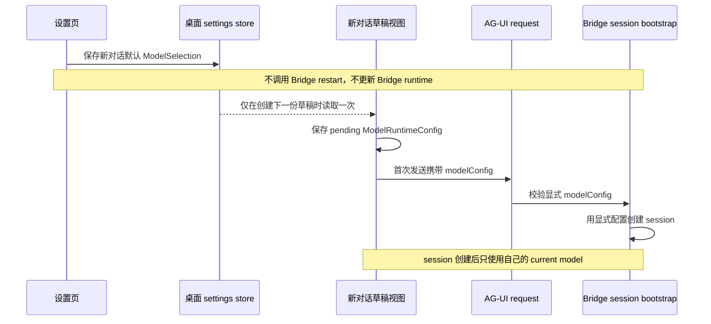

# 112 · 新对话默认模型 - 技术方案

## 状态

CONFIRMED

## 需求文档

[requirement.md](./requirement.md)

## 现状分析

### 默认值仍是渲染/发送时的懒回退

`frontend/src/pages/chat/components/Composer.tsx` 当前通过：

```ts
const selectedModel = currentModel ?? chatModel.model;
```

显示模型。`frontend/src/stores/conversation.ts` 在新 session 首次发送前也通过
`currentModel ?? resolveDefaultConversationRuntimeConfig()` 解析模型。

这意味着一份 `currentModel === null` 的新对话草稿没有自己的模型快照。只要用户尚未在草稿中显式切模，全局设置变化就可能在渲染或发送时改变它，不符合“只初始化一次”的语义。

### 首次发送已经具备显式模型链路

现有桌面发送链路已经提供本需求所需的核心能力：

1. conversation store 在发送接纳前取得完整 `ModelRuntimeConfig`；
2. `runAgentStream()` 把它写入 AG-UI `forwardedProps.modelConfig`；
3. Bridge decoder 校验 `model + reasoningPreset`；
4. AG-UI route 创建未知 thread 时优先使用该显式配置；
5. 已存在 thread 继续使用 session 自己的 current model。

因此不需要给 Bridge 增加默认模型热更新协议，只需保证桌面新草稿始终拥有显式配置。

### Bridge 启动仍会读取桌面 chatModel

`runtime_config.SettingsFileSource` 当前把桌面 settings store 中的 `chatModel.provider/model` 投影为 `LLM_CHAT_PROVIDER/LLM_CHAT_MODEL`。`agent_bridge.runtime_config.resolve_bridge_runtime_config()` 在启动时消费这两个值，并把结果装配为 `BridgeRuntime.default_model`。

如果只删除设置页的即时 restart，而保留该投影，之后任何无关 Bridge 重启仍会把桌面默认设置扩散到：

- AG-UI 未提供 model 的兼容 fallback；
- OpenAI/stateless 未提供 model 的 fallback；
- IM 首次创建 session；
- persona editor 首次创建 session；
- REST/Agent tool 新建 scheduled task；
- dev fire-source。

所以本需求必须同时切断桌面 `chatModel` 到 Bridge chat fallback 的配置投影。否则“只影响新对话草稿”只在当前进程暂时成立。

### 设置保存把 chat 与 memory 复用了同一 restart helper

`RuntimeConfigPanel.saveModelSetting()` 对 `chatModel` 与 `memoryModel` 都调用
`persistBridgeRuntimeSetting()`；后者在设置持久化后无条件调用 `restartLocalService("bridge")`。

两者生命周期不同：

- `chatModel`：桌面新草稿初始化偏好；
- `memoryModel`：Bridge 长生命周期 memory client 配置。

本需求只拆开 chat 分支；memory 与 credential apply 流程保持原样。

## 方案设计

### 总体数据流



### 1. 新对话草稿视图持有模型快照

继续复用 conversation store 已有的 `HOME_VIEW_KEY` 与 `SessionConversationView`，不新增第二套 draft-model store。

新增语义明确的工厂：

```ts
function newConversationDraftView(
  config = resolveDefaultConversationRuntimeConfig(),
): SessionConversationView {
  return {
    ...emptyView(),
    currentModel: config.model,
    currentReasoningPreset: config.reasoningPreset,
  };
}
```

这里 `currentModel/currentReasoningPreset` 在 `HOME_VIEW_KEY` 上表达 pending config；在真实 session view 上继续表达后端确认的 current config。两者都表示“这份 view 当前要使用的配置”，无需再复制字段。

初始化边界：

- conversation store 创建时，用 `newConversationDraftView()` 初始化当前 home view；
- 从已有 session 进入新对话且没有可恢复的 home draft 时，调用工厂创建；
- 离开并返回已有 home draft 时，复用缓存 view，不重新调用工厂；
- home draft 首次发送并成为真实 session 后，消费并移除旧 `HOME_VIEW_KEY` 缓存；下一次显式进入新对话时再按当时设置创建。

`emptyView()` 继续用于 session 加载、错误回退和无详情缓存，不隐式读取全局默认，避免普通 session 状态被桌面设置污染。

### 2. 草稿切模与首次发送只使用 view 快照

无 session 时，`selectRuntimeConfig()` 继续调用 model validation，但成功后只更新当前 home view 的
`currentModel/currentReasoningPreset`。它不写 `chatModel` 设置。

`send()` 必须从当前 view 捕获 `initialConfig`：

```ts
const initialConfig = requireCurrentDraftOrSessionRuntimeConfig(get());
```

正常路径不再在发送时调用 `resolveDefaultConversationRuntimeConfig()`。兼容旧内存状态时可以在一个明确的 normalization helper 中补建草稿快照，但补建完成后必须把配置写回 view，再继续发送；不能只为当前调用临时懒读。

捕获发生在 optimistic session/run 状态建立和 transport 启动之前。之后：

- optimistic session view 保存同一 config；
- `runAgentStream` 收到同一 config；
- 附件 capability 检查使用同一 model；
- Bridge 创建的 session 恢复为同一 config。

已有 session 的 send 路径继续从 session view 读取后端 current config，不访问全局默认设置。

### 3. 设置页拆分 chat 与 memory 保存流程

把 `saveModelSetting()` 拆为职责清楚的两个分支或两个 helper：

#### `chatModel`

1. 沿用现有 model validation，确保目标模型与凭据在保存时可用；验证不产生模型回答。
2. 调用 `setSetting("chatModel", selection)` 持久化。
3. 不调用 `persistBridgeRuntimeSetting()`、`restartLocalService()` 或 supervisor command。
4. 成功提示：
   - title：`新对话默认模型已保存`
   - description：`下次新建对话时将默认选择该模型；当前对话不会切换。`
5. 保存失败沿用 `setSetting` 的前端 cache 回滚，并显示“新对话默认模型未保存”。

设置页展示：

- group/字段文案改为“新对话默认模型”；
- 增加简短说明：“仅作为之后新建对话的初始模型，不会切换当前对话或重启服务。”

当前已经存在的 home draft 不订阅该保存操作，也不被主动改写。

#### `memoryModel`

继续使用当前 `persistBridgeRuntimeSetting(..., "request_settings_changed")` 与“已保存/已应用”反馈。本需求不改变 memory client 生命周期。

`persistBridgeRuntimeSetting()` 可以保留为 memory 专用兼容 helper；移除它对
`default_model_changed` 的前端调用与相应单测。Supervisor/Agent 的历史 restart reason 可以保留兼容，不因本需求做跨模块清理。

### 4. Bridge server fallback 与桌面设置解耦

`runtime_config.SettingsFileSource` 调整为：

- 不再从 `chatModel` 返回 `LLM_CHAT_PROVIDER` 或 `LLM_CHAT_MODEL`；
- 继续从 `memoryModel` 返回 `LLM_MEMORY_PROVIDER` 与 `LLM_MEMORY_MODEL`；
- 旧 `deepseekModel` 只作为桌面 settings 迁移输入，不再成为 Bridge chat fallback；
- process env 或其它显式 server runtime source 对 `LLM_CHAT_*` 的覆盖能力保持不变。

`resolve_bridge_runtime_config()` 在没有显式 server-side `LLM_CHAT_*` 时使用代码版本固定的 Bridge fallback provider/model。默认值从 provider catalog 取得，不复制具体 model id 字符串；当前产品 fallback provider 保持 Kimi，避免本需求无意改变非桌面入口的既有默认模型。

这个 fallback 只负责协议兼容与非桌面入口，不与桌面设置同步，也不需要热更新。

### 5. 专用 AG-UI 调用不再读取桌面 chatModel

普通桌面 chat 的 `RunStreamInput.modelConfig` 保持必传。

persona editor 当前也通过 `resolveDefaultConversationRuntimeConfig()` 构造 wire config，但后端创建 editor session 时并不消费该值。为防止桌面默认设置继续泄漏到非新对话入口：

- 基础 `buildRunAgentInput` 支持调用方不提供 model config 时省略 `forwardedProps.modelConfig`；
- 普通 desktop chat wrapper 保持 model config 必填；
- persona editor 不再读取桌面 `chatModel`，由其已有 session 或 Bridge server fallback 决定模型。

这样类型层能继续保证普通聊天显式模型，同时不迫使所有专用 Agent surface 继承桌面新草稿偏好。

### 6. 已有 session、run 与 Prompt Cache

本需求不调用以下 mutation：

- `SessionModelService.update/switch`；
- `Conversation.switch_model_config`；
- `SessionCacheEpoch.advance`；
- `SessionModelHistory.reconcile/prepare/commit`；
- runtime supervisor restart。

所以默认设置保存本身不产生任何 session epoch。已有 session 下一次请求仍使用其 current model 和既有 runtime state；在其它 prompt contributor 未变化时，Prompt Cache observation 应继续保持
`strict_extension`。

用户显式切换已有 session 模型时，继续由 model route 变化在目标 session 下一次请求建立局部 epoch。真实 Bridge 重启继续由 runtime identity 与 `process_resume_degraded` 表达，不受本需求修改。

## 并发与状态一致性

### 设置保存与草稿创建

设置持久化由 Tauri settings mutex 串行化。草稿创建通过同步的 `getSettingsSnapshot()` 取得一个完整
`ModelSelection`，再解析成 `ModelRuntimeConfig`。创建完成后不继续订阅设置值，因此不存在运行时 apply 竞态。

如果设置保存与新草稿创建并发，草稿得到原值或新值中的一个完整快照；不会得到 provider/model 混合状态。之后下一份新草稿一定读取最终保存值。

### 首次发送

conversation store 在接受发送前同步捕获 view config，并继续沿用现有 `modelSwitching`、history loading、edit/resend 和 active-run gate。设置变化不参与 session mutation，也不与 run scheduler 争锁。

### 多窗口

`settings://changed` 继续让各窗口更新保存的默认偏好，但事件只更新 settings cache。任何窗口中已经存在的 home draft view 不响应事件；之后由该窗口创建的新 home draft读取更新后的 cache。

## 错误语义

| 阶段 | 失败结果 | 状态 |
| --- | --- | --- |
| model validation | 显示缺凭据/不支持模型等既有错误 | 设置和草稿均不变 |
| settings persistence | 显示“新对话默认模型未保存” | `setSetting` 回滚 window cache；原设置继续有效 |
| 草稿显式切模 | 沿用会话模型选择的稳定错误 | 草稿保留原 pending config；全局默认不变 |
| 首次发送 admission/decode | 沿用既有 run error 与 optimistic rollback/refresh | 不回退或改写全局默认；重试仍使用草稿/session 已确认配置 |

不存在“设置已保存但 Bridge 尚未应用”状态，因为 Bridge 不消费这项设置。

## 涉及文件

| 文件路径 | 改动类型 | 说明 |
| --- | --- | --- |
| `frontend/src/pages/settings/components/RuntimeConfigPanel.tsx` | 修改 | 拆分 chat/memory 保存流程，移除 chat restart，修正文案 |
| `frontend/src/lib/runtime-config/index.ts` | 修改 | 收窄 `persistBridgeRuntimeSetting` 的 default-model 语义与测试 |
| `frontend/src/stores/conversation.ts` | 修改 | 新建 home draft 时快照默认 config；发送只使用 view config；消费后移除旧 home draft |
| `frontend/src/pages/chat/components/Composer.tsx` | 修改 | 模型展示只读当前 draft/session view，不再直接用 setting 做渲染 fallback |
| `frontend/src/services/stream.ts` | 修改 | 区分普通聊天必传 model config 与专用 surface 可省略 config |
| `frontend/src/services/api/persona.ts` | 修改 | persona editor 不再读取桌面新对话默认模型 |
| `runtime_config/src/runtime_config/sources.py` | 修改 | 移除 desktop chatModel 到 Bridge chat runtime 的投影，保留 memory 投影与显式 server source |
| `agent_bridge/src/agent_bridge/runtime_config.py` | 修改 | 为无显式 `LLM_CHAT_*` 的 Bridge 提供独立稳定 fallback |
| 对应 frontend/runtime_config/agent_bridge tests | 修改 | 固定草稿、wire、无 restart、fallback 解耦与兼容行为 |

实现时若发现更小的现有 helper 可以承载上述职责，允许就近复用；不得引入通用 runtime settings state、事件总线或额外配置服务。

## 测试设计

### 前端设置

- 保存 chat model：validation + `set_setting` 成功，不调用 `restart_runtime_service`。
- 保存 chat model 失败：恢复旧 setting，错误文案正确。
- 保存 memory model：仍调用 Bridge restart，既有反馈不回归。
- 成功 toast 与设置说明不包含“服务已重启/已应用到 Bridge”。

### 新对话草稿

- store 初始化时 home draft config 等于当时设置。
- 已有草稿含文字/附件/引用时修改设置，pending config 与草稿内容不变。
- 离开并返回 home draft，恢复原 pending config。
- 消费 home draft创建 session 后，再创建 home draft读取最新设置。
- home draft 显式切模后首次发送使用手动选择，全局设置不变。
- 普通 session 的加载、缓存驱逐和错误回退不因新草稿工厂读取设置。

### Wire 与 Bridge

- desktop chat 的每次首次发送都包含完整 `forwardedProps.modelConfig`。
- Bridge 未知 thread 使用显式 config 创建 session；已存在 thread 忽略默认 fallback并使用 current model。
- persona editor wire 不携带桌面 `chatModel`。
- settings fixture 中改变 `chatModel` 不改变 `resolve_bridge_runtime_config().default_model`。
- settings fixture 中改变 `memoryModel` 仍改变 memory config。
- 显式 server-side `LLM_CHAT_PROVIDER/MODEL` 仍覆盖 Bridge fallback。

### 连续性与 observation

- 默认设置变化前后，两个 resident session 的 runtime diagnostics 完全不变。
- 正在运行的 fake model stream 不被设置保存取消或替换。
- 设置变化后的已有 session 下一请求保持原 model route/cache epoch；固定 observation 在正常追加条件下为 `strict_extension`。
- 显式切换其中一个 session 后，只该 session 的下一请求得到 `model_route_changed`。
- 真正重建 SessionManager/Bridge 仍得到 `process_resume_degraded`。

### 项目门禁

- 运行受影响的 frontend、runtime_config、agent_bridge 和 agent 定向测试。
- 运行 `scripts/check` 全量门禁。
- 本需求默认不执行真实 LLM 调用；若后续需要真实 Prompt Cache smoke，另按单次授权执行。

## 影响分析

### 上游

- 设置页仍保存同一 `chatModel` 数据结构，不需要 settings 文件迁移。
- 模型目录、provider 归属和 reasoning preset 继续使用现有统一事实源。

### 下游

- 普通桌面对话首次发送变得完全显式，不再依赖 Bridge default。
- Bridge restart 后非桌面入口不再受桌面偏好影响；其 server fallback 保持稳定。
- memory model 与 credential/tool runtime 不变，不扩大本需求验证范围。

### 兼容

- 已有 settings 文件继续可读；`chatModel` 仍供桌面 UI 使用。
- Bridge 继续接受缺少 model 的兼容请求，只是 fallback 不再取桌面偏好。
- `default_model_changed` runtime start reason 可保留读取兼容，但产品正常路径不再产生该 reason。

## 风险与控制

- **草稿被过早重建**：只有明确创建新草稿或旧草稿已消费时调用初始化工厂；普通导航恢复缓存。
- **发送仍有隐藏懒回退**：测试要求正常首次发送前 view config 非空，transport 精确等于 view config。
- **Bridge fallback 无意变化**：用固定 catalog fallback 和 settings A/B fixture证明 chatModel 不影响它，同时保留显式 server override。
- **专用 surface 继续泄漏设置**：扫描 `resolveDefaultConversationRuntimeConfig()` 调用方，普通 chat 之外逐项移除或证明其属于新对话草稿。
- **顺手改其它 restart**：memory、credential、tool、voice 路径保持原实现与回归测试；发现问题另行分诊。

## 变更记录

| 日期 | 变更内容 | 是否需要重新实现 |
| --- | --- | --- |
| 2026-08-31 | 首次确认：以桌面新草稿快照 + 首次发送显式模型替代 Bridge 默认模型热更新；切断 desktop chatModel 到 Bridge fallback 的启动期投影 | 是 |
