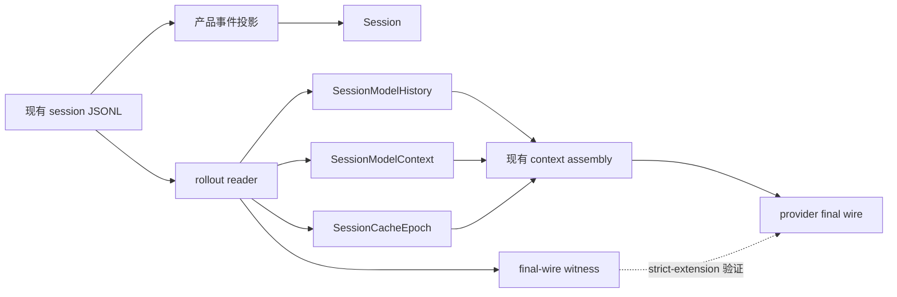
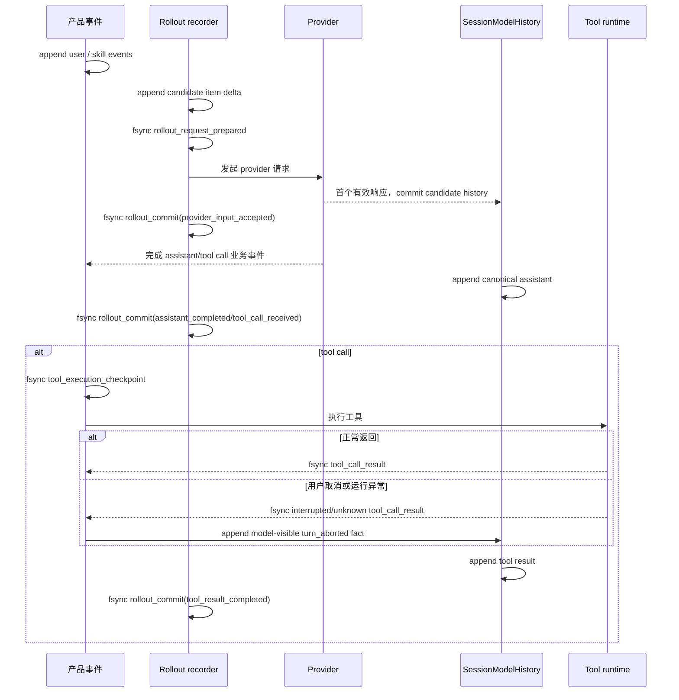

# 113 · 会话流水持久化与重启恢复 - 技术方案

## 状态

CONFIRMED

## 需求文档

[requirement.md](./requirement.md)

## 现状分析

### 当前权威与持久化边界

- `SessionModelHistory` 保存当前 Bridge 进程内真正采用的规范化 `Message` 序列，是运行时 model transcript 权威。
- `JsonlSessionStore` 已用一个 session JSONL 保存产品会话事件，包括用户与 assistant 消息、tool call/result、reasoning state、compaction、模型和 persona 变更等。
- 日期、surface、权限、runtime capability、Memory recall 和一部分 turn context 只存在于进程内；Skill 事件也不足以恢复所有当时实际采用的模型正文和位置。
- `SessionCacheEpoch`、`SessionModelContext` 和精确 final-wire witness 都是进程内状态。新进程只能从业务消息建立 `process_resume_degraded` baseline。
- 当前工具恢复器不会重新执行原工具：它只探测、重新连接、补交已有结果或写入 interrupted/unknown 结果。需求实现必须保留该边界。

### 当前请求提交顺序

一次普通用户轮当前按以下顺序推进：

1. 持久化用户业务事件及 Skill 选择事件；
2. 召回 Memory、生成动态 model context，并组装候选 model history；
3. 发起 provider stream；
4. provider 返回首个有效事件后，将候选 history、model context 与 cache epoch 提交到进程内状态；
5. 完成 assistant 或 tool call 后写业务事件并追加到 `SessionModelHistory`；
6. 工具执行前写 execution checkpoint，完成后写 tool result 并追加到 model history。

新增 rollout 必须贴合以上边界，不能让“已组装”误等于“provider 已接受”，也不能在恢复时把尚未完成的 turn 当作终态。

## 方案设计

### 总体结构

继续使用现有 session JSONL 作为同一份本地会话流水文件，在其中增加 rollout 专用事件。产品事件与 rollout 事件处于相同安全、删除和保留边界，但形成两个职责明确的投影：

- `Session` 从产品事件投影 UI、业务历史、Memory source 与会话 metadata；
- rollout reader 从已完整提交的 rollout 事件重建 `SessionModelHistory`、`SessionModelContext`、`SessionCacheEpoch` 和 final-wire witness；
- 仅当旧会话完全没有 rollout commit 时，migration builder 才能读取一次 `business_llm_messages`，并在 writer lease 内同步提交 `legacy_migration` checkpoint；提交后该业务投影不再参与跨进程 model history 恢复；
- 恢复完成后，后续 provider input 仍由现有 `SessionModelHistory → context manager → provider renderer` 链路生成。

rollout 不保存完整 provider request body。final-wire witness 只保存不可逆摘要、item role/domain 和 envelope identity，用于下一次请求比较。

### 身份定义

| 身份 | 语义 | 生命周期 |
|---|---|---|
| `session_id` | 用户可见产品会话的稳定身份，也是会话文件和 provider cache key 的现有绑定 | 创建会话时生成，hard delete 时消失 |
| `rollout_id` | 该 session 内持久化 model transcript 流水的稳定身份 | 首次建立 rollout 时生成；损坏降级和 compaction 不改变 |
| `segment_id` | 一段可由前一完整 commit 确定性应用的 rollout 写入段 | transcript rewrite、尾部损坏续写或 legacy migration 时新建 |
| `cache_epoch_id` | cache identity 兼容、允许比较 strict-extension 的世代身份 | model/provider/persona/system/tools/settings/compaction 等不兼容变化时更新 |

`cache_epoch_id` 与数值 `generation` 同时保留：ID 用于跨进程稳定关联，generation 用于排序和现有诊断兼容。

### Rollout 事件

在现有 `Event` schema 中增加以下纯加性类型：

| 事件 | 作用 | 是否能单独成为恢复点 |
|---|---|---|
| `rollout_segment` | 声明 `rollout_id`、`segment_id`、父 commit、schema 版本和开段原因 | 否 |
| `model_transcript_item` | 保存一条规范化 `Message` 快照及 ordinal/source 关联 | 否 |
| `rollout_request_prepared` | provider 调用前的 write-ahead 标记，引用候选 transcript delta 与 cache manifest | 否 |
| `rollout_commit` | 原子声明一组 item 已成为可恢复 history，并保存 boundary、hash、context、epoch 与可用 witness | 是 |

每个 `model_transcript_item` 保存：

- `role`、`content`、`uuid`、UTC timestamp；
- 会影响 `Message.to_openai()` 或恢复语义的 metadata；
- attachment/reference 的规范化投影；
- `prompt_cache_domain`、model-only/synthetic 标记；
- 可确定时的 `source_event_uuids`；
- 所属 segment、ordinal 和内容摘要。

`rollout_commit` 不重复保存全部正文，只引用本次追加或 replacement 所需的 item 事件，并记录最终 item count 与 transcript hash。正常 append 只写 suffix；compaction、edit/resend 或其它 rewrite 新建 segment 并逐条写 replacement history。

### Epoch manifest

每个 `rollout_request_prepared` 与 `rollout_commit` 都携带版本化 epoch manifest：

- `cache_epoch_id`、generation、reason；
- model route snapshot：产品 model ID、provider ID、provider model、client/transport identity、API base；
- persona ID 与当时完整 system prompt snapshot；
-规范化 tool schema/capability snapshot；
- cache-relevant request settings；
- transcript schema/version；
- compaction checkpoint identity和 history generation；
-上述字段各自 fingerprint 及 manifest 总 fingerprint。

manifest 只从白名单字段构造。API Key、Authorization、Cookie、访问令牌、宿主权限凭据和客户端对象不会进入 manifest。静态内容恢复时使用保存的 canonical snapshot；当前资源只用于 fingerprint 兼容校验，不用于改写旧 transcript。

### 消息与状态序列化

- `Message` 使用明确字段序列化，不整体序列化任意运行时对象。
- metadata 做递归键过滤，凭据型字段直接拒绝或移除；正文作为当时实际 model transcript 保存，不做会破坏 exact continuation 的启发式改写。
- `SessionModelContext` 保存初始化 contributor 集合及 calendar、surface、channel、permission version、runtime capability 和 capability catalog 的最后快照，避免重启后无条件重复注入 snapshot。
- `SessionCacheEpoch` 增加稳定 epoch ID 和 manifest 恢复能力。
- final-wire witness 保存完整的不可逆 witness 字段，不保存 request body。恢复后 tracker 可以做 exact-item 比较，但 witness 仍不能生成 history。

### 提交时序

具体规则：

- provider 调用前必须完成 `rollout_request_prepared` 的 flush+fsync。它只是 write-ahead 事实，不是可恢复 commit。
- provider 首个有效事件出现后，先按现有语义提交进程内 candidate，再写 `provider_input_accepted` commit。
- completed assistant 在业务事件与 `SessionModelHistory` 均成功后写 commit。无后续 tool call 的 commit 标记 `turn_terminal=true`。
- tool call 的 canonical assistant/tool call item 必须在工具执行前 commit；execution checkpoint 仍是“工具可能已产生副作用”的权威判断。
- tool result 加入 history 后写独立 commit；错误、取消和 unknown 结果与成功结果使用相同的 call/result 闭合协议。后续最终 assistant terminal commit 才使正常 turn 成为 exact-restorable 终态；被取消的 turn 以闭合后的 interrupted commit 作为安全续聊边界。
- partial assistant 不作为完整 assistant item commit；恢复时保留产品事件，但只恢复到最近完整 rollout commit，并进入 interrupted epoch。

### 恢复算法

1. 在 session 生命周期开始时取得 writer lease；失败则拒绝成为该 session 的可写 runtime。
2. 逐行读取 JSONL，验证 UTF-8、事件 schema、segment/commit 链、item ordinal、count 和 transcript hash。
3. 仅应用完整 `rollout_commit`；孤立 item、prepared request 和半截 commit 全部忽略。
4. 最新 commit 为 `turn_terminal`、cache manifest 可读、业务 model-relevant 事件没有未覆盖 suffix 且文件没有未处理损坏时，恢复为 exact candidate。
5. 最新 commit 是 provider/tool 中间边界或有未覆盖业务 suffix 时，恢复到最后安全 transcript 后进入 `interrupted_turn` 新 epoch；不自动重新提交用户请求或重新执行工具。
6. 无 rollout 的老会话先构造 `legacy_migration_pending` 候选：从现有 `business_llm_messages` 提取仍可恢复的规范化历史，并建立原因固定为 `legacy_migration` 的新 epoch。该候选还不是可运行的持久化事实。
7. `SessionManager` 在持有 writer lease 时立即写入完整 migration segment 与 terminal checkpoint；checkpoint 明确标记 `exact_eligible=false`、原因 `legacy_migration`。写入失败则释放 lease 并拒绝建立 runtime。
8. 成功迁移后 runtime disposition 为 `legacy_migrated`。重复重启直接从 migration checkpoint 重建同一 `SessionModelHistory` 和 epoch，不再次读取业务消息，也不再次推进 epoch；完成一轮新的 provider terminal commit 后，后续重启才可以成为 exact candidate。
9. 完整恢复后把 item 重建为新的 `SessionModelHistory`；后续 assembly 不读取 final wire 或业务事件重拼已恢复 transcript。
10. 已出现未知/损坏 rollout 且没有任何有效 commit 时不进入 legacy migration：原产品事件仍可只读投影，但 `SessionManager` 拒绝建立 writable runtime，防止业务历史变成隐式恢复 fallback。

恢复 disposition 使用稳定值：`fresh`、`exact`、`legacy_migration_pending`（仅内部迁移候选）、`legacy_migrated`、`interrupted`、`truncated_tail`、`incompatible_schema`、`corrupt_committed_history`、`writer_conflict`。

### 损坏与写入一致性

- `JsonlSessionStore` 新增批量 append：同一文件锁内写入多行，最后 flush+`fsync`；普通单事件 append 复用该路径。
- append 前检查文件是否以换行结束。若上次崩溃留下半行，先补换行，使坏尾成为独立记录，不覆盖原字节。
- reader 可以忽略最后完整 commit 之后的坏行。首次续写先追加带 `starts_after_corruption=true` 的新 segment，并建立 `truncated_tail` epoch。
- 已有恢复 segment 后，后续读取允许跨过原坏行，但只能从明确的新 segment 继续。
- committed chain 中间损坏、hash 不符、base commit 不连续或未知破坏性 schema 不允许跳过后宣称 exact；运行时降级到安全业务 baseline 或明确阻止写入。
- 日志只记录行号、字节数、hash、disposition 和原因，不复制损坏正文。

### 并发与 writer 所有权

- `SessionManager` 为每个 resident session 只创建一份 runtime state 和 recorder，多个窗口复用。
- `JsonlSessionStore` 为每个 session 提供独立 OS advisory writer lease 文件；lease 生命周期覆盖 resident runtime，而不是单次 append。
- 第二个 Bridge 可以只读打开会话，但在 `start_conversation` 获取 lease 时得到明确 `SessionWriterConflictError`。
- 现有同 session run ownership/串行化继续负责 provider 并发；rollout recorder 在单 writer 内保持同步追加，不引入第二套调度器。
- hard delete 前释放本进程 lease；archive 不释放或删除 rollout。

### 工具副作用恢复

工具执行恢复继续以现有业务事件为准：

- 没有 `tool_execution_checkpoint`：表示宿主尚未承诺开始执行，可以由正常当前 turn 逻辑处理，但重启恢复不自动提交旧 turn。
- 有 checkpoint、无 result：只允许 adapter probe、resident reattach、补写已知结果或 interrupted/unknown；禁止调用原工具。
- 有 result：恢复其 canonical tool item，不再执行。
- rollout 只持久化模型看到的 call/result 顺序，不取代 checkpoint 的副作用裁决职责。

### 命令过程证据 checkpoint

命令输出分成三层状态，不把 UI progress、执行事实和最终业务结果混成同一个概念：

- `tool_execution_checkpoint` 继续只表示“宿主已承诺开始执行”，不承载输出正文，也不因过程证据而改变其单次 write-ahead 事实语义。
- `CommandRuntime` 的内存 snapshot 是当前进程内的实时权威；前端 `command_process_changed` 仍只是 UI 投影，不参与恢复裁决。
- 新增 session-owned tool execution evidence store，为每个命令 `operation_id` 保存一份最新的原子快照。该快照是运行中的恢复 checkpoint，不是第二套 model transcript；只有成功完成原子替换的版本才是可恢复事实。
- 正式 `tool_call_result` 仍是模型可见工具结果的唯一权威。过程证据只在正式 result 缺失且事务已中断时，用于合成一个匹配的 interrupted result。

证据快照由独立的内部类型定义，首期 `kind=command_output`，包含：

- 稳定 `evidence_ref`、`run_id`、`tool_call_id`、`operation_id`、`tool_name` 和 evidence schema version；
- `source=host_command_runtime`、`complete=false`、捕获时的 process status 与单调 `output_seq`；
- 已到达宿主的有界 `stdout`、`stderr`、PTY 尾部，以及 `dropped_bytes`；
- 内容 hash、字节长度和完整性字段，供 reader 拒绝半写、越界或错配快照。

快照放在 `agent.paths` 管理的用户数据根下，不放进命令可见的 session workspace，也不向模型或诊断暴露绝对路径。每次写入使用同目录临时文件、flush + `fsync` 和 atomic replace；输出更新按固定时间/字节门槛节流，取消和终态路径强制同步刷新。快照正文复用现有 `CommandProcessSnapshot` 尾部上限，再增加 session 级总额；配额、I/O 或完整性检查失败时显式退化为无可信证据的 interrupted/unknown，不使用 UI 内容补造。

命令正常完成并已提交正式 result 后，未被引用的 active snapshot 可删除。命令中断时，同一 `evidence_ref` 的 snapshot 冻结为受 session 生命周期管理的证据：

- interrupted result 复用现有 `MAX_RESULT_OUTPUT_BYTES` 预算内联有界预览，并带 `partial=true`、`complete=false`、来源、`output_seq`、`dropped_bytes` 和稳定 `evidence_ref`；
- `recover_tool_result` 在保持原 `result_ref` 行为的基础上支持模型原样提供的 `evidence_ref`，仍只允许从当前 session 中已闭合、active 的 tool result 反向验证引用，再按 query/offset 有界读取；
- 快照只保存命令本来会进入 tool result 的输出字段，不序列化 argv、env、审批对象、宿主凭据或整个 runtime 对象。

该证据类型以 `kind + schema_version` 扩展；未来其它流式工具可以提供自己的有界 payload 和 renderer，但不为本期预建通用事件溯源或 exactly-once 平台。

### 取消终结与 Provider 前完整性门禁

取消终结由 `Conversation` 负责，因为它同时持有本轮 call 列表、session 事件、`SessionModelHistory` 与 rollout recorder。`ToolBatchExecutor` 继续只负责有界执行和协作取消，不自行写会话状态。

- 工具 batch 因用户取消或其它 `BaseException` 退出时，`Conversation` 在重新抛出异常前逐个检查本 batch 已进入模型历史、但尚无 result 的 call，并追加幂等的 `tool_call_result`。
- 幂等键使用 `(run_id, event_tool_call_id)`；已有结果时原结果胜出，不因重复取消、finally、启动恢复或下一轮 preflight 再追加第二条。
- 明确未被执行器接纳的 call 写入 `transaction_status=interrupted`、`process_status=not_started`、`semantic_status=not_started`、`executed=false`。缺少 `tool_execution_checkpoint` 本身不足以证明未执行，因为并非所有工具都提供宿主 checkpoint。
- 已被执行器接纳或已有 execution checkpoint 的 call 写入 `transaction_status=interrupted`、`process_status=cancelled_or_detached`、`semantic_status=unknown`、`executed=unknown`；正文明确说明工具可能已部分执行，应先查询实际状态再决定是否重试。命令工具存在可信 evidence snapshot 时，正文同时投影其有界预览与引用，但不改变 unknown 语义。
- interrupted result 复用现有 `tool_call_result` 事件和 `tool_result_completed` rollout boundary，不新增第二套事务事件；`result_origin` 标记为 `runtime_cancellation` 或 `history_preflight_repair`。
- 普通取消时，命令的 cancel callback 先在有界时间内终止进程并强制刷新 evidence snapshot，再返回给 `Conversation` 闭合事务。若自然终态和取消竞态，已提交的正式 result 胜出；证据不得产生第二个 result。
- Bridge 重启恢复时，`ToolTransactionReconciler` 先用同一事务键找 execution checkpoint，再校验其 `operation_id` 对应的 evidence snapshot。有效证据交给与普通取消共用的 renderer，生成稳定的 interrupted result；无证据、坏证据或未接入工具继续使用现有 generic unknown 结果。
- 两条路径使用相同 `evidence_ref`、同一快照版本和同一 renderer；正文不带绝对路径或非稳定时间戳，以保证同进程续聊与 Bridge 重启后恢复内容一致。
- 所有缺失 result 闭合并提交 rollout 后，追加一条 `synthetic=turn_aborted` 的 model-only system message，携带稳定 `run_id` 和不含工具正文的中断说明。该事实只进入模型 transcript/rollout，不生成用户可见聊天消息；同一 run 只追加一次。

Provider 请求采用两级门禁：

1. 新用户轮开始并完成 session/history reconcile 后，扫描 canonical `SessionModelHistory`。若发现有持久化 request、无 result 的旧 call，按 execution checkpoint 与 run terminal 事实补写 interrupted/unknown result，并提交新的 rollout commit；不得执行原工具。
2. `ContextManager` 完成裁剪和上下文组装后、构造 `ModelRequest` 前，再验证最终 messages 中每个 assistant tool call 都恰有一个匹配 tool result，且不存在孤立或重复 result。仍无法闭合的历史以稳定的本地完整性错误终止并记录 call/run ID，不向 provider 发送已知非法请求。

该门禁只维护模型协议和已持久化事务的安全终态，不提供业务级 exactly-once：它不推断工具领域操作是否成功，不自动补偿，也不自动重试可能有副作用的调用。正常中断闭合、发送前兜底和 turn-aborted 事实共同保证同进程与跨进程续聊使用相同安全语义。

### 删除、保留与安全边界

- rollout 与产品事件共处同一 session JSONL，所以 archive 天然保留，hard delete 与批量删除天然同时删除正文和 rollout。
- tool execution evidence 是 session-owned 用户数据：archive 保留，hard delete 和批量删除必须同步删除对应证据目录，恢复/启动清理只能删除已有正式 result 且不再被 active result 引用的孤立 snapshot。
- writer lease 文件不含正文；hard delete 会在安全释放后清理当前 session 的 lease 文件、tool evidence 和现有 command workspace/metadata。
- 不新增自动过期策略；沿用 session 生命周期。
- 默认诊断只暴露 ID、generation、reason、fingerprint、item count、hash、证据字节数和恢复 disposition，不输出 evidence 正文或本地路径。

### Prompt Cache 验证

- terminal commit 保存上一轮 final-wire witness 和 content-free cache diagnostics。
- 恢复时将 witness 注入 `PromptCacheTraceTracker` 的跨进程 exact anchor。
- 下一次 provider request 由 provider transport 产生新的 final-wire witness，并与恢复 witness 比较。
- `strict_extension` 只证明客户端 final wire 延续；provider `cache_read/input_total` 独立报告。
- cache manifest 不兼容时先推进 epoch，并禁止将偶然 cache hit 报告为 exact continuation。

## 涉及文件

| 文件路径 | 改动类型 | 说明 |
|---|---|---|
| `agent/src/agent/sessions/rollout.py` | 新增 | rollout schema、序列化、recorder、reader 与恢复结果 |
| `agent/src/agent/sessions/events.py` | 修改 | 增加 rollout 事件类型 |
| `agent/src/agent/sessions/store.py` | 修改 | 批量 fsync append、坏尾读取、writer lease 与冲突错误 |
| `agent/src/agent/sessions/session.py` | 修改 | 承载只读加载诊断，确保 rollout 事件不进入业务投影 |
| `agent/src/agent/sessions/model_history.py` | 修改 | 从持久化 item 恢复并忽略 rollout 自身事件 UUID |
| `agent/src/agent/sessions/recovery.py` | 修改 | terminal run 仍需闭合缺失 result，并统一 provider/event call ID 的事务关联 |
| `agent/src/agent/sessions/tool_execution_evidence.py` | 新增 | 有界 evidence schema、原子快照 store、引用校验与 interrupted result renderer |
| `agent/src/agent/sessions/model_context.py` | 修改 | snapshot 序列化与恢复 |
| `agent/src/agent/sessions/cache_epoch.py` | 修改 | 稳定 epoch ID、manifest 恢复和兼容判断 |
| `agent/src/agent/sessions/manager.py` | 修改 | writer lease、rollout restore、runtime state 共享、evidence store 注入和删除清理 |
| `agent/src/agent/paths.py` | 修改 | 提供不暴露给命令 workspace 的 tool evidence 用户数据路径 |
| `agent/src/agent/command_runtime/runtime.py` | 修改 | 按节流门槛发布可持久快照，在取消/终态强制刷新 |
| `agent/src/agent/command_runtime/tools.py` | 修改 | 绑定 evidence callback、取消终止和命令过程证据 |
| `agent/src/agent/conversation.py` | 修改 | prepared/accepted/assistant/tool/terminal 提交接点，以及 evidence-aware 取消闭合 |
| `agent/src/agent/tools/builtin/tool_result_recovery/tool.py` | 修改 | 在当前 session active result 授权下有界读取 `evidence_ref` |
| `agent/src/agent/prompt_cache_trace.py` | 修改 | 恢复精确 final-wire witness anchor |
| `agent/tests/test_session_rollout.py` | 新增 | 持久化、恢复、损坏、epoch、writer、删除与凭据隔离测试 |
| 既有 command/conversation/recovery/cache 测试 | 修改 | 补取消竞态、有界输出、引用恢复、跨 Bridge 一致性与无重放覆盖 |

本次过程证据修订在已完成的取消闭合上增加一个小型 session-owned evidence 模块；不改变 rollout transcript 事件格式，不把临时 UI delta 写成 model history，也不扩展为所有工具的通用恢复平台。

## 影响分析

### 上下游影响

- Bridge 和桌面应用 API 仍返回相同业务投影；新增的 tool evidence 路径只是 `agent.paths` 管理的 session-owned 内部用户数据，不对 UI 或命令工作目录公开。
- 现有 session 文件增加内部事件，旧版本读取这些新事件会因未知类型失败，因此 schema 兼容边界由本需求后的 reader 负责；不支持用旧 Bridge 写入新 rollout 文件。
- 会话列表扫描必须忽略 rollout 事件，仍只按用户/assistant 业务事件计算更新时间。
- compaction、edit/resend、provider transform rebase 和显式模型/persona 切换会触发新的 segment 或 epoch，但不创建新 session。
- `recover_tool_result` 的 tool schema 增加 evidence 引用分支，因此 tool capability fingerprint 会按现有规则变化；部署后的第一次相关续聊可能正常进入新 cache epoch，不伪装为原前缀 exact continuation。

### 风险点

- **正文重复**：model transcript item 与产品事件可能包含相同文本，但只有前者能无损恢复实际模型顺序；通过 suffix delta 与 source UUID 关联控制重复量。
- **落盘延迟**：provider 前增加 fsync。先保持同步硬门槛确保语义正确，验证后再决定是否需要平台级 group commit 优化。
- **旧版本回退**：新事件是旧 Bridge 不认识的类型，不提供 downgrade 写兼容；升级后如需回退只能使用升级前备份。
- **旧会话迁移边界**：历史上未持久化的 model-only 内容无法补造，因此 migration checkpoint 是显式 degraded/new-epoch 基线而非旧 provider 前缀的精确复制；其价值是从迁移点开始消除业务历史恢复 fallback。
- **任意正文中的秘密**：不能在不改变模型前缀的情况下对用户正文做启发式脱敏；本方案保证宿主 credential 不通过 manifest/meta/runtime 对象进入 rollout，并维持现有“不要把凭据注入模型正文”的上游边界。
- **多进程锁可靠性**：依赖项目已有 `portalocker` 的 OS advisory lock；网络文件系统的异常语义不作为本期承诺。
- **中断恢复**：不自动重放旧 turn，可能需要用户显式重试，但优先保证不重复 assistant 和有副作用工具。
- **执行结果不确定性**：线程或宿主进程收到取消不等于领域操作已回滚。interrupted result 与 turn-aborted fact 必须保留“可能已部分执行”的不确定性；部分输出不能把取消包装成确定成功或失败。
- **快照时间窗口**：节流写入与 Bridge 突然退出之间仍可能有尚未完成原子替换的最新输出。恢复只陈述最后一份已提交快照，通过 `output_seq` 与 `complete=false` 显式保留这个边界。
- **快照正文增长**：每个中断命令最多保留一份有界尾部，并受 session 总额限制。达到配额后不删除仍被 active result 引用的旧证据；新事务明确退化为 generic unknown。
- **证据与正文机密性**：命令自身输出的秘密与普通 tool result 一样无法启发式脱敏而不改变事实。证据存储必须处于相同用户数据边界，诊断默认不包含证据正文。

## 变更记录

| 日期 | 变更内容 | 是否需要重新实现 |
|---|---|---|
| 2026-08-31 | 首次确认：同一 session JSONL 内追加 delta rollout；prepared/commit/terminal 边界；跨进程 exact witness；非破坏性坏尾续写 | 是 |
| 2026-09-01 | 旧会话改为 writer lease 内同步提交 migration checkpoint；提交后 rollout 成为 model transcript 唯一恢复来源，迁移基线保持 degraded 直到产生新的 terminal provider commit | 是 |
| 2026-09-01 | 增加取消终结协议、model-visible turn-aborted fact 与 Provider 前两级历史完整性门禁；复用现有 tool result/rollout 事件，不建设通用 exactly-once 平台 | 是 |
| 2026-09-01 | 增加 session-owned 命令过程证据 checkpoint、有界 partial result 与 `evidence_ref`；普通取消和 Bridge 重启共用恢复 renderer，不改变 semantic unknown 且不重放原命令 | 是 |
