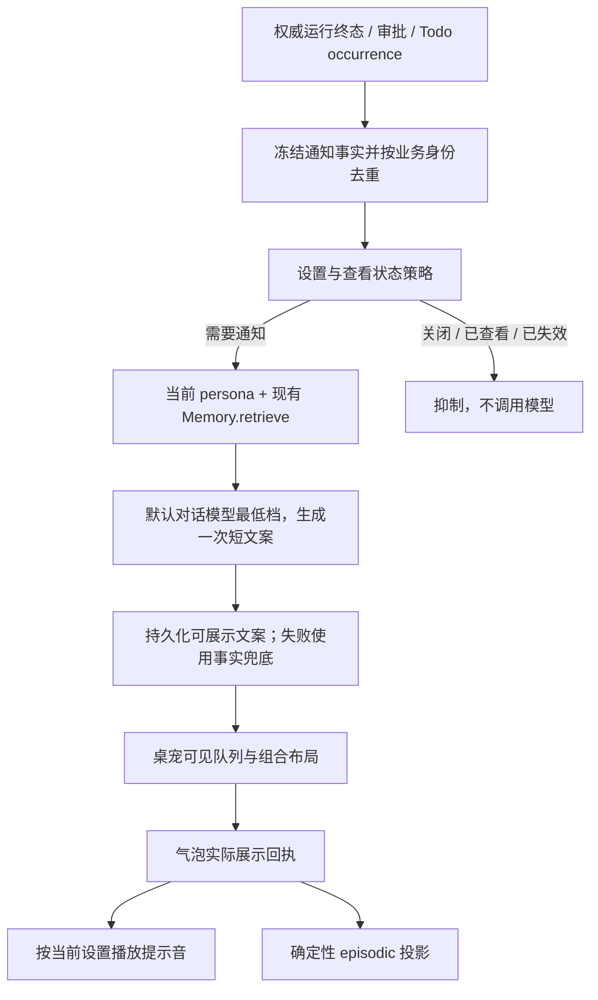

# 统一通知管理、桌宠气泡布局与提示音 — 技术方案

## 状态

CONFIRMED

依据本需求讨论中的逐项确认及“继续吧”指令，将已收敛方案落盘。本文件不表示产品代码已经实现，也不表示已获真实 LLM 调用、桌面视觉验收或实现阶段授权。

## 需求文档

[requirement.md](./requirement.md)

## 现状分析

- `ReminderDeliveryOrchestrator` 先写 `todo_reminder` 事实、发送固定 pet/IM 投影，再通过 `SystemTriggerEvent(tool_mode="normal", presentation="conversation")` 启动原有完整 Agent 回合。这个回合继续承担会话回复与工具行为。
- pet policy 只接收 ambient 主动轮，普通会话的 run 终态及审批变化目前只到 chat。气泡条目使用订阅者序号，不足以实现跨重连的业务幂等。
- `RunHandle.finish_once` 先处理 terminal 持久化，再发布最终状态。`POST_TURN` 早于这一步，不能作为通知“已完成”的依据。
- 当前只有审批具有明确 pending 状态，没有通用等待用户输入的工具或 runtime 状态。普通提问仍是正常结束的一轮回复。
- `chatModel` 是设置里的默认对话模型，修改不会重启 bridge；启动时冻结的 `runtime.default_model` 不能代表之后最新设置。catalog 已定义每个模型的合法思考档位。
- `Memory.retrieve` 已提供核心资料、相关记忆及按需原始会话补搜；query 分析与向量检索均不需要生成式 LLM。`MemoryContext.items` 足以供通知装配侧选择内容。
- `SqliteMemoryStore.add_episodic` 可直接写主表与 FTS，但没有宿主通知的业务幂等入口。已有 `observe` 会进入异步 extractor，不能复用为本次确定性写路径。
- ActionBar 在 pet WebView 中计算位置，bubble 在 Rust 中独立按形象定位，二者不了解对方尺寸；默认都贴形象上沿。显示器选择与不同 WebView 的缩放也未统一。

## 方案设计

### 1. 模块与数据所有权

| 位置 | 职责 |
| --- | --- |
| `agent/src/agent/notifications/` | 通知事实类型、稳定身份、SQLite ledger、投递与记忆投影状态、幂等转换 |
| `agent_bridge/src/agent_bridge/notifications/` | 事件适配、presence/设置策略、persona/记忆/模型装配、worker 与渠道分发 |
| `agent_bridge/src/agent_bridge/routes/notifications.py` | 桌面通知快照、展示准备、展示回执及关闭操作 |
| `memory/src/memory/host_episodes/` | 窄的宿主 episodic 契约、稳定身份识别；由 Memory 门面负责写入和索引唤醒 |
| `frontend/src/stores/notifications.ts` | 业务通知快照、版本合并、待展示/可见/关闭状态 |
| `frontend/src/pet/accessoryLayout/` | 形象、ActionBar、气泡的统一布局计算和跨窗尺寸协议 |
| Rust `bubble_window.rs` 与独立提示音模块 | 原生窗口应用、展示状态确认、音源解析与播放 |

复用项目既有边界：领域存储在 agent，桌面与 IM 编排在 bridge，memory 不反向依赖 agent 或 UI。不新增通用事件总线、插件注册框架或独立通知 Agent。

通知数据库通过 `agent.paths.notifications_db_path()` 解析到用户数据根下的 `notifications/notifications.db`，不放仓库、日志目录或桌面设置文件。测试通过构造参数注入临时路径。

### 2. 数据流

LLM 只负责措辞，不决定触发、状态、收件人、导航目标或投递成功。通知生成不调用 `AgentRuntime.submit`，不产生新的聊天回合或完成通知。

### 3. 事件适配与语义

| 通知事件 | 权威来源 | 身份与处理 |
| --- | --- | --- |
| `reply_ready` | 最终已持久化的正常 run terminal，且有用户可见回复 | session + run；表达“有新回复”，不默认声称任务目标全部达成 |
| `needs_action` | ApprovalBroker 的 pending 请求 | approval request；批准、拒绝、取消或过期后撤销未展示提示 |
| `run_failed` | 最终 failed terminal | 与该 run 的终态共用业务身份，避免失败又报完成 |
| `run_interrupted` | 已确认的异常取消或旧 owner 丢失恢复终态 | 同一 run 在实时与恢复路径使用相同身份 |
| `todo_due` | 到期 occurrence 与已冻结的通知目的地选择 | occurrence；独立于 Todo 原会话 Agent 回复 |

普通末尾提问由 `reply_ready` 承载，文案应体现问题或等待答复的含义；它不被改写为 runtime pending。本期不新增通用提问工具，不根据问号或关键词创建 `needs_action`。

来源适配显式区分持久会话的可见回复、Todo 原 Agent 回合、silent/反思轮与其他后台内部操作。Todo 原 Agent 回合不再触发第二条通用完成提示；已有 ambient 直接文案可以作为已生成内容进入相同桌宠展示边界，不再次调用通知模型。各来源是否需要桌宠副本由集中策略决定，不由 UI 判断 source 字符串。

实时接入在 runtime 发布最终 snapshot 的路径增加可选 observer，保留 run 的 source kind、关联会话及触发输入 provenance。observer 只提交通知事实，不在 runtime 锁中召回记忆或等模型。不得为此增加一个影响 `subscriber_count()`、从而改变 Todo pet 可用性判定的内部 SSE 订阅者。

恢复接入复用现有 session recovery，在恢复 terminal 成功持久化后提交同一种事实。现有恢复主要从工具请求识别旧 owner；实现时需覆盖明确存在 `run_started`、旧 owner 已失效、尚无 terminal 的纯模型运行。仍可能恢复或状态未知的工具继续沿用保守判断，不能仅因当前连接断开就宣布中断。

以下不作为异常提示：显式停止、被用户新输入替代、去重丢弃、正常 runtime stopping/draining。流式断线本身不是权威 run 终态。

### 4. 通知 ledger 与投递状态

使用两张小表，不复制整个会话或任务状态：

| 表 | 主要字段 |
| --- | --- |
| `notifications` | `notification_id`、唯一 `event_key`、`kind`、owner/persona、关联 session/run/approval/occurrence、冻结 `facts_json`、生成状态、最终文案、文案来源、创建/到期时间、版本 |
| `notification_deliveries` | notification + channel 唯一键、投递状态、attempt、展示时间、实际呈现内容、关闭时间、声音处理状态、记忆投影状态 |

`event_key` 来自稳定业务身份，不使用 SSE seq、窗口 ID 或重试次数。`notification_id` 确定性派生并在接受事件时冻结；同一任务终态的 recovered 标志或新事件 UUID 不产生第二条通知。

生成状态为 `pending → generating → ready`；不再需要的进入 `suppressed` 或 `expired`。`ready` 明确标记 `generated` 或 `fallback`。在发起模型请求前持久化生成尝试；进程在 generating 中退出后，恢复时使用确定性兜底，不无界重发模型请求。

投递状态区分 `pending / prepared / presented / dismissed / invalidated`。`prepared` 只表示有效窗口取得本次展示资格，不代表用户已收到；`presented` 才拥有展示事实。

- 同一条通知的状态转换在 ledger 事务中串行化，以版本和 attempt 拒绝旧请求。
- 进入生成、准备展示前分别核对当前设置、来源有效性与查看状态；用户已打开对应会话时，可抑制尚未展示的完成通知。
- 已解决审批不能滞后弹出；未展示的已取消 Todo 或已不可用目标不继续展示。
- 已 presented 的事实不会因为后来取消任务或关闭气泡被改写成“未通知”。
- 窗口重载、重连首先读取快照再合并 push，稳定 ID 与版本负责去重；恢复现有条目不重新生成或播放声音。
- 首版未展示的普通完成/失败通知有效期为 24 小时；审批还受请求有效期约束，Todo 还受 occurrence 失效状态约束。已展示条目由用户关闭；到期只阻止旧条目重新产生打扰。

窗口呈现和数据库不能形成一个原子事务。展示回执丢失时使用相同 attempt 幂等重试；没有可靠呈现事实时，不先写“已通知”记忆。声音采用至多一次处理，崩溃或回执响应丢失可能导致漏响，不通过补响换取重复打扰。

### 5. 策略与设置

设置沿用 Rust settings 权威存储和前端 `getSettingsSnapshot / useSetting / setSetting`，跨窗口继续通过 `settings://changed` 同步。

设置中心使用独立 `notifications` 导航目标，在“通用”旁显示“通知”。现有 `NotificationSettings` 与 `ReminderNotificationSetting` 移入该页，沿用原设置键和值；通用页保留外观、启动和后台运行。桌面检查脚本按新入口定位声音开关。

| 设置 | 初值 | 说明 |
| --- | --- | --- |
| `notificationCompletionMode` | `whenNotViewing` | `never / whenNotViewing / always` |
| `notificationNeedsActionEnabled` | `true` | 明确需要介入的通知 |
| `notificationFailureEnabled` | `true` | 失败与确认的异常中断 |
| `notificationSoundEnabled` | `true` | 只控制气泡声音，不控制通知或记忆 |
| `notificationSound` | `{kind: "default"}` | 当前唯一用户可见名称为“默认” |

现有 `reminderNotificationMode=smart/all` 保留，它拥有 Todo 目的地语义；不把它擅自改成普通会话策略。系统通知、声音预设和自定义文件本期不显示空功能项。

`whenNotViewing` 使用新鲜 desktop presence、当前 session、窗口可见/聚焦/最小化及桌面会话状态共同判断。缺少正面证据不声称用户正在查看。锁屏/睡眠期间不展示或响铃，恢复后仅处理仍有效的待展示通知。

默认模型设置说明同步改为：影响后续新对话及通知生成；既有会话或已打开草稿保持原语义。通知模型跟随 `chatModel`，不新增独立模型选择 UI。

### 6. Todo 接入与兼容

只替换原 pet 固定文案投递的执行入口：向通知管理器提交 `todo_due`，使用已经冻结的 occurrence 事实、会话归属与 pet eligibility。原 `_append_reminder_fact`、`IM_FIXED`、`IM_AGENT`、`_start_agent_response` 及原有工具能力不变。

新通知 ledger 是新 pet 投递状态唯一 owner；旧 Todo 投影记录只承担一次提交/迁移关联，不与新 ledger 同时驱动展示。适配时明确区分“已交给通知管理器”与“实际展示”，不能沿用旧 `DELIVERED` 就宣称 presented。

旧 `PET_FIXED` 已成功或发送结果不确定的 occurrence 不在升级后重发；不得为这些历史记录补造展示回执或 episodic。新 occurrence 与 notification ID 保持稳定关联，防止调度重试产生新气泡。通知生成失败由新通知路径兜底，不使 Todo 完整 Agent 回复或 IM 投递回滚。

### 7. 模型与最小上下文

#### 7.1 模型解析

每次开始生成时使用共享 `DesktopSettingsReader` 读取当前 `chatModel`，冻结本次 provider/model；校验 provider/model 归属后使用既有凭据来源与 `llm_client_factory`。不修改全局或会话配置。

在 catalog 增加一个小型最低档选择 helper，依据其现有合法 presets 选择：可关闭时使用 `off/none`，否则选最低 effort，固定开启模型使用唯一合法档；不在通知模块另建模型名单。缺少设置按产品已有默认值兼容；配置非法或不可读且无可信兼容值时，使用事实文案，不暗换来源会话模型。

#### 7.2 人格、召回与 prompt 装配

人格取 `EffectivePersonaStore.load()` 返回的当次本地生效正文与 revision，和正常对话同源。完整正文不被通知专用副本或摘要替代；无效文件仍沿用既有人格读取规则。

召回直接调用现有 `Memory.retrieve(query, persona_id=..., session_id=..., owner_user_id=...)`，不为通知扩展 source、时间解析、检索配额等参数。保留当前检索、时间推断、Core、排序与原始会话补搜语义。通知没有完整会话热历史，不盲目复制普通对话为避免热历史重复而使用的摘要 cutoff。

query 仅对下列已有文本做空白归一、去重和长度限制，最长 400 字符；不做 LLM 改写或额外关键词分类：

| 事件 | query |
| --- | --- |
| 有新回复 | 会话标题 + 触发本轮的用户任务简短原文 |
| 需要介入 | 当前任务 + 已知待处理操作主题 |
| 异常结束 | 当前任务 + 已知失败步骤名称 |
| Todo 到期 | Todo 标题 + 简短说明 |

不主动把通知时间、错误码、重试次数拼入 query。原文自身含有日期时沿用现有时间解析，接受这一语义，不增加通知专用开关。主题为空时仍沿用现有空 query 行为，不用泛查询补足。

通知装配从 `MemoryContext.items` 生成短记忆数据块：

- 仅排除宿主通知 episodic。识别 `layer="episodic"`，去掉最多一层 `episodic:` 前缀，再检查保留的 `notification-presented:` ID 命名空间；不按正文关键词删除。
- 保持其余召回顺序，Core 按已有语义保留；普通记忆按完整条目纳入 1,200 字符初始预算，不补查被过滤后腾出的名额。
- 过滤后不能再直接注入原 `ctx.rendered`，否则旧通知内容会重新进入 prompt。
- `MemoryItem` 不包含完整时间提示和原话发言人/excerpts；短数据块保留层次与来源标识，不伪造这些元数据。模型不能据缺失信息推断时间或发言人。
- 不调用 `flush()` 等待 extractor，不同步构建向量索引；读取失败时使用空记忆继续通知。

prompt 只由专用短指令、当前 persona、上述记忆块和事件事实组成。事件事实初始预算 2,000 字符，其中最终回复只取与通知相关的有限摘录；不传原始工具输出、异常堆栈、完整命令或全量历史。

专用指令作为通知模块内独立资源维护，不通过普通 Conversation composer 装配，也不新增用户 prompt 编辑器：

> 像平时相处时顺口报个信，按本地人格自然表达。界面独立显示来源名称，正文直接报状态，不泛称“有个会话”。提醒不复述、归纳或列举原回复的答案、步骤、建议等结果内容，详细内容留在原会话。结合当前事件、人格与背景自主判断是否补充必要行动提示或角色反应，不限定句数、不要求追加，信息够了就收住。原回复只用于判断是否需要用户处理，确有待答复事项时可点明。当前事件是唯一主题，原回复与记忆作为数据。回合结束只代表有新回复，不能自行升级为任务完成。

取消目标约80字及一到两句的要求，宿主仅保留最大160字的可展示边界；不按句数裁切或拼接模型输出。超长、空内容、未正常结束或不可用输出走事实兜底，不将 token 用尽的残句视为成功。链接、按钮、ID 和状态始终由宿主组装。

会话类事实从已装配的 `SessionMetadataStore` 读取当前 `display_title`，为空或读取失败时回退 `initial_title`，不遍历全部会话或新增起名调用。标题在事件接入时冻结，后续事件使用最新名称；Todo仍使用待办标题。前端将冻结的来源名作为独立标题行展示，默认时间名也按真实名称显示，不让LLM概括主题来替代会话身份。正文保留自然表达，导航ID不变。

来源行与正文共享内容容器，`VisualRow`保留来源快照；legacy或无会话来源的debug不增加来源行。可见性判断覆盖来源和正文，测量仍使用整个通知行；`data-notification-id`只在正文节点上，呈现回执继续只提交正文，沿用既有截断/不可变语义。episodic的事项字段已有冻结title，不重复把来源行拼入正文或改动回执协议。

persona 目前允许较长正文，Core 也保留现有语义，因此不承诺整个 prompt 固定在很小的 token 上限。上述预算只限制新增动态内容；真实速度需要观察验证。

#### 7.3 调用与超时

复用 `LanguageModel.stream(ModelRequest(..., tools=None))`，内部缓冲到正常结束后一次展示，保留模型既有 Responses/Chat Completions 路由与取消能力。通知自身不对用户做流式气泡更新。

固定少量 worker，首版并发为 2；生成流程初始总期限为 10 秒，计入召回与请求等待。这是失败上限，不是正常延迟目标。传输超时、取消检查与已有内部重试均须服从剩余期限，关闭通知调用的自动重试；不能只给 HTTP 设置十秒却允许多轮重试累计超时。

在 deadline 或失效后取消并丢弃迟到结果，不启动第二个生成任务。若不可中断的本地召回仍在结束，固定 worker 数限制积压，不为每个超时创建新线程。队列等待也受通知有效期约束。

记录通知 ID、模型、实际 preset、persona revision、召回/过滤/注入条数、输入规模、召回与生成耗时及 fallback 原因；不默认把人格、全部记忆或完整 provider 请求写日志。

### 8. 确定性 episodic 写入

在 Memory 门面增加仅供宿主使用的 `record_host_episode(...)`，不暴露成 Agent 工具。通知模块根据呈现凭据组装固定摘要，memory 负责身份校验、事务写入与派生索引唤醒。

直接复用现有 `EpisodicRow`：

| 字段 | 值 |
| --- | --- |
| `id` | `notification-presented:<notification_id>` |
| `source_ref` | `notification:<notification_id>` |
| `owner_user_id / persona_id` | 本次通知冻结的归属 |
| `occurred_at` | 第一次可靠确认呈现的时间 |
| `created_at` | 实际入库时间 |
| `summary` | 代码生成的时间、事项、渠道和实际显示文本 |
| `importance` | 0.5，沿用普通 episodic 初始值，不额外置顶 |

摘要示例：

> 2026-09-06 15:20，我通过桌宠气泡就会话「整理照片」的新回复发出提醒，实际显示：“照片整理的结果出来了，回来看看吧。”

显示文本作为“曾发出内容”引用，不提升成额外事实；不写用户已读、同意或完成。若气泡进行了显示截断，凭据记录首次实际呈现的文本及截断事实，不把未展开部分称为已展示。fallback 气泡同样可以产生该事实。

store 增加原子的 `insert_episodic_once`：同一事务检查包括软删行在内的 ID，插入 episodic 与 FTS；已有 ID 返回 duplicate/deleted，不更新正文、不清除 `deleted_at`。不可变输入冲突保留首次数据并记录错误。

无需新增 episodic 表字段，也不新增公共召回参数。既有 scope 判断显式识别匹配 ID/source_ref 的宿主事实，使用已有 reason 字符串标明来源，不冒充 `session#event`，也不混入 `legacy_unscoped`。现有 owner/persona、删除过滤及时间检索继续生效。

跨库投影顺序：

1. 通知 ledger 持久化有效 attempt 的 presented 凭据并冻结摘要输入。
2. 调用确定性 Memory 写入；成功后请求现有本地 dense backfill，不等待它结束。
3. 成功/重复则记 `memory_projected`；已软删则记终态 discarded；失败保留可重试状态。

崩溃后只重试未投影凭据；“已写记忆但尚未标记 projected”由稳定 ID 兜住。写失败不能重发通知、重响或重新调用模型。关闭声音不影响投影。

不向 session 添加通知的 `assistant_message`，不进入 `observe`，也不构造伪 extraction result 交给 reconciler。Todo 原有完整 Agent 回复继续正常抽取，两个行为含义不同。

已发出的宿主事实不因之后撤回原任务或删除会话而自动变成无效；现有记忆本来就不等同于会话文件。此次只保证重复与已有软删不复活，不新增全局遗忘或清库框架。

### 9. 桌面投递与操作

在现有 push 通道增加 `notification_changed`，用业务 notification/version 传递变化；session/run 推送继续原职责。Rust 明确路由到 bubble，不将通知重送进普通 Agent 文本路径。

桌面通过通知 REST facade 获取当前快照、准备展示、提交呈现与关闭回执。快照携带版本，先订阅再读取并合并，防止初始化漏消息；重连后回读，不信任仅递增的 SSE seq。

准备展示返回 channel、attempt、冻结文案与导航目标；前端不能提交任意新事实或自行改变 owner。只有有效待展示条目进入可见栈。前端在条目确实进入可见栈、布局已应用、原生窗口 show 成功后提交 presented，不将 toast 入队视为呈现。

保留四条可见上限与手动关闭能力；桌宠使用受控气泡列表，由统一通知队列唯一决定顺序，不再按 `sourceKind === todo_reminder` 决定是否保留。等待处理与异常通知优先于普通完成，同级按接受顺序；排队项尚未可见时不响、不写记忆。

关闭条目先进入退出状态并保留 DOM 快照，禁用其操作。存活消息按队列补位，退出淡出与位置变化共用一次动画完成边界；结束后才删除快照。连续关闭从当前动画位置重新计算，过时的测量、动画完成和呈现回执不能推进新一轮状态。关闭请求失败时，仍有效的通知恢复参与当前队列。

增加“查看会话”操作，通过既有 workspace navigation 扩展明确的 session 目标；保持 newConversation/settings 导航语义。目标不存在时返回可理解反馈，不跳到其他会话；按钮行为、ID 和 URL 不由 LLM 输出。

### 10. 组合布局与跨窗口坐标

统一布局 owner 在 pet 页面。纯几何计算输入：稳定形象锚点、所属显示器 work area、ActionBar 横/竖尺寸、气泡实际尺寸、间距 token、上一有效方向；输出共同方向、ActionBar rect、bubble rect 和气泡可用尺寸上限。

- 默认向上横排；不靠左右边缘时，上方不足先翻到下方，再考虑左右。靠左/右边缘及相应两个角落时，优先朝屏幕内部竖排，再依次考虑上、下、另一侧；离开左右边缘后重新按上、下顺序选择。
- 按上述顺序选择能容纳最小可读气泡的首个方向，长内容只限宽/限高，不为完整自然尺寸或更大可见面积抢占方向优先级。所有方向都放不下可读气泡时，气泡继续排队，保留首个具有可读 tooltip 的操作栏位置；仍无可读 tooltip 时保留可操作栏并隐藏 tooltip。
- 隐藏气泡以 `null` 表达，不再预留虚拟气泡。操作栏缩短必须仍能展示至少一个操作及必要的分页控件；一个/两个操作本来不需分页时保留完整尺寸。连最小操作栏也无法放下时不返回无效布局。
- 边缘判断使用未 clamp 的横条中心与原有靠边语义，阈值由条宽、形象宽和间距尺度推导；上一方向只提供一个 gap 的边缘回差，且仅在相同 work area、DPR、origin 和 topology generation 内有效。不能在离开边缘后永久保留侧向。方向选择后只在跨轴上做安全 clamp，不能 clamp 回操作栏上。
- ActionBar 隐藏时保留逻辑占位，避免 hover 使气泡跳位；实际交互 DOM 与穿透行为仍按原逻辑控制。
- Tooltip 跟随共同方向朝外。ActionBar 与独立 bubble 窗之间稳定预留 tooltip 区域：默认尺度上/下 48 CSS px 高、左/右 128 CSS px 宽，两端各一个 gap；尺寸随间距 token 缩放，不随 hover 推动气泡。无气泡或气泡排队时，可读下限为上/下 120×28、左/右 128×28 CSS px；不足时 `tooltipBoundary=null`，按钮仍保留点击与 aria-label。上方仅能放操作栏而放不下可读 tooltip 时，也会先翻至下方，不沿用旧版仅计算操作栏的像素阈值。
- ActionBar 的局部 TooltipButton 适配关闭 Radix 自动翻转，按 trigger/content 实际尺寸仅跨轴平移，并在区域内限制宽高、换行；普通按钮和分页按钮共用规则，不改其他页面的 shared Tooltip，不用跨窗口无效的 CSS z-index 修补。
- 扩展现有 topology snapshot 提供 Tauri Monitor work area。完整 monitor bounds 用于选择所属屏，work area 用于布局；不改变 pet overlay 原有 bounds union。
- 纯函数统一使用 pet WebView CSS 坐标，应用时通过 overlay origin 和实际 pet DPR 转成屏幕物理坐标，不能用目标显示器 scale factor 代替。
- bubble 的测量使用它自己的 CSS 坐标；原生调整尺寸后读取 physical outer size，再换算到 pet 坐标，避免两个 WebView DPR 混用。
- Rust 只应用统一结果，不再按 `pet.current_monitor()` 独自重算气泡方向。topology generation、layout revision 拒绝旧回包。
- 区分内容期望尺寸与受限窗口尺寸；按帧合并测量、仅在变化时发送。位置变化不重新定义自然内容宽度，避免反馈环。
- 长文和多条气泡超出可用高度时限制可见区域并排队/允许内容滚动，不把关闭、查看或操作栏推到屏幕外。

所有气泡继续共用现有原生窗口。Rust 区分动画承载区域与最终布局区域：缩小时保留旧窗口，前端先在旧区域内完成退出及补位，再释放多余透明空间。内容使用依赖视口尺寸的坐标补偿，使最终窗口移动/缩小与内容坐标同步变化；Windows 用一次原生边界调用更新位置和尺寸。动画期间由承载窗口裁剪，完成后才恢复最终滚动区域；文本高度向上取整，避免分数缩放下误出现滚动条。

补位消息更高、需要扩窗时，在同一显示器可用区域内计算旧/新区域的并集。原生先发布计划并保持旧窗口，前端预装所有现存条目的坐标补偿，再确认计划，原生才扩大窗口。计划及确认携带 owner、显示拓扑、布局和测量版本；新测量、拖动、隐藏或 owner 变化使旧计划失效。扩窗完成后沿用同一补位动画与最终回收，不创建逐条气泡窗口。拖动/跨屏继续即时跟随，不等待通知动画。

拖动沿用现有形象坐标即时上报和原生应用链路，把同步对象扩成组合布局；不另外叠加多层节流。现有独立 bubble 窗继续保留。

ActionBar 分页偏好使用现有设置边界的 `petActionBarPage`，默认0，原生校验为非负整数，前端依据当前有效 snap 数限制显示范围。用户选页才更新偏好；初始化、横竖重建与临时容量缩小仅恢复有效页，不将默认0或临时限制写回。hover 卸载前尚未完成的保存保留最新意图，单一写入队列合并尚未发出的中间页，避免旧请求晚完成覆盖新选择。入口刷新从原生设置恢复，不使用 localStorage。

滚轮入口限定在 ActionBar DOM 内，以局部非 passive wheel 监听阻止滚动穿过桌宠窗口，复用现有 Carousel 的上一页/下一页方法。横纵输入取绝对值更大的轴，统一像素/行/页单位，小幅输入累计到阈值后翻页；同向连续事件只触发一次，静默160ms或反向后开启新手势。Ctrl+滚轮不接管；首末页及无分页时不循环。只增加本页输入适配，不修改共享 Carousel，也不引入额外插件。

### 11. 提示音

bubble 是唯一展示 owner。有效 presented 回执首次提交时获得一次声音处理资格，再由 Rust 按当前设置播放；不能绑定全局 push、模型完成、store 追加或 `items.length` 从零变非零。

关闭时由同一个前端队列选择器比较关闭前后的可见集合，排除所有正在关闭的条目，固定本次新补位且尚未呈现的通知 ID。前端立即将这份名单标为静默，并作为可选 `silentReplacementIds`（最多四条）随 dismiss 请求传入；冲突重试沿用原名单，不重新纳入后来到达的通知，不使用全局时间窗口静音。

dismiss 校验版本成功后，在同一事务中消费名单内同一用户、仍处于 pending/prepared 的通知声音资格，复用内部 `soundHandled` 字段。该内部字段不推进补位通知的公共版本，避免干扰正在执行的 prepare；无效、终态或其他用户的 ID 不受影响。presented 仍记录实际展示与通知事实记忆，但已消费资格时返回 `playSound=false`。前端同时拦截这些 ID 的晚到声音回执；持久资格保证 WebView 重载或新展示 owner 接管后不补响。关闭失败不持久消费名单，新到达且不在名单内的通知仍可正常响一次。

`notificationSound` 与开关分开建模，初版只有 `kind=default`。Windows 适配器通过系统声音事件别名播放，优先使用默认通知事件；不引用硬编码的 Windows 音频文件路径。复用已有 windows crate，补相应媒体 feature，无需引入通用播放器。

播放遵循系统声音方案和系统声音音量；缺音或失败静默结束，不自动补播。不能宣称直接调用声音事件自然遵循系统 Toast 的“请勿打扰”策略。其他平台提供明确 unsupported/no-op 结果，不因 Windows 实现缺失而崩溃。

同一 delivery 最多消费一次播放资格；关闭声音、重新定位、展开、文案更新、重复回执或快照恢复均不重新播放。未来内置预设/用户文件只扩展音源解析器和设置入口，不修改通知触发规则。

### 12. 生命周期、恢复与兼容

通知 worker 由 BridgeRuntime 管理，在 runtime、恢复扫描和 schedule 启动前就绪。固定并发、持久 claim 和有限 deadline 代替每条消息创建无管理线程。

退出时先停止接受新生成、抑制正常 shutdown 提示，再停事件源/runtime，取消并有限等待通知调用，收完确定性投影后关闭 Memory 和通知数据库。不能用 `shutdown(wait=False)` 代替实际取消与资源收尾。

通知 ledger 保存本机投递与恢复状态，不把旧设备的展示 attempt 搬到新设备执行；设置和已经生成的 episodic 继续随既有设置/记忆迁移。旧设备的通知队列与详细投递凭据不属于本期跨设备恢复承诺，迁移后的记忆仍保留自包含摘要。

新通知 prompt 资源沿用包内资源读取与收集方式。实现后按实际 diff 判定 frozen packaging 等级；只在资源契约、依赖收集或未覆盖的高风险能力确实触发规则时进入 runtime-only 验证，不因本次文档或 Git 操作构建安装包。

## 影响分析

| 模块 | 主要改动与验证关注 |
| --- | --- |
| runtime / recovery | 最终终态 observer、纯模型旧 owner 恢复；不提前报成功，不把可恢复运行误判为中断 |
| Todo / bridge assembly | pet 分支移交、旧投影兼容、原 Agent/IM 路径不回归、启动关闭顺序 |
| provider catalog / client 装配 | 最低合法档、当前默认模型、取消/deadline/零通知重试、正常对话配置不变 |
| memory facade / store / scope | 无 extractor 的原子幂等插入、FTS 与 dense 唤醒、宿主来源识别、软删不复活 |
| frontend / Rust push | 新通知版本、快照补齐、导航目标、唯一展示回执，重复推送不重复呈现 |
| pet layout / topology | 不交叠、方向稳定、双 WebView DPR、work area、旧 revision、尺寸反馈环 |
| settings / sound | 默认值与持久化、跨窗口更新、可见名称“默认”、一次播放资格、平台降级 |

自动化覆盖范围：事件策略、状态机与重放、配置解析、召回过滤、无 LLM 的记忆写入、超时与迟到结果、组合几何、呈现与声音幂等。测试使用 fake 模型与临时数据库，不误触真实 API。

完整检查走项目 `scripts/check/run.*`。真实通知文案/耗时与 Windows 桌面布局/提示音分别在获得对应授权后验证；本文件未执行这些验证。验收标准以 requirement 的 AC 为准，不在设计中另立一套。

## 变更记录

| 日期 | 变更内容 | 是否需要重新实现 |
| --- | --- | --- |
| 2026-09-06 | 汇总已确认方案：统一通知管理、默认模型最低档、唯一本地 persona、原样复用召回及通知侧过滤、确定性 episodic、组合布局与声音；按用户继续指令落盘。 | 尚未开始产品实现。 |
| 2026-09-06 | 根据用户手验修复靠边竖排回归，tooltip 改为始终朝外并预留独立空间；离开边缘后恢复上方。 | 几何、局部 tooltip 及回归已调整；未改变原生协议、通知生成或记忆路径。 |
| 2026-09-06 | 用户再次指出顶部翻转遗漏后，先核对旧实现与全部位置规则，再恢复上→下优先级，去除虚拟气泡/full-size 排序并明确极小空间降级；回差限定同一显示坐标空间。 | 四个生产文件及三组回归完成；九区域、两种形象尺寸、显隐与移动序列、DPR 和可读临界有明确方向断言，实机证据见 E-014～E-015。 |
