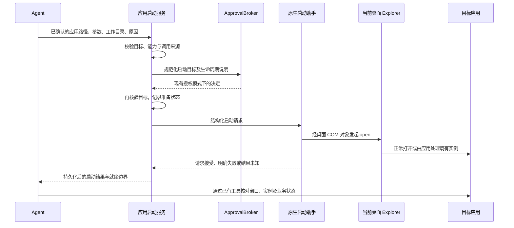

# 桌面应用正常启动与生命周期：技术方案

## 状态

CONFIRMED

确认日期：2026-09-17。对应 [requirement.md](requirement.md) 的首次确认版本。方案确认不代表实现或真实环境验证已经完成。

## 现状分析

- `agent/command_runtime/tools.py` 的 `HostProcessStartTool` 继承命令执行路径，启动后登记 run-scoped 进程句柄。`ToolRunContext.close_commands()` 在对话结束时执行终止回调。
- Windows 桌面服务 supervisor 通过 Job Object 管理服务进程树。因此只去掉单轮终止回调，不能满足服务退出后的应用存活要求。
- `ApprovalBroker` 已统一拥有授权模式、审批等待、取消与通知。新能力复用该控制面，不建立第二套审批状态机。
- Tauri 的 push subscriber 当前负责转发通知，不是应用启动 RPC。应用启动不依赖 WebView 在线、SSE 重放或前端组件执行副作用。
- MAA skill 已将模拟器窗口、实例状态、Android、ADB 和有限执行的 MAA 命令分开核验。无需把模拟器注册成命令进程来维持这条链路。

## 方案设计

### 能力与所有权

新增模型工具 `launch_desktop_application`，表达一次经授权的桌面应用打开动作。应用由用户桌面管理，不进入 run 的命令句柄表，也不成为 `write_stdin`、`terminate_command` 或 command-processes 的控制对象。

现有 `exec_command`、`host_process_start` 保留受管命令能力及清理语义。同步修正其 description：需要等待退出、读取输出、交互输入或终止的命令使用受管执行；希望在任务后继续使用的桌面应用使用新工具。

本期支持 Windows 已确认的本地 `.exe` 及参数。快捷方式、URI、应用商店应用、通用脚本解释和其他平台不宣称支持。已有应用是否可复用由调用前的应用相关发现流程判断；不以可执行文件名相同推断同一实例，也不由启动工具强制单实例。

### 数据流

### 原生启动助手

提供小型 Rust 二进制 `agent-friend-app-launcher.exe`，复用已有 `windows` crate。Python 启动服务以参数列表、`shell=False` 和隐藏助手窗口的方式启动该程序；输入输出为带协议版本、大小上限的 UTF-8 JSON，通过管道传输，应用参数不拼入 shell 命令。

助手使用 STA COM 初始化，在当前交互桌面定位已有 Explorer 的桌面 Shell 对象：`IShellWindows` / `SWC_DESKTOP` → 活动 Shell view → `IShellFolderViewDual.Application` → `IShellDispatch2.ShellExecute`。必须取得已有桌面对象，不把创建一个任意 `Shell.Application` 对象视为等价保证。

固定执行 `open`，使用普通可见窗口的显示建议；不暴露任意 verb、隐藏启动或 `runas` 参数。传给 Shell 的参数字符串由宿主从数组按 Windows 参数规则序列化，覆盖空格、空参数、引号及尾部反斜杠。应用自身的单实例转发、参数解释和窗口显示行为仍由应用决定，工具不能因此报告业务就绪。

助手自身是有限执行进程，由启动服务持有、等待和清理；它可以处于现有服务 Job 中。真正应用的打开动作委托给当前桌面 Explorer，不登记到本产品的任务清理表。助手只拥有自身，不用进程树扫描或名称匹配回收目标应用。

启动前核验当前用户、Windows session、可用交互桌面及 Explorer 对象的一致性。若无法取得匹配桌面、Explorer 不可用、调用失败或隔离前提无法成立，明确返回错误；不自动降级为直接 CreateProcess、Start-Process、cmd start 或放宽父级 Job 的 breakaway 策略。

服务 Job 与目标应用的实际隔离是实现阶段的首项验证。若该路径无法满足隔离或目标版本的启动需求，停止推广该实现并回到方案阶段，不用 shell 绕行掩盖失败。

### 模型工具契约

| 输入 | 语义 |
| --- | --- |
| `executable_path` | 必填，来自用户或本机发现证据的既存本地 `.exe` 绝对路径；不从自然语言应用名猜测 |
| `arguments` | 字符串数组；省略时为空，每个参数独立传入，非 shell 命令 |
| `working_directory` | 可选的既存绝对目录；省略时使用目标 exe 所在目录，规范化后纳入审批 |
| `reason` | 必填，向用户解释本次打开的用途 |

JSON Schema 使用明确字段类型、必要的长度/数量限制和 `additionalProperties: false`。宿主再次校验平台、路径、文件类别、目录及输入大小；拒绝 URI、快捷方式、脚本和不可确定目标。不把此工具描述成任意程序的常驻命令入口。权限事实、helper 路径、运行身份、请求编号和协议版本由宿主提供。

结果至少包括 `launch_id`、`status`、`lifecycle`、`readiness`、稳定错误码和下一步说明。`launch_id` 只标识本次启动记录，不是 PID、命令句柄或关闭授权。

- `accepted`：桌面 Shell 已接受请求；`lifecycle=user_desktop`，`readiness=not_verified`。不保证新建进程，不保证窗口或 Android 已就绪。
- `denied` / `cancelled`：授权被拒绝，或确定在启动提交前取消，没有提交本次打开动作。
- `failed`：确定的校验、能力或平台调用失败，说明改变哪个前提后才可重试。
- `unknown`：可能已提交但回执缺失或无法确定结果；不得自动重放，先检查现有实例。

不虚构目标 PID、进程退出码或窗口状态。模型需按应用契约继续核验；MAA 的四层门禁仍由 skill 负责。

### 授权与副作用边界

在现有 `ApprovalBroker` 增加应用启动请求类型，复用 per-request / session-auto 模式、版本检查、取消和审计。审批端点、序列化、前端类型与展示同时接入新类型，避免将应用伪装成 sandboxed command 或依赖 Codex sandbox setup。

审批展示规范化后的可执行文件、参数、工作目录，以及“由用户桌面继续运行，不随本轮任务结束关闭”。风险策略针对实际目标与参数进行评估，不能因为新增 kind 而跳过已有可确定的高风险动作识别。应用运行不受命令沙箱限制应明确表达。

批准后、调用助手前重新核对目标身份及规范化参数；目标变化则拒绝执行并要求重新发起。助手同样核验实际目标，不能接受由模型指定的内部程序路径或可执行协议。路径执行仍存在平台 API 的竞态边界，不宣称具备超出实际实现的原子执行保证。

第一期只在能承载现有桌面审批语义的调用入口开放；CLI、IM 或其他入口不因检测到 Explorer 就获得能力。缺少合适审批入口、平台或可验证 helper 时返回可解释的 capability unavailable。

### 取消、失联与去重

以宿主注入的 session/run/tool-call 身份绑定一次启动，生成 `launch_id`。同一执行重入只恢复已有记录，不再次打开；新 tool call 不能自动视为同一请求，也不能假定应用天然幂等。

在实际 COM 调用前持久化 `dispatching`。已确定尚未进入提交阶段的取消可以记为 `cancelled`；一旦进入提交阶段，取消不再表示“应用没有打开”。清理助手不撤销 Explorer 已接收的请求，也不终止可能已启动的应用。

成功回执落盘后记录 `accepted`。回执丢失、助手超时或服务在提交阶段退出时保留 `unknown`；重启、对话恢复和推送重连均不自动重放。该机制提供有限的重入保护，不声称跨崩溃的 exactly-once 启动保证。

助手需要有限等待上限。超时后仅终止助手，记录可确定的最后阶段；不能把超时笼统投影为未执行。审批后的执行取消检查、状态写入与提交之间按同一服务锁协调，跨进程无法消除的窗口归入 unknown。

### 持久化与诊断

启动记录复用会话工具执行证据体系，保存操作身份、helper/build 身份、目标摘要、授权来源、阶段、错误码和时间。补齐缺失工具结果的恢复投影，保证后续对话能看到 accepted 或 unknown，而非仅留下取消文本。

会话私有记录可保留复查所需的规范化请求；诊断汇总沿既有脱敏边界输出，不把参数、完整用户路径或凭据复制到通用日志。按诊断生产契约同步导出与 inspector，只提供本产品实际观察到的事实。

应用启动请求被接受，不代表启动工具继续监视应用。用户要求关闭时走既有应用相关工具和明确目标核验，保留相应工具证据；本工具不提供通用 PID 强杀接口。若后续自行崩溃、用户关闭或其他应用关闭，只能在取得证据后归因。

### 文件与模块边界

| 位置 | 职责与改动 |
| --- | --- |
| `agent/src/agent/desktop_applications/` | 新增工具、启动服务、请求/结果模型、助手协议适配和操作状态；按职责拆文件 |
| `agent/src/agent/approvals/` | 新请求类型与现有风险策略、授权生命周期衔接 |
| `agent/src/agent/tools/factory.py`、`agent_bridge/src/agent_bridge/assembly.py` | 按平台和可信 runtime 能力装配，注入 helper 与证据存储 |
| `agent/src/agent/command_runtime/tools.py` | 澄清受管命令与桌面应用的工具路由，不放宽命令清理 |
| `agent/src/agent/sessions/` | 应用启动证据与恢复投影，保留 accepted/unknown 等实际边界 |
| `agent_bridge/src/agent_bridge/routes/approvals.py` | 新审批类型的决定端点、过滤与状态投影 |
| `frontend/src-tauri/src/desktop_applications/`、`src/bin/agent-friend-app-launcher.rs` | 小型原生实现与薄二进制入口；不启动 Tauri UI |
| `frontend/src/services/api/`、`stores/`、聊天审批组件 | 复用现有审批界面，新增应用启动字段与生命周期说明 |
| `scripts/package/`、桌面服务装配及开发脚本 | 构建、身份验证、payload 收集、可信路径传递和 smoke |
| 诊断导出与对应 inspector | 按实际新增证据结构同步生产者与消费者 |
| 独立 `maa-daily-skill` 仓库 | 修改启动指引与能力不可用时的处理；保留后续业务门禁 |

### 打包与开发装配

助手随产品版本化 payload 分发，纳入现有 manifest、hash 与安装完整性校验。路径由受治理的开发/安装装配提供；不搜索用户 PATH，不从 cwd 猜测二进制，不由模型指定或下载。

复用 Cargo/Windows 原生依赖；Python 侧只负责结构化进程通信，不新增 COM Python 绑定库。helper 的协议版本和产品身份需要握手验证。helper 缺失或不匹配时，只降级应用启动能力，不妨碍普通聊天。

该能力属于 package-sensitive：不仅验证 helper 文件存在，还需通过 frozen runtime 实际走到原生能力边界。运行时验证、完整安装包构建和安装验收分别服从对应工作流，方案确认不自动授权构建或覆盖安装。

开发构建、单测和 smoke 通过双平台 `scripts/*/run.*` 入口；非 Windows 平台提供明确的不支持检查，不把跳过写成验证通过。具体脚本目录沿用既有操作入口能承载的范围，不另建通用后台框架。

### MAA skill 联动

保留顺序：发现既有实例 → 必要时调用新工具 → 核验窗口、管理器状态、Android、ADB → 有限执行 MAA → 业务后置核验。

新工具返回 accepted 后，仍重新发现实际实例与端口；返回 unknown 时先检查既有状态。需要持续运行的模拟器不再直接用 streaming 命令启动。新能力不可用时报告缺口，不自行拼 shell 绕行；其他宿主已有等价普通启动能力时，skill 按能力选择，不写死 agent-friend 专用路径。

MAA runner、ADB、奖励检查等普通命令继续按自身有限生命周期执行。临时 helper 清理、MAA 退出和 MuMu 关闭是三种不同事实。关闭模拟器仍按用户请求、目标实例与既有正常关闭契约处理。

## 验证与推进顺序

验收目标唯一来源为 requirement 的 AC；以下定义获得证据的顺序，不增加平行验收标准。

1. 原生可行性：使用可控测试应用，以生产等价 Job 约束启动助手；确认应用身份、实际 Job 归属和助手退出后的状态。测试只清理由本轮确证创建的测试应用。
2. 生命周期：分别覆盖 run 正常结束、取消、助手超时、Bridge 停止及产品退出；受管命令作为对照，必须仍被清理。结果未知分支保留完整时间线。
3. 契约：覆盖非法目标、参数引用、审批拒绝与过期、目标变化、缺少桌面、helper 身份不符、重复请求、回执丢失和恢复；验证 provider 实际工具定义及前后端一致性。
4. 打包：按 frozen-runtime-packaging 验证真实能力路径；记录 helper、shell 和 bridge 身份，不用 source-env 测试替代安装版证据。
5. 产品：在来源明确且源码新鲜的 Windows 实例上验证 MuMu 的窗口、Android、ADB，以及任务/服务/产品退出后的状态。
6. Skill：记录产品与 skill 的准确版本，在用户明确授权的账号、设备和资源范围内运行一次真实日常；不修改正式配置来掩盖启动失败。
7. 行为回归：按 agent_eval 治理覆盖工具路由、持续运行承诺、结果未知时不重启和关闭归因；使用相邻场景检查不把普通命令错用成桌面启动。真实模型验证服从相应授权。

实现前读取将触及的前端、诊断、安装器与 eval 规则。截图/DOM 结论、真实游戏动作、外部 LLM 和安装动作各自保留授权边界；缺失项记录为未验证。

## 影响与风险

- 不改变现有 run cleanup 和 Windows 服务 Job 的默认行为，避免普通命令残留。
- Explorer API 接受请求不证明应用就绪，也不保证返回新 PID；结果语义必须在工具、UI、历史及诊断中一致。
- Explorer 重启、交互桌面变化、权限差异和应用自己的二次启动可能影响隔离；以真实 Windows 证据判断，不按进程名推断。
- 增加一个受分发治理的原生二进制及一种审批类型，需要同步开发装配、安装 payload、frontend 和 frozen smoke。
- 原生可行性若不通过，返回设计阶段；不通过关闭整个 Job 清理、隐藏脚本或放宽受管命令语义兜底。

## 变更记录

| 日期 | 变更内容 | 是否需要重新实现 |
| --- | --- | --- |
| 2026-09-17 | 用户确认独立应用启动工具、Explorer 委托、小型 Rust 助手、审批复用与分层验证方案；首次落盘 | 尚未实现 |
