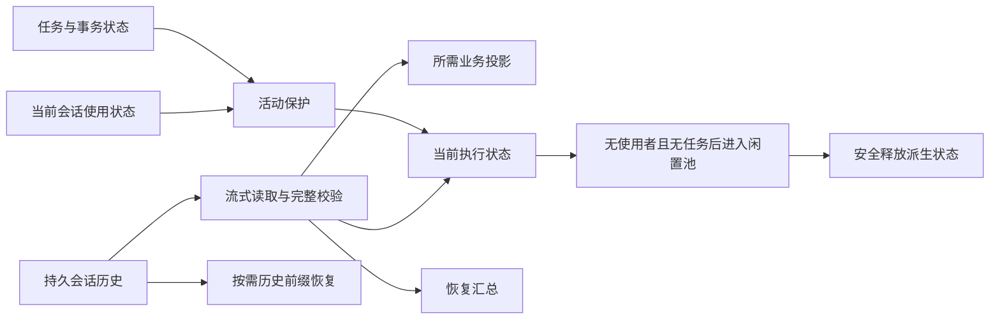

# 145 · 会话内存与持久化增长治理 — 技术方案

## 状态

CONFIRMED

对应 [requirement.md](requirement.md)。2026-09-30 用户确认整体方案，并明确活跃会话不计入闲置缓存预算、兼容只面向新版使用旧数据。本文件记录已确认方向；用户随后授权实现，当前状态见 [progress.md](progress.md)。未对原始用户数据执行维护。

## 现状与边界

调查基线为 `f22fbb6d4df7db3f600a7bb5c35d73e05419abf2`。具体证据、来源版本、测量方法与局限见 [证据索引](evidence-index.md)、[盘点](inventory.md)和[固定样本调查](investigation-20260930.md)。

- Bridge lifespan 的恢复任务结果持有包含完整 Session 的报告；任务完成不等于会话对象释放。
- SessionManager 的驻留运行态经 recorder 持有 Session；完整历史又包含大量已不属于当前模型输入的内部记录。
- 只读投影与完整执行恢复已有区分，但部分后台消费者仍加载过多内容；逐行解析后收集全部对象依然产生高驻留。
- 现有提交链需要完整验证。编辑重发、失败恢复和有效分支判断依赖历史前缀，不能直接删掉旧记录的内存引用而不替换消费者。
- 当前全局推送连接不能表示“用户正在使用哪个会话”；已加载过也不能等价于正在使用。

沿用项目技术栈和现有会话存储边界。本期在会话存储、恢复、运行态与消费者之间明确数据所有权，不引入通用工作流框架或另建事实数据库。

## 数据所有权与读取路径

持久历史继续是恢复与审计的权威来源；缓存和运行态都是可校验、可重建的派生状态。

| 数据 | 所有者与保留方式 | 消费入口 |
| --- | --- | --- |
| 原始业务及内部恢复记录 | 会话存储；持久化保存 | 流式扫描与按需历史前缀读取 |
| 业务事件、当前有效分支 | 会话业务投影；按消费者需要持有 | 详情、通知、附件核对、记忆输入 |
| 当前模型上下文与执行恢复状态 | 当前会话运行态；活动期间保护 | 执行准备、连续发送、取消与恢复 |
| 历史提交、旧模型上下文 | 原始存储；不用全部常驻于运行态 | 编辑重发、失败恢复时按需校验与读取 |
| 查询与搜索派生数据 | 各自缓存；可失效和重建 | 只读调用，不隐式激活执行运行态 |
| 恢复扫描结果 | 小型汇总；不包含 Session 或其闭包 | 启动日志、完成统计与错误报告 |

## 启动恢复与后台消费者

恢复扫描按会话处理并释放。报告仅保留标识、处理状态、必要计数和受限错误摘要；不把完整 Session、原始事件或捕获它们的异常 traceback 留在长期任务结果中。聚合报告也不得重新收集这些对象。

启动任务、其完成回调与 lifespan 分别核对成功、单会话失败、取消和整体退出路径。仅清空 task 变量不能替代修正报告数据所有权；对象生命周期测试覆盖最终结果与异常引用。

附件核对、通知、提醒、记忆输入、列表与搜索分别声明所需投影。能顺序处理的入口不先加载全部会话；只需末尾业务片段的入口不构建全部模型流水。保持记忆任务已有持久序号与失败边界，不为减少排队条目随意合并或丢弃任务。

## 流式恢复与当前状态

将读取、校验和保留拆开：读取器逐条解码，恢复器验证格式、提交哈希、前后引用与有效分支，仅保留当前恢复需要的状态及必要索引。消费后不再需要的旧对象可释放；逐行读取后再构造完整 raw records 列表不算完成改造。

旧格式首先获得流式完整验证与精简持有。不得跳到最后一个 commit，或因为拥有文件末尾偏移就省略验证。对于损坏中段、恢复 segment、无提交历史和可恢复尾部，保留既有安全语义并通过独立用例校验。

运行态只常驻业务事实、当前有效模型上下文及执行恢复所需状态。`turn_origin` 等历史前缀消费者改为按需读取已验证前缀；支持编辑重发、失败分支存活前缀和重启恢复之后，才能移除它们对完整 `Session.events` 内部流水的依赖。不能让“精简 Session”被未迁移的调用方当成完整原始历史。

按需读取绑定存储已有源版本与单写者约束。文件被替换、截断或继续写入时，失效旧派生结果，不能把不同文件版本的前缀和当前状态拼接。任何位置索引都可重建，不是恢复真相；本期不承诺未经完整性证明的独立尾部检查点。

## 活跃保护与闲置预算

### 分类

| 状态 | 判断 | 闲置预算与释放 |
| --- | --- | --- |
| 当前使用 | 当前打开、加载中、对话交互中；多窗口或多入口任一仍使用 | 不计闲置字节数、会话数和过期时间 |
| 后台活动 | 排队或执行任务、待审批、运行工具、未决事务、取消收尾 | 同样不计闲置预算，即使用户已经切走 |
| 闲置缓存 | 没有当前使用者，也没有上述活动；保留用于再次访问 | 进入有界闲置池 |
| 已释放 | 不再持有执行运行态，可从持久数据重建 | 不占运行态缓存 |

“当前加载”指正在加载或当前已打开使用的会话，不涵盖所有曾被加载后留在 `_runtime_states` 的对象。当前会话所需的数据不能换个缓存名称再被闲置淘汰器间接清除。

活动保护不代表无限保留重复副本：仍精简历史引用、优化解析峰值并单独计量。需求中的固定样本恢复峰值目标用于验证机制效率，不是限制活跃对话大小的运行时配额。

### 使用状态与竞态

前端当前选择、加载中的目标会话和切换失败后恢复的旧会话，要与后端运行态建立明确的使用关系。复用现有连接与会话装载流程，在其边界增加必要的使用状态传递；不能以全局推送订阅替代逐会话使用状态。

使用关系以客户端或窗口持有者及其代次区分。加载完成、切换、关闭与断连的晚到事件，只能释放它所属的旧持有关系；不能清除新打开的同一会话。多持有者中任一仍使用即保护，断连清理也不能解除后端执行活动的保护。

执行保护由后端真实生命周期建立，不依赖前端持续上报。语音、IM 或后台任务通过对应活动进入同一保护判断；不因没有前端页面就判为闲置。列目录、后台只读扫描和搜索不建立长期使用关系。

### 回收策略

闲置池采用字节数、条目数和空闲时间的组合约束，初始值对应需求 R-2。只对闲置对象记账；活跃与闲置之间转移时同步移动记账，不重复计数。使用单调时钟，重新活跃后取消旧的闲置期限；再次闲置从新的活动结束点计时。

超出容量时优先回收最久未使用的闲置对象，过期对象也进入回收。单个闲置对象超过预算时不必为了缓存它而扩大预算。记账估算覆盖运行态实际持有的派生对象，不能把序列化长度直接标为真实堆大小；记录估算方式，并用隔离进程测量校准。

回收前在现有调度和会话变更互斥边界内重查所有保护条件。完成安全释放前保留必要互斥；最终从 manager 移除时比较实例身份，防止同 ID 的新运行态被旧回收任务删除。重新使用或执行请求与回收竞争时，要么取消回收复用原实例，要么等待释放后重建，不能出现两个写者。

若活动重新出现，保留运行态并重新分类；释放失败保留可诊断状态并有界重试，不能假报预算达标，也不能靠强制取消任务满足预算。保护中的资源超出闲置预算不是预算违例，仍需在占用报告中展示。

## 查询缓存、队列与其它持有者

查询和搜索缓存分别计量条目及字节，失效与源版本绑定。保留现有查询缓存边界并校准其估算偏差；补齐搜索聚合持有与临时查询结果的预算，避免只有外层 LRU 有界、内部文档集合仍无限增长。具体查询缓存调整以实现测量为依据，不把闲置运行态的 256 MiB 重复充作所有缓存的统一额度。

订阅缓存与推送调度同时检查累计字节、终态清理和慢消费者行为。现有 run journal 上限不代表 `_turn_buffers` 或投递到事件循环的回调积压也有界。能重建的状态可合并或失效后重同步；权限、工具终态等权威事实不得静默丢弃。

已具备上限的工具输出和已清理完成回调的路径保留原边界，用压力验证检查合计持有。前端、语音及子进程继续单独对账，只有证据确认新问题时才扩大整改范围。

## 版本化增量持久化

为新记录引入显式格式版本。重复的 system/tools/epoch 与上下文值按版本保存，提交引用已经落盘且可校验的值；值未变化时不再次写入完整副本。业务事件身份集合采用可验证增量表达，分支切换或非前缀变化必须明确表示，不能默认所有变化都只是尾部追加。

版本引用限定在会话可验证的历史范围，读取器检查引用存在、内容完整和所属版本。依赖值先于引用它的提交写入，提交沿用明确的持久成功边界。中断后可忽略未被成功提交引用的数据，不能产生“提交成功但依赖只在内存”的状态。写入成功后缓存更新失败也不能导致重复追加业务事实。

新旧读取器输出统一的业务与恢复语义，旧格式保留其原校验规则。旧文件由新版继续写入时，在完整验证旧前缀后建立显式新版本边界及所需初始状态；不要求每次打开即重写完整文件。新边界不能绕过旧前缀校验，也不能复活撤销分支。

新版支持读取、恢复和接续旧数据；不维护旧版读取新文件的适配层，不要求继续输出旧格式，也不提供降级运行导出。这个兼容方向不减少编辑重发、权限、Skill、模型配置与工具执行事实的保真要求。

## 旧文件物理治理

旧文件首先通过读取和持有改造获得内存改善。物理缩减作为显式维护操作独立执行，不能由正常启动或会话打开悄悄触发。

维护过程复用写者与维护互斥，锁定输入版本，写入临时结果，完整检查业务历史、分支、权限、有效模型上下文和恢复边界后发布。只有新结果持久化并验证成功后才允许替换；失败或中断时保留可识别的原始数据和继续/恢复路径。覆盖重命名与文件锁的语义需分别验证 Windows 和 mac/linux。

原数据保留和失败恢复是维护事务的完整性保障，不是支持旧版程序运行新数据。不会为了去重删除必须可查询的历史或审计事实，也不会自动重放外部副作用。当前任务尚未授权对用户原数据执行维护。

## 改动落位与上下游

| 模块 / 入口 | 计划改动与影响 |
| --- | --- |
| `agent/src/agent/sessions/` 的 store、rollout、session、model_history | 分离读取与持有，版本化恢复与写入，保留旧格式完整校验 |
| 同目录 recovery、manager、turn_origin | 小型恢复报告、活动保护与闲置回收、历史前缀按需访问 |
| 调度器、执行生命周期与命令状态 | 为回收提供一致的保护和互斥判断，保持取消与审批语义 |
| `agent_bridge/src/agent_bridge/` 启动、会话路由与推送 | 释放扫描结果、接收当前使用状态、修正只读消费者与队列持有 |
| `frontend/src/stores/conversation.ts` 及对应 bridge 客户端 | 表达当前打开、加载、切换与断连的使用关系；不以全局订阅作为会话活跃标记 |
| 通知、附件、提醒和记忆相关消费者 | 改用所需投影，保持业务处理及持久任务事实 |
| 对应 tests 与 `scripts/` | 确定性回归、隔离测量与显式维护入口；对外入口提供双端包装 |

接口变化逐个核对调用方；不能只在执行链路减小对象，却让详情、恢复和诊断消费者读到不完整历史。变更不要求重做页面布局；若后续需要声称真实桌面交互已通过，按项目视觉验收规则执行。

## 验证安排与实施顺序

验收标准以需求 AC 为准。实现按以下顺序推进，各阶段在同一需求分支完成：

1. 启动结果与后台消费者：先用生命周期断言固定引用释放，再减少无必要的完整读取。
2. 流式恢复与驻留治理：先迁移历史前缀消费者，再精简 Session；接入当前使用关系、活动保护和闲置淘汰。
3. 增量格式与显式维护：实现新旧读取、版本边界、写入一致性及失败恢复；最后比较增长与治理效果。

测量使用现有固定 A/B 私有副本及其 SHA-256，不将会话正文写入仓库。候选和基线分别在独立子进程中运行，每路径至少 3 次，报告最小值、中位数、最大值和采样限制；模块导入基线、加载、恢复、稳定持有及释放分阶段记录。OS 工作集、私有提交和对象存活分别报告。

测试覆盖当前打开但无运行任务、加载取消与切换失败、多个持有者、后台任务、审批、命令结束、取消收尾、迟到事件、同 ID 新实例、反复超过闲置池容量、重新激活与源文件替换。使用可控时钟与调度屏障验证过期和竞态，不靠固定 sleep 碰运气。

格式验证覆盖旧文件读取及续写、新边界缺失依赖、提交前中断、尾部损坏、中段损坏、分支非前缀变化、编辑重发和维护发布失败。基线文件保持不变，维护验证只在隔离副本上执行。

响应速度除冷恢复耗时外，验证连续发送不触发重复完整读取。增长对比使用相同业务输入分别统计业务记录和内部记录，不能将字段去重潜力当成已经实现的节省率。项目检查、真实模型调用与安装包验证继续遵守各自规则；文档确认不代表这些验证已执行。

## 风险与未覆盖结论

- 活跃会话没有闲置配额，多个同时活跃的大会话仍可合计占用较多内存。需给出占用与保护原因，不能宣称整个 AF 一定低于 256 或 512 MiB。
- 流式校验仍可能受单条巨大记录或恢复必需状态影响；固定样本达标不证明任意历史都有常数内存。
- 历史前缀恢复和新旧边界是主要正确性风险；减少持有必须与这些消费者一并交付。
- Python 分配器保留可能使对象释放后工作集不立即回落；要区分生命周期正确与进程指标变化。
- 查询缓存的实际堆估算、慢订阅者策略和总进程残差需在实现测量中进一步收敛；不能把尚未完成的对账写成已确认泄漏。

## 变更记录

| 日期 | 变更 | 实施状态 |
| --- | --- | --- |
| 2026-09-30 | 用户确认整体方案；纳入活跃使用不计闲置预算和单向数据兼容 | 方案落盘，尚未开始代码实现 |
