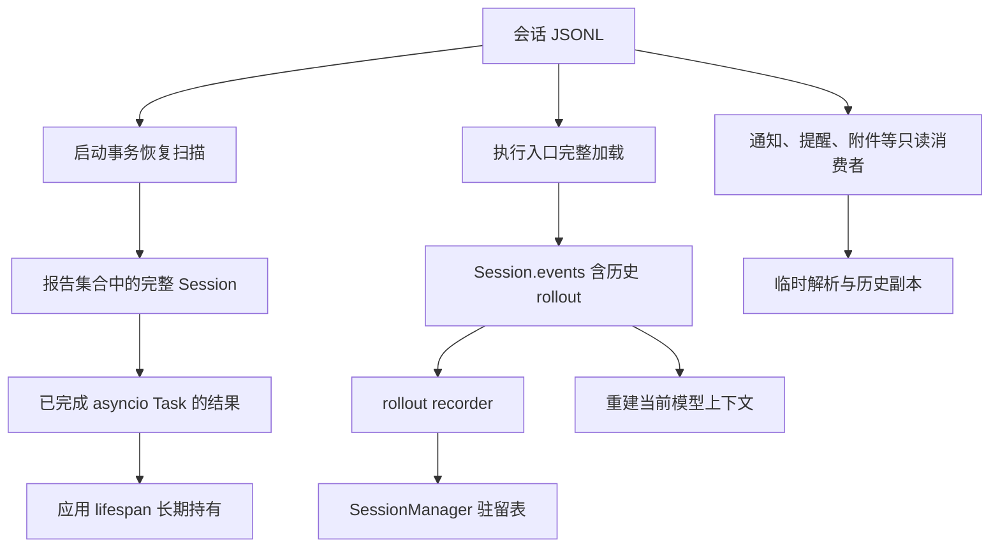

# 145 · 会话资源初始盘点

基线：`f22fbb6d4df7db3f600a7bb5c35d73e05419abf2`。2026-09-30 根据当前源码与 09-29 诊断整理；这是调查记录，不是已确认技术方案。证据强度见 [索引](evidence-index.md)。

后续核对与固定样本测量见 [2026-09-30 调查](investigation-20260930.md)。下表保留初始检查状态；新证据补充了历史前缀依赖、callback 释放反证、记忆队列内容及搜索局部聚合边界。

## 生命周期与持有关系

图描述已检查的引用/调用关系，不代表每条路径的 live heap 占比已测得。

| 边界与入口 | 当前观察 | 已有约束 | 待验证问题 |
| --- | --- | --- | --- |
| `agent_bridge/app.py::_make_lifespan` → `sessions/recovery.py::reconcile_known_sessions` | Task 返回全体报告，报告含完整 Session，任务对象保留到应用退出；隔离实验已复现 | 启动幂等与事务恢复保护 | 去掉结果持有后是否仍有异常 traceback、observer 或其它长期引用；逐会话峰值 |
| `sessions/store.py::load/_read_records` | 分块读取后仍保存全部解析 Event | 快照前缀、读锁、损坏恢复诊断 | 全量业务 Session 是否混入消费者不需要的内部记录；峰值与最终对象集分别是多少 |
| `sessions/manager.py::_runtime_states` → recorder.session | 已使用会话保持完整 Session；close/delete 释放入口可见 | writer lease、执行互斥、来源校验、暖路径复用 | 闲置会话预算、活跃保护、恢复延迟，以及引用移除和实际释放是否一致 |
| `sessions/rollout.py::record/commit/restore_rollout` | 每个 commit 携带累计 active UUID 与 epoch/context/witness；事件继续进入 Session.events | transcript hash、commit chain、损坏与降级语义 | 哪些内容可复用、哪些必须独立保存；当前 checkpoint 能否自包含；旧数据读取的兼容边界 |
| `sessions/query.py::SessionQueryCache` | 64 entries、64 MiB 估计预算；查询投影排除 rollout | 版本校验、single-flight、不可变结果 | 估计值基于序列化字节等，是否代表 Python 实占；进行中构建与已暴露引用是否额外放大 |
| `sessions/search.py` | 搜索缓存条目数限制 64 | 来源版本/存活会话校验 | 大条目的总字节量与查询期间临时字典占用 |
| `notifications/service.py::on_terminal` 等 | 为通知事实加载完整会话 | 终态与通知语义 | 是否可只读必要字段；同一时刻与驻留 Session 并存的峰值 |
| `reminders.py`、`session_files/service.py` | 存在完整 load 消费者 | 提醒、附件权限与来源规则 | 必要信息范围、跨会话并发、是否误用执行型读取 |
| `attachment_reconciliation.py::reconcile_attachments` | 启动遍历会话并完整读取，只消费附件引用 | 附件可达性与清理正确性 | 与事务恢复扫描重叠/顺序的成本；能否避免内部 rollout 解码及上一份 Session 与下一份同时存活 |
| `runtime/listeners.py` | 单 run journal 有 2 MiB/2048 条边界，另有按订阅者与 run 的 turn buffers | 终态 flush、取消订阅与 journal 清理 | 各类缓冲是否都按字节有界；慢消费者、长工具轮及中断时是否回收 |
| `runtime/__init__.py` | terminal snapshots 有 TTL/数量限制并触发 journal 清理 | 活跃运行与历史快照分开 | 淘汰触发时机、长时间空闲后的保留、callback/exception 是否保留大对象 |
| `command_runtime/runtime.py` | 输出尾部默认 256 KiB，终态进程数上限 128 | 截断信息与执行证据持久化 | 多流、多个副本、发布定时器与大块输入的瞬时放大；单项边界不代表全局预算 |
| 记忆观察、检索、后台抽取 | 属于共享 Session 消费链，需要纳入盘点 | 记忆事实与抽取/召回边界 | 尚未完成逐对象计量；不能将记忆模块名称与物理内存占用混同 |
| Tauri/WebView/voice/外部工具 | 首次进程分账已排出 Bridge 大头 | 独立进程与 runtime identity | 后续同口径测量仍须独立列出，不能把 OS 共享页重复相加 |

## 不可丢失的兼容性约束

- 需求 113：rollout 是跨进程 model transcript 的持久事实源；恢复不能静默回退到只含业务消息的历史；当前完整提交链校验不能被末尾读取替代。
- 需求 122：有效驻留连续发送应复用；回收策略不能把每个新轮次变成冷恢复，来源变化和单写者保护必须保留。
- 需求 144：成功压缩后的有效上下文应被恢复；原始用户记录仍须可查询，token 压缩与进程内存/磁盘回收需分别判断。
- 运行中的命令、审批等待、未知副作用和取消收尾有独立生命周期；窗口关闭或无人订阅不等于可以销毁其状态。

## 下一步有区分力的验证

1. 冻结私有 A/B 副本并记录版本/大小/hash；建立合成增长样本，区分轮数、每轮记录量、会话数与重复上下文体积。
2. 分别测量启动扫描完成但没有打开历史、首次执行加载、持续发送、多会话切换、空闲与重启；每个阶段记录私有提交、工作集、峰值和对象存活。
3. 以低副作用的只读读取与 fake provider 验证替代完整产品启动；区分完整恢复和只读投影，不在真实用户目录运行修复型恢复。
4. 验证启动扫描结果释放后的剩余占用，再判断驻留回收与历史持有分别能解释多少；不把一次修正后的下降归功于所有候选改动。
5. 在明确权限、持久化、异常与重连约束后提出设计；确定可行预算和回归矩阵，再请求方案确认与实施授权。

2026-09-30 进展：第 1 项的 A/B 固定副本及哈希已完成；第 2、3 项已完成 query 与完整恢复的 12 次隔离基线，未执行完整应用矩阵。第 4 项保留 09-29 的单会话生命周期反事实；尚无产品候选或全量 live heap 对账。
