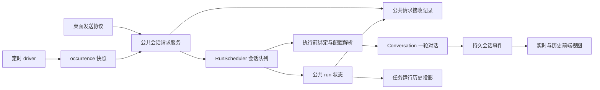

# 154 · 会话定时请求与任务管理技术方案

## 状态

CONFIRMED

2026-10-06 以本次方案讨论和用户补充的归档／重启边界收敛。需求见 [requirement.md](./requirement.md)。代码实现尚未开始；实现进度与验证结果由进入实施阶段后建立的 `progress.md` 承载。

## 1. 现状与改动边界

分析基线为 `4fe7151a4be4dc877c8fb87986dd2298d3818195`。当前分支只有本需求文档，未进行运行验证。

| 现有能力 | 当前边界 | 本期调整 |
|---|---|---|
| `agent/scheduled_tasks` 的 task、occurrence、SQLite 和 driver | task 只记录创建来源；claim 为每次运行分配新 session | task 保存明确目标；occurrence 冻结目标和请求，运行固定会话 |
| `agent_bridge/scheduled_tasks/runner.py` | 创建独立 scheduled session，以 PROACTIVE 提交 | 通过公共请求服务提交，不创建执行专用会话 |
| `agent/runtime/scheduler.py` | per-session mailbox、worker pool；interactive 会取消低优先级工作 | 保留唯一调度队列，拆开排队优先级与可被替代策略 |
| `protocols/ag_ui/routes.py` | 解码、附件准备、会话绑定和 submit 集中在协议入口；忙时拒绝 | 抽出公共提交服务，正常桌面请求允许排队；协议只负责请求／事件转换 |
| `Conversation` 单轮模型快照 | 绑定会话默认模型；审批中心读取会话模式 | 扩展本轮模型覆盖与按 run 解析权限，默认配置不变 |
| 附件资产与草稿 | 草稿有 TTL；回收主要依据会话消息引用 | 保存任务／待执行请求的资产引用，纳入共同回收边界 |
| 主窗口、会话同步和消息定位 | 已有 workspace 导航、虚拟消息列表和搜索锚点 | 增加任务页面与通用消息锚点导航，复用现有展示与同步 |

表内 `agent/…` 指 `agent/src/agent/…`，`agent_bridge/…` 指 `agent_bridge/src/agent_bridge/…`。详细静态证据与局限见 [evidence-index.md](./evidence-index.md)，不在本文重复竞品判断。

## 2. 职责和数据流

- `scheduled_tasks` 拥有任务定义、时间安排、触发去重、旧任务迁移和 task → occurrence 关系。
- 公共会话请求层拥有请求内容、接收幂等、输入资产引用及接收／执行结果记录；它不读取任务表或理解周期。
- `AgentRuntime/RunScheduler` 继续拥有唯一执行队列、同会话串行、跨会话容量、取消和运行状态。请求记录库不扫描或派发工作，不成为第二个 scheduler。
- Bridge 请求服务负责接入资产、模型目录、审批中心、会话生命周期及 Runtime；桌面协议和 scheduled runner 都调用它，不发送本机 HTTP 回环请求。
- UI 使用后端配置、公共 run 状态及会话事件，不根据计时器或回复文本自行推断执行完成。
- 本期统一桌面普通发送与定时发送；编辑重发、继续任务和其它协议保留自身语义，不为形式一次性重构所有入口。共用模型／权限／取消基础能力时必须覆盖相邻回归。

## 3. 公共请求和接收记录

### 3.1 请求边界

在 `agent/src/agent/session_requests/` 放置小型 typed model、编解码及接收记录存储；在 `agent_bridge/src/agent_bridge/session_requests/` 放置提交服务与资产／会话接入。模块不依赖 scheduled_tasks。

公共请求包含：

| 字段组 | 内容与约束 |
|---|---|
| 身份 | `request_id`、`run_id`、`session_id`、预分配 `user_event_id`；同一逻辑请求重试保持身份 |
| 输入 | 正文、已验证的附件资产引用、已有引用片段／Skill 选择；复用当前输入类型 |
| 配置 | 可空的模型运行配置覆盖、审批模式覆盖；空值表示跟随目标会话 |
| 来源 | 可选来源 kind、来源引用与显示快照；队列不据此分支 |
| 执行控制 | 输入通道、surface、控制 scope、通用排队／替代策略，由可信适配器提供 |

普通客户端不能伪造 scheduled 来源、自动审批授权或内部控制 scope。scheduled adapter 根据实际 occurrence 构造来源。源 ID、消息 ID、run ID 各自命名，不把它们当作可互换的 opaque ID。

### 3.2 接收顺序与幂等

1. 验证目标、请求结构、附件身份与配置选择，并取得公共会话准入保护。
2. 消费上传草稿，保存持久资产引用；用稳定 request/run 身份保存请求接收记录。
3. 提交现有 Runtime 队列，返回 request/run 身份及准入状态；容量不足或不可接收时保存明确拒绝结果。
4. worker 获得该会话执行权后重新检查目标仍存在且未归档，再解析执行配置、准备附件和 Conversation。
5. 开始本轮时持久化 user_message；消息成功落盘后才报告 `input_accepted`。接收排队与消息已落盘是两个不同事实。
6. 公共生命周期回调持久保存结束结果，scheduled adapter 仅按稳定 ID 更新 occurrence 投影。

同 ID 同内容返回已有接收结果，不再次排队；同 ID 不同输入返回冲突。终态请求不以相同 ID 自动重放，用户再次运行应生成新请求／occurrence。

接收记录使用独立的 SQLite 存储，路径由 `agent.paths.session_requests_db_path()` 与 settings 注入，位于用户数据目录 `session-requests/session-requests.db`。不把通用请求表塞进 scheduled_tasks 数据库，不持久保存 Python callback、凭据或 provider secret。

记录最小保存输入快照、身份、来源、准入时间、已开始／已接受消息事实、终态和原因。Runtime 是进程内执行状态 owner，接收记录是持久事实；恢复使用稳定身份核对两者，不依赖轮询时间猜测状态。新增生命周期观察回调保持有序且幂等，回调失败须记录持久化错误并禁止同 ID 重放。

### 3.3 重启语义

- 启动时，在允许新请求和启动定时 driver 前执行对账。
- 若会话中已有匹配 run 的可靠持久终态，以该事实补齐接收记录与 occurrence，不能把成功执行改成中断。
- 已接收但没有可靠完成事实的请求（包括排队和执行中）记为 `interrupted`，原因区分重启前未开始或执行未完成；不重新入队。
- 尚未提交 Runtime 的 occurrence 继续使用现有有界恢复；提交前必须先检查稳定 request/run 身份是否已有接收事实。存在记录就对账，不能重复创建请求。
- 请求记录与 occurrence 跨库写入通过稳定 run ID、提交前检查和启动对账恢复，不宣称存在跨库事务。无法确定是否开始时采用中断而非重试。
- 正常周期的未来计划仍按现有 driver 执行；暂停或目标不可用不补跑暂停期间的计划。

## 4. 会话队列与生命周期

### 4.1 排队策略

- 保留 RunScheduler 的 mailbox／worker 模型。桌面手动请求和定时请求均属于显式用户工作，以相同优先级按接收顺序串行执行。
- 将“优先级”与“是否可被新请求替代”分离为通用策略；显式用户请求默认不可被新请求隐式替代。
- 普通手动消息仍可沿用现有对可替代后台主动轮的处理；定时请求只入队，不主动打断当前轮。scheduler 只接受通用策略，不判断任务来源。
- 后端保留 `InteractiveBusyPolicy.QUEUE` 通用能力；本期聊天输入框及前端 send store 在会话忙碌时拒绝手动发送，不开放手动入队交互。编辑重发等需要稳定历史的操作继续拒绝忙碌。
- 继续使用全局和每会话容量限制；拒绝有明确原因，不用丢弃旧显式请求为新请求腾位。
- queued 取消只取消指定 request/run，不取消会话中正在执行的其它请求；running 取消继续联动审批与命令进程清理。

### 4.2 归档、删除及竞态

归档后的会话不可接收或启动定时请求。不能只靠“暂停关联任务”一次写入保证此规则，提交和实际执行前都必须检查会话状态。

会话管理复用并扩展 Runtime 的 mutation reservation：

1. 若有 active run，保持现有忙碌错误；提示先结束／取消运行，不谎报归档成功，也不偷偷终止正在执行的工作。
2. 若只有 queued 工作，进入原子 mutation barrier，防止 worker 在归档过程中启动下一项。
3. 持久化 archived 状态，暂停关联可运行任务并保存 `target_session_archived` 原因；取消该会话未开始的请求并保存原因。
4. 释放 barrier 后，任何迟到提交仍由 archived 检查拒绝。若暂停任务投影失败，归档状态门禁仍禁止执行；启动／后续查询对账修复任务展示。

删除沿用同样的准入互斥和取消边界，随后执行既有会话删除及附件引用回收。批量删除归档会话必须经相同服务，不遗漏 task 关联。持久会话管理提供变更通知，Bridge 订阅并协调任务；SessionManager 和 scheduler 不直接依赖定时任务模块。

取消归档不会恢复暂停任务。用户显式恢复时重新校验会话、模型、附件和 Skill，并从恢复后的未来计划点开始，不补归档期间的触发。

### 4.3 任务变更

| 动作 | 未来触发 | 已接收请求 |
|---|---|---|
| 修改任务内容／目标／配置 | 使用新修订 | 使用原快照；跟随项仍在执行时读取原目标会话 |
| 暂停任务 | 停止 | 继续，可单独取消 |
| 删除任务 | 停止并软删除定义 | 继续，可单独取消；保留来源与快照 |
| 归档／删除目标会话 | 停止，任务展示目标原因 | 未开始请求取消；active run 必须先结束才能完成归档／删除 |
| 应用重启 | 活跃计划恢复正常调度 | 无持久终态的已接收请求记中断，不自动重放 |

同任务非终态 occurrence 包括排队、运行和等待审批。其间下一触发仍按 099 的非重叠规则留下 skipped 记录，不因固定会话而累积无限重复请求。

## 5. 请求级模型与权限

### 5.1 模型快照

- 扩展 Conversation 的单轮执行参数与 `_capture_run_model_snapshot`，支持传入可选 ModelRuntimeConfig。
- 执行准备阶段读取目标会话当前模型／推理配置，用同一模型目录验证覆盖配置；固定模型不可用时明确失败，不静默改用其它模型。
- 覆盖模型通过现有 factory 和 provider execution binding 构建本轮 client，覆盖上下文窗口、预算、工具能力与推理参数的实际消费点；不调用 `switch_model_config` 或写 model_config_change。
- 成功、异常、取消及 generator 提前关闭都在同一 finally 边界释放本轮绑定；异常发生在快照构造期间也必须回收部分初始化状态。
- run_started、用户／助手事件、usage 和诊断中的实际模型标识取本轮有效配置，不能继续写会话默认模型而造成证据错误。

### 5.2 审批解析

- 只使用现有 `per_request`／`session_auto` 模式，不新增批准生命周期。
- 审批中心提供按 `session_id + run_id` 查询有效模式的入口。覆盖由可信公共请求服务在执行边界注册，完成或取消时释放；不修改 SessionMetadataStore。
- 未覆盖时保留会话模式的动态读取和版本校验，用户在运行期间改变会话权限仍沿用既有撤回／确认语义。
- 覆盖时使用本轮覆盖版本；命令恢复、文件审批、待审批批量处理及提示词的权限说明都读取同一有效来源。
- 会话改为自动模式不得批量放行明确覆盖为 per_request 的本轮请求；覆盖自动模式也不能影响其它 run 或成为长期授权。
- 审批卡标明本轮有效模式及来源；“对整个会话启用自动授权”等既有操作仍属于显式会话设置，不能被解释成修改任务配置。存在覆盖时避免展示会误导用户的模式切换操作。
- Agent 工具不可通过自报字段获得自动授权。任务创建／修改的权限覆盖经既有可信用户设置入口确认，工具复用已授权配置或返回需用户设置的明确结果。
- 灾难性操作门禁、目标重校验及 once 审批继续保留；决策来源可区分会话自动与本轮覆盖自动，但它不是新的权限等级。

## 6. 任务持久化与旧数据

### 6.1 新字段与快照

保留现有 task、occurrence、revision、schedule 和终态。新增字段按当前 SQLite 迁移风格落位：

- task：`target_session_id`、附件引用、可空 model_config_override／approval_mode_override、绑定状态与暂停原因。
- occurrence snapshot：目标会话、正文、附件、配置选项、Skill、task revision／名称及消息身份；不可被后续任务修改覆盖。
- occurrence：稳定 `request_id`／`run_id`／`user_event_id` 与实际开始时的有效配置，既有 session_id 继续表示此次实际目标。
- `origin_session_id` 继续只表示创建来源，不改名充当目标。
- 只有旧任务迁移期间允许目标为空；任何新创建或恢复任务均要求明确存在且未归档的目标。

新建会话通过已有会话创建服务一次完成，使用稳定创建意图 ID 防止保存重试产生多个会话。任务保存失败时保留可重试的同一目标，不删除可能已被用户使用的会话。

### 6.2 旧任务迁移

- 在 driver 启动前做幂等 schema/data migration。旧任务标记 `needs_target`，旧 active 任务暂停；已删除任务不复活。
- 不用 origin_session_id 或“最近一次运行会话”猜目标。UI 展示待确认并允许选择已有普通会话或新建一个。
- 保留旧名称、指令、schedule、Skill 及模型选择；旧固定模型映射为显式覆盖，用户可在确认时改成跟随会话。旧 persona 信息只作历史，不覆盖目标会话人格。
- 历史 occurrence 的实际 session/run、来源和最终结果不改写；旧无 user_event_id 的记录可从既有 run 关联确定消息，无法确定时只打开会话并诚实提示。
- 旧未提交 occurrence 在迁移期间终止或阻断并记录 `target_confirmation_required`，不在确认后补发；已提交未完成运行按重启中断规则处理。
- 绑定确认和恢复使用 revision 乐观锁；暂停期间不推进成一串待补跑任务。

## 7. 附件与来源事实

### 7.1 资产寿命

- 表单编辑仍使用现有上传草稿；成功保存任务时验证、消费草稿并保存 canonical AttachmentRef，之后不依赖 draft ID。
- 原件引用 owner 包括未删除任务、需要保留的 occurrence 快照、公共待执行请求和所有历史会话附件；旧 scheduled session 也必须纳入扫描。
- 同一 task 多次发送复用原件，不反复上传／复制原件；会话工作副本继续按现有 151 行为准备。
- 新引用提交与回收共享资产变更保护：先验证／保护资产，再提交引用，之后释放临时保护。回收不能在扫描后、引用提交前删除正在接入的原件。
- 修改任务移除附件不影响已排队快照和旧消息；删除任务不释放其它 owner 仍引用的资产。无历史／快照引用的原件继续按既有回收期限处理。
- 请求被取消或拒绝后仍保留最小记录；释放资产引用前保证任务／历史快照的必要引用已建立。不以后台吞错方式把丢失附件变成无附件请求。

### 7.2 消息来源

来源作为 user_message 的可选结构化字段，由宿主写入：`kind=scheduled_task`、task ID、occurrence ID、任务名称快照。手动消息不携带该来源。

- 新消息记录来源，老消息缺字段仍可正常加载。
- 源名称作为纯文本显示，不解析为 HTML；路由只使用稳定 ID。
- 同一消息的实时投影和历史投影读取相同字段；不靠正文前缀、会话 origin_kind 或当前任务名称反推来源。
- 手动编辑重发定时消息属于新的手动请求，不复制“由任务发起”的标识；旧运行记录保留原消息身份，原消息若已因重写不可见则显示明确反馈，不跳到相似文本。
- 消息来源是展示与审计元数据，不复制为第二份用户指令或权限声明；会话摘要／上下文恢复不得改变原说话人。

## 8. API、工具与前端

### 8.1 入口与查询

- 继续使用 `/v1/scheduled-tasks` 及详情、pause、resume、runs、occurrences 等既有路由，扩展请求／响应以暴露目标、配置、附件及绑定状态。
- 普通 AG-UI 路由保持 wire 兼容，改由公共请求服务提交；排队生命周期与运行 SSE 分离理解，连接断开仍遵循 DETACH。
- 增加公共会话请求查询及取消边界供待发送 UI 使用；run ID、会话 ID 和 runtime instance 必须校验。任务页的停止操作也调用公共取消能力，联动审批与命令清理。
- scheduled run 作为普通桌面会话工作使用可由用户控制的公共 scope，不沿用导致桌面无法停止的私有 scheduled-only scope；权限由可信适配器分配。
- 任务 get 可返回已删除状态及历史；列表默认不列已删除任务。消息蓝链打开已删除详情时显示只读状态。
- 任务变更提交后发布 invalidation，页面重新读取服务端版本；运行阶段复用公共 run push。断线重连重新拉取任务／运行快照，不新增前端计时执行器。
- task 管理工具的 schema、description 和结果同步目标选择、附件身份、覆盖模式、迁移阻断与错误恢复；未知字段和歧义 ID 在确定性边界拒绝，错误能指明正确下一步。

### 8.2 页面结构

- 主窗口增加 `scheduled-tasks` workspace target，与现有平级 surface 一致；Rust/Tauri 导航 envelope、前端类型和状态同步更新。
- 列表展示任务名称、目标会话、状态、下次执行及最近结果；详情提供配置摘要、编辑入口、运行历史和管理操作。
- 创建／编辑采用 shadcn 表单组件，模型／思考强度、审批模式与 Skill 收入更多设置；下拉显示解析后的实际模型和强度，未修改时仍保存跟随语义，覆盖后可恢复会话配置。附件使用 Button 触发隐藏的文件 Input。
- 时间入口按后续用户确认只开放一次、每天、工作日、每周，已有其它频率可保持原安排；时区自动取得并只读显示。日期采用 CLI 引入的 Calendar 与已有 Popover 组合，时间用已有 Select 选择小时／分钟；页面组合保存在 `pages/scheduled-tasks/components/`，不伪称独立官方 DateTimePicker。序列化保留本地墙上时间，不经 UTC 转换；缺少一次性日期时不创建会话。调度仍使用现有后端能力。
- 删除确认采用 CLI 引入的 AlertDialog，并复用项目 PortalHost 适配 Activity 隐藏；错误提示复用已有 Alert。新组件按项目主题 token、目录和 barrel 约定适配。
- 列表和运行历史通过底部可见性观察追加分页，后台刷新保留已加载范围，展示计划时间、实际开始／结束、状态和原因；等待审批可打开关联会话处理，不在任务页复制另一套审批实现。

### 8.3 等待请求和消息定位

- 会话输入区附近显示通用待发送列表，包含内容摘要、附件、来源和取消操作。这里只管理待执行请求，不把它们提前渲染成已发送消息。
- 根据 2026-10-07 用户确认，普通发送恢复忙碌时 busy 拒绝并保留草稿；输入框执行中显示原生停止图标，不额外显示“停止回复”文字按钮，不提示发送入队。手动队列交互延后细化。
- 前端待发送状态按 request/run ID 保存，可在同一会话存在多项；不能复用一个“当前发送”槽位覆盖前一请求的 controller、消息占位或终态。
- 等待列表只展示 queued 且未接收的请求；进入 running 后即移除，避免把准备阶段误标为排队。用户消息仍在 input_accepted 后通过持久化和公共同步进入消息区；两种状态不能混为一谈。
- 来源提示位于用户气泡上方，灰色辅助字和蓝色任务链接均使用主题 token；其它用户气泡布局保持现有组件能力。
- 导航扩展 `sessionId + messageEventUuid`，从现有搜索／引用定位抽取通用锚点能力；必要时加载对应历史页，虚拟列表滚动后高亮，不能依赖目标消息已在 DOM 中。
- 请求导航带序号，用户切换目的地时旧异步加载不能把页面拉回；已归档会话可按现有只读／打开规则查看历史，查看不恢复任务。

## 9. 涉及模块与影响

| 路径／模块 | 改动 |
|---|---|
| `agent/src/agent/session_requests/`（新增）、`agent/paths.py` | 公共请求契约、接收记录、幂等和路径 |
| `agent/src/agent/runtime/` | 通用队列策略、生命周期观察、mutation barrier 和取消 |
| `agent/src/agent/conversation.py`、会话事件／模型历史 | 本轮模型配置、实际配置元数据、消息来源、恢复兼容 |
| `agent/src/agent/approvals/`、`command_runtime/`、`filesystem/` | 本轮权限解析、pending 处理与恢复重校验 |
| `agent/src/agent/scheduled_tasks/`、工具 `scheduled_task_manage` | 目标绑定、快照、迁移、状态与工具契约 |
| `agent/src/agent/attachments/` | 资产引用交接和回收竞态保护 |
| `agent_bridge/src/agent_bridge/session_requests/`（新增） | 公共提交服务、执行前准备及控制 scope |
| Bridge AG-UI、scheduled runner、routes、assembly、settings | 共用服务装配、查询／取消、生命周期联动、初始化恢复顺序 |
| Bridge `attachment_reconciliation.py` | 合并任务／快照／请求／全部会话的可达资产 |
| 前端 services/types/stores | 任务接口、请求等待态、来源投影与刷新 |
| 前端 `pages/scheduled-tasks/`（新增）、chat 组件 | 列表、详情、表单、来源和待发送展示 |
| 前端 workspace 与 Tauri 导航 | 任务详情和消息锚点的统一导航 |

现有 099 调度与 Reminder adapter 的时间语义不变。公共权限、附件和会话管理会影响手动对话、命令恢复、IM 等调用方，需以相关回归测试证明没有扩张行为。实现前不重排这些模块的无关代码。

## 10. 验证与交付

验证覆盖需求 AC，先确定性机制，再经用户授权的真实观察：

- 队列：同会话 FIFO、跨会话并发、手动与定时交错、后台主动轮、容量、排队取消、归档与 dequeue 竞态；不靠 sleep 推测顺序，使用 barrier 控制。
- 接收：同 ID 幂等／内容冲突、记录写入前后崩溃、Runtime 接收后投影失败、历史终态已写但 receipt 未更新、重启中断；证明无重复执行。
- 配置：跟随执行时配置、覆盖后正常／异常／取消不泄漏，实际模型日志一致；逐次／自动模式交叉覆盖、待审批切换和命令恢复重校验。
- 附件：保存后首次未触发、长时间排队、重启、多个任务共用、修改／删除、回收竞态、旧 scheduled 历史和原件损坏。
- 迁移：升级前 active／paused／exhausted／deleted、未提交／已提交 occurrence、重复升级、目标确认 revision 冲突，确认后不补迁移期间任务。
- 投影与 UI：消息来源实时／重开一致、手动重发来源、已删除任务、锚点不在当前历史页、异步导航失效、多个排队请求互不覆盖。
- 工具：最终工具 schema 与 parser 一致、目标 ID 的来源、非法附件／配置、权限覆盖不能靠模型自报授权。

按项目入口运行 `scripts/check/run.ps1 --stage backend`、`--stage frontend`、`--stage rust`（mac/linux 对应 run.sh），进入实现后把实际结果记入 progress；本文不把计划检查写成已通过。

后续按用户要求统一组件时，Calendar 的 CLI 引入新增前端依赖 `react-day-picker` 和 `date-fns`，没有新增后端调度依赖。冻结 runtime 影响需在实现 diff 后按规则分类；若新增能力的高风险路径没有既有 frozen smoke 覆盖，按 `frozen-runtime-packaging` 做 package-sensitive 验证，不能因未改依赖就自动豁免，也不自动构建安装包。

桌面视觉验收和真实 LLM 调用尚未授权，实施后按相关规则询问／执行并明确证据类型。文档确认不等于代码实现授权。

## 变更记录

| 日期 | 变更内容 | 是否需要重新实现 |
|---|---|---|
| 2026-10-06 | 首次技术方案；公共请求入口与会话队列、单轮配置、附件寿命、来源导航、旧任务绑定；按用户意见归档停止任务，重启未完成请求标中断 | 尚未开始实现 |
