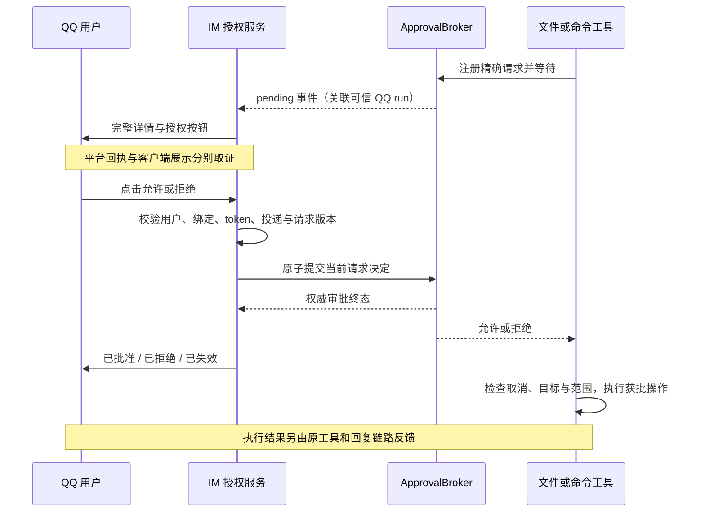

# QQ 会话授权控制 - 技术方案

## 状态

CONFIRMED

2026-10-18 用户确认方案方向，包括完整授权详情无法可靠展示时转桌面处理。本次确认覆盖方案落盘；生产代码实现尚未开始。

## 需求文档

[requirement.md](./requirement.md)

## 现状分析

- `protocols/im/control.py` 负责 QQ 菜单和不透明按钮 token，只有会话、模型、推理强度操作。
- `protocols/im/coordinator.py` 持有整个 IM turn 的绑定锁；现有 `try_mutation` 会在回复期间拒绝修改。审批不能等待此锁。
- `approvals/broker.py` 已负责单次审批、模式版本比较、pending 收敛和高危规则。桌面接口在调用 broker 前完成风险确认校验。
- 文件授权与命令工具从可信调用上下文取得 surface/session/run，目前只接受 `desktop_chat`。QQ 的实际 surface 是 `im:qq`，不得伪装为桌面来绕过限制。
- QQ 适配器使用 Markdown 消息承载按钮；明确的 keyboard 拒绝会触发无按钮重发。当前通用发送回执无法区分“文本已送达”与“按钮随消息被平台接受”。
- QQ interaction ACK 先于业务处理，不能用 ACK 或按钮访问文案代表审批成功。服务端当前也不能证明某条消息在真实客户端完整渲染。

源码证据和版本锚点见 [evidence-index.md](./evidence-index.md)。

## 方案设计

### 模块与数据所有权

授权模式、请求状态、允许范围和执行结果继续由现有 owner 管理：

| 责任 | 所有者 | 本次调整 |
|---|---|---|
| 会话模式与版本持久化 | session metadata + ApprovalBroker | 复用两种模式和版本比较，不增加 QQ 独立模式 |
| 请求 pending/终态、单次决定与高危门禁 | ApprovalBroker | 复用决定接口；补齐 QQ 所需的请求版本校验和受信任 run 入口登记 |
| QQ 绑定和 provider 生命周期 | IMStateStore + IMRuntime | 绑定变更、解绑、provider 替换时失效对应控制 token 与活动路由 |
| QQ 菜单入口 | IMControlService | 展示模式，转交授权专用操作，不继续把审批逻辑堆入现有文件 |
| QQ 授权渲染、按钮与异步投递 | 新增 `protocols/im/approvals/` | 分为 service、rendering、tokens，连接 broker 与 QQ adapter |
| 平台发送与 interaction 转译 | QQAdapter | 保留真实发送结果，明确控件是否随请求被接受 |
| 文件 capability、命令执行及副作用校验 | 原文件/命令工具与 runtime | 接受已登记的 QQ run，继续原有范围、沙箱、路径身份和执行校验 |

不引入新的外部依赖，不改变 session metadata 的持久化格式。token 和运行路由只存在当前进程内，重启后全部失效。

### 可信 QQ 入口

不能只把工具中的 surface 判断改成允许所有 `im:qq`。为一个真实 QQ turn 放行须同时满足：

1. IMRuntime 已验证当前已绑定的 QQ C2C 用户，且本轮已取得绑定对应的 session。
2. IMRouter 在提交运行前登记该 session/run 的授权路由，关联 provider 实例、绑定快照、来源消息和 event loop。
3. 引擎侧只保存平台无关的受信任 run 可用性；QQ 身份、凭据、消息发送器和 token 不进入引擎。
4. 工具使用 Conversation 覆盖注入的 session/run/surface 核对活动登记，不向模型新增可自报的授权字段。

仅开放文件授权与命令工具。无 broker、无真实 run_id、旧的 send-callback-only 调用方、未登记的 QQ run，以及语音、其它 IM、定时任务等入口继续拒绝。桌面路径保持既有行为；桌面应用启动和社交平台登录不随之开放。

活动登记在本轮结束、取消、provider 停止或绑定失效时清理；清理必须作用于确切 run，不能误伤同会话的其它运行。异步路由取消时同步撤销登记并清理该 run 的 pending，不能只取消投递 coroutine 而遗留等待中的工具线程。执行前继续检查 runtime 取消状态和原工具的目标/范围身份。

### 档位菜单与风险确认

主菜单增加当前模式和“授权设置”。授权页面给出两个现有档位及会话标题；返回菜单时重新读取 broker 状态。

切入免授权使用两步操作：选择档位只生成风险说明和确认 token，不修改模式；确认 token 绑定当前绑定、会话、模式版本、目标模式和有效期。取消会失效同一次确认的 token，不能随后再次点击旧确认生效。每次重新进入都创建新的确认流程。

确认通过后调用 `set_session_mode` 并读取权威结果。版本冲突返回最新模式，提示重新操作，不把用户对旧状态的确认自动套到新状态。退出免授权无需二次确认，但同样检查绑定和版本。

模式控制允许在运行期间执行，不进入 turn 持有的 `try_mutation`。既有会话/模型切换仍遵循原来的 busy 规则。授权控制的最终绑定检查和状态提交之间不跨异步发送；绑定变更与该提交使用统一、短时的绑定校验边界，避免“检查 A、提交时已绑定 B”。

模式属于会话，因此 QQ 的确认会影响同会话桌面运行及已有 pending，风险说明必须说明这一点。调用 broker 后由既有 mode-change 通知更新桌面；QQ 另发成功或冲突结果。模式已经成功持久化但结果消息投递失败时，不擅自回滚，后续菜单读取实际状态。

### 单次审批与详情

通过 broker listener 接收已登记 QQ run 的审批变化。listener 只把不可变事件快照转交 event loop，不在 broker 锁或工具线程里执行网络 I/O。异步发送前重新检查请求仍有效。

审批由独立控制消息呈现，不拼入 assistant 正文流、不等待整轮完成。消息包含会话、请求短标识、当前档位、申请理由、精确对象和风险说明：

- 文件：规范化的每个路径、文件或目录类型、所申请权限、破坏性动作及递归范围。
- 命令：原命令、实际授权目录及来源、文件系统权限、额外与宿主派生目录、网络权限、sandboxed/host_user、运行方式和超时；涉及 Skill 时保留其身份及对应范围。
- 不显示内部环境变量、凭据或可重放 token。采用确定性格式化，转义 Markdown 特殊字符，禁止对授权对象进行摘要、截断或省略。

第一版不做多消息分片审批或“摘要卡片后直接允许”。渲染器先生成完整内容并检查本地长度/可表示性预算，实际编码后的 wire 长度也要检查；预算集中定义并用边界用例覆盖，不冒称它就是 QQ 官方平台上限。实现时核对 SDK/官方限制，真实客户端核对长但在预算内的内容。无法保证完整呈现的对象不签发可批准 token，提示在桌面原会话检查。

普通审批卡片提供“仅本次允许”“拒绝”和授权设置入口。批准对该请求的完整范围作一次性决定；本期不新增 QQ 逐项勾选或部分批准。授权设置入口采用菜单的模式切换语义，已有高危 pending 被拒绝，不复制桌面“批准当前高危卡片并进入免授权”的快捷例外。

已有请求保留 broker 的有界等待（当前文件和命令请求为 300 秒），转桌面时只提示仍有效的请求。QQ 发送失败或不支持按钮不会批准请求，也不会无限延长等待；桌面可在原有效期内处理，过期后需重新发起。即使提示本身发送失败，服务端终态仍必须有界收敛。

### 控件投递事实

在 `OutboundSendResult` 增加有默认值的控件投递状态，用于区分未请求、平台已接受、明确未附带/拒绝和结果未知；保留原 `outcome` 与 message id 的含义及旧调用方兼容性。

- 有有效消息回执且实际发送了 keyboard，才记录该消息的控件被平台接受。
- keyboard 被拒绝后纯文本重发，即使文本 delivered，控件状态仍是未附带/拒绝。
- capability 已为 unsupported 而直接省略按钮，同样不能报告控件可用。
- 超时、无回执或旧 provider 返回 None 按 unknown 处理，不推断送达。

批准和风险确认 token 初始为不可提交，只有对应完整消息及控件被平台接受后才启用。回调先于发送回执时不乐观批准，提示稍后重新打开/操作；投递结果未知时禁用旧 token，不能盲目重发有效授权卡片。该状态仅证明平台接受了消息，不证明客户端已完整显示，后者由真实验收覆盖。

### token、并发与终态

授权 token 使用单独命名空间和有界内存注册表，不将 session id、命令、路径、决策正文编码为客户端可改写参数。登记信息包括 binding、provider 代次、session/run/request 标识、请求种类和版本、模式版本、动作、有效期以及投递状态。

处理回调时验证：可信 C2C operator 与绑定一致，token 当前有效，绑定未变化，provider 代次匹配，完整详情已提交，目标 run/request 仍待处理。随后调用 broker 的原子决定接口；补齐可选 expected request version 校验，不让“先读取 pending、稍后无版本提交”的流程成为新入口。

所有新参数保留旧调用方兼容默认值。QQ 必须传完整 session/run/kind/version；桌面与 QQ 最终竞争同一个 pending 状态，首个有效决定成功，其余返回已处理/失效。文件允许使用请求自己的完整批准决定，拒绝使用其否定决定，不能根据回调字段重新组装权限。

重复 callback、重复 token 点击、桌面先批准、超时、取消、删除与 mode 自动收敛都不会再次执行。取消/失效和拒绝分开表述；按钮 visited 文案仅写“已点击”之类中性反馈，实际业务结果由后续消息确认。

QQ 历史消息不依赖编辑或撤回能力：请求变为终态时使相关 token 失效并发送状态说明，历史卡片即便仍可见也不能再生效。服务端记录已批准只意味着可以继续，执行完成/失败由原工具结果与进程状态证明，不把批准提示写成“操作成功”。

### 数据流

## 涉及文件

以下路径为当前预期边界；实现中可在同一职责目录拆小文件，不改变上述协议和状态语义。

| 路径 | 变更 |
|---|---|
| `agent/src/agent/approvals/` | 平台无关的可信 run 入口登记与请求版本校验 |
| `agent/src/agent/filesystem/tools.py`、`command_runtime/tools.py` | QQ 可信入口判断及可行动错误；保留原有执行边界 |
| `agent/src/agent/conversation.py` | 核对隐藏上下文注入；只在现有可信 session/run/surface 不足时补充宿主信息 |
| `agent_bridge/src/agent_bridge/protocols/im/approvals/` | 新增专用服务、完整渲染和 token 生命周期 |
| `protocols/im/control.py`、`router.py`、`runtime.py`、`state.py`、`coordinator.py` | 菜单、运行登记、生命周期与短时绑定校验；只改实际需要的 owner |
| `protocols/im/provider.py`、`adapters/qq.py` | 控件投递结果与回调证据 |
| `agent_bridge/src/agent_bridge/assembly.py` | 注入同一 broker、state、服务和 listener，并处理停止/清理 |
| `agent/tests/`、`agent_bridge/tests/` | 状态、工具链、投递、身份、并发及回归测试 |
| `scripts/im-smoke/`、`scripts/README.md` | 必要时扩展现有双端入口，提供确定性 QQ 授权验证/证据采集模式；不默认发送真实消息或调用模型 |

本期预计无需修改 Tauri UI，也不新建桌面模式状态。若需要改变桌面可见交互，重新评估 frontend 规则与视觉验收边界。

## 验证与联合验收执行方式

本节是需求 AC 的执行方法，不新增另一套验收标准。

### 确定性验证

1. broker、入口登记和工具链：已绑定 QQ 可走正常审批/免授权；仅伪造 surface、不同 run、生命周期已失效、语音和定时任务均不获得能力。
2. 真实 Conversation 隐藏参数与工具边界：使用 fake 模型发出工具调用，验证请求、允许/拒绝、结果续接以及临时目录中可观察的副作用；不能只测试消息字符串。
3. QQ 适配器 wire：完整 Markdown、特殊字符、长路径/命令、多文件与边界长度，keyboard 拒绝降级、无回执、延迟回执、callback 先到和重复回调。
4. 并发与异常：pending 期间操作、桌面先处理、模式切换收敛、会话绑定 A→B→A 后旧 token、取消、删除、超时、provider 停止和重启，确认执行次数和终态。
5. 高危请求只测拒绝与无副作用，不实际执行危险命令；原文件、命令和桌面授权回归继续运行。最终执行项目 `scripts/check/run.ps1` 或对应 `run.sh`。

### 真实 QQ 联合验收

自动化通过后安排一个连续验收窗口，先核对专用测试会话、QQ 客户端平台/版本及唯一运行实例。确认 bridge 来自当前候选且晚于改动启动；需要接管既有用户实例时先获得授权。保留明确 HEAD、未提交 overlay 和必要内容 hash，不能只记录分支名。

| 阶段 | 用户在实际 QQ 操作 | coding agent 核对 |
|---|---|---|
| 菜单与风险 | 打开菜单、取消免授权确认、确认开启、切回每次授权 | 当前会话、模式版本、确认 token 生命周期、桌面状态一致性 |
| 单次文件 | 允许临时测试文件操作，再拒绝另一项 | 完整路径/权限、回调关联、审批终态、文件内容与无副作用证据 |
| 单次命令 | 允许无害命令，再拒绝一次 | 命令/目录/权限展示、回调、仅一次启动、输出/退出码 |
| 免授权与 pending | 等待审批时开启免授权，再完成普通任务并切回 | 既有 pending 收敛、后续自动允许与恢复每次授权 |
| 跨端与旧按钮 | 桌面先处理后点 QQ 旧按钮，重复点击及会话切换后再点击 | 无重复执行、无串会话，客户端提示与实际状态一致 |
| 长详情与恢复 | 查看预算内长详情和超预算提示；在安排好的断连/重启后操作旧按钮 | 全量可读性、无不完整批准、token 失效与有界终态 |

每轮只给用户当前需要操作的少量步骤，获得该轮结果后再推进。普通平台故障使用确定性注入覆盖，真实环境只记录实际发生的故障，不为了完成表格随意破坏连接。

以同一测试步骤关联 session/run/request、平台消息回执、interaction、broker 状态和副作用。记录用户所见/反馈与服务端观测为不同证据来源；时间只作为辅助关联，不能用相近时间替代请求身份。截图或录屏由用户按需提供，不声称 coding agent 已直接观察 QQ。

必须等待用户对真实客户端结果的确认，缺一端证据时保持 `not verified`。真实模型调用另按 `llm-api-confirm` 在执行前说明目的、配置与粗略调用量并取得本次授权；按钮操作与 fake 验证本身不需要调用模型。平台消息发送只在明确开始的联合验收范围内执行。

## 影响分析

### 上下游与兼容性

- 模式仍作用于整个持久会话；QQ 确认页需解释会影响同会话桌面 pending，不能让用户误认为只改 QQ。
- 文件 scope 与 action grant 的轮次边界、命令结构与沙箱设置不变。现有 provider schema 不暴露新授权字段，错误文案按真实可用入口调整，不增加全局 prompt 例外。
- 新增发送回执字段带默认值，所有 fake provider 和 `send_observed` 包装核对透传；旧测试返回 None 不能被新审批路径视为成功。
- provider 重连与替换分开处理：同实例短暂重连不自动重放未知投递；替换/停止撤销活动路由，重启不会恢复 token。
- 不迁移会话数据，不添加依赖或动态导入。实现后依据实际 diff 和既有 frozen smoke 覆盖判定打包等级；若新增 QQ 能力的高风险路径未被 frozen capability smoke 覆盖，则按 `frozen-runtime-packaging` 走 package-sensitive/runtime-only 验证，不自行构建安装包。

### 主要风险与处理

- **客户端不可直接观察**：用联合验收补齐展示证据，发送成功不冒充可读性确认。
- **跨线程/异步等待**：broker listener 不阻塞，所有异步投递均有有界生命周期；拒绝等待 turn 锁的审批实现。
- **详情渲染造成授权歧义**：不截断、不摘要，不支持的字符/长度转桌面；实际客户端长详情必须实测。
- **结果消息丢失**：保留 broker 权威结果与关联日志，重新打开菜单/请求读取当前状态，不重放副作用。
- **身份校验与状态提交之间发生变化**：把最终绑定核对、token 消费及 broker 决定放在明确的同步边界，网络发送在外；通过竞态测试证明旧 token 不能复活。

日志仅记录关联标识、请求种类、版本、投递状态、状态变化与错误类别。用户/绑定标识按现有脱敏方式处理，不写完整命令、文件正文、凭据或 token。详情在用户授权界面展示与日志留存是两个不同边界。

## 变更记录

| 日期 | 变更内容 | 是否需要重新实现 |
|---|---|---|
| 2026-10-18 | 确认 QQ 授权服务、可信 run 入口、完整详情降级、控件回执、跨端并发与联合验收方案 | 尚未实现 |
