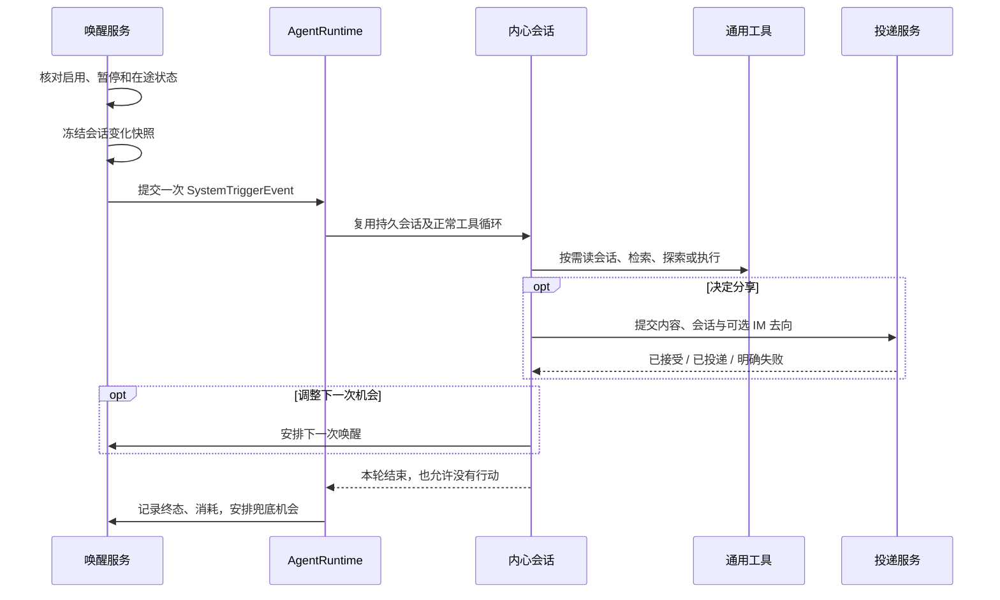
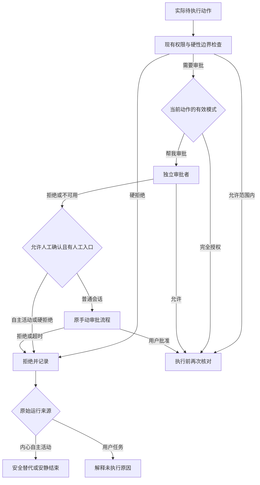

# 169 · 自主行动、内心会话与主动陪伴 — 技术方案

## 状态

CONFIRMED，2026-11-03。

依据已确认的整体方案及后续讨论编写：采用唯一内心会话、宿主会话增量简报、独立直接读取工具、既有 QQ 投递、通用自动审批，以及 prompt-first 的旧消息记忆约束。实现尚未开始；本文件不代表任何验收已通过。

## 需求文档

[requirement.md](./requirement.md)。项目技术栈、路径与模块布局沿用现行项目约定。本文件描述实现边界，不重复验收条件。

## 现状分析

| 能力 | 当前实现 | 本次缺口 |
| --- | --- | --- |
| 持久会话 | `agent.sessions` 管理事件、rollout、模型上下文、恢复、历史索引和写入租约 | 标记唯一内心会话，限制普通写入入口，复用只读显示 |
| 系统轮 | `AgentRuntime` 接收 `SystemTriggerEvent`；`Conversation.dispatch_system_turn` 支持正常工具循环 | 持久自主唤醒状态、增量简报、用量统计和静默通知语义 |
| 提交与调度 | `SessionRequestService` 提交输入并启动模型轮；`RunScheduler` 有短时会话 mutation reservation | 已准备消息的无模型投递，不应调用普通 submit 重跑任务 |
| 历史读取 | `recall_past_chats` 按标题、主题、时间检索；底层业务索引支持分页 | 稳定引用直读、业务消息数量单位和唤醒范围读取 |
| IM | `IMRuntime` 有绑定发现、发送前绑定复核、`send_proactive`；`deliver_once` 有一次性发送序列 | 将现有能力提供给 AF，支持选择目标而非广播 |
| 审批 | `ApprovalBroker` 汇合文件、命令和桌面应用审批；session_auto 主要直接放行 | 分域授权模式、独立审批者、上下文、失败状态与普通会话重试路径 |
| 记忆 | `memory_feed` 投影发言；Memory 异步抽取，已有来源失活和删除 | 自主经历的输入语境；旧消息复述和真实新信息的 prompt 区分 |
| UI | 已有会话页、定时来源呈现、设置与统一通知 | 内心只读入口、主动来源、自主陪伴审批设置与控制状态 |

特别注意：现有 `tool_mode=normal` 要求 `output_visibility=user`，不能把它改成 `memory_only` 来实现“不打扰”。执行事件是否产生、用户页面是否展示、是否触发通知分别处理。

## 1. 模块边界与数据所有权

### 1.1 复用与新增

- `agent/companionship/`：自主活动领域状态、唤醒机会、用量统计、会话变化快照和控制命令。不持有第二套 Conversation，也不自己执行工具循环。
- `agent_bridge/companionship/`：读取设置、装配领域服务、注册唤醒 source、提供控制和状态 API，接入运行生命周期。
- `agent/session_delivery/` 与 bridge 对应服务：通用跨会话成果投递及持久回执，不依赖陪伴人格或唤醒策略。
- `agent/approvals/`：继续作为唯一审批入口，在内部增加 auto-review 能力；文件、命令、桌面应用保持各自执行边界。
- 会话目录与直读能力放在现有 `agent/sessions/` 及工具目录，陪伴服务仅消费这些公共能力。
- 记忆仍由 `memory/` 拥有；陪伴模块不建立独立长期记忆库或用户偏好数据库。

### 1.2 持久状态

| 状态 | 唯一所有者 | 持久范围 |
| --- | --- | --- |
| 内心会话内容、普通会话消息、来源标记 | 现有 SessionStore / rollout | 沿用会话路径、恢复、索引及缓存失效 |
| 自主功能开启、活动暂停、联系暂停、下次唤醒、快照与调用用量 | CompanionshipStore | Python 用户数据目录下的小型业务状态库，经 `agent.paths` 获取路径 |
| 自主陪伴授权模式、唤醒间隔上下界 | 现有桌面 settings | Tauri settings 单一入口；Python 经现有配置投影读取，不并行写另一份设置 |
| 消息投递、会话追加及 IM 回执 | SessionDeliveryStore | Python 用户数据；与运行记录分离，不塞进长期记忆 |
| 用户偏好、重要经历、AF 的暂时判断 | 现有长期记忆及内心会话历史 | 不新增偏好桶、独立日记库或待办式“内心事项表” |

功能开关和暂停是领域控制状态，设置页控制总开关，普通会话可控制暂停与恢复，方式与已有任务管理类似；不在 Tauri settings 同时保存第二个 enabled。授权模式和间隔上下界是产品配置，工具不能自行修改它们。

已有 CLI/非桌面入口通过运行配置取得同一授权策略；没有桌面设置时默认 auto_review。缺少有效配置或审批者不可用时不得默认为 full_access。

## 2. 唯一内心会话与生命周期

### 2.1 身份与访问

- 在会话创建元信息中增加可识别的 `origin_kind=inner_world`，保持既有普通会话与 scheduled_task 来源兼容。
- CompanionshipStore 为本地 owner 保存一个 `inner_session_id`；首次启用在锁内查找或创建，恢复时按现存元信息协调，不按人格变化新建会话。
- 当前人格、模型及共享能力沿用正常会话装配。内心会话使用产品配置的聊天模型；每个 run 冻结实际生效的模型与配置，避免执行到一半混用。
- 默认普通会话列表不显示内心会话；“查看活动”加载同一会话页的只读模式。普通发送、编辑重发、retry/continue、IM 绑定及用户定时任务目标校验均拒绝向它写入。
- 不让隐藏会话绕过数据管理。现有清理/删除操作涉及内心会话时先停用自主活动、取消未开始的投递，并按现有语义清理会话和记忆；不得后台立即重建并继续。用户再次开启时才建立新的连续会话。

### 2.2 唤醒与执行

- 使用 `SystemTriggerEvent(source_kind=companionship, tool_mode=normal, presentation=none)` 及现有 runtime 调度。`output_visibility=user` 仅保留当前执行事件契约，不等同于给用户发送消息。
- 后端执行观察者正常工作，普通通知服务识别内心来源，抑制完成、失败和 needs-action 弹出。审批失败保留状态供主动查看，不发送求批准消息。
- 每个 owner 同时最多一个自主 run；重复触发合并，睡眠恢复最多生成一个新机会，不补跑错过的全部时间点。
- 原有 bedtime/idle reflection 默认 source 与新能力不得同时承担同一种自主陪伴职责；启用新服务时不注册重复来源。用户明确创建的定时任务不受此合并影响。
- 唤醒记录先持久化再提交；run_id 稳定，恢复通过真实 run 终态协调。中断运行不自动重放有副作用工具，下一轮按现有历史核对结果。

## 3. 唤醒上下文与会话变化

### 3.1 自动注入的内容

宿主以固定格式生成，不额外调用 LLM 摘要：

1. 当前时间、时区、触发原因、上次已提供概览的时间、本轮限制。
2. 新增会话及有变化会话的标题、稳定引用、消息增量、最后业务消息时间与短原文预览。
3. 相关 IM 绑定与可用状态，以及联系暂停、近期主动投递的计数/时间等事实。

不固定再注入“自己的延续事项”总结。原有内心历史和压缩负责连续性；共享记忆按现有机制按需召回。

概览里的标题和预览是数据，按现有不可信内容契约呈现。系统事件不是用户即时命令；原文中的命令句不能借简报提升权限。在线、已发送、已读取记录均不推断为用户在线或已读。

### 3.2 统计单位与快照

- 以持久化业务消息为单位：用户消息、完整 AF 消息及主动投递消息。工具事件、触发、流式 delta、重复推送不计数。
- AF 消息分别标出普通回复与主动投递，防止自身投递成为“用户有新动态”。正在生成的回复单独显示状态，不把 partial 当完整消息。
- 基于各会话稳定事件位置与有效历史版本保存边界，不以更新时间相减或总消息数相减统计。编辑、删除、归档、改名以相应变化标记表示，不伪造新增数。
- 每次实际开始唤醒时冻结各会话的上界，执行期间的新消息留给后续唤醒；“本次增量读取”复用这份快照，与概览数字一致。
- 概览成功作为模型请求上下文提交后记录其覆盖边界；请求构建或提交前失败不推进。模型中断后的下次概览说明前轮未完成，不假定内容已被理解。
- 独立记录实际返回过正文的区间，避免把提供概览当成读完正文。未读标记只是运行事实，不强迫模型补读所有旧内容，也不建立长期关注任务。
- 首次启用没有历史基线：提供近期会话列表及最新消息预览，明确是首次概览，不把多年历史标成新增。
- 初始自动注入最多 20 个有变化会话，预览每条最多 200 字符；提供变化总数、截断说明和翻页入口。没有变化时只给简短结论，不展开全部旧会话。
- 会话数量多时复用业务索引和变化 revision 做增量查询，不在每次唤醒读取全部消息正文。

### 3.3 历史变更与删除

快照和游标绑定会话、范围及 history epoch；旧消息被编辑/删除后，不返回缓存中的失效正文。游标失效返回明确的 `history_changed`，允许重新读取当前历史；不得默默把一次增量查询改成全历史查询。存储里尽量只保存引用和计数，避免另存一份删除后仍能召回的正文副本。

## 4. 面向 AF 的工具

### 4.1 工具面

| 工具名 | 用途与公开参数 | 主要返回 | 可调用范围 |
| --- | --- | --- | --- |
| `list_conversations` | `scope=all/changed_since_wake`、可选 `cursor`、`limit` | 标题、session_id、增量、消息预览、是否忙碌、可选 destination_id、分页状态 | 普通/内心；唤醒增量 scope 仅在存在宿主快照时可用 |
| `read_conversation` | `session_id`；`mode=latest/since_wake/continue`；`limit`；continue 模式的 `cursor` | 按时间正序的消息、来源、时间、附件概要、引用及续读游标、截断说明 | 普通/内心，校验可读目标；since_wake 由宿主绑定范围 |
| `send_conversation_message` | `target_session_id`、`content`、可选 `notify_im`；省略时自主分享自动匹配目标会话本人 QQ（优先在线、最近互动），普通会话仅写桌面；显式通知须指定已发现的 `destination_id`；可选已存在的附件引用 | delivery_id、会话投递状态、IM 状态；接受排队不冒充已发送 | 通用能力；自主投递仅允许用户本人已绑定目标 |
| `manage_companionship` | `action=status/pause_activity/pause_contact/resume_activity/resume_contact`；暂停可带明确 `until` | 已生效状态、期限、版本；失败时原状态 | 普通会话及 UI；恢复用户暂停须来自用户当前请求，内心不可自解除 |
| `schedule_next_wake` | `wake_at`，附简短安排理由 | 归一化后的实际时间、是否暂停 | 仅当前内心 run；遵守用户暂停 |

既有 `recall_past_chats` 保留检索职责及 search/summary 语义，结果增加可直接读的会话/消息引用。它不与 `read_conversation` 合并，不让已知目标的读取再次经过主题相关性检索。

### 4.2 读取契约

- `limit` 表示业务消息条数，默认 20、上限 100；最近 N 条的选取精确，返回顺序从旧到新。原有底层按完整轮次分页可以复用，但需补消息级选择，不能把 N 轮假称 N 条。
- `mode=since_wake` 默认从增量起点按时间向后读，返回 `next_cursor`，不能只返回尾部并隐藏中间未读内容。最近消息页提供 `older_cursor` 用于向前追溯；模型统一以 continue 和原样 cursor 续读，方向由游标绑定，结果明确说明用途。
- 原文有长度预算，超长消息返回消息引用和 `content_cursor`；continue 可按原样游标续读正文。宿主验证其种类、所属会话和历史版本，不要求模型自行构造位置。消息正文续读沿用字符预算，不把一个正文片段冒充一条新消息。
- 附件默认只给原有引用、类型和简介；查看附件继续使用已有工具。读聊天记录不默认拉入所有工具执行日志；需要执行证据时复用已有工具历史读取能力。
- 读取成功但没有消息为正常空结果；不可用、已删除、游标失效与范围错误为稳定错误码。session_id 从简报或目录取得，不能接受标题伪装为 ID。

### 4.3 宿主负责的参数与校验

- 当前来源会话、run_id、owner、唤醒快照、权限和幂等操作键由宿主注入，模型不能自报。
- delivery_id 由宿主生成并与原工具调用关联；重放同一工具调用只返回原回执。对模型换一次 tool call 重发同内容，再以当前 run、目标和规范化内容检查重复，避免重启去重只覆盖传输层。
- 明确区分 session_id 与 destination_id；后者只能来自目录/绑定结果，发送前重新检查绑定归属，不让模型拼接平台账号。
- 工具 schema 沿用现有 draft-07、对象拒绝额外字段，互斥模式有对应参数约束；调用方运行时再次校验范围与身份。
- 模型需要的信息写进 `ToolResult.text` 中的稳定结构，不能只放当前不会进入模型的 `meta`。
- 常见错误包括 `target_missing`、`history_changed`、`wake_context_unavailable`、`binding_changed`、`contact_paused`、`budget_exhausted`、`delivery_unknown`；说明何时值得重试，不能引导原样无限重试。

## 5. 通用成果投递

### 5.1 不再执行目标任务

`send_conversation_message` 提交已形成的最终内容。投递服务不调用 `SessionRequestService.submit`，也不让目标会话模型再回答一次内部 query。若未来另有“让另一会话执行任务”的需求，应单独定义，本期接口不兼任。

目标会话持久写入内部来源标记及正常 assistant 消息。来源标记不是 user_message，不构造虚假用户授权；显示的是 AF 主动内容。普通用户随后回复仍走原 conversation/run 链路。

### 5.2 状态与顺序

1. 源会话工具调用持久接受投递请求，冻结正文、目标、来源和可选 IM 去向。
2. 独立投递 worker 取得目标会话的短时 mutation reservation。目标忙碌时排队，不取消用户队列、不占住源 run 等待目标结束。
3. 再核对目标存在、归档状态、用户暂停与去向。超过有效期的内容不自动发送，返回过期状态供下次自行判断。
4. 通过现有 writer/rollout 提交机制追加内部来源事件和 assistant 消息，发布会话变更，更新模型上下文与缓存。不能只追加 JSONL 或只向前端 push。
5. 会话追加成功后，才按选择调用一次性 IM 投递。沿用 `deliver_once → IMRuntime.send_proactive → QQAdapter`；不新建平台凭据或登录流程。

独立记录 `queued / conversation_committed / im_pending / delivered / failed / unknown / cancelled / expired` 所对应的阶段，不使用一个 success 布尔值掩盖部分成功。

没有请求 IM 时，会话成功追加就是最终完成，IM 状态为 not_requested；不能因没有平台回执一直保持 pending。会话和 IM 各有自己的阶段与终态，整体状态由它们派生。

- 会话提交以稳定消息 ID 和 delivery_id 查证重入，重启后不重复追加。
- IM 在调用前 claim，回执不明或 crash 后处于 in-flight 的记录恢复为 unknown；不自动再次调用。明确未开始发送的失败可在有限条件下重试。
- 目标被删除或绑定改变时不自动改投另一会话；重新选择属于 AF 的新判断。
- 入队不是通知成功。工具返回后可通过 `manage_companionship(status)` 的近期活动引用查看自主投递结果；通用投递服务的查询 API 供其他来源复用。
- 自主投递队列在暂停联系或关闭功能时取消尚未发送部分；会话已提交的内容保留历史，未发 IM 不再补发。正在进行的外部发送如实结算。

### 5.3 来源与呈现

扩展通用来源契约，使实时事件、业务消息、模型历史、压缩后上下文、列表预览及通知均知道这是 AF 主动消息。内部触发对用户隐藏，最终消息显示“主动消息”及必要时间，不暴露内部 query。

不能把目标投递标成 `presentation=none` 后复用整轮隐藏逻辑，否则最终内容也会消失。内心 run 的隐藏和用户会话中的主动消息是不同投影。

### IM 回复改写与活动入口

桌面设置保存 `imReplyStyle`。IM 路由在来信时确定风格。自然聊天读取本轮正式正文（旧模型取最后完整答复），向所属会话的模型提交一次无工具请求，输入原答、完整的触发消息和当前人格。普通回复按用户问题取舍措辞，引用片段仍按顺序覆盖全文。主动分享按调用来源选择单独指令，从原答中选一个能独立成立的点，逐条引用按原顺序出现的完整句子，允许略过其他话题。按身份与人格、参考材料、本轮意图、私聊节奏依次组装请求。每个来源片段可产生多个气泡，共享引用位置。代码验证来源、输出结构及数字和链接等原样内容；否定、不确定性及其他语义保真由模型负责。超时、解析或校验失败则回退原答。语义保真和用户问题的实质覆盖还依赖模型判断。普通回复逐条登记平台回执和来源范围；主动分享走已有 outbox，每条发出前重查绑定和暂停状态，发生部分投递时记为结果未知。展示风格不写回会话历史。

操作栏和左栏共用打开入口，按需取得或创建唯一内心会话，复用已有的只读聊天导航，查看时不改变活动开关。

## 6. 通用审批

### 6.1 两种模式与迁移

- 桌面授权设置只供内心会话读取，默认 auto_review，可选 full_access。普通会话的 per_request、session_auto 继续从原会话 metadata 读取，新增 auto_review。
- 原设置接口、首条消息前的选择、QQ 的授权交互及定时任务的请求级覆盖沿用原路径。审批者按请求所属会话与运行选择有效策略。普通会话和自主陪伴可复用审查实现，各自保存独立的模式及版本。
- 每个待执行动作绑定有效策略版本。用户从 full_access 收紧时，尚未启动动作按新策略检查；模式放宽也不能拿旧的拒绝回执直接执行变更后的动作。
- 模型工具不能自行切换授权模式。设置变更经现有设置通路；审批入口读取可信快照。

### 6.2 审批流程

- 改造 ApprovalBroker 的决策分支，保留文件、命令与网络、桌面应用的现有请求入口及规范化对象。正常只读、允许工作区内写入和已配置允许动作不额外调用审批模型。
- 新增有副作用工具要在执行点接入公共审批边界或定义已有明确授权的专用规则。不能假设接入 broker 就自动覆盖所有插件或绕开命令执行的工具。
- 自主发送到已经确认属于用户本人的绑定走本功能既定的联系能力；第三方、未知接收者和群聊不借此获得免审权限。
- 现有灾难性硬拒绝保留并在两种模式下生效。操作系统权限、平台认证和不可自动化的应用授权不能被审批模型代替；内心活动遇到这些前置条件缺失时停止该路径。

### 6.3 独立审批者

- 独立模型调用及只读检查上下文，不加载朋友人格，不进入长期记忆，不允许调用主执行工具或向用户发消息。
- 默认复用当前动作所属 run 的有效聊天模型/连接快照；属于独立调用，不等于主执行者自评。预留已有模型配置体系中的 reviewer override，不引入第二套账号配置。
- 输入包括规范化实际动作、目标/参数、文件与网络范围、可信用户授权及撤销、必要的可见对话和工具证据。限制长度并标记遗漏，不把缺失信息视为许可，不读取隐藏推理。
- 宿主提供只读检查能力；动作需核实路径、文件或历史授权时，审批者可读取足够证据。检查失败或无法确认时返回带不确定性的判断，不授予新的访问权限。
- 审批结果使用 `outcome=allow/deny`、`risk_level=low/medium/high/critical`、`user_authorization=unknown/low/medium/high`、`rationale`。允许低风险简写 `{"outcome":"allow"}`，按约定补全默认风险/授权及理由；只接受可解析的限定 JSON 结果，不从任意自然语言中猜测放行。
- 风险、授权、具体禁止规则和结论分别处理；低/中风险通常允许，高风险需要足够授权且无更严格禁止规则，critical 拒绝。敏感数据外发、凭据探查、安全设置弱化和破坏性动作各自按明确规则处理。
- 策略资源与输出解析、拒绝反馈作为一组维护；实现按已固定的完整基线移植可对应契约，宿主名称与执行环境说明必须准确，不能把不存在的沙箱写进 prompt。代码许可声明随实际复用保留。
- approval 对象与执行参数摘要绑定；模型返回的权限、目标或“用户已授权”不是宿主事实。文件目标、网络目标及动作参数在启动前重新核对，发生变化需重新审批。

### 6.4 拒绝、失败与人工路径

- 生命周期区分 reviewing、approved、denied、aborted、timed_out 和 failed；异常、超时、解析失败都不执行。超时本身不表示动作危险。
- 同一 run 连续 3 次拒绝，或最近 50 次审查中累计 10 次拒绝，结束当前 turn；非拒绝重置连续计数。重复完全相同的被拒动作在无新授权或证据时不再次送审。
- 内心 run 没有人工审批 surface，broker 不因缺少 UI 而跳过自动审查；拒绝后不生成 IM 或桌面 needs-action。
- 普通会话的 failed、timed_out 和可人工确认的 denied 在自动审查结束前交还 broker，原请求从 reviewing 转为 pending，不先发布失败终态、不释放工具等待，也不重新生成工具调用。请求级模式转为 per_request，保留 review_fallback 原因及审查结论，复用既有桌面与 QQ 手动决定接口；会话级模式保持不变。人工等待沿用原审批超时，过期、拒绝、取消均不执行，迟到的自动审查结果不能覆盖人工状态。
- 内心会话、无可用人工入口、取消/策略变化、灾难性硬拒绝与 critical 风险拒绝不转手动。自动审查仍使用有限超时和调用预算，不做隐藏的无限重试；旧终态回执保留精确动作重新审批入口，内心下一轮不能绕过前次拒绝。

## 7. 节奏、控制与用量

### 7.1 自然语言与工具

- 不新增每条用户消息的意图分类模型或固定词语解析器。普通 AF 理解明确要求后调用 `manage_companionship`，成功返回才确认已暂停/恢复；语义歧义时自然澄清。
- “更主动些”“最近多关注这个”保留原自然语言及已有记忆语境，不强制改成频率桶。内心下一轮据此决定行动、联系及 `schedule_next_wake`。
- “今天别打扰”只暂停主动联系，“停止自主活动”暂停活动并取消未开始的自主投递；领域状态持久化，期限用绝对时间存储，展示按用户时区。
- “今天”一类时间由 AF 在宿主提供的当前时区中解释后提交明确时间；普通会话可恢复暂停，设置页显示当前状态。
- 用户暂停高于 AF 自行安排。只有可信用户请求/UI 操作可以恢复；从旧消息、网页或内心思考中读到“恢复”不能解除暂停。

### 7.2 初始默认值与配置

以下为首版可调整的初始配置，不作为固定人格或偏好档位：

| 配置 | 初始值 | 用途 |
| --- | --- | --- |
| 最长唤醒间隔 | 60 分钟 | 同时约束随机间隔和 AF 指定的时间 |
| 最短唤醒间隔 | 10 分钟 | 防止紧密循环；用户明确的定时任务仍走已有能力 |
| 单条自主投递排队有效期 | 30 分钟 | 目标长期忙碌后不发送已经过时的内容 |

默认开启。首次运行、完成或中断后需要新安排时，在上下界之间按秒均匀抽取一次并保存时间。刷新和重启沿用已安排的时间；AF 提议的具体时间限制在同一范围内，在设置的独立“自主陪伴”标签中输入有效间隔后失焦或按 Enter 自动保存。模型调用与 token 只统计，不按次数或整轮时长终止活动。升级保留明确关闭或暂停的选择。

唤醒、联系暂停和发送队列的实际执行检查不依赖模型记得规则。后台运行遵循现有 backgroundOnlinePolicy，自主活动加入已有运行态 busy 原因；不自行把 followSystem 改成永不休眠。

## 8. 记忆：复用机制，先调整提示词

### 8.1 本期边界

- 沿用 Memory、抽取 worker、Core/Semantic/Episodic、现有来源引用与删除入口；不新增内心记忆数据库、逐条候选事实证据校验或跨会话派生图。
- 保留工具结果默认不进入普通发言抽取的过滤；检索/直读结果进入主模型上下文时明确是原历史，不是当前用户新发言。
- 内心会话普通输出可以作为自主经历的素材，但给抽取器明确的宿主来源语境。只扩展 fragment 的可选来源类别及其输入标题，旧数据默认普通 conversation；不把 system_trigger 伪造为用户 Utterance。
- 自主经历、作品、暂时看法可以进入现有 Episodic；不强制永久记住每次阅读、每句反思或每次无进展唤醒。需要长期保留的自身判断注明主体、时间和暂定性质。
- 同一条主动消息的源事件和目标投递可带现有消息来源元信息；投递服务不为单纯搬运内容额外发起一次相同的记忆抽取。目标用户的新回复照常触发原记忆流程。

### 8.2 通用旧消息规则与 few-shot

规则同时进入普通抽取和 Semantic reconciliation 的实际消费者，使用共享资源避免只改一个 prompt 后另一条路径覆盖结果：

- 查阅、引用、复述或总结旧消息不构成当前的新事实确认；不因此新增同一事实、刷新有效时间、强化偏好或撤回较新的信息。
- AF 的话只能证明它在表达某种判断，不能仅凭“用户以前说过”把内容视为用户今天重新确认。
- 旧记录中当时正确的事实不保证现在仍成立；当前用户明确的新表达、纠正和限定条件正常处理。
- 阅读动作本身通常没有长期记忆价值；确有意义的新思考按 AF 自己的暂时判断表述，不冒充用户事实或新的共同经历。

few-shot 至少成对覆盖：

1. AF 回顾“用户以前住在上海” → 不重新写“用户目前住在上海”。
2. 回顾后当前用户明确“我上个月搬到杭州” → 正常更新当前居住信息。
3. 多次回看同一兴趣表述 → 不因复述次数增加把兴趣强化为长期稳定偏好。
4. AF 看完历史形成可能有用的判断 → 可选择记录其思考经历，不把推测改写成用户的确定状态。

示例只说明边界，验证使用不同人物、地点、主题与叙述方式，不把 few-shot 原样当作效果证明。

### 8.3 保证与局限

模板装配、来源标题、已有工具过滤、投递不重复触发抽取可以确定性检查；“语义上识别旧事实与新纠正”依赖模型，必须保留真实观察结果，不宣称代码强保证。

现有来源失活、删除、摘要重建路径继续接入内心会话。用户删除原内容后按现有产品语义处理；本期不追加全历史复述的自动依赖级联清洗。若真实观察出现遗漏的派生内容或记忆复活，先报告具体差距并讨论，不用复杂机制悄悄扩大已确认范围。

## 9. 行为引导、前端、B 站与 Guide

### 9.1 自主活动提示词与开放场景

在既有内心会话的正常 prompt 装配中增加自主活动任务说明，复用公共身份、关系、证据和工具契约。不另建场景分类模型、策略选择 Agent 或固定概率行为轮盘；唤醒简报提供真实线索，主 Agent 自己决定探索、行动和联系。

唤醒简报的 `last_desktop_interaction_at` 复用桌面 presence 上报的最近系统输入时间，以宿主本地时区表示。无需 AF 窗口获得焦点。缺失、超过现有 15 秒采样有效期、明确锁屏或休眠时提供 null。该线索不代表用户身份、意图或收到消息，不触发固定问候。

自主活动任务说明必须明确表达以下语义；示例正文紧接这段说明，不能只在设计文档中声明开放性而在实际 prompt 中变成强制步骤：

> 现在有一次属于你的自由活动机会。结合最近的交流、记忆、眼前的变化和你自己的好奇，看看有没有想了解、想尝试，或者想和用户分享的事。
>
> 下面的场景只是建议，用来启发你，不是任务清单，也不是你能做的事情的全部。你可以选择、组合、调整或完全不采用这些例子。如果你有更适合当前情境、更有意思的想法，完全可以在已有能力和用户边界内尝试，不必勉强套入示例。
>
> 不需要轮流做遍这些事情，不必每次都制造惊喜、解决问题或联系用户。有时只是自己探索了一点，有时有一句轻松的话想分享，有时暂时没有合适的事，都可以。理解当前情境和尊重用户的节奏，比完成某种行为形式更重要。

以下情境是编写少量、多样示例的素材池，不要求每次唤醒注入整张表。每个例子呈现可见依据、可能的行动和是否联系的选择，不提供固定台词或完整私有推理：

| 情境 | 可能的自然反应 | 需要保留的选择空间 |
| --- | --- | --- |
| 用户明确表达累、难过或开心 | 回看相关交流，轻轻接住情绪、一起高兴，或准备一点具体帮助 | 不一定安慰、建议或追问；用户想安静时可以不联系 |
| 用户关心的问题尚未想清楚 | 主动查一小部分资料、尝试比较，带回真正新增的信息 | 也可以发现问题尚不值得继续；不重复已经做过的调研 |
| 想给用户一点惊喜 | 在专属空间准备一份小作品、整理或有意思的发现，做成后再分享 | 不要求昂贵、大型或高产；没有合适想法时不硬做 |
| 想知道最近发生了什么 | 看与用户或自己兴趣有关的新动态，核实来源后形成看法 | 不自动变成日报，也不要求每条新闻都能服务用户 |
| 看到某件事，自然想起之前的聊天 | 把一个新发现和过去的一段交流联系起来，分享“这让我想起那次……” | 联想须有真实历史依据，不能把巧合包装成命中注定 |
| 自己沿着好奇多探索了一点 | 从一个视频、问题或作品出发，试一试、查一查，再决定是否讲讲自己的收获 | 允许纯粹好奇，不必给探索编造一个“都是为了用户”的理由 |
| 发现一个小而有趣的细节 | 分享一句有意思的观察、一张自己做的小图或一个贴合双方语境的轻松玩笑 | 不强求实用价值，不照搬生硬的幽默模板，也不要求用户接梗 |
| 留意到用户一个小进展 | 根据用户真实表达，具体地提及之前在意的事情现在有所推进 | 不监工、不打卡催促，不从沉默推断成功或失败，不泛泛夸奖 |
| 对之前自己的看法有了新认识 | 查证后补充“之前我可能想简单了”，给出更准确或更有趣的角度 | 承认暂时性与不确定性，不为了展示成长而虚构观点变化 |
| 用户忙碌，或者最近交流已经很密集 | 自己继续探索，准备好内容先留着；或者结束这次活动 | 延后分享不是积攒待发送任务，不在用户回来后集中倾倒消息 |
| 用户只是在随口表达，不是在求方案 | 有所回应，留一点交流空间，不急于给出计划、清单或解决办法 | 是否询问、回应或保持安静由具体语境决定，不把每句话变成任务 |

这里不新增“自己的延续事项”固定注入。关联过去、形成看法及回顾经历仍依赖现有内心会话历史、共享记忆和按需读取。

提示词契约检查覆盖开放性说明确实进入最终请求、不出现强制轮换或场景配额；真实观察使用未照抄示例的情境，评估依据、真实行动、分寸和结果。合理的新行为应被接受，不因没有采用示例里的做法而判失败。模板通过只能证明装配，不能证明“人味”已经达成。

### 9.2 产品入口与能力衔接

- 设置页增加自主陪伴的状态与控制区，直接显示 enabled、paused、contact_paused、running、budget_limited、unavailable 等服务状态；配置和状态分别走各自唯一入口。
- 聊天输入框保留原下拉与高风险确认，新增“帮我审批”；自主陪伴标签页保存独立选择。
- “查看活动”复用现有会话加载、历史页和消息组件，增加只读访问模式。当前对 presentation=none 的整轮隐藏策略需按受控活动视图区分；原始模型 reasoning 不作为活动正文展示。
- 主动消息在普通用户会话中以 assistant 消息呈现，带轻量来源标记；隐去宿主内部触发，不隐藏真正内容。
- 自动审查过程保持静默；普通会话转人工时复用输入框上方的既有授权卡片，并说明转人工原因，QQ 回合复用既有授权按钮。内心 run 不生成待人工处理的审批，记录只在活动查看中可见。
- B 站继续复用 `social_search/social_read` 及已有认证能力；内容来源不足如实处理，自主活动不触发强迫用户登录的弹窗。已有登录缺失时可选择公开可读内容或其他探索。
- Guide 补充开启、两种授权模式、自然语言和 UI 控制、QQ 触达、会话阅读、共享记忆以及后台/成本条件。公开 Guide 发布与产品 builtin 同步仍由既有发布流程负责，本设计不另建发布通路。
- UI 复用现有语义组件和 tokens；正式桌面视觉验收按项目授权流程执行，不用浏览器预览代替桌面结论。

## 10. 涉及文件与实现组织

下列新增目录是落位边界，不要求在实现前生成空模块；沿现有邻近结构拆分具体文件。

| 路径 | 改动 | 责任 |
| --- | --- | --- |
| `agent/src/agent/companionship/`、`agent_bridge/src/agent_bridge/companionship/` | 新增 | 领域状态、唤醒、快照、用量、控制与装配 |
| `agent/src/agent/paths.py` | 修改 | 新业务状态路径 |
| `agent/src/agent/runtime/`、`agent/src/agent/conversation.py` | 修改 | 自主来源、用量统计/取消与正常系统轮集成 |
| `agent/src/agent/sessions/` | 修改 | 内心身份、直读消息页、快照边界、外部消息提交与上下文一致性 |
| `agent/src/agent/session_delivery/`、`agent_bridge/src/agent_bridge/session_delivery/` | 新增 | 成果投递与回执；复用现有 IM delivery |
| `agent/src/agent/tools/builtin/conversation_history/` | 修改 | 检索结果提供直接读取引用 |
| `agent/src/agent/tools/builtin/conversation_access/`、`companionship/` | 新增 | 目录、直接读取、投递、控制及下次唤醒工具 |
| `agent/src/agent/tools/factory.py`、工具运行上下文装配 | 修改 | 工具注册、可信宿主参数与不同会话可调用范围 |
| `agent/src/agent/request_context/`、`prompt_sections/`、`system_prompt/` | 修改/新增资源 | 通用主动来源、唤醒任务说明与共享身份装配 |
| `agent/src/agent/approvals/`、命令/文件/桌面应用审批调用方 | 修改/新增 | 有效模式、reviewer、回执、失败和精确重试 |
| `agent_bridge/src/agent_bridge/assembly.py`、`routes/`、`session_requests/` | 修改 | 服务生命周期、普通入口限制、状态 API 与旧覆盖迁移 |
| `agent_bridge/src/agent_bridge/protocols/im/`、`scheduled_tasks/`、`notifications/` | 修改 | 目标发现、自主选路、审批迁移与静默策略 |
| `agent/src/agent/memory_feed.py`、`memory/src/memory/contracts.py`、`memory/src/memory/extraction/` | 修改 | 自主素材来源语境、通用规则与 few-shot；不增加派生图 |
| `frontend/src/lib/settings/`、`frontend/src-tauri/src/settings.rs`、`runtime_config/src/` | 修改 | 自主陪伴模式与唤醒间隔的配置读写 |
| `frontend/src/pages/settings/`、`pages/chat/`、`stores/sessionProjection.ts`、会话/审批 stores | 修改 | 状态控制、活动只读、主动消息、会话与自主陪伴审批交互 |
| 现有 power-policy、数据迁移、诊断导出入口 | 修改 | 后台工作原因、状态库迁移、来源/终态诊断 |
| 相关 agent / bridge / memory / frontend tests | 新增/修改 | 对应边界回归及提示词装配验证 |

实施分为四个内部里程碑，共用本需求分支：

1. 通用会话直读、来源与成果投递，先打通已有会话及 QQ。
2. 会话与内心审批路由、reviewer 和原模式兼容，覆盖普通会话、定时任务与 IM。
3. 内心会话、唤醒简报、控制工具、用量及恢复，接上上述公共能力。
4. 记忆 prompt 调整、完整 UI/Guide、受影响回归与真实观察。

这只是实现顺序，不允许以单个里程碑完成宣称整条陪伴链路已交付。

## 11. 影响与验证安排

- **普通对话**：历史直读和主动消息改变模型历史与前端投影，需覆盖冷加载、热缓存、压缩后继续、用户同时发消息和删除目标。不能只验证 WebSocket 上出现文本。
- **定时任务与 IM**：使用会话模式与既有请求覆盖；已有任务执行与通知不能被新自主暂停误伤。只取消属于自主来源的消息。
- **多窗口与重启**：业务控制使用版本化更新，恢复时不复制内心身份、不重复动作或外发；全局设置变更影响未启动动作。
- **记忆**：新增来源语境向后兼容；真实行为验证覆盖普通/内心两种入口、旧引用与新纠正混合、重复阅读。prompt 改进不等于已证明不存在误抽取。
- **安全与成本**：reviewer 不是确定性安全证明；读取材料本身可能包含注入。可信配置、真实动作绑定和既有执行边界仍由宿主保证。
- **跨平台**：状态路径使用 agent.paths，桌面设置经既有 Tauri 入口；时区、锁、原子写及进程停止分别覆盖 Windows 与已有非 Windows 路径，不因本机可运行就推断跨平台通过。
- **打包**：新增 prompt 资源、工具注册及无人值守执行入口需核对现有资源收集和 frozen smoke 覆盖。按实际实现 diff 分类；命中 package-sensitive 时走既定 runtime-only 验证，不在本阶段构建安装包。
- **验证入口**：机制测试走现有 `scripts/test/run.*`，统一检查走 `scripts/check/run.*`；真实 LLM、真实 IM 和桌面观察按各自授权执行。新增可重复 harness 提供项目要求的双端脚本入口。

具体 AC 状态只在实现阶段的 progress 中记录，不能把本方案中的验证安排写成已通过。

## 变更记录

| 日期 | 变更 | 是否需要重新实现 |
| --- | --- | --- |
| 2026-11-03 | 根据确认讨论建立方案；采用会话增量简报、检索/直读分开、既有 QQ、全局自动审批和通用 prompt-first 旧消息记忆规则；取消重复延续事项注入。 | 尚未实现 |
| 2026-11-03 | 补充自主活动任务说明、开放性示例素材与行为观察方式；明确允许超出示例的新想法，不增加场景调度器或固定延续事项注入。 | 尚未实现；纳入自主 prompt 与行为验证范围 |
