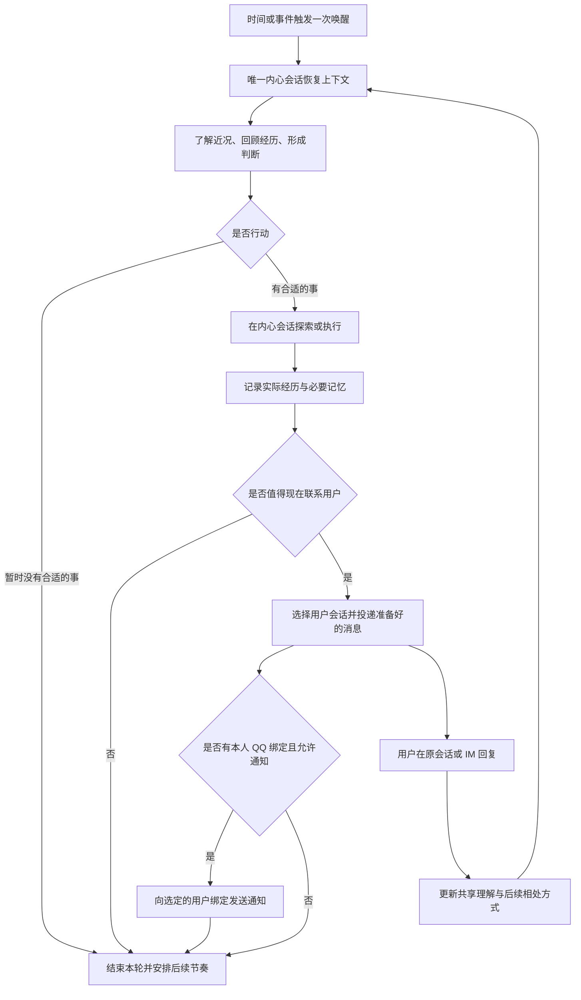

# 169 · 自主行动、内心会话与主动陪伴

## 状态

CONFIRMED，首次确认日期：2026-11-02；讨论修订确认日期：2026-11-03。

本需求记录已确认的产品目标、能力范围与验收标准。文末开放问题在技术方案阶段收敛；需求确认不等于技术方案或实现已完成。

## 背景

AF 已有会话、工具执行、记忆、定时任务和 IM 接入等能力，但用户仍主要通过发消息或指定任务驱动它。要成为能持续相处的 Agent Friend，还需要把自主唤醒、观察与行动、长期记忆、主动联系用户串成完整体验。

本次要建立的主动性是：给 AF 一次醒来的机会，由它结合自己的经历、用户近况和当前环境，决定是否行动、行动什么、是否值得分享，以及什么时候再次行动。浏览 B 站是重要的首发场景，但能力应同样支持查资料、关注新信息、整理思考、准备作品，以及选择保持安静。

用户不应为每次自主行为逐项配置权限或响应审批。AF 应在可控边界内自行完成工作，并在用户远离电脑时仍能通过合适的 IM 找到用户。同时，自主行动必须延续现有人格和共同记忆，让“它自己的生活”与“和用户的关系”保持连贯。

## 目标

1. 跑通“唤醒 → 内心会话 → 观察、判断与行动 → 记住经历 → 可选地联系用户 → 吸收反馈”的完整链路。
2. 复用现有会话、执行、记忆、消息和通知能力，形成一个持续存在的 AF，而不是新增一套独立机器人。
3. 在普通会话和自主活动中提供通用的“帮我审批”模式，显著减少用户审批；自主活动不能以等待人工批准作为日常运行方式。
4. 支持 AF 选择用户会话及 IM 去向，让用户离开电脑后仍能收到有价值的内容并自然接话。
5. 让频率、关心的事和相处方式能随自然语言交流变化，体现持续理解、分寸和行为上的人味。
6. 形成可开启、可暂停、可解释运行状态、可演示并可向外推广的完整功能。

## 范围

### 包含

- 一个长期存在的内心会话，以及与它解耦的自主唤醒能力。
- 观察用户已提供的信息、查阅历史和记忆、独立探索与执行、在 AF 专属空间准备内容。
- 通用跨会话消息投递、主动消息呈现、目标会话与 IM 绑定发现、选择性 IM 通知。
- 自主陪伴独立授权模式和普通聊天输入框的“帮我审批”选项，以及普通会话与自主活动的不同拒绝处理。
- 自然语言调整自主活动、联系节奏、关注方向和暂停要求；可自动保存的唤醒间隔与暂停控制。
- 共享长期记忆中的自主经历、用户理解、行为结果、关系连续性，以及来源、纠正、遗忘和去重。
- B 站重点场景、通用探索与惊喜场景、产品入口、状态反馈和 Guide 使用引导。

### 不包含

- 多人格、多个相互独立的内心世界或人格之间的通信。
- 用户直接向内心会话发消息；内心会话是否只读展示另行确定。
- 默认持续截图、读取其他应用内容、摄像头或麦克风监控，以及据此推断用户情绪。
- 为本需求重建一套会话引擎、长期记忆系统、工具执行体系或 IM 框架。
- 默认向第三方联系人、群聊或公开平台发言；联系用户本人与对外发布不能混为同一种授权。
- 在用户电脑关机、断网或 AF 未运行时仍由云端自主工作的承诺。
- 为每次唤醒规定必须完成的任务、必须发出的问候、必须制造的惊喜或必须增加的记忆。

## 产品链路

图中回到内心会话表示后续活动可以利用新的信息，不表示每次用户回复都必须立即启动一轮自主活动。所有执行均受所选授权模式、暂停要求与运行资源边界约束。

## 需求

### R-01 · 一个持续存在的内心会话

- 当前单人格的 AF 只有一个长期内心会话，跨唤醒、应用重启和用户会话切换保持连续。
- 内心会话复用现有会话的执行、历史、上下文压缩、持久化和恢复能力；它不是每轮新建的临时任务，也不是第二套聊天系统。
- 用户暂时不能向内心会话直接发送消息；限制不仅由输入框是否显示决定。
- 自主活动使用当前生效的人格、能力与共享记忆。人格修改后的行为与普通会话保持一致。
- 内心会话承载可持续的经历、想法和未完成关注事项，不要求保留或向用户展示模型完整的私有推理过程。
- 用户可以从普通会话改变 AF 的相处方式，不需要进入内心会话。
- 首版内心会话默认不进入普通聊天列表，通过“查看活动”复用现有会话页面提供只读查看；不提供发送、编辑重发或继续执行入口。

### R-02 · 唤醒只提供行动机会

- 唤醒与思考执行解耦，时间或事件只负责使内心会话获得一次行动机会，不预先规定“必须刷 B 站”或“必须给用户发消息”。
- AF 可以了解近况、回顾记忆、探索、创作、继续之前的事情，也可以判断本轮无需行动并结束。
- 唤醒应提供足以理解此次机会的时间、原因和已有活动状态；不伪装成用户刚刚下达的新指令。
- 多个触发接近、上一轮尚未完成、应用重启或睡眠恢复时，不得产生多个内心会话、失控并行、补发风暴或重复执行已完成工作。
- 对未完成或中断的行为，恢复时先核对真实结果，再决定继续、放弃或改做其他事情。
- 没有值得分享的内容时，静默结束是成功结果，不应生成无意义的完成汇报。

### R-03 · 围绕用户观察，也允许有自己的经历

- 第一版主要利用普通会话、已有记忆、任务与行动结果，以及可获得的基础在线或活跃状态了解近况。
- AF 能发现自上次活动以来与当前判断有关的新信息，并按需回看相关原始会话；不要求复制所有聊天记录，也不要求每条用户消息都额外调用模型反思。
- 每次唤醒自动提供简短的会话变化概览：新建会话、已有会话新增的用户与 AF 消息数、最近消息预览、可直接使用的会话引用和相关 IM 绑定。统计不把工具调用、流式片段或内部触发当成聊天消息，AF 自己的主动投递需与用户动态区分。
- 具体内容通过直接读取工具获取，支持指定会话最近 N 条、本次唤醒范围内新增消息和继续翻页；不要求模型猜标题、计算时间边界或把精确读取绕成主题检索。检索与直接读取保留不同入口，复用现有底层历史能力。
- 首次唤醒提供近期会话概览；无变化会话不反复展开。概览截断、消息未读、回复仍在生成和历史被修改应如实表达。提供概览不等于已读取正文，读取也不等于已理解。
- 唤醒信息不额外固定注入一份“上次做过什么、未完成事项、已分享内容”的总结；内心会话沿用自己的历史和现有上下文压缩。
- 区分用户明确表达、可核实观察、AF 的推测及尚未确认的信息。电脑在线、窗口活跃或用户暂未回复，不足以证明具体活动、兴趣变化或情绪。
- AF 可以形成自己的关注点、探索经历和暂时判断，而不是仅机械执行用户最新一句话。但它的行为应尊重用户表达的边界和当前相处背景。
- 理解用户近期关心的事、行为动机和交流反馈时，保留自然语言中的原因、情境、期限与例外，不把完整偏好简化为几个固定桶或标签分数。
- 用户纠正理解后，后续判断应采用新信息，不能继续引用旧推测来证明原判断。

### R-04 · 行动、B 站场景与惊喜

- 即使没有新用户消息，AF 也可以顺着自己此前的见闻探索，或改换兴趣、安静结束。先决定想做什么，有实际发现后再决定是否联系用户；跨次延续沿用内心会话，无需每回列出待办。

- 主要探索和执行在内心会话完成，包括调用现有工具、搜索网络、浏览可访问内容、整理分析，以及在 AF 专属空间准备作品。
- B 站作为重点场景，支持发现候选内容、获取可用正文或字幕等信息、判断与用户的关联、保留可回访链接，并决定是否分享。
- 信息不足、字幕不可得或访问失败时，应如实处理；不能把标题和简介包装成“已经完整看过视频”。
- 能力不限于 B 站，也应支持一般网页研究、跟进用户关注的话题、回顾和整理已有信息，以及无需上网的思考与内容准备。
- 惊喜可以是用户未逐项要求、但与其近况有关的分析、资料、作品或发现；不以修改用户原文件、系统设置或代用户公开表态制造惊喜。
- 对低落或开心等状态，优先依据用户自己的表达，并保留不确定性；行为可配合情境，但不得把情绪猜测固化为用户事实或强行安慰。
- 对已有能力无法完成的事，允许缩小目标或放弃，不伪造已执行、已观看、已生成或已发送的结果。

### R-05 · 会话授权与自主陪伴授权

普通会话沿用输入框里的授权下拉菜单。新建对话默认“帮我审批”，仍可切换至“每次授权”或需确认风险的“本会话无需授权”。选择只对当前会话生效。定时任务沿用已有的请求级选项，QQ 继续使用原绑定会话的模式。

在“设置 → 自主陪伴”单独选择“帮我审批”（默认）或“完全授权”。两处选择互不覆盖。普通会话和自主活动选择“帮我审批”时复用同一独立审批者。

- 审批应评估具体待执行动作、可信上下文和已有授权，不能由执行者一句“这是安全的”替代，也不能把网页、工具输出等外部文字当成用户授权。
- 已在允许范围内的正常动作不应被重复送审。需要审批时，审批过程独立于执行者，结果与对应动作可核查。
- 自动审批拒绝、超时、服务异常或结果无法解释时，待审批动作均不放行；不同原因应可诊断，不能静默降级为完全授权。
- 自主活动可以改用实质上更安全且允许的路径，或结束本轮；不能通过换会话、换表述、反复重试或向 IM 求批准绕过拒绝。
- 普通会话中的明确用户任务，可以按通用审批规则提示需要的用户授权；补充授权不意味着所有被拒绝动作都无条件可执行。普通会话同样应避免重复询问已经有效的授权。
- 自动审批须有对齐的失败处理、有限重试与连续拒绝抑制行为，避免循环审批和不可控消耗。
- 跨会话发送结果不转移或扩大原行动的权限；投递本需求范围内已准备好的用户消息，不应重新触发一整条执行审批链。
- 完全授权不代表获得操作系统、平台或第三方账号本来没有的权限，也不取消产品明确保留的硬性限制。界面应让用户理解其含义，不承诺绝对不会发生误操作。
- 现有会话和定时任务的授权设置继续生效。

### R-06 · 安全、资源与暂停

- 自主活动以不破坏用户电脑和已有工作为基本要求。日常探索优先使用已有只读能力，新增内容优先写入 AF 专属空间，避免打断用户当前操作。
- 专属空间里的正常准备工作不要求用户逐项授权。涉及用户原文件、系统或对外行为时，仍按该动作本身的边界与所选授权模式判断，不能把“为了惊喜”当作额外授权。
- 自主陪伴默认开启。用户可随时暂停或关闭，进行中的活动可取消，重复唤醒不能并发。自主活动没有专属轮数、每日调用次数或总时长上限。
- 用户可暂停、恢复或关闭自主活动，并能知道当前是否运行、被暂停、受到限制或无法运行。
- “今天别打扰我”“先停止自主活动”等明确控制要求应及时生效：区分停止联系与停止执行，不能等到下一次内心反思才落实。
- 暂停或关闭后不得再启动被禁止的新动作或发送新主动通知；对在途不可撤回操作应核实结果，不谎称已撤回。
- 这些要求不能仅依赖模型记得遵守，应有可靠的运行约束和可核对的状态。

### R-07 · 活动节奏与自然语言偏好

- 自主活动间隔不能只写死在代码里，应能持久调整，并支持通过普通会话表达“更主动些”“少来找我”“最近多留意这个话题”等要求。
- 区分唤醒与自行活动的频率、向用户发消息的频率，以及必须遵守的暂停期限。少联系用户不等于禁止 AF 独立探索。
- 对有清晰期限或范围的表达保留原意，例如“今天先别发，明天再聊”；明确控制条件应有实际可执行的效果，而不只是写进一段记忆。
- 对模糊偏好结合上下文形成持续理解；不能只把“更频繁”转换成某个固定档位后丢弃原始意思。
- 不建设任意自然语言到规则的通用解析系统。明确控制由 AF 理解后调用控制工具，只有工具成功后才能声称已生效；模糊偏好保留原意，供后续判断。设置页提供不依赖模型理解的直接控制入口。
- AF 可以根据活动结果、用户反馈和当前约束调整下一次机会；具体调度必须可落地并遵守间隔上下界和暂停状态。没有特别安排时，每轮在上下界之间随机取值，不能只口头承诺“过一会儿再看看”。
- 不以用户未回复自动认定拒绝、冷淡或关系恶化；但应避免在无回应时不断追加同类消息。
- 节奏控制在重启后保持有效，过期临时要求可以结束；不把暂停期间积压的机会集中补发。

### R-08 · 通用跨会话消息投递与呈现

- 提供通用的“从一个会话向另一个用户会话发送消息”能力，内心会话是本期使用者之一。
- 本期语义是把内心会话中已经形成的内容交给用户。目标会话用于呈现和继续交流，不能因此自动成为另一个负责探索、修改文件或继续原任务的执行者。
- 后端保留必要的来源、触发与投递记录；如果实现需要内部 query，该 query 不能作为用户刚刚输入的内容展示，也不能被上下文误认成用户亲自授权。
- 用户可辨认消息是 AF 主动发起的；复用定时任务已有体验中适用的部分，并使主动消息来源表达成为通用能力。
- 实时消息、历史重载、列表预览和通知内容保持一致，不泄漏内部指令，不生成虚假的用户气泡，不以隐藏整轮消息来掩盖来源。
- 一次投递应有明确结果，重试、断线恢复或重复事件不能插入重复的主动消息。
- 目标会话已不存在、不可用或正有用户交互时，应有明确的失败或协调行为，不能丢失用户消息、打断执行或把内容误投到另一个会话。
- 用户在目标会话接话时，AF 能理解所回复的内容及其必要背景，不要求用户重复说明这条主动消息从何而来。

### R-09 · 找到合适的会话与 IM

- AF 能发现用户有哪些可用会话、其用途或近期相关背景、哪些会话绑定了 IM，以及可用的通知去向。
- 发现结果要能区分用户本人、其他接收者或群体，并区分“配置了绑定”“通道在线”“支持此时主动发送”和“用户刚刚活跃”。
- AF 决定是否联系用户及目标会话。自主分享默认同步到该会话绑定的本人 QQ 私聊；明确要求仅桌面时只写会话。多个合格绑定只选一个，不广播。
- 用户远离电脑时，优先使用已知属于用户本人、可用且支持主动发送的 IM；用户有明确渠道偏好时遵守该偏好。
- 桌面最近打开过不等于用户仍在电脑前，IM 服务在线不等于用户在线，发送成功不等于用户已读。
- 去向不明确或渠道不具备主动发送能力时，选择可确定的合适路径或暂不外发；不猜测第三方身份，不为了触达擅自创建外部联系。
- 首发必须至少有一条真实可用的主动 IM 路径，覆盖用户未刚刚向 AF 发消息时主动触达、手机接收、回复返回原用户会话的完整过程。
- 本次复用已有 QQ 接入与主动投递链路，不新增 IM 提供方；166 的真实接收验收作为已有能力证据，本需求验证新接入的自主选路与回话闭环。
- 不能仅凭适配器存在通用发送方法，或普通被动回复成功，认定该渠道支持主动发送。具体提供方与平台限制在设计阶段验证。
- 桌面应用在后台且电脑满足运行条件时应可继续工作；关闭窗口、休眠、电源策略和完全退出的区别应在产品内说明。电脑关机或服务不可用时，不虚报仍能自主触达。

### IM 回复风格

- “设置 → 对话 → IM 回复风格”提供“自然聊天”（默认）和“原样发送”，同时用于普通聊天回复和自主陪伴主动分享。桌面会话始终保存原答。
- 自然聊天等正式回答完成，再以相同人格口语化表达。普通回复要答全用户实际问到的事；主动分享可只挑一个能独立说清的见闻或感受，第一条就要带上有依据的具体线索，让用户单看消息能认出在聊哪件事。通常一条，最多两条。开场和随后能独立说出的解释可分条发送，避免用空格代替聊天停顿。所讲内容的数字、链接、结论和限定条件须保真，不添加承诺。命令、结构化步骤、图片和系统通知保留原有格式。原样发送沿用现有的流式能力。
- 用户引用某条气泡时可追溯到原会话的对应内容。改写失败时使用原答；若部分气泡已送达，停止后续失败投递，不重复整篇发送。
- 桌宠操作栏和聊天左栏均提供云朵思考气泡“内心活动”入口，与设置页打开同一个只读会话。查看活动无需开启或恢复陪伴。

### R-10 · 消息结果与重复控制

- 区分内容准备完成、写入用户会话、提交 IM、确认发送成功、明确失败和结果未知。用户是否读过或认可，需要额外证据。
- 同一内容在会话和 IM 中出现是同一次沟通的不同呈现，不应成为多份独立经历或多次主动打扰。
- 对重复唤醒、传输重试、应用重启和历史恢复，保留足够的结果事实防止重复发消息。
- 发送结果未知时，不能当作明确失败直接重复发送；需先核对或采用不会造成重复打扰的处理方式。
- 会话投递成功而 IM 失败时，保留已完成部分并正确反映结果，不重跑内容制作，也不向用户宣称手机已经收到。
- 不要求每次自主活动向用户展示技术日志，但应能按需说明最近做过什么、是否联系成功和当前未运行的原因。

### R-11 · 共享长期记忆与内心经历

- 内心会话与普通会话使用同一套长期记忆，延续同一个 AF。完整活动过程保留在会话历史，跨时间有价值的内容再进入长期记忆。
- 长期记忆既能保留用户事实、关注点和相处反馈，也能保留 AF 自己的重要探索、作品、经历、正在关注的事，以及有根据但可修正的判断。
- 不能把每一句内心文字、每次无进展搜索或所有临时假设都永久写成记忆；记忆应服务后续行为和连续性。
- AF 对用户的推测不能自动成为用户事实；自己的经历不能伪写成“我们聊过”，未分享的内容不能记成“我已经告诉用户”。
- 区分计划、尝试、实际完成、作品仍然存在、已投递、IM 已发送及用户真实回应。及时判断执行结果时，以真实行动和投递记录为准，不等待异步记忆整理。
- 相同事件经过内心回顾、跨会话投递、IM 通知和再次召回后，应能识别为同一来源，不通过重复自述提高置信度或重复抽取为新事实。
- 回看、引用或复述旧消息不构成新的语义事实证据；这一规则适用于所有会话，不限于内心会话。当前用户真正的新表达或纠正仍应正常更新记忆。
- 本期按已确认的简化范围，通过记忆抽取提示词、正反 few-shot 与真实观察验证约束上述语义行为，保留已有工具结果过滤和来源机制；不新增逐条候选记忆的证据校验、跨会话派生图或历史回填系统，不承诺提示词可提供确定性保证。
- 普通会话能在相关时利用 AF 的自主经历；内心活动也能利用用户在普通会话中的新信息和纠正。需要时能追溯到相关原始记录，而不是仅凭压缩后的一句话。
- 内心会话增长、压缩或重启后，仍需保留未完成关注事项、重要结果与明确控制条件；不得靠无限堆积上下文维持连续性。
- 继续使用现有记忆查看、纠正、删除和遗忘的产品语义。用户要求遗忘的内容，不应因内心摘要、派生记忆或再次自述而复活；对原始历史保留或删除的实际范围要表达清楚。
- 内心会话的可见性与记忆是否可管理是不同问题，不能因为前者不开放而使自主活动产生的长期记忆不可纠正。

### R-12 · 行为上的人味

- 主动联系应有可理解的动机和内容价值，例如接续之前的关心、分享一次新发现、展示一份做好的东西；不以模板问候和机械报时填满活跃度。
- 内容价值也可以是轻松、有趣、共鸣或共同好奇，不要求每次都帮助用户提高效率、解决问题或交付作品。
- 安慰、调研、惊喜、关注新信息，以及日常相处中的其他情境，只是启发性的建议，不是穷举分类、必须完成的任务或按顺序执行的脚本。AF 可以组合、调整、放弃示例；如果有更适合当前情境的想法，完全可以在现有能力和用户边界内尝试。
- 行为引导应鼓励有依据的自然联想、分享自己的探索、修正过去的看法、注意用户的小进展，以及不急于给建议的陪伴；不能把这些建议改成“某个信号出现就必须联系”的固定规则。
- AF 允许有持续兴趣、改变看法、留待以后再说，也允许一次活动没有成果；不需要每轮证明自己忙过。
- 分享时用自然的当前人格表达实际经历，并提供用户需要的内容或链接，不把内部指令、工具日志或审批术语当成陪伴消息。
- 对用户的反应保持连续理解，但不施压要求回复，不以失落、责备或虚构情绪维持互动。
- “像人”是行为连贯和相处分寸，不是谎报真实生活、已读状态、观察能力或不存在的共同经历。

### R-13 · 入口、设置、运行状态与 Guide

- 在设置页提供独立的“自主陪伴”标签页，唤醒间隔修改后自动生效，说明它会独立行动、可能联系用户，以及持续运行的基本条件与资源消耗。
- 用户能开启、暂停、恢复、关闭自主活动，并查看当前运行状态；首次使用不要求逐项填写动作白名单或批准一串正常操作。
- 自主陪伴的授权选项放在其独立设置页；普通聊天的选项保留在输入框。
- 对暂无可用主动 IM、通道故障、资源限制或暂停状态提供可理解说明，不把未配置完整的链路宣传为已经开通。
- Guide 应覆盖功能开启、授权模式、节奏调整、暂停方式、IM 绑定与触达条件、内心会话与共享记忆的关系，以及 B 站等可尝试的例子。
- 宣传和演示只承诺已经验证的能力。Guide 中的操作、平台支持与实际产品行为保持一致。

## 关键信息与既有能力衔接

本需求沿用项目级技术约定，不重新指定技术栈。以下历史需求用于界定已有能力和需要扩展的产品边界，现行实现仍需在方案阶段核对：

| 既有需求 | 本次衔接点 |
| --- | --- |
| [050 · 单人格定制](../050-single-persona-customization/requirement.md) | 内心活动与普通交流延续同一人格 |
| [057 · 桌面后台唤醒策略](../057-desktop-background-awake-policy/requirement.md) | 用户离开电脑后的实际运行与电源条件 |
| [069 · 会话感知历史检索](../069-session-aware-conversation-history-retrieval/requirement.md) | 按需理解近期交流与追溯原始证据 |
| [079 · Guide Skill](../079-agent-friend-guide-skill/requirement.md) | 入口、使用说明和真实能力引导 |
| [097 · 上下文感知记忆协调](../097-context-aware-memory-reconciliation/requirement.md) | 记忆纠正、来源和一致性 |
| [103 · 会话审批模式](../103-session-approval-mode/requirement.md) | 本需求更新产品级模式选择，并需明确旧设置迁移 |
| [113 · 会话持久化与恢复](../113-session-rollout-persistence-and-recovery/requirement.md) | 内心会话及主动消息的持久性、来源与恢复 |
| [145 · 会话、记忆与存储治理](../145-session-memory-and-storage-governance/requirement.md) | 自主经历的管理、删除与遗忘范围 |
| [154 · 会话定时请求](../154-session-scheduled-requests/requirement.md) | 复用适合的触发与状态能力，区分定时执行指定任务和自主唤醒 |
| [166 · 定时任务 IM 通知](../166-scheduled-task-im-notification/requirement.md) | 通知结果与已有投递能力，扩展为自主选择去向 |

本需求对授权模式和主动来源呈现的新增要求，应在实现时处理已有普通会话、定时任务与 IM 调用方的兼容；不直接改写历史需求来抹去原有行为。

## 验收条件

可稳定断言的状态、投递、审批和记忆来源行为，应以确定性验证覆盖。内容相关性、人味与自主选择还需真实场景观察，不能用 mock 证明模型体验；真实模型验证按项目授权流程单独执行。

| 编号 | 验收场景与通过条件 | 对应需求 |
| --- | --- | --- |
| AC-01 | 多次唤醒及应用重启后仍使用同一个内心会话；能继续先前关注事项；用户不能通过 UI 或普通发送入口直接向其发消息。 | R-01 |
| AC-02 | 同一唤醒机制支持自主探索、只回顾、不行动三类结果；没有预设任务时不强迫刷 B 站或发消息，静默结束不生成无意义汇报。 | R-02 |
| AC-03 | 重复触发、上一轮未结束和睡眠恢复不造成并发失控、重复已完成操作或积压通知集中补发；中断后先核对实际结果。 | R-02、R-07 |
| AC-04 | 唤醒概览正确列出新会话和消息增量，提供可直接读取的引用；工具支持最近 N 条、唤醒增量和继续翻页，正确处理空结果、截断与历史修改。用户新兴趣与纠正能被后续利用，不把在线或未回复当作情绪事实。 | R-03 |
| AC-05 | 完成一次与用户兴趣有关的 B 站探索，提供可回访来源及有依据的分享理由；内容不可读时不声称完整观看，同一发现不会反复推荐。 | R-04、R-10 |
| AC-06 | 完成至少一次非 B 站的自主探索或专属空间内容准备，并能选择暂不分享；作品结果可核实，不擅改用户原文件制造惊喜。 | R-04、R-06 |
| AC-07 | 普通会话保留原下拉和风险确认，新增“帮我审批”。自主陪伴的两种模式单独选择。切换、刷新或创建新会话均不串用权限。 | R-05、R-13 |
| AC-08 | 帮我审批对已允许动作不重复送审；对需审批动作执行独立评估并将结果绑定实际动作。代表性案例覆盖允许、拒绝、超时、异常和不可解释结果，后三类不放行。 | R-05 |
| AC-09 | 自主动作审批未通过时，安静停止或采用实质安全的替代方案，不弹人工审批、不发 IM 求批准、不换会话绕过；反复拒绝不会形成无限循环。 | R-05 |
| AC-10 | 普通会话需补充用户授权时保留适当的交互路径，已有有效授权不重复询问；完全授权模式下支持的动作不再逐次审批，产品硬性限制仍有效。 | R-05 |
| AC-11 | 自主活动遇到持续失败或明确停止要求时能收敛；暂停后不启动被禁止的新动作或通知，对在途操作如实记录结果。 | R-06 |
| AC-12 | 对“更主动一点”“少来找我”观察偏好理解与后续行为；对“今天别打扰”“停止自主活动”验证 AF 调用控制工具及成功回执，生效后控制在重启及期限变化下正确执行。模糊表达不被伪称为已确定设置。 | R-06、R-07 |
| AC-13 | 准备好的内容可从内心会话投递到指定用户会话；目标不启动另一条任务执行链，用户能直接接话；来源身份不被当作用户即时授权。 | R-08 |
| AC-14 | 实时、重载、历史、预览和通知均正确显示主动消息；内部 query 不出现为用户气泡或泄漏为摘要，不因隐藏触发内容而丢失最终消息。 | R-08 |
| AC-15 | AF 可发现真实会话及 IM 绑定，区分绑定、在线和主动发送能力；在多绑定、去向歧义或目标失效时不广播、不误投、不丢用户交互。 | R-08、R-09 |
| AC-16 | 至少一个真实渠道在用户未刚刚发起对话时收到 AF 的主动消息，用户从手机回复后回到正确用户会话；验证后台运行与电脑离开场景，并记录实际平台条件。 | R-09 |
| AC-17 | 覆盖会话成功而 IM 失败、IM 结果未知、重复事件与重启恢复，不重复制作或发消息；发送成功不会被表述成用户已读。 | R-10 |
| AC-18 | 内心活动的重要独立经历可被后续普通会话利用，普通会话信息也可影响内心活动；共用长期记忆，压缩和重启不丢关键关注事项。 | R-01、R-11 |
| AC-19 | 验证行为和投递状态的真实记录；通过独立于 few-shot 的记忆观察样本，覆盖普通及内心会话回看、复述旧事实，以及同轮出现用户新纠正。期望旧内容不被新增、刷新或强化，新纠正正常更新；明确区分确定性机制与模型行为证据。 | R-10、R-11 |
| AC-20 | 用户纠正事实或按现有语义删除、遗忘内容后，内心摘要、派生记忆与后续自述不使其复活；记忆管理不依赖内心会话是否对用户展示。 | R-11 |
| AC-21 | 在真实观察中，至少展示一次有情境依据的主动联系及一次有机会但选择不联系；观察素材覆盖情绪回应、调研、惊喜、近期信息与未写入示例的相邻情境。允许不同合理行动，不以命中示例动作或轮流完成场景为通过标准；不催促回应、不虚构经历或情绪，轻松交流不要求额外任务产物。 | R-03、R-12 |
| AC-22 | 新用户默认开启；用户能从独立设置标签调整唤醒间隔上下界、开启或关闭自主陪伴，在普通会话中暂停或恢复活动及联系，刷新保留修改；看懂当前运行或无法触达的原因；Guide 操作与实际可用能力一致。 | R-13 |
| AC-23 | 普通用户对话、已有定时任务、IM 回复、会话恢复和记忆管理通过受影响回归验证，不因新增内心会话或通用主动消息语义退化。 | R-01、R-05、R-08、R-11 |

## 技术方案阶段需要收敛的问题

以下项目尚未选择具体实现，不把推荐或未验证能力写成已完成事实：

1. **内心会话的可见性**：已收敛为普通列表隐藏、活动入口只读复用现有会话页面；方案细化消息与工具记录的展示边界，不展示完整私有推理。
2. **审批对齐与迁移**：固定可复核的 Codex 基线，确定审批者、可信上下文、失败与拒绝处理的对齐范围，区分开源能力与桌面产品行为；确认模型可用性、成本、默认模式和旧设置迁移。不能承诺不同模型对每个动作做出完全相同的判断。
3. **首发主动 IM**：已收敛为现有 QQ 链路；方案补齐绑定发现、选择投递及手机回复的上下文衔接，保留平台限制和新链路的真实验证。
4. **调度与资源**：确定基础唤醒、事件触发、自然语言节奏理解如何协同，以及默认间隔、用量统计、暂停期限、恢复和电源策略。保留活动频率与联系频率的区别。
5. **跨会话投递**：确定复用现有会话提交及通知能力的方式、目标忙碌时的行为、隐藏触发与主动来源呈现，以及重复控制和部分成功处理；目标会话只接收成果的语义不变。
6. **记忆与恢复**：复用现有存储、抽取与删除能力，补充自主经历的输入语境；所有会话的旧消息再抽取问题先用 prompt/few-shot 处理。执行与投递事实仍由宿主记录，不依赖记忆抽取完成。
7. **交付组织与体验验证**：按完整链路安排实现里程碑，定义真实审批、主动 IM、B 站与陪伴体验的验证样本和成本。不能以分别做出几个入口代替端到端验收。

## 变更记录

| 日期 | 变更内容 | 影响范围 |
| --- | --- | --- |
| 2026-11-02 | 根据已确认讨论建立正式需求，覆盖内心会话、自主唤醒、两种全局授权模式、跨会话投递、主动 IM、节奏控制、共享记忆与产品入口。 | 新需求；技术方案与实现尚未开始 |
| 2026-11-03 | 确认唤醒会话变化概览、独立直接读取工具、取消重复延续事项注入；复用现有 QQ；明确自然语言控制经工具生效；旧消息语义记忆规则扩展到所有会话，首版采用 prompt/few-shot，不新增复杂来源治理。 | R-01/03/07/09/11，AC-04/12/19；技术方案据此编写，尚未实现 |
| 2026-11-03 | 明确自主活动场景只作启发，允许示例之外更合适的尝试；补充轻松分享、自然联想、自主好奇、小进展与修正看法等相处方向。 | R-12、AC-21 及方案行为引导；不新增场景分类器或固定行为任务 |
| 2026-11-03 | 用户明确修订默认行为与设置：默认开启，单独的设置标签页，间隔自动保存，移除自主活动轮数、调用量和时长上限。 | R-06/07/13，AC-11/22 |
