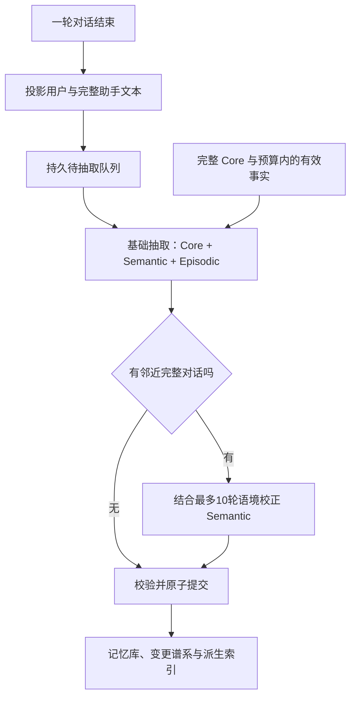

# 170 · 记忆现状与本机数据调查

日期：2026-11-05（UTC+08:00）。状态：调查结论与候选方向，尚未确认为需求或技术方案。

## 结论

当前记忆系统已经具有分层存储、后台抽取、事实替代谱系、关键词与向量混合检索、原文核查等能力。
本机数据暴露出的主要问题是：部分纠正未覆盖所有旧事实，临时状态长期有效，重复记录与来源归属不够可靠，以及抽取反复携带大量旧事实带来的开销。
优化应先改善“什么进入记忆、如何更新、何时仍有效”，再测量召回效果；现有证据不支持先更换向量库或直接归因于模型能力。

调查只读真实数据；没有修改产品代码、清洗用户记忆、调用外部 LLM、启动应用或进行正式代码评审。
本文件只保存脱敏事实、统计与待讨论方向。原始数据库、记录 ID、原文摘录和具体日志定位在本机私有档案中。

## 1. 证据范围

- 源码：`688f51116a37480e8b43aa6b08931b3cb96fc768`，本任务开始时与刷新后的 `origin/main` 一致。
- 数据：经 `agent.paths.memory_db_path()` 的规则定位系统用户数据目录中的记忆库；使用 SQLite 只读连接与 backup API 取得一致快照，包含 WAL 中的已提交内容。
- 快照时间：2026-11-05 01:01:49.555（UTC+08:00），schema v8，完整性检查通过。
- 内容检查：审阅全部 912 条有效 Semantic；Episodic 按月等距抽样 82 条，另追查关键冲突的原始用户与助手消息。统计查询覆盖全库，语义判断不等于全库错误率。
- 近期日志：2026-11-04 12:53 至 2026-11-05 00:53 的记忆调用与提交，辅以相关的 `memory.log`、模型请求指标。
- 历史样本跨多个版本。近期两个安装态调用记录了 source commit，相关 memory 与素材投影文件和本次源码内容一致；其余 source 模式调用缺少精确 SHA，历史质量案例也不能归因到当前 HEAD。
- 详细证据关系见 [evidence-index.md](evidence-index.md)，聚合统计见 [artifacts/20261105-summary.json](artifacts/20261105-summary.json)。

## 2. 现在的记忆如何工作

### 2.1 存什么

| 层次 | 用途 | 当前边界 |
| --- | --- | --- |
| 原始会话 | 保留实际用户/助手发言，供搜索和核查 | 与记忆摘要分开存储，不是每轮完整塞入模型 |
| Episodic：经历 | 记录某轮发生了什么，带发生时间和原文指针 | 按 persona 隔离；通知等宿主事件也可直接进入这一层 |
| Semantic：事实 | 长期事实、偏好、关系等原子陈述 | 按 owner 共享，具备有效期、软删除、来源及多对多替代记录 |
| Core Profile：核心资料 | 希望被如何称呼、当前住处、与当前 persona 的关系、对 persona 的昵称 | 只有这四类；完整、独立地注入自然对话，不依赖普通 top-k |

Core 为空不等于全部记忆为空，也不表示没有向量索引。`memory/README.md` 的部分描述已落后于实现，本次以实际代码为准。

### 2.2 怎么记住

- `agent/src/agent/memory_feed.py` 是素材入口：保留用户文本、文本引用及非 partial 助手文本，不直接投影附件正文和工具结果。自主活动有专门的宿主语境标记。
- `memory/src/memory/extraction/worker.py` 用持久队列与后台线程处理，支持冷却、延后和坏条目隔离；一个活动触发最多处理两段。
- 基础抽取会看到完整 Core 和预算内有效 Semantic。当前旧事实预算为 50,000 个估算 token，关键词相关的优先，再补其余有效事实。
- 有可用邻近对话时增加一次 Semantic 纠错调用。邻近最多 10 个完整轮次，只作理解语境；Core 与 Episodic 不经过该第二阶段。
- `Reconciler` 在事务中校验和落库，支持撤回、多条合并与拆分，记录来源及 observation commit；同一 observation 不重复提交。
- 正常一段素材通常消耗一次基础调用，另可能有一次纠错调用；两阶段完整响应等待均为 600 秒，provider 重试另计。

### 2.3 怎么想起来

每轮对话第一次模型请求前自动召回；Core 独立完整注入，普通相关记忆默认最多 8 条，原始对话证据额外最多 4 组。
普通记忆采用 jieba 分词、FTS/BM25；本地向量资产可用时叠加 BGE-small-zh-v1.5 ONNX 与 sqlite-vec，使用 RRF 合并候选。
结构化候选不足以覆盖查询时回查历史；显式 `recall_past_chats` 会主动搜索原文，并可继续用 `read_conversation` 阅读。

当前已经有两项重要保护：召回末端按规范化文本去重；抑制重复注入当前窗口里本来可见的对话。
因此，“数据库有完全重复记录”不能直接推导为“最终八条召回被相同文本占满”。

## 3. 本机库存

| 项目 | 数量 / 状态 |
| --- | --- |
| Semantic 总数 | 1,152 |
| 仍有效 / 已被替代 / 已软删除 | 912 / 227 / 13，互斥分类 |
| 有效事实来源标签 | user 470，agent 442；来源标签本身不等于正确性判定 |
| Episodic 总数 / 有效 / 已软删除 | 2,702 / 2,663 / 39 |
| Core Profile | 0 条，包含历史在内均为空 |
| 抽取提交 | 672 次；早于该机制建立的记忆不以此计数反推遗漏 |
| 待抽取 | 1 条 blocked，2026-10-02 本地时间隔离，错误码 observation_time_conflict |
| 向量索引 manifest | 3,575 = 912 个事实 + 2,663 个经历；generation 为 ready |
| 有效事实完全重复 | 33 组、69 条，按每组保留一条计算多出 36 条 |
| 有效经历完全重复 | 5 组、10 条，额外 5 条；不同事件同文未必可合并 |
| 有效事实来源列表为空 | 48 条；只证明追溯缺口，不证明内容为假 |
| 经历超过 prompt 的 80 字目标 | 490 / 2,663（18.4%），最大 192 字；不是语义错误率 |

本机存在 ready 的向量索引清单，覆盖全部有效记忆。manifest 的覆盖、失效排除及内容 hash 检查通过，数据库完整性和外键检查通过；这不能证明每次召回实际使用 dense，也不能替代物理向量索引、向量数值或召回质量验收。
没有发现普遍停抽或大量 pending 堆积。存量精确重复组产生于 7 月 26 日至 8 月 15 日，不能据此声称最新版本仍持续产生相同重复。

## 4. 逐项问题与候选方向

### F-01 · 用户已经纠正，旧的同义错误仍然有效

- **观察**：一个账号被误记为用户本人所有。用户明确澄清它属于朋友，助手承认理解反了。系统新增了正确记忆，并撤回一条错误记录，却漏掉另一条同义错误；两种归属仍同时有效。
- **失败边界**：用户原话与新纠正记录正确，错误在“修正已知事实 → 覆盖全部冲突旧事实”这一步未完成。责任边界是 Memory 更新；不能仅凭结果断言是模型、候选暴露还是旧版上下文导致。
- **证据与反证**：快照、原始 user/assistant 消息及实际 retirement 记录闭环，现象 confirmed / runtime-supported；存在成功撤回，证明替代机制已工作，只是覆盖不完整。原始模型输入及历史代码身份不足以确认更细根因。
- **候选方向**：对一次纠正寻找同一事实的全部旧版本或等价表达，区分重新确认与新事实；提交前检查已知矛盾是否仍活跃。用该纠正片段固定回放，验证旧错误是否全部退出当前视图，同时保留历史审计。

### F-02 · 临时状态和过时现态长期留在“有效事实”里

- **观察**：先前“目前失业”与后来“已入职”同时有效，双方均有明确用户原话。另有很早的“今晚／明天／等待某一步完成”等状态；有效库中 64 条含“今天／今晚／明天／本周末”，其中 58 条创建于 10 月以前。关键词统计不是过期错误率，需逐条区别历史事件和当前状态。
- **失败边界**：新状态已被获取，旧现态未失效；临时事项和稳定事实共用长期有效的表示，扩大了风险。当前新 Semantic 默认没有结束时间，依赖显式 retirement；没有自动到期机制。
- **时间缺口**：Fragment 有消息时间，但实际抽取文本未把这个时间传给模型；旧事实也只展示正文，不展示有效期。该机制缺口是 code-supported；不能据此证明每条相对日期都已算错。
- **候选方向**：区分稳定偏好、阶段状态、任务进度和历史事件；为有明确期限的状态保存时间锚点与结束条件。到期转为历史，而非删除经历；稳定偏好不宜统一按年龄淘汰。用入职变化及跨日“明天”样本分别验证更新和时间语义。

### F-03 · 同一事实反复存为新记录

- **观察**：912 条有效事实中，33 个同文组包含 69 条记录，额外 36 条；部分同义重复不在该确定性计数中。
- **失败边界**：跨轮重复事实进入新行。当前幂等约束针对 observation 和同一批次，跨轮相同事实主要依靠模型避免重复。
- **证据与限制**：精确重复是全库 SQL 确认，现象 confirmed。召回末端已有文本去重，因此主要确定影响是库存、抽取上下文和维护成本；没有实测同义重复对答案的影响。已发现的精确重复是历史遗留。
- **候选方向**：同一事实再次被确认时追加证据或确认时间；只有语义发生变化才创建新版本。存量合并先输出候选清单，保留原来源与替代谱系，不能直接批量删掉“看起来相像”的不同事件。

### F-04 · “谁说的”和“依据是什么”不够可靠

- **观察**：一条入职事实标记为 `speaker_origin=user`，但直接 provenance 指向助手的人物总结；更早用户确实说过同一事实。因此是来源归属不准确，不是凭空捏造。另有 48 条有效事实没有来源列表。
- 同次总结共有 8 条有效事实被标为 user 来源，其中还包括未经用户在该片段确认的性格判断；“可靠旧事实的复述”和“助手新推断”未能从标签区分。
- **失败边界**：助手复述 → 被记录成用户来源。当前来源标签由模型提供，同批新事实共同绑定整轮 user/assistant refs 与全部 episode IDs，未建立逐事实的精确证据关系。
- **证据与限制**：上述具体来源不一致由原文确认；442 条 agent 标签并不能整体判成污染，AI 的行动与共同经历也有记忆价值。空来源多属历史记录，不能强行补造出处。
- **候选方向**：区分用户明确陈述、助手建议/复述、工具观察和不确定推断；每项事实绑定最小证据，复述引用原事实而不升级为新的用户确认。旧数据以“来源待核验”处理，用角色反转样本验证。

### F-05 · 核心资料层目前没有发挥作用

- **观察**：Core 表全空，稳定身份底色只能依靠普通召回或历史检索。
- **证据边界**：这是 confirmed 的空表观察；是否构成抽取覆盖缺口仍未确认。Core 只接受四个窄字段；职业、兴趣不是 Core，真实姓名也不自动等于希望被如何称呼。已有 084/147 明确保守迁移、不自动补建历史 Core；附件正文不直接进入抽取也是已有边界。
- **候选方向**：先选明确表达称呼、当前住处等的原文做覆盖核对；没有足够新证据时保持空值。若需要历史补建，先生成可审阅候选和依据，再单独确认回写，不能从合同姓名或历史地址直接推定当前资料。

### F-06 · 短素材也承担接近全库的抽取输入开销

- **观察**：近期 20 次基础抽取的日志输入为每次 47,788–49,249 token，合计 962,657；缓存读取为 16,896（占报告输入 1.76%）。这 20 次均为单次 HTTP attempt，没有重试放大。
- **产出**：与快照提交匹配的 20 次中，10 次是三个空数组的合法空输出；对应基础调用输入合计 480,899。空结果可以是正确判断，不能说这些请求必然都能省掉。
- **第二阶段**：4 次 Semantic 纠错中 3 次成功，已知输入 148,386，cache read 为 0；另一次 provider 502 的 usage 未知，不能填零。失败后回退基础结果并提交，不是整段丢失。
- **具体样本**：最后一次自主内心活动的目标文本仅 20 字，含义为休息、不发送消息，仍产生 48,167 输入 token，最终合法空提交。该样本支持检查无新增事实活动的触发开销，不足以将所有自主活动一概跳过。
- 该窗口实际请求模型均为 `openai/gpt-6-sol`，与源码默认选择区分。基础调用中位耗时 6.739 秒，这是后台模型调用耗时，不是用户首字延迟。
- **机制与限制**：当前 912 条事实仅旧事实文本就约 61,963 字符，按代码公式估算 34,388 token；两阶段可能重复发送。估算与 provider token 不等价。上述指标来自已存在日志，本次没有新调用，不能直接换算账单或外推全月。
- **候选方向**：围绕目标片段选择相关事实及可能冲突的事实簇，保留必要的全局核心资料；评估第二阶段是否只在需要纠错时触发，并测量缓存前缀稳定性。必须同时守住漏记率和纠正覆盖率，不能只看 token 降低。

### F-07 · 经历摘要的粒度与筛选仍可改善

- **观察**：2,663 条有效 Episodic 中 490 条超过 prompt 的 80 字目标；全部 importance 为 0.5，其中 437 条为宿主通知。抽样可见事件、提醒和执行过程混合；长摘要本身不代表事实错误。
- **失败边界**：长度/拆分要求主要靠 prompt，parser 只校验非空字符串。相同 importance 无法表达经历之间的重要性差异，但排序仍受关键词与向量相关性影响，并非完全随机。
- **候选方向**：保留重要动作、结果和具体锚点，将重复提醒/执行步骤按事件组织；通知有独立审计和召回价值，不直接删除。先定义“应拆分、应合并、应保留”的样本，再比较内容保真和检索效果，避免单纯截断到 80 字。

### F-08 · 一条历史素材仍处于隔离状态

- **观察**：快照有一条 `blocked / observation_time_conflict`，于 2026-10-01 16:45 UTC（本地 10 月 2 日 00:45）隔离，未见普通 pending 积压。
- **失败边界与反证**：该条没有正常提交，需要单独判断恢复或放弃；队列隔离正在保护其它素材，不能把它写成整体记忆故障。
- **候选方向**：核对迟到观察与当前事实版本，提供可解释的处理结论；不无条件重放旧素材，以免覆盖新状态。历史数据处置与产品代码改进分开授权。

### F-09 · 执行流水与长期事实混在同一层

- **观察**：有效 Semantic 全部为 normal；163 条明确含“游戏日”，并存有逐账号/日期的资源数量、完成场次、运行目录、错误码及存档状态。10 月以后新增且仍有效的 372 条中，309 条命中两类游戏/执行主题关键词。
- **证据边界**：结构和内容分类有快照支持；没有实测这些记录是否影响最终回答，关键词占比也不是噪声率。任务的授权限制、不可重复执行约束、长期偏好和重要完成结果可能非常有用。
- **失败或风险边界**：抽取准入把执行过程保留为持续有效的跨会话事实，使当前状态维护与长期事实维护耦合；不能以“游戏内容”作为删除条件。
- **候选方向**：具体执行过程放可检索事件历史，当前进度依赖任务/游戏存档等权威状态；长期层保留可跨会话复用的偏好、约束和重要结论。使用“后续问到这次执行”“下次继续执行”“一般聊天”三类查询比较分层后的效果。

## 5. 建议的推进顺序（待讨论）

1. **先固定可复查的质量样本。** 以本次账号纠正、就业变化、相对时间、重复确认、助手复述、任务过程及 Core 明确表达为起点；复用现有 `memory_eval` 与机制测试入口。原文留私有，公共回归用等价脱敏/合成案例。当前只归档调查，未新增或运行评测。
2. **优先改写入和更新。** 先处理 F-01～04，并确认 F-09 的分层边界，让错误不再累积；把稳定事实、临时状态、事件和执行进度的归属讲清楚。保持现有原子提交、来源撤回、迟到观察保护与历史可追溯。
3. **再控制抽取开销。** 用同一批冻结样本验证候选上下文和按需纠错；同时看新增事实精度、遗漏、纠正覆盖、角色归属、时间语义、输入 token 和时延。不能用独立两次随机生成结果的分差宣称改进。
4. **最后治理存量。** 在新写入策略稳定后，生成重复合并、过期状态转历史、Core 补建与 blocked 项处理清单；保留备份和审阅依据。不能在优化方案尚未确认时自动清库或全历史重抽。

值得优先讨论的是：任务执行进度和游戏内阶段状态，哪些应该成为跨会话长期事实，哪些只需留在事件/任务历史中。
本机当前 912 条事实中 163 条含“游戏日”；10 月以后新增且仍有效的 372 条中，有 309 条命中两类游戏/执行主题关键词。
这些数字反映使用结构，不代表 309 条都是噪声；正确取舍取决于希望 AI 长期记住什么。

## 6. 未覆盖与验收边界

- 尚未测量整体问答准确率、召回 precision/recall，也没有把每条记忆与全部历史聊天逐一对照，不能给出全库错误率或遗漏率。
- 近期六次自动检索耗时从 32 ms 到 7.094 s，其中最慢一次历史源耗时 4.829 s；样本不足以声称普遍性能退化，单列为后续测量线索。
- 没有通过桌面 UI 验收，没有调用真实 LLM，没有修改原始用户数据，也没有正式代码修复。
- 当前没有已确认的 `requirement.md` / `design.md`；待讨论明确目标和范围后再进入正式需求与方案阶段。
