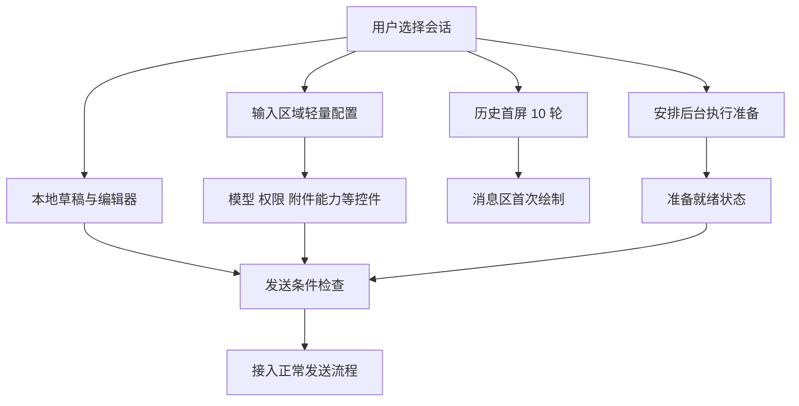

# 长会话首屏响应与发送准备 — 技术方案

## 状态

CONFIRMED

- 日期：2026-11-07。
- 需求：[requirement.md](./requirement.md)。
- 用户已认可独立历史读视图、后台发送准备、编辑与发送分离和完整链路验证方向，并明确要求输入区域在前后端解耦。
- 2026-11-07 用户确认方案并授权开始实现、本需求的桌面与冒烟验证；真实 LLM 运行前仍说明具体目的与预计调用量。
- 实现细化采用下述读取与接管契约；历史数据规模下的实际首屏耗时仍须测量，未通过不标记 AC 完成。

## 现状与问题边界

- 桌面历史请求统一取最近 30 轮；`JsonlSessionStore.query_page()` 先检查 business index，失效时可转入全历史读取、投影和索引重建。
- `BusinessIndex.database()` 使用覆盖整个事务的排他文件锁，历史读取与后台维护可能互相等待；仅增加后台线程不能消除这类等待。
- 日志写入成功后 business index 更新是尽力而为，竞争时可以跳过。不能把“缓存有效时快”当作旧会话或重启后读取的保证。
- `ChatContentSurface` 将历史加载、服务连接等状态合并为整个 Composer 的禁用状态；`conversation.ts` 从历史详情同时写入模型、推理设置、权限和消息。
- 冷会话的 `SessionManager.update_model_config()` 虽不构建 Conversation，却调用完整 `query()` 取得当前配置，仍可产生全历史成本。
- `start_conversation()` 除装配外还涉及写入租约、遗留迁移和工具事务恢复，不能直接作为打开会话时的无副作用预热入口。

## 数据流与责任划分

图中分支表示独立生命周期，不表示后台重任务与首屏无节制竞争资源。历史读取和输入区域请求优先，重准备须可取消并受资源预算约束。

### 1. 历史分页与持续维护的读视图

- 历史读写边界位于 `agent.sessions`，Bridge 仅负责公开投影与取消；前端请求首屏 10 轮、续页 30 轮。
- 复用现有 SQLite 基础，持续维护有效业务事件、回合边界、历史版本和处理进度。JSONL 原始记录保留，不因本需求删除或改变模型历史语义。
- 只读请求取得同一版本的页面、游标和状态，不在返回之前执行全日志校验或全量 rebuild。并发追加后的刷新由版本契约处理，不能让首屏无限重试。
- 采用短读事务和 WAL 快照隔离，移除读请求外层覆盖长维护操作的排他锁。WAL 不等于无锁；checkpoint、schema 变化和发布仍须避免进入首屏等待链路。
- 正常追加按增量维护。编辑历史、恢复和索引版本变更单独规划，不能因页读取顺手执行大事务。
- 跨文件一致性通过源版本校验处理：日志已 durable、索引尚未发布时，首屏回退到该源版本的尾部读取；返回前再次检查版本。索引更新失败不影响原日志，重读不自动全量 rebuild，也不把过期视图声明为最新。
- 固定最近 10 轮正文时，读取范围不得因更早历史增长而扩大。超大单轮另设专项场景，不通过切断工具调用配对降低成本。

### 2. 输入区域独立数据契约

- 将历史页、会话轻量配置、执行准备状态分为三个独立的数据契约；不能只拆 URL 而在后端继续调用同一个全历史查询。
- 在 `agent.sessions` 提供会话轻量配置读取能力，由 `agent_bridge` 暴露独立入口；具体接口见文末契约。
- 轻量状态至少覆盖会话身份、当前模型与推理设置、只读属性及对应配置版本；权限模式继续复用现有 owner。模型目录、附件能力和语音服务状态保留各自数据源，避免再造一个依赖全部服务的聚合大请求。
- 已采用新协议的会话，在事件写入边界增量维护当前配置；轻量读取和配置修改不得调用 `query()`、`load_execution()` 或首屏索引构建。
- 冷会话修改模型时，配置校验、短事务提交和后台执行状态失效分别处理。不得为了修改一个配置先持有长时间恢复租约。
- 旧数据的轻量配置初始化也需要兼容路径。首行 initial_model 不能当作用户当前配置；现有从文件尾反向查找配置的逻辑也不天然具有固定成本，必须纳入验证。
- 前端拆开 `historyLoading`、轻量配置状态、各控件状态和执行准备状态。本地草稿及编辑器可先挂载；附件或语音依赖缺失只影响对应动作。
- 历史响应以消息区为更新目标，不再无条件回写当前模型和用户待应用选择。若兼容响应仍携带元数据，也只能由对应 owner 按版本接收。
- 草稿配置优先表达用户的新选择；服务端未确认前明确保持待应用状态，不冒充已经持久化成功。会话切换、服务重启和请求重试均需会话身份与代次校验。
- 只读或权限状态未知时，允许本地编辑不等于允许服务端变更或发送；必要校验保留，但不让整个输入区域等待历史。

### 3. 无副作用后台发送准备

- 在 `SessionManager` 边界分离只读准备与正式接管。准备复用现有 execution snapshot 和 rollout 恢复结果，不复制一套模型上下文语义。
- 准备阶段不发起 LLM 请求，不执行工具，不创建真实 run，不触发记忆抽取、任务钩子或遗留迁移写入。可维护可丢弃的派生缓存，但不改变用户会话业务事实。
- 准备结果绑定会话、源数据身份、配置代次和服务实例；模型修改、历史改写、其他入口的新消息及服务重启都可能使其失效。
- 在正式发送的既有调度与写入所有权下接管仍有效的结果，补充本轮输入和动态信息，再完成必须发生在执行时的恢复或检查。
- 接管复用同一写入租约保护下已经完整验证的 Session，并再次检查源身份；正常接管不再次加载全部历史或 hash。未准备的请求仍保留原校验路径，正式执行仍做事务对账。取消立即释放准备租约，迟到结果不可发布。
- 准备状态区分未准备、进行中、可复用、失效和失败；可复用仅指重准备完成，不表示外部模型服务已成功或所有发送条件都满足。
- 同会话合并重复准备请求，用户当前会话优先；失去消费者的任务可取消，实际 run 优先，最多保留一个冷准备结果并受 60 秒闲置时间限制（未设置独立的字节配额）。控制信息经轻量响应或已有事件通道更新，不携带模型上下文正文到前端。
- 不能假定 `asyncio.to_thread` 自动解决 CPU、磁盘和共享锁竞争；以并发测试验证，是否需要独立执行资源由测量和部署约束决定。

### 4. 编辑和发送状态

- 编辑器禁用仅反映编辑本身的限制；历史加载、执行准备和后端连接状态不再统一禁用本地草稿输入。
- 发送按钮和键盘入口使用同一条件判定，考虑只读、权限、配置应用、附件就绪、运行状态和执行准备；不隐藏排队发送行为。
- 各控件加载失败就地反馈；准备失败提供重试并保留草稿。停止正在执行的任务不因另一条准备状态失效而不可用。
- 配置应用成功后使相应准备失效并重新安排，旧响应不覆盖新配置。准备取消不会取消已开始的真实 run。

## 旧数据自动兼容与边界

- 正常升级不要求开发者或用户手工跑脚本，也不要求安装后先转换全部会话。
- 产品识别已有格式，允许旧数据与新读视图并存。存在可兼容索引时直接读取，避免因为版本号不同就立即删除全部旧索引。
- 旧会话首屏直接使用尾部兼容读取，配置快照在实际访问时自动建立；执行准备复用已有执行快照。未访问会话不批量处理，新会话和正常追加维护派生视图。
- 原始 JSONL 保留，派生配置原子替换；中断后按源版本重新读取，不追加或复制业务消息。没有全库迁移队列，配置或索引缺失不影响原数据，不以打开历史触发无界全量 rebuild。
- **尚未解决的性能边界**：只有未索引单体日志时，按需后台建索引可以消除人工和全库升级要求，但不能证明首次真实历史内容满足 1 秒目标。从尾部读取最近回合也可能遇到巨大内部记录、历史改写和缺失配置，不能未经验证视为固定成本方案。
- 尾部兼容算法已落地并完成真实旧日志副本测试；无索引 1.6 GB 样本最近 10 轮占约 751 MB 原始尾部、96 MB 业务事件，读取为 0.91–1.19 秒。这个边界未被豁免，也未宣称满足任意旧数据的 1 秒或严格常数 I/O 保证；详细证据与未决项见 evidence-index.md。

## 涉及模块与影响

| 模块 | 计划职责与检查点 |
| --- | --- |
| `agent/src/agent/sessions/` | 读视图、轻量配置、准备结果及接管、版本与恢复、生命周期 |
| `agent_bridge/src/agent_bridge/` | 独立轻量接口、准备调度与取消、复用实际发送入口和模型配置服务 |
| `frontend/src/services/api/`、`types/` | 区分历史、输入区域状态和准备协议 |
| `frontend/src/stores/` | 分离加载状态与 owner，配置和草稿版本保护，切换与重连 |
| `frontend/src/pages/chat/components/` | 编辑器和控件独立可用，发送限制和局部状态呈现 |
| `scripts/session-latency/` | 复用并扩展无网络基线、故障注入与增长测试；保持双端入口 |

持久化变更须检查桌面、IM、语音、自主活动等共享写入方；不因桌面预热引入另一套会话执行所有权。模型可见输入、压缩语义和公共提示词保持既有 owner。

## 验证计划

- 固定末尾 10 轮，逐级增加前缀，记录访问字节、事件数、查询指令及首屏端到端耗时，区分正常、重启、索引落后和旧格式。
- 人为挂起历史读取，验证编辑、模型与推理设置、权限读取和独立能力状态；后端 spy 明确禁止轻量链路进入全历史 query/load/rebuild。
- 在持久化和视图发布之间注入中断，验证恢复正确性及读取成本；同时覆盖改写、并发追加、删除和失败重试。
- 对准备阶段禁止真实网络、工具执行和业务写入；检查正式发送仅消费一次有效结果，失效时不串会话或模型。
- 并发执行历史读取、配置修改、连续切换和后台准备，验证优先级、取消、资源回收与输入响应。
- 首屏工程预算采用已讨论的正常 100–300 ms、P95 ≤500 ms、受控慢路径争取 ≤1 秒；设备、数据和重复次数仍需明确，不能将子步骤计时充当首屏结果。
- 真实消息绘制和交互响应通过身份及源码新鲜度匹配的 Tauri runtime 验证，用户已授权。正常链路测量、故障注入和实际发送分别记录，不互相替代。
- 根据最终实现评估 frozen runtime 影响；若引入新执行进程或未覆盖的安装包能力，按项目规则补相应验证，不预先声称 standard 即足够。

## 变更记录

| 日期 | 内容 | 确认状态 |
| --- | --- | --- |
| 2026-11-07 | 记录用户认可的四部分方案方向，补充输入区域前后端独立读取和修改，整理自动按需兼容建议 | 已认可方向已注明；旧数据算法及跨文件恢复、接管细节待确认，整体保持 DRAFT |

## 已授权实现的具体契约

- 首屏读取入口为 `/v1/sessions/{id}/history`，独立返回业务事件、游标、历史版本、只读属性及续接提示，不捎带模型配置。优先只读打开兼容 SQLite 快照；不存在、失效或维护竞争时，使用 JSONL 文件尾部的按需读取，不触发全历史重建。新会话创建时建立索引，追加增量维护。旧会话无需全库迁移。
- 旧日志兼容使用字节偏移遍历，跳过内部 rollout 正文的解码，按倒序出现的改写标记排除失活事件；游标绑定源版本，并完整读取用户回合。这个展示读取不认证未访问的旧日志完整性，执行恢复继续保留完整验证。巨大内部记录的物理扫描成本单独测试，不宣称已有严格常数上界。
- 轻量配置入口为 `/v1/sessions/{id}/composer`。按源版本绑定的 `.configuration` 派生快照仅保存当前配置，正常创建与追加维护；旧数据缺失时仅解码配置事件自动初始化，不调用全历史投影或执行恢复。旧格式的首次定位耗时单列。
- 后台准备入口使用 `POST/GET/DELETE /v1/sessions/{id}/prepare`。单个 worker、最多一个冷准备结果，60 秒闲置回收；开始只读恢复前取得可释放的写入租约，取消立即释放所有权并丢弃迟到结果，实际任务优先。
- 准备结果在同一租约与源版本保护下转交真实执行，避免重复加载与重复全文件 hash；正式接管仍执行必要的事务对账和遗留迁移。配置修改取消旧准备并独立完成轻量写入。
- 索引读取使用 WAL 短事务，不取得外层维护文件锁。没有可用索引时由尾部读取提供准确消息，不以过期视图或加载提示充当成功。
- 页面打开、重连和配置应用分别安排输入配置读取和准备；消息区域读取独立开始。前端编辑、控件依赖与发送条件分开维护，支持失败重试、取消及迟到响应隔离。

## 验证后收敛

- 侧栏摘要复用轻量配置视图；只读身份检查只读首行，不枚举其它会话。它们也必须避免后台解析挤占首屏资源。
- 准备 worker 使用单个可替换待处理槽位，解析约 5 ms 后让出执行时间；旧日志配置扫描也周期性让出线程。正式发送不受该后台节流限制。
- 已准备且有效的发送 admission 不再重复构建全量业务投影。后续正式绑定继续检查来源和所有权；未准备的调用方保留原路径。
- 外部配置变化及重连通过独立配置刷新处理，不依赖历史响应成功。模型未知时按钮仅用中性“模型”标签，不显示“正在读取 / 待确认”，不冒充默认模型已确认，仍允许选择模型；推理子项等待其必要的模型信息。
- 本次仅静态 Python 模块与标准库能力，未改变运行时依赖、资源收集或动态发现契约，frozen-runtime 影响分类为 standard；未构建安装包。
- 详细测量、失败样本、真实 API 对账及未达到的极端旧数据目标只在 [证据索引](./evidence-index.md) 维护。

## 2026-11-07 用户界面范围修订

正常加载与准备保持静默：移除输入框上方的准备提示以及模型按钮里的进度文案，不为后台步骤新增动画、骨架或占位区域。发送按钮和键盘仍共享准备条件，输入、草稿与切换保持可用。只有准备确实失败时显示错误及可点击的重试入口；已有语音通话限制和连接状态沿用原界面。

## 聊天展示数据的持久化

完整业务索引写入每个事件时，在同一 SQLite 事务里保存公开展示记录。工具正文和回合顺序沿用历史接口，展示记录排除上下文统计并脱敏模型推理状态。状态恢复和诊断继续读取完整业务记录。已有兼容索引可先读出所请求的页，再补齐该页缺少的展示记录。

仅有日志时，从末尾分块查找最近完整回合，在当前会话的 SQLite 文件里保存这个连续区间的展示记录、原始字节偏移、源版本和最早覆盖边界。向上翻页再扩展区间，正常追加时更新展示记录和版本。区间尚不足以回答请求时回到日志。编辑重发或检测到源文件替换时重新确定边界，用版本隔离旧记录，按小批回收旧数据。展示缓存写入失败不影响日志或本次正常返回的历史页。

首屏仍需定位从未访问的旧日志。验收分别测量首次打开与重开，从点击计时至目标会话的实际消息进入可见区域。当前实测见[证据索引](./evidence-index.md)。

侧栏通过导航摘要读取标题、归档状态和排序时间，选定会话后再读输入配置及历史。排序时间单独持久化并校验日志版本。启动恢复与附件清理使用只读业务记录，后台清理先检查是否存在可回收资源，只有需要时才读取会话引用。该路径不为未访问会话构建展示索引。
