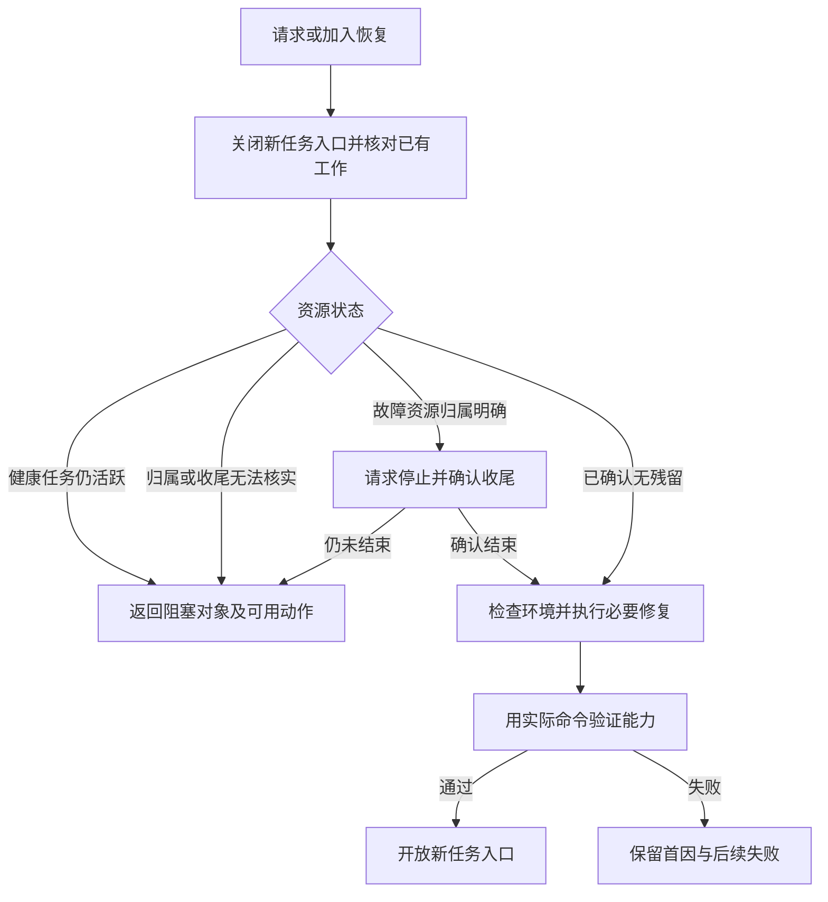

# Windows 沙箱执行与恢复可靠性 — 技术方案

## 状态与确认边界

CONFIRMED（2026-11-28：用户确认保持官方后端，先跑通“故障 → 修复 → 新命令执行成功”）

用户确认统一生命周期、控制请求可达、后台恢复、原生能力前置验证和组合回归的整体方案。保留共享执行服务，先补齐 AF 的生命周期及监督能力；需要修改执行后端时，先提交最小变更范围和维护影响，再确认方案修订。

用户随后已授权开始实现，当前完成了 M0 宿主/协议探针。M0 未取得完整沙箱资格，详见 [观察记录](./m0-observations.md)。用户质疑自维护 Codex 源码补丁的建议；该建议未获批准，现已撤回作为首选。M0 的接口观察不能证明必须分叉后端，缺失内部首因也不能单独阻断 AF 侧恢复工作。当前继续复核官方后端、AF 生命周期与原生监督的组合，不将原生未验证项写成已通过。原实施授权对范围未改变的工作仍有效。安装版及 frozen runtime 验证按用户决定延期到后续打包，不作为本次合入前门槛。

用户再次明确授权先完成第一条恢复链。先以“启动超时后收到明确未启动的迟到拒绝”为可断言场景，保留在途 RPC 的归属与结果，恢复前核对；无法证实收尾的操作继续阻塞，健康任务不被终止。随后扩展原生收尾、并发及重启场景。首个自动化链路不冒充原生账户修复或完整需求验收。

需求与验收标准见 [requirement.md](./requirement.md)，现场、源码锚点和方案证据见 [evidence-index.md](./evidence-index.md)。本文件不改写历史需求或 issue 的归属与验收结果。

## 现状与改动边界

当前 command runtime 把进程快照、未知启动集合、沙箱状态文件、恢复 flight 和 RPC pending 分开维护。启动超时后，原响应可能被丢弃；未知状态使 idle 检查一直不满足，而恢复本身没有核对和收尾该状态的步骤。手动修复仍经过同一个等待条件。

命令启动前的 read access 和 fs/getMetadata 也可能触发准备；命令句柄及取消回调却在较晚阶段登记。执行服务默认串行处理请求，长启动可能阻塞后续控制请求。前端同步等待修复的期限短于恢复预算，且本地 loading 无法表达后台实际进展。

本次涉及四个责任边界：AF 负责授权后的操作归属与恢复编排；执行适配层负责协议事实、连接身份和查询；原生监督负责已纳管资源的存活与收尾证明；Bridge、工具结果和前端负责投影同一事实。沙箱身份与隔离策略继续由执行后端负责，AF 不自行生成或改写凭据。

## 一、先验证原生保证

### M0：能力资格验证

实现开始后先建立隔离的资格专项，固定当前 payload 身份与源码基线，通过实际启动入口观察以下能力。纯 fake 只验证编排，不替代原生结论。

| 能力 | 要取得的证据 | 不足时的处理 |
|---|---|---|
| 控制请求可达 | 准备请求阻塞及队列饱和时，查询、终止和退出观察仍在各自期限内完成 | 调整有界 admission；协议仍不足时提出后端改动 |
| 准备取消 | 在准备阶段停止后释放阻塞点，确认无迟到业务启动；准备资源确实结束 | 不将取消回执标为清理完成，不启用依赖此保证的恢复路径 |
| 资源归属 | refresh helper、不同身份 runner、其后代、提权 helper 的创建及关闭均可归属 | 单列未覆盖资源及所需原生接口，不按进程名称补杀 |
| 服务故障 | 服务断线、被终止或宿主退出后，旧工作能被确认结束或明确保留为未核实 | 新连接不能替旧连接解除隔离 |
| 正常后代语义 | 根进程正常结束、后台后代继续运行及强制终止三者可区分 | 不把正常根退出当成空进程树，也不静默改为杀掉合法后代 |
| 身份维护与首因 | 保存外层可观察的首次错误，维护互斥范围与实际账户/状态归属一致 | 内部首因不可取得时明确记录缺口；分别验证安全恢复能力，不据此要求修改上游 |

专项必须区分非提权、不同身份和 UAC 边界。外层 Job 只对已证实纳入的资源作保证；父进程退出、管道 EOF、PID 消失或 RPC 返回均不能单独替代完整证明。

保留现有官方 payload 作为资格基线，不预先更换 vendor、启用 MXC 或改为每命令一个执行服务。若当前组合不能达到所需保证，M0 输出失败的最小案例、缺失能力和最小后端变更建议；回到方案确认后再继续依赖该能力的实现。不得用放宽 `closed` 含义、降低隔离强度或遗忘记录绕过。

资格专项不操作现有 production 沙箱、身份或安装。临时数据目录不能自动证明系统账户和 ACL 已隔离；涉及这些状态时使用具备隔离条件的原生环境，缺失环境则记录验证缺口。源码原生专项与延期的安装版验证分别记账。

## 二、统一操作与执行事实

### 登记时机与所有权

在授权完成、任何目录/权限准备或执行 RPC 之前创建操作记录，并注册取消入口。命令、可见性准备、修复和验证探针均有操作归属；子操作关联父操作，不能在进程 ID 尚未生成时成为无人管理的工作。

继续使用既有 session、run、tool call、process 标识。新增的操作与执行服务身份由宿主生成和注入，不要求模型传入。一个命令保持原 process_id，超时后不换 ID 重发。

| 信息 | 职责 |
|---|---|
| `operation_id`、`parent_operation_id`、`kind` | 标识一次操作及其准备、修复、探针关系 |
| `runtime_instance_id`、`executor_instance_id` | 分别绑定 Bridge 实例与具体执行服务实例；重连产生新的执行服务身份 |
| `phase` | `queued / preparing / starting / running / reconciling / stopping / finished`，描述宿主正在处理什么 |
| `execution_result`、`exit_code` | 区分业务未启动、结果未知、已观察退出；有输出或已启动不等于业务成功 |
| `resource_state`、`resource_evidence` | 区分未创建、活跃、已关闭、未核实，并记录依据与覆盖范围 |
| `stop_reason`、`version`、时间与期限 | 保留取消/超时意图及单调版本；意图不直接改写结束事实 |
| `first_failure`、后续处理记录 | 首因独立保留，恢复失败追加，不覆盖首因 |

状态由一个转换入口维护，调用方提交已观察事实。业务结果与资源状态独立：可以已取得退出码但后代仍活跃，也可以资源已关闭但丢失了业务结果。结果未知但资源已确认关闭时，允许恢复环境；原业务仍不自动重放。

替换 `_uncertain_starts` 与进程终态分别决定恢复资格的逻辑，以统一记录判断。输出缓存裁剪不得删除未核实资源的归属信息。生命周期结束判断使用显式状态集合，不能继续用 `status != running` 判断所有新增状态均已结束。

### RPC、迟到响应与断线

RPC 请求绑定 operation_id 和 executor_instance_id。调用者等待期限到达后，等待可以结束，但可能产生副作用的请求仍保留可核对的归属；迟到响应和通知进入同一转换入口。只保留必要关联和有界输出，限制在途请求数，避免无限积累 pending。

同一实例中的通知、查询和迟到响应按事件/输出序号去重。重复或乱序事件不得回退版本、重复输出或把已证明的终态改回运行。旧实例通知只能完善其旧记录，不能清空新实例网络授权或改变新实例状态。

优先用实际后端支持的状态查询核对未知启动。`not found`、`running=false` 或查询记录过期不单独证明从未执行；查询无法覆盖的准备阶段继续由原生归属证据解释。断线时保留旧实例及其资源，先隔离与核对，再决定是否启动替代实例。

### 取消、重启与持久化

取消从准备前开始生效，并传播到在途请求和已纳管原生操作。取消确认分为接受请求和资源收尾完成；未确认收尾时继续显示 stopping/未核实，不能返回已取消成功。取消后的迟到业务启动仍属于原操作，必须被发现并收尾。

生命周期最小记录在可能产生外部副作用前持久化；写入失败时不提交新的有副作用工作。沿用 `agent.paths` 及现有 command-runtime 数据根，在 codex-home 和临时 execution_root 之外保存宿主拥有的生命周期状态。该目录不得被业务沙箱写入，并验证目录归属及重解析点，避免伪造控制事实。运行日志继续走日志入口。记录使用版本化格式、原子替换及必要 flush；不保存凭据、完整环境或为重放准备的命令正文。

应用重启后加载未结束归属并重新核对。持久化的 PID 仅作线索，必须结合创建身份、可信进程句柄/监督凭证和作用域验证；不能凭旧 PID 终止进程。历史业务输出仍由现有 ToolExecutionEvidenceStore 管理，不把部分输出证据改称完整生命周期日志。

## 三、执行服务与原生监督

Windows 的沙箱执行和已授权宿主执行使用不同服务实例及资源作用域。保留各自共享服务，避免沙箱修复误停宿主命令。read access、可见性准备和探针必须进入相应沙箱操作作用域，不能绕过 admission 与维护锁。

开启经 M0 验证的并发协议模式，并在 AF 侧限制普通请求数量，为查询和收尾留出容量。`process/read` 不能仅依赖后端的控制请求优先级；普通请求上限必须低于可用容量，且覆盖所有调用入口。网络策略回调、事件发布和日志处理不得在 RPC 读取线程上等待同一服务的另一个响应。

原生监督保留具体执行实例的资源所有权。采用在工作可执行之前纳管、超时有界终止、等待资源实际退出的语义；收尾期限包含输出管道和日志线程，不能只限制根进程等待。借用已有服务监督代码时先核对 API 边界，不能把 Tauri 拥有 Bridge 的 Job 当成命令级隔离证明。提权准备必须有独立、可核实的所有者，普通父进程超时不释放其维护占用。

恢复期间关闭受影响沙箱域的新任务入口，已有健康任务仍可接收输出、输入和正常取消。只有作用域内无健康任务，或用户已明确授权停止列出的任务后，才能回收整个故障执行服务；不能用全局重启替代单操作收尾。

身份维护串行化范围须匹配实际账户和状态资源。多个 AF 实例的维护不能只靠进程内锁；也不能把不同 codex-home 自动等同于独立系统身份。无法核实外部占用或归属时返回具体阻塞，不接管无关进程或账户。

## 四、后台恢复操作

### 状态与推进

恢复协调器改为持有独立生命周期的后台操作，自动恢复和手动修复复用同一实现。同一沙箱域只允许一个活跃恢复操作。

恢复阶段为 `reconciling / stopping / repairing / verifying`；结束结果为 `succeeded / blocked / failed / cancelled / interrupted`。取消或中断结果描述恢复操作本身，相关资源是否关闭仍由资源记录决定。

`blocked` 返回阻塞操作、原因和可用动作，结束本轮主动等待。重复点击且阻塞事实未变时返回同一结果；任务结束、资源核实或用户明确选择了新动作后，才允许新一次尝试。每个执行调用最多加入一次自动恢复，不递归启动新的恢复，也不叠加新的完整预算。

等待健康任务完成、停止用户指定任务、重新核对资源和导出诊断按实际能力提供。涉及停止其他任务时，确认内容绑定其实例与操作版本；确认后状态变化则重新计算影响，不能扩大到新加入的任务。

### 预算、取消与恢复完成

由恢复操作持有唯一总 deadline，查询、停止、提权准备和验证从剩余预算中领取阶段期限。先保留现有恢复总上限 480 秒和准备上限 300 秒作为上限，其他阶段采用有界期限并受总 deadline 截断；确切值在实现时集中为一份预算配置及确定性测试输入，不在前端和工具执行器复制常量。

健康任务或不可核实资源已经构成明确阻塞时立即返回，不耗尽总预算。截止后停止启动新动作，并完成有界收尾；无法确认关闭的资源保留隔离状态。调用者取消、HTTP 断开和后台操作取消分别处理，不能因一个等待者离开而误停其他等待者共用的修复。

身份文件结构正常只作为检查输入。修复完成需运行实际沙箱探针，校验执行身份、预期输出、退出状态及本次要求的隔离能力，并核对探针自身收尾。探针成功只恢复环境可用性，不把原未知业务写成成功。

原业务仅在能够证明未提交或被明确拒绝、仍未取消且原授权/路径身份继续有效时，使用既有有界续接入口执行。存在未知副作用时保留结果未知，由用户决定下一步，恢复协调器不重放。

## 五、Bridge、桌面与工具结果

在现有 command-runtime API 下增加恢复操作的创建/加入、查询和取消接口。创建请求携带客户端重试键，返回 202 及恢复快照；查询使用 recovery_id，取消接受预期版本。同一重试键在响应丢失、网络重试或后端已结束时仍解析到原操作，不能重新触发修复。

现有 setup 路由作为兼容入口委托同一协调器，保留旧返回形状；其等待超时明确返回“后台仍在处理”及恢复引用。新前端使用异步接口；兼容入口不得另起恢复 worker。旧调用者遇到较短 HTTP 超时时，仍可通过 runtime status 取得当前恢复操作。

恢复快照包含 recovery_id、阶段/结果、版本、起止时间、期限、阻塞项、可用动作及脱敏错误。runtime status 附带当前或最近一次恢复快照；既有状态推送传递其更新。前端由服务端快照驱动 loading 和操作按钮，断线重连后重新查询，按实例和版本抵御旧事件。

命令快照新增准备/启动/收尾阶段及资源状态，当前消费者在同一 changeset 同步更新。旧历史缺少这些字段时使用显式 legacy 投影，保留当时记录，不凭缺字段补造原生保证。session residency、取消入口和工具结果生成同步使用明确的生命周期判断。

保留现有模型工具及权限入口，操作 ID、服务身份和恢复 coordination 由宿主处理。模型可见结果区分启动结果未知、停止待确认、修复受阻和环境已恢复；错误只给真实可行的下一步。涉及工具说明或固定提示原文变化时，按提示词规则先渲染现行与候选并取得具体文本确认，再实施。普通运行时状态不通过增加全局 prompt 规则补救。

## 六、诊断与兼容

同一操作关联首次错误、恢复错误、实例身份、阶段期限、状态变化和收尾证据。原生首因在身份刷新或二次启动前采集；只能取得最终错误时明确标为缺失，不由日志关键词补造首次原因。诊断采集不能触发修复或阻塞控制通道。

诊断包新增语义同步修改生产契约、capability、真实解析 handler 和测试；旧包继续按其版本解释。生命周期记录只导出脱敏摘要，不导出凭据、完整命令环境或可用于未授权控制的句柄/令牌。故障记录与运行输出分别裁剪，未核实资源的最小归属不随日志轮转丢失。

公共生命周期与 RPC 关联变更覆盖所有平台的确定性测试。Windows 服务拆分和原生监督在 Windows 入口启用；其他平台继续使用已有执行后端，并检查共享类型、状态与取消行为。后端版本、原生组件和包装收集方式有变化时重新列出影响；安装版验证仍按 PV-1 延期，源码通过不得写成安装通过。

## 涉及模块

| 路径或模块 | 改动职责 |
|---|---|
| `agent/src/agent/command_runtime/lifecycle/`（新增） | 操作记录、转换、最小持久化、归属与核对接口；原生实现接入受 M0 约束 |
| `command_runtime/runtime.py`、`models.py`、`exec_server.py` | 操作接线、服务实例区分、迟到结果、查询、admission 和快照 |
| `command_runtime/recovery.py`、`windows_home.py` 及准备入口 | 后台恢复、预算、维护互斥、取消与准备资源监督 |
| `command_runtime/tools.py`、`agent/src/agent/tool_runtime/` | 准备前登记取消、等待预算、授权续接及模型可见结果 |
| `agent/src/agent/paths.py`、现有 assembly/CLI 装配 | 生命周期持久化目录与所有入口的依赖注入 |
| `agent/src/agent/sessions/tool_execution_evidence.py` 与会话投影消费者 | 保留输出证据职责，适配新增状态与旧历史 |
| `agent_bridge/src/agent_bridge/routes/`、监听器及 session residency | 异步恢复 API、事件、取消和活跃状态判断 |
| `frontend/src/services/api/commandRuntime.ts`、对应 store、权限面板与命令呈现 | 进度、阻塞对象、可用动作、断线恢复和版本处理 |
| 原生监督实现 | M0 确认实际覆盖与最小落位；如需独立原生组件或后端修改，先确认方案修订 |
| diagnostics producer、consumer 与 machine contract | 同步证据语义、版本和兼容测试 |
| `scripts/command-runtime/`、相关 tests 与 `scripts/README.md` | 原生资格专项和组合回归的标准双端入口；平台不适用明确报告 |

## 实施与验证顺序

1. **M0 原生资格**：固定版本/平台，完成能力表中的最小故障注入及首因可观测性检查。记录通过、失败、未执行；必要时回到设计，不提前依赖未证明的保证。
2. **M1 生命周期与协议**：建立统一状态、持久化和连接归属，再接入查询、迟到响应、取消和执行作用域。用确定性测试固定转换、崩溃窗口及重启行为。
3. **M2 恢复与投影**：替换旧 idle 等待循环，接入原生收尾、维护互斥、后台 API、前端和诊断；验证重试、取消、断线和版本兼容。
4. **M3 完整故障链**：从生产工具入口驱动故障、恢复和独立命令成功，并覆盖有健康任务、宿主命令、正常后代及无法收尾的相邻场景。禁止用只断言某函数被调用的测试代替恢复事实。

验证按需求 AC 逐项登记到实现阶段的 progress；本设计不复制验收标准。主要检查域为后端、前端、诊断生产/消费契约；原生代码涉及 Rust 时补 Rust 阶段。计划以实施后的实际 diff 和语义影响为准。

Windows 10 与 Windows 11 分别记录原生结果；无法实跑的平台不标通过。真实桌面视觉检查按已有授权规则另行处理，确定性 API/store 验证不冒充 Tauri 视觉验收。安装版和 frozen runtime 留作 PV-1，后续打包再验证。

2026-11-29 用户确认当前无隔离测试环境，真实账户、不同本地身份、UAC 与 Windows 10 原生验证按需求 PV-2 延期。本轮继续完成 AF 实现及本机安全专项；原生证据范围仍按实际记录，未知准备/提权资源继续保留为阻塞，不能因延期而当成已清理。

## 风险与回溯条件

- **原生保证不足**：外层监督若覆盖不了准备、提权或不同身份工作，必须提出后端/原生组件的最小变更，不以协议成功返回降格验收。
- **首因已经被后端覆盖**：仅增强 AF 日志无法补回不存在的事实；需要原生证据接口时与 M0 结论一起回到设计。
- **共享资源影响扩大**：身份互斥或进程回收涉及原作用域外的任务、账户或其它应用时，重新核对边界，不沿用普通修复授权。
- **既有后代语义变化**：正常命令结束后仍活跃的后代不能被静默杀死；如选定实现必须改变此行为，先呈现用户影响并重新确认。
- **持久化与迁移**：未核实资源记录损坏或旧版本缺少记录时保持显式未知，不能由“没有日志”推断已经清理。
- **验证延期**：安装版延期已获确认，不触发本阶段打包；后续发现包装或原生兼容问题按实际证据继续修复，不回填虚假的历史通过结果。

## 变更记录

| 日期 | 变更 | 是否需要重新实现 |
|---|---|---|
| 2026-11-28 | 用户确认统一生命周期、共享服务及执行域拆分、后台恢复、原生能力先验证和完整故障链方案；安装版验证维持延期 | 首次设计，产品实现尚未开始 |
| 2026-11-28 | 用户授权开始实现；M0 获得宿主/协议证据并确认原生契约缺口，按既定边界回到方案确认 | 已有资格专项保留，依赖后端保证的主体尚未实施 |
| 2026-11-28 | 用户质疑维护 Codex 源码补丁；撤回首选分叉建议，纠正“接口缺口必然要求修改上游”的推断，复核保持官方后端的路径 | 没有修改过 Codex 源码、vendor lock 或正式恢复代码；已有探针与历史证据保留 |
| 2026-11-28 | 用户确认四步实施顺序并明确先跑通故障恢复链；恢复设计确认状态，先实施 AF 侧可独立验证的部分 | 沿用已获实施授权；原生未确认收尾仍受阻，安装版验证继续延期 |
